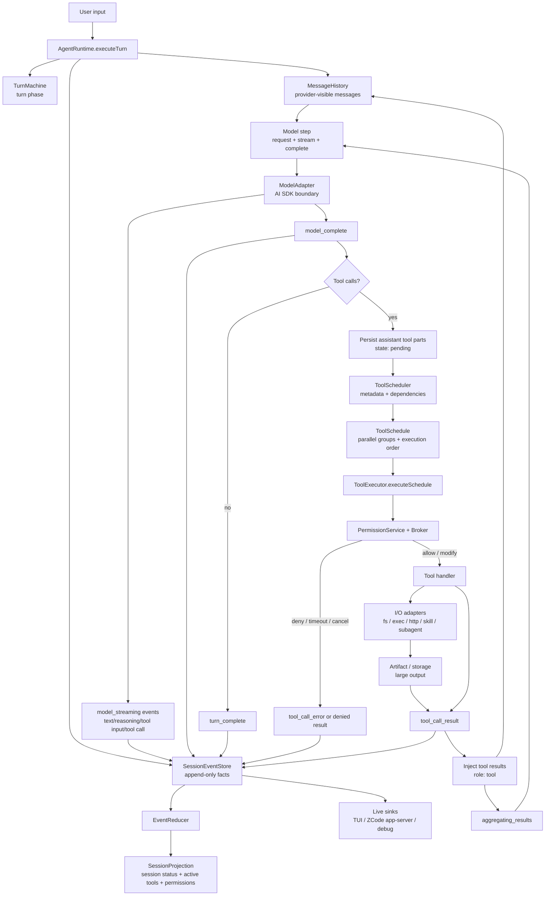
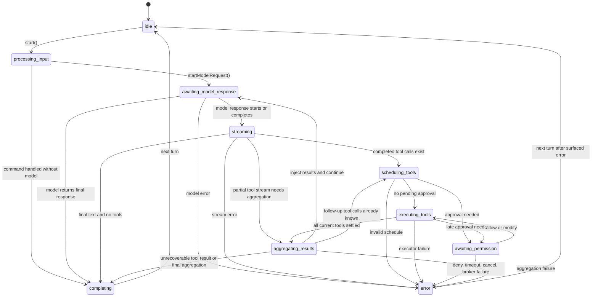
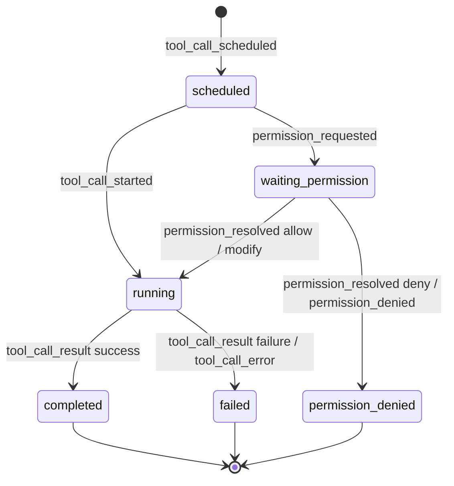

# Output State Rotation Architecture

## Document scope

The state rotation during one output turn, answering two questions:

1. Why the user-visible output switches between thinking, streaming, tool running, permission, and
   done.
2. Which tool scheduling states exist, and which are schedule plans, which are execution states,
   and which are only UI projections.

Supplement to the v2 loop spec. It adds no runtime code; it unifies the current implementation and
the next contract into one architecture picture.

## Conclusion

Output is not a single-layer state machine; five layers of state advance in parallel:

| Layer | Main states | Source of truth | Consumers |
| --- | --- | --- | --- |
| Session projection | `idle`, `running`, `waiting`, `paused`, `completed`, `error` | `EventReducer` rebuilding from `SessionEvent` | TUI, ZCode app-server, debug panel, session list |
| Turn phase | `processing_input`, `awaiting_model_response`, `streaming`, `scheduling_tools`, `executing_tools`, `awaiting_permission`, `aggregating_results`, `completing`, `error` | `TurnMachine` in-memory state | Runtime control flow, error attribution |
| Model stream part | `start`, `text_delta`, `reasoning_delta`, `tool_input_delta`, `tool_call`, `finish`, `error` | `model_streaming` events | TUI live assistant text, debug timeline |
| Tool call | `scheduled`, `waiting_permission`, `running`, `completed`, `failed`, `permission_denied` | `ToolExecutor` events and `TurnMachine` | Tool progress, message history, artifacts |
| Background task | `running`, `completed`, `failed`, `timed_out`, `cancelled`, `spawn_error`, `lost` | `background_task_*` events | TUI long-running task view, debug |

Do not flatten these states into one enum. The recommended shape: `SessionEvent` is the fact,
`TurnMachine` owns transition legality, and the UI only projects.

## Overall architecture



## Turn phase state machine

`TurnPhase` is the runtime's control-flow state and must not be treated as UI copy.



## Tool scheduling is not tool state

`ToolScheduler` produces an execution plan, not a tool lifecycle. The plan has three parts:

| Field | Meaning |
| --- | --- |
| `items` | Scheduling entry per tool call, with dependencies, parallel eligibility, and read-only/destructive/side-effect info |
| `parallelGroups` | Tool call id lists executed per batch; concurrent within a group, serial between groups |
| `executionOrder` | The model-explainable order after `parallelGroups.flat()` |

The `dependsOn` the runtime currently passes the scheduler is still an empty array — dependency
support exists in the scheduler but is not yet exposed as a model-declarable dependency protocol.
Grouping is driven mainly by tool contracts:

- `readOnly && sideEffectScope === "none"` usually parallelizes.
- `concurrentSafe: true` parallelizes.
- `concurrentSafe: false`, `destructive: true`, or workspace/system/git/network side effects
  usually run serially.
- `maxConcurrency` splits oversized parallel groups into multiple batches.

```mermaid
flowchart LR
  Calls["Model tool calls"] --> Registry["ToolRegistry metadata\nreadOnly / destructive / concurrentSafe / sideEffectScope"]
  Registry --> Dependencies["ToolDependency[]\ndependsOn + safety metadata"]
  Dependencies --> Topo["Topological sort\ncycle detection"]
  Topo --> Grouping["Group by dependency level\nand parallel safety"]
  Grouping --> Limit["Apply maxConcurrency"]
  Limit --> Plan["ToolSchedule\nitems + parallelGroups + executionOrder"]

  Plan --> Batch0["batch 0\nparallel"]
  Plan --> Batch1["batch 1\nexclusive or parallel"]
  Plan --> BatchN["batch n"]

  Batch0 --> Complete0["tool_batch_complete"]
  Complete0 --> Batch1
  Batch1 --> Complete1["tool_batch_complete"]
  Complete1 --> BatchN
```



## Tool call lifecycle

The ideal lifecycle of a single tool call:



Note: the same concept currently has several names in the code.

| Semantics | TurnMachine | Session projection | Persisted message part | SessionEvent |
| --- | --- | --- | --- | --- |
| Queued | `scheduled` | `pending` | `pending` | `tool_call_scheduled` |
| Waiting for approval | `waiting_permission` | `pendingPermissions[]` | may still show `pending` | `permission_requested` |
| Executing | `running` | `running` | `running` | `tool_call_started` |
| Success | `completed` | usually removed by batch after `completed` | `completed` | `tool_call_result` |
| Execution failure | `failed` | usually removed by batch after `failed` | `error` | `tool_call_error` or failing result |
| Permission denied | `permission_denied` | `denied` | `error` or denial result | `permission_denied` / `permission_resolved` |

This table is the translation layer UI and debug views should use. Do not demand that every
low-level enum be renamed at once, but new events and new UI copy should reuse the user-visible
vocabulary "pending / waiting permission / running / completed / failed / denied".

## Output event sequence

Typical sequence for "model emits a tool call, tool runs, model then outputs the final answer":

| Order | Event | Turn phase | User-visible state |
| --- | --- | --- | --- |
| 1 | `turn_started` | `processing_input` | Input received, processing |
| 2 | `model_request` | `awaiting_model_response` | Calling model |
| 3 | `model_streaming(start/text_delta/reasoning_delta)` | `streaming` | Assistant outputting |
| 4 | `model_streaming(tool_input_delta/tool_call)` | `streaming` | Model generating a tool call |
| 5 | `model_complete` | `streaming` | Model step finished |
| 6 | `tool_call_scheduled` | `scheduling_tools` | Tool pending |
| 7 | `permission_requested` (optional) | `awaiting_permission` | Waiting for approval |
| 8 | `permission_resolved` (optional) | `executing_tools` | User approved or modified |
| 9 | `tool_call_started` | `executing_tools` | Tool running |
| 10 | `tool_call_result` / `tool_call_error` | `executing_tools` | Tool completed / failed |
| 11 | `tool_batch_complete` | `aggregating_results` | Current batch done |
| 12 | Tool results injected into `MessageHistory` | `aggregating_results` | Preparing next model request |
| 13 | Back to `model_request` | `awaiting_model_response` | Calling model |
| 14 | `model_streaming(text_delta)` | `streaming` | Assistant continues the final answer |
| 15 | `model_complete` | `streaming` | Model done |
| 16 | `turn_complete` | `completing` | Turn finished |

## State boundary guidance

### Session status

`SessionStatus` expresses coarse session state only:

| Status | Recommended semantics |
| --- | --- |
| `idle` | No running turn or background interaction |
| `running` | At least one turn advancing |
| `waiting` | Turn waiting for user or an external system, consuming no model/tool execution |
| `paused` | User-paused, resumable |
| `completed` | Session explicitly finished or archived |
| `error` | The most recent turn ended with an error |

The reducer implements the `idle`/`running`/`error` main line. `tool_batch_complete` only means the
current parallel tool group finished: it removes the corresponding `activeToolCalls` from the
projection but never switches the session from `running` back to `idle`; only `turn_complete` ends
the turn and returns to `idle`. `waiting`, `paused`, and `completed` remain reserved, to be
activated with interactive permissions, pause/resume, and archiving.

### Turn phase

`TurnPhase` is advanced only by runtime control flow. The UI may read it for debug display, but
ordinary user status copy comes from event projections, never from raw enum names.

### Tool status

Tool state is maintained per `toolCallId`. Batch completion is not turn completion — it only means
the current parallel group settled. One turn may go through multiple rounds:

```
model -> tools batch A -> tools batch B -> model -> tools batch C -> model -> final
```

### Model stream part

`ModelStreamingKind` is an output fragment type, not a turn state. `text_delta` and
`reasoning_delta` can be high-frequency; the TUI coalesces by frame rate. `tool_call` reaches the
scheduler only when the full tool call is already executable.

### Background task

Background tasks derive from tool results and may keep changing after the turn completes. They
carry the same `traceId`, `sessionId`, `turnId`, and `toolCallId` but must not block the current
turn's completion.

## Known semantic gaps

1. `TurnMachine` has `requestPermission()` and `resolvePermission()`, but the current permission
   flow is driven by `ToolExecutor` events. For the turn phase to strictly reflect
   `awaiting_permission`, the runtime must advance the machine inside executor permission/event
   callbacks.
2. Tool state names differ across `TurnMachine`, projection, persisted parts, and events. New
   features should define the translation table first; the UI must not hardcode against one
   internal enum.
3. The scheduler supports dependencies and cycle detection, but the runtime currently gets no real
   `dependsOn` from the model or tool contracts. Complex orchestration needs a "model-declarable
   dependency" or "runtime-derived dependency" contract.
4. Production streaming v1 executes tools only after a model step completes. Starting tools while
   tool input is still streaming is a later optimization and must not be mixed into this state
   diagram.

## Test coverage guidance

When implementing or changing state rotation, cover at least:

- `TurnMachine`: `awaiting_permission -> executing_tools` and the denial path.
- `EventReducer`: covered — the session stays `running` after `tool_batch_complete` until
  `turn_complete`.
- `AgentRuntime`: stable event order for streaming tool calls, permission asks, tool result
  injection, and the next model request.
- `ToolScheduler`: read-only parallel, write serial, `maxConcurrency` splitting, dependency
  ordering, cycle detection.
- TUI projection: translating low-level states into pending, waiting permission, running,
  completed, failed, denied, without mistaking batch completion for turn completion.

## Code sources

- `packages/core/src/agent/turn-state.ts`
- `packages/core/src/agent/turn-machine.ts`
- `packages/core/src/runtime.ts`
- `packages/core/src/tool/scheduler.ts`
- `packages/core/src/tool/executor.ts`
- `packages/contracts/src/events/session.events.ts`
- `packages/contracts/src/events/event-reducer.ts`
- `packages/contracts/src/interfaces/session.port.ts`
