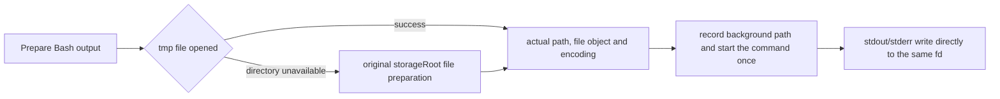

# Bash Tool

## Current execution contract (2026-09-07)

The direct-write refactor follows the root `docs/bash-background-parity.md`: POSIX append/no-follow, Windows "w", stdout/stderr share one fd opened once; 5 GiB / 5 s soft threshold; settlement on root exit without waiting for pipe EOF. Large foreground output keeps the full file; by default the head 30,000 bytes (max 150,000) are read and the full file path is returned; there is no 64 MiB artifact truncation any more. Small foreground output and over-limit files keep best-effort cleanup; background output files are retained. Progress tail-reads 4 KiB and extracts a 5/100-line preview, byte count and estimated total line count, delivered through `outputPreview` into events and the V4 tool row. Desktop shows only the preview body, not line/byte counts; TUI is unchanged; the running-state TaskOutput still reads the head and the terminal state reads the tail. 2026-09-08: an ordinary terminal Bash with partial output / a retained file gets a strict `bash_output` display carrying a bounded head body, the true truncation flag and an optional canonical file path; Desktop shows a partial-output hint and a file entry and does not parse the model envelope.

## Purpose

`Bash` executes a shell command and returns its output. Despite the name it is the general shell execution tool. Provider-visible output follows the "Model result mapping rules" in this document.

## Input contract

`Bash` input is a strict object:

| Field                       | Type      | Required | Description                                                                                                                  |
| --------------------------- | --------- | -------- | ---------------------------------------------------------------------------------------------------------------------------- |
| `command`                   | `string`  | yes      | Command to run                                                                                                               |
| `timeout`                   | `number`  | no       | Foreground wait budget in milliseconds, capped by the maximum; the budget is invalidated as soon as the task is backgrounded |
| `description`               | `string`  | no       | Human-readable active-voice description for UI and permission text                                                           |
| `run_in_background`         | `boolean` | no       | Turn into a background task. The start result returns the task ID and output file path; a short notification is injected into the model on completion |
| `dangerouslyDisableSandbox` | `boolean` | no       | Request to bypass the sandbox, controlled by policy                                                                          |

`timeout`, `run_in_background` and `dangerouslyDisableSandbox` remain `number` / `boolean` in the provider-facing JSON Schema, but runtime validation tolerates common semantic outputs such as `"30000"`, `"true"`, `"false"`, `"1"`, `"0"`.

`argv`, `cwd` and `env` are not model-visible Bash inputs. The model only composes the shell command; the working directory comes from the session cwd and environment variables use the execution adapter's default inheritance. `ExecutionPort` may keep `argv/cwd/env` for hooks, internal runners or later non-model calls, but they must not be exposed through the Bash tool schema.

Internal fields such as `_simulatedSedEdit` do not enter the model schema. If ZCode supports internal extension fields they must be separated from the model-visible schema to prevent bypassing permission or sandbox.

## Output contract

Output:

| Field                       | Type       | Description                                                                                                        |
| --------------------------- | ---------- | ------------------------------------------------------------------------------------------------------------------ |
| `stdout`                    | `string`   | Bash command stdout/stderr merged in Node `data` callback order                                                    |
| `stderr`                    | `string`   | Execution framework errors, timeout/cancel info or shell reset hints                                               |
| `rawOutputPath`             | `string?`  | Raw path of large MCP output                                                                                       |
| `interrupted`               | `boolean`  | Whether interrupted                                                                                                |
| `isImage`                   | `boolean?` | Whether stdout is image data                                                                                       |
| `backgroundTaskId`          | `string?`  | Background task ID                                                                                                 |
| `backgroundedByUser`        | `boolean?` | Whether the user manually backgrounded it                                                                          |
| `assistantAutoBackgrounded` | `boolean?` | Whether assistant mode auto-backgrounded it                                                                        |
| `dangerouslyDisableSandbox` | `boolean?` | Whether sandbox bypass was requested                                                                               |
| `returnCodeInterpretation`  | `string?`  | Interpretation of special return codes                                                                             |
| `noOutputExpected`          | `boolean?` | Whether no output is expected on success                                                                           |
| `structuredContent`         | `any[]?`   | Structured content blocks                                                                                          |
| `persistedOutputPath`       | `string?`  | Path of large output persisted to disk                                                                             |
| `persistedOutputSize`       | `number?`  | Original size of large output                                                                                      |
| `ghRateLimitHint`           | `string?`  | system-reminder appended for the model when the raw stdout of a non-failed foreground `gh` result hits a rate limit |

Model-visible result handling:

- `Bash` must implement a dedicated `formatModelContent`; the model-visible tool result is by default plain text of stdout/stderr joined, not a `BashOutput` JSON string.
- Before spawn, Bash asynchronously opens the canonical output; stdout/stderr share the same fd; after spawn the parent closes the fd. It does not go through a Node collector and no redirection is appended to the user command. On POSIX hosts it uses append/no-follow/0600; Windows uses "w" (Git Bash and CMD alike); foreground/background transitions do not reopen the file.
- An open failure settles as spawn_error; child write failures are reflected by its exit result. On terminal empty stdout, non-zero exit and not 137, a statfs of the output directory is run, keeping the existing space/inode output-loss diagnostic. `persistOutput="always"` keeps the identity of a zero-byte file; other small outputs are read back and the redundant file is deleted best-effort.
- A Windows append-only handle once triggered MSYS compatibility problems; after the Windows "w" open mode was verified, ordinary Bash uniformly uses direct file output. Generic argv/Hook keeps pipe/collector.
- On the success path the `<claude-code-hint ... />` lines are stripped before model-visible stdout; hint stripping precedes image / stale read / gh rate-limit and other later processing.
- Image output becomes an image content block; if it cannot be recognized as a supported image block, fall back to text. Resize/compress is a model-budget optimization, not the only basis for image detection: when the data URI's magic bytes confirm a supported image and resize failed only for generic reasons, it may still be exposed to the provider as an image block, so a legitimate image is not degraded to raw data-URI text. If resize explicitly fails on budget/request semantics such as `too_large`, `invalid_request`, `unsupported`, `empty`, it must fall back to text and not bypass the provider image budget.
- On interruption, timeout or user cancel, `<error>Command was aborted before completion</error>` is appended after the stderr section so the model can reliably recognize an unfinished state.
- The provider-neutral mapper itself writes `is_error` only from `interrupted`; the ZCode production chain does not throw on non-zero exit, so the provider-visible projection layer must mark an ordinary failure result as error and output `Exit code N` + stdout/stderr text. Semantic non-zero exits such as `grep` no match, `diff` with differences, or a false `test` condition are still not provider errors.
- `staleReadFileStateHint` is a stable model-facing hint and must be appended as a text segment so it is not lost now that the result is no longer JSON.
- Large output goes to tool-results / an execution artifact; the model gets only a `<persisted-output>`-style preview, the full path and the original size, and never the full JSON or large stdout in context. Whether persistence comes from the execution adapter's output artifact or from the generic serializer's `resultBudget` artifact, Bash must use the same Bash-specific provider-visible projection.
- A background task returns the task ID and output path; the model-visible text must say the task still runs in the background and where the output is written.
- The background start return must include a canonical output path that can be `Read` immediately; even if the command has written no bytes yet, the adapter must create that file before spawn. New Bash executions no longer create a second stderr log file; the historical split-path fields are for compatible reading only and must not be exposed to the provider together.
- After a background task completes, fails, times out, is cancelled or is stopped by the output limit, the runtime injects one short `<task-notification>` into the message history of the next model request. The notification contains only `task-id`, optional `tool-use-id`, status, summary and output file path, never full stdout/stderr; the model keeps calling `Read` when it needs the log.
- Structured `status`, `exitCode`, `stdoutBytes`, artifact path and similar fields stay in structured output, events, UI, ZCode app-server and debug; they must not be the main form of the model-visible result.

### Model result mapping rules

These rules are the basis of the model-visible result mapping; ZCode tests must cover these cases:

- A non-empty `structuredContent` is returned directly as tool result content, with priority over `isImage`, stdout, stderr, background text and hint fields.
- With `isImage=true`, an image content block is returned only when stdout is a recognizable `data:image/*;base64,...` and the image type is supported; otherwise fall back to the plain text path. Image resize is a best-effort optimization: if resize fails but the shared magic-bytes detection confirms the data URI and media type agree, and the error is not an explicit budget/request failure, the original data URI is kept and an image content block is returned.
- Plain-text stdout first runs `replace(/^(\s*\n)+/, "")` to drop leading blank lines, then `trimEnd()`; stderr uses `trim()`.
- `persistedOutputPath` produces the `<persisted-output>` text only for non-background text results. The preview is the first 2000 characters of normalized stdout, cut at the last newline after the first half where possible; size text uses 1024-based, space-free `bytes` / `KB` / `MB` / `GB`, for example `2KB`. When the serializer additionally writes an artifact because of `resultBudget`, it must also call the Bash-specific persisted projection instead of the generic tool-output text; but if the over-budget content came from `structuredContent`, the projection must not pass the full structured blocks through again and keeps the artifact preview.
- With `interrupted=true`, `<error>Command was aborted before completion</error>` is appended after the stderr section and the mapper marks it as error. An ordinary failing command is likewise a provider-visible error result; ZCode produces it in the projection layer rather than relying on the mapper's `exitCode` judgment.
- `backgroundTaskId` produces three texts: ordinary background, user-initiated background, assistant-mode auto-background. The ordinary text must contain "still running / completion will notify / use Read to view the output file"; the assistant-mode auto-background text must contain the 15s blocking budget and a suggestion to use a subagent or `run_in_background` for long tasks.
- `staleReadFileStateHint` and `ghRateLimitHint` are both appended last as separate text segments. `ghRateLimitHint` is computed from raw stdout only for non-failed foreground results; the provider-visible error text of a failed `gh` does not get this system-reminder.
- A background result, even with a `persistedOutputPath`, exposes only the background text to the model and does not produce `<persisted-output>`.
- `bash_progress` / tool JSX updates, the user-initiated background entry and `_simulatedSedEdit` are runtime / UI / internal surfaces; the provider-visible conformance suite covers only the final tool result content, and end-to-end event capability belongs in a separate runtime suite.

## Behavior semantics

Core flow:

1. Validate the input schema.
2. Dynamically decide whether it is read-only. Only commands that pass readonly command validation and do not change directory are concurrency-safe.
3. Parse the command for permission matching. Complex, unparseable or suspicious commands default to ask.
4. Decide whether to sandbox from sandbox config, exclusion rules and `dangerouslyDisableSandbox`.
5. Normalize the session cwd to an absolute path and use it as the command working directory; Bash tool input does not accept a custom `cwd`.
6. Call the unified shell adapter and run `command` in shell mode.
7. The default foreground wait budget follows config; input may override it but not exceed the maximum; the budget must be cleared once backgrounded.
8. After the progress threshold, start the progress stream.
9. Support `run_in_background` and record the background task.
10. Support the user or the assistant auto-backgrounding long tasks.
11. After completion interpret special return codes, track git operations and code indexing use.
12. Handle stdout/stderr, sandbox violation notes, image output and large output persistence.
13. Return structured output.

## Prompt constraints

The Bash prompt gives the model several strong constraints:

- The main agent does not get `Glob/Grep` directly; repository file-name or content search is delegated to `Agent(subagent_type=Explore)` first.
- `Glob/Grep` are available only inside the Explore child runtime; the main Bash prompt must not ask the model to call a nonexistent search tool.
- Prefer `Read` for reading files; do not read files or images with `cat/head/tail/base64/file`.
- Prefer `Edit` for editing files; do not modify files with `sed/awk/perl -pi`.
- Prefer `Write` for writing files; do not create files with shell heredoc, `echo >` or redirection.
- Explain to the user by replying in text; do not use `echo/printf` in place of a natural-language answer.
- Bash is mainly for tests, builds, package managers, git/gh, system commands, scripts and shell operations no dedicated tool covers.
- Multiple independent commands may be issued as multiple parallel Bash tool calls.
- Use `&&` only for dependent commands.
- Avoid unnecessary sleep; use background or Monitor for long tasks.
- Destructive git operations require an explicit user instruction.
- Do not skip hooks or signing unless the user explicitly asks.
- In sandbox mode use `$TMPDIR` for temporary files, not `/tmp` directly.

The ZCode prompt can be shorter, but these constraints should become tool policy and tests, not rely on the prompt alone.

## Permission model

`Bash` is a dynamic-permission tool:

- `isReadOnly(input)` is decided by command parsing and readonly validation.
- `isConcurrencySafe(input)` equals the read-only decision and additionally requires the command to contain no `cd`/`pushd`/`popd`: after a successful foreground command `pwd -P` is written back to the session cwd, and parallel directory changes would make the final cwd depend on completion order. The runtime capability returns this conclusion in the `concurrentSafe` field; `scheduleTools` uses it to put read-only Bash into the same parallel group as adjacent concurrency-safe calls; all other Bash stays serial. The cwd write-back is compare-and-set: if the session cwd was already changed by another command in the same group it is not written back, so a directory change produced by a hook rewrite is not overwritten by a parallel sibling command. The same conclusion also decides streaming early execution: non-background, read-only, no-directory-change Bash may start while the model is still outputting (see `model/streaming-tool-execution-and-recovery.md`).
- Command permission supports exact, prefix and wildcard.
- Compound commands must be split into subcommands; any subcommand matching a hook or deny rule must trigger.
- Commands that cannot be parsed safely, are too complex, or contain dangerous semantics fail closed to ask.
- A deny rule must not be downgraded to ask by a complex command.
- The sandbox is an independent boundary, not equal to WebFetch's pre-authorized domains.
- `dangerouslyDisableSandbox` takes effect only when policy allows and the user approves.

ZCode splits shell permission into three layers:

- `ShellParserPort`: cross-platform shell command parsing and extraction of the argv view needed for audit/permission.
- `ShellPermissionPolicy`: rule matching, dangerous semantics, readonly decisions.
- `ExecutionPort`: actually runs commands, handles timeout, cancel, stream, sandbox.

### Minimal read-only Bash allowlist

At this stage only static judgment is done; a full command-level readonly validator is not introduced. `Bash` downgrades the runtime capability to `readOnly=true`, `sideEffectScope="none"`, `riskLevel="low"`, `needsApproval=false` only when the command parses safely, is exactly one simple command, has no assignment prefix, no redirection, no dynamic words such as command substitution / parameter expansion / brace expansion / process substitution, and matches the safe allowlist in `ShellPermissionPolicy`. Plan mode therefore auto-allows only this kind of Bash; other Bash is still hard-denied as a non-read-only tool in plan mode.

The first allowlist covers only low-ambiguity view and search commands:

- Existing: `pwd`, `ls`, `tree` with safe flags.
- File viewing: `cat`, `head`, `tail`, `wc`, `stat`, `file`, `strings`. These only read to stdout and shell redirection is not allowed; the model prompt still asks to prefer `Read` for file contents.
- Search: `rg`, `grep`. Only common read-only flags are allowed, such as line numbers, case, fixed strings, recursion, context line counts, glob/include/exclude, pattern files; arguments such as `rg --pre` that execute external commands are not in the allowlist.

`find`, `sed`, `awk`, `jq`, `yq` and `git` are explicitly not given automatic read-only permission. They need dedicated subcommand-, expression- or predicate-level rules; they are opened only after a separate spec and tests.

## Cross-platform requirements

ZCode cannot implement only POSIX Bash:

- Windows needs a cmd adapter; the Bash tool may best-effort use an installed and detectable Git Bash but must not require users to install Git Bash.
- The Bash tool always hands the model-provided `command` to the execution adapter as a shell command; internal hooks/runners that need shell-less execution use `ExecutionPort` argv mode directly, not the Bash tool.
- Working directory changes, environment variables, path escaping, `.cmd`/`.exe` lookup, signals and TTY must all be capability-detected.
- Sandbox, permission and output truncation interfaces must be decoupled from the concrete shell.

Minimum compatibility rules for the Windows execution adapter:

- On Windows ZCode must not require users to install Git Bash, MSYS2, Cygwin or WSL to run the built-in Bash tool.
- The internal `argv` mode of `ExecutionPort` on Windows must resolve `PATHEXT`, supporting shims such as `pnpm` / `npm` / `npx` that are exposed on PATH only as `.cmd`.
- When resolved to a native executable such as `.exe` / `.com`, keep using `spawn(file, args, { shell: false })`.
- When resolved to `.cmd` / `.bat`, do not spawn directly; run explicitly through `ComSpec` or `cmd.exe`, keeping timeout, cancel, stdout/stderr, trace and output budget behavior. Arguments must be escaped by `cmd.exe` rules, covering spaces, double quotes, pipes, redirection, parentheses, `&`, `^` and `%`.
- `shell` mode on Windows defaults to the environment's `ComSpec` / `COMSPEC`, falling back to `cmd.exe`; on non-Windows it keeps the Node default shell.
- The Windows `Bash` tool may best-effort use an installed and detectable Git Bash on the internal execution path where `command.shellProfile === "posix-bash"`. Git Bash stays an optional capability: if it cannot be resolved, `Bash` must fall back to the existing `ComSpec` / `cmd.exe` path.
- The Windows `Bash` tool may accept an internal shell override injected by ZCode runtime settings. A valid user-configured override has higher priority than automatic Git Bash detection.
- ZCode adds no Git Bash path environment variable and no Windows startup gate. A missing Git Bash is a fallback condition, not a startup failure.
- Generic `ExecutionPort` shell mode on Windows keeps using `ComSpec` / `cmd.exe`; Git Bash auto-detection and the shell override apply only to the `command.shellProfile === "posix-bash"` created by the Bash tool.
- Internal `env.set` and `env.unset` of `ExecutionPort` on Windows must both be case-insensitive, to avoid passing duplicate keys such as `PATH` / `Path`.
- Repository development scripts must not depend on POSIX-only commands such as `rm -rf`; use Node scripts or cross-platform packages to delete build directories.

## ExecutionPort v1 contract

### Bash output path preparation

The product assembly entry injects an optional `bashOutputTempDir` into the adapter, which first creates and opens a named file at `zcode-bash-<random id>/<session>/<tool>-stdout.log` in a private directory under the system temp directory. If the directory is unavailable, the original `outputRootDir` is reused, including a custom storageRoot; an adapter without this option keeps the original behavior. The concrete degradation error set and retention rules are in the root `docs/tmpdir-storage-paths-spec.md`.



The actual path is determined after preparation and then passed into the execution chain; backgrounding does not reopen the file. Cancel or close during preparation must release this file and must not start the child process. The initialization snapshot and startup script still use the original root; the search shell and watchdog are unchanged. Temporary output is not archived or bulk-deleted when the adapter closes and is left to system cleanup; app storage usage does not count tmp for now.

`Bash` does not call `child_process` directly. All child-process side effects converge in `ExecutionPort`; the adapter owns platform differences, process lifecycle and output budget.

Input semantics:

| Field                    | Description                                                                                                                                                                                                                                         |
| ------------------------ | --------------------------------------------------------------------------------------------------------------------------------------------------------------------------------------------------------------------------------------------------- |
| `command.mode = "shell"` | Execution mode used by the Bash tool. The model-provided `command` runs as a shell command                                                                                                                                                         |
| `command.mode = "argv"`  | Internal execution mode of ExecutionPort. For hooks, config runners or later non-model calls; not exposed in the Bash tool schema                                                                                                                  |
| `cwd`                    | The Bash tool must pass the absolute path resolved from the session cwd; it must not take cwd from tool input, and the adapter must not implicitly fall back to the host process cwd                                                                |
| `env`                    | The Bash tool takes no env overlay from model input. ExecutionPort keeps the field for internal calls; the adapter handles Windows environment variable case differences                                                                            |
| `timeoutMs`              | Single-run timeout for ordinary `run()`; the Bash background lifecycle interprets it as the foreground wait budget and clears it on background commit                                                                                              |
| `signal`                 | Cancel signal. Cancellation must enter the structured `cancelled` state and trigger process-tree cleanup                                                                                                                                            |
| `sandbox`                | Sandbox policy request. May be a no-op in v1, but the field must flow through trace and audit                                                                                                                                                       |
| `outputLimit`            | Generic execution keeps the dual-stream stdout/stderr budget; Bash uses a single merged output budget with a runtime check every 5 s for a soft threshold strictly above `5GiB`; normal foreground keeps the full file. Past the inline budget only the prefix is returned and `truncated` is set |
| `onEvent`                | Streaming event callback; Bash covers `started`, `progress`, `completed`, `failed` with no per-chunk events; generic execution keeps `stdout`/`stderr`                                                                                              |
| `close()`                | Optional adapter lifecycle method. Called on normal host app/session close; must best-effort cancel and clean the foreground/background shell process trees the adapter still holds                                                                |

Background and large output policy:

| Scenario          | Behavior                                                                                                                                                                                                                                       |
| ----------------- | ---------------------------------------------------------------------------------------------------------------------------------------------------------------------------------------------------------------------------------------------- |
| Foreground Bash   | Default wait budget `120000ms`, default maximum `600000ms`; an eligible command that reaches the budget is committed as a background task, a command whose first token is `sleep` returns a structured `timed_out`; the tool executor's outer timeout keeps only a cleanup grace period |
| Background Bash   | `run_in_background=true` commits to background right after the process starts successfully; whether or not `timeout` is passed explicitly, the commit must clear the foreground deadline and unbind the parent turn abort, so the foreground budget is never mistaken for a background task lifetime |
| Large output      | Bash default inline limit is `30000` bytes; `BASH_MAX_OUTPUT_LENGTH` is parsed with decimal `parseInt`, invalid or non-positive falls back to `30000`, maximum `150000`; an ordinary foreground retained file keeps the full raw output and the observed size at read time is returned |
| Background events | Background task start, status updates and completion must become session events. TUI/GUI consume only session events and do not read adapter internal state                                                                                    |
| Model notification | Background completion events inject only a short notification and the log path; the raw log stays in the output file and the model gets it with `Read` when needed                                                                            |
| compact           | The raw background log does not enter the model message body, so compact does not write long logs into the conversation context; compact keeps only the short notification, event projection and artifact references                              |
| resume            | Phase 1 restores only background task info persisted in events and messages; a process that belongs to an in-memory task of the previous CLI process and cannot be reconnected must be treated as lost/orphaned in product semantics, not pretended to be controllable |
| shutdown          | When the host app/session closes, `ExecutionPort.close()` must be called first. The adapter must best-effort stop the foreground/background process trees it started and can still track, then release internal state; only old processes that cannot be reconnected may become `lost/orphaned` |

UI / ZCode app-server background task panel contract:

- Core must use `BackgroundTaskStarted`, `BackgroundTaskUpdated`, `BackgroundTaskCompleted` as the only UI notification entry for background Bash. The payload contains at least `taskId`, `terminalId`, `status`, `cancellable`, `pid`, `stdoutBytes`, `stderrBytes`, `stdoutTail`, `stderrTail`, `outputPath`, `outputBytes` and `outputTruncated`.
- TUI, GUI and ZCode protocol clients do not read the `ExecutionPort` internal map; they only maintain a session event projection and show a running task with `cancellable=true` as a stoppable background terminal.
- Kill/cancel is an explicit user action, not a permission approval; on kill the UI calls the session-layer `cancelBackgroundTask(taskId)`, core then calls `ExecutionPort.cancelBackgroundTask`, and emits a `cancelRequestedAt` update and the final completed/cancelled/lost event.
- The ZCode app-server compatibility layer maps background tasks to standard `tool_call` / `tool_call_update` and also exposes `taskId`, `terminalId`, `cancellable` in `_meta["zcode.dev/backgroundTask"]` plus the extension method `zcode.dev/backgroundTask/cancel`. A ZCode protocol client that does not understand the extension can still show long-task status; a client that does can implement a background task panel and kill button.
- The TUI compatibility layer keeps the `backgroundTerminals` screen state and the `cancelBackgroundTask(taskId)` callback interface; the concrete shortcut, dialog or side panel may evolve independently without changing the core event contract.
- Prompt/stall notifications are background task status updates and by default need no user confirmation. Only when a user choice is needed does it enter a natural-language confirmation flow, without asking the user to type a shell command.

### Bash timeout / background lifecycle

Bash uses a dedicated lifecycle capability and does not change the generic `ExecutionPort.start()`. Defaults are resolved by bootstrap from the runtime environment and injected into the runtime:

- `BASH_DEFAULT_TIMEOUT_MS` is parsed with decimal `parseInt`; a positive result takes effect, otherwise `120000`.
- `BASH_MAX_TIMEOUT_MS` is parsed with decimal `parseInt`; a positive result uses `max(configuredMax, default)`, missing or invalid uses `max(600000, default)`.
- The effective foreground budget of one call is `Math.min(input.timeout || defaultTimeoutMs, maxTimeoutMs)`.

```text
spawning
  |-- abort / spawn failure --> terminal (no task id)
  |-- explicit -------------> COMMIT_BACKGROUND
  |-- eligible foreground --> running -- complete --> foreground result
  |                                  \-- deadline --> COMMIT_BACKGROUND
  \-- first-token sleep ----> running -- deadline --> timed_out / kill

COMMIT_BACKGROUND
  state CAS -> clear deadline -> detach parent abort -> register adapter task
  -> root shell exit => completed (stop polling, do not wait for descendants)
  -> task stop | adapter close | persisted-limit event | periodic observer

subagent_child owner constraints
  -> default 3600000ms max runtime | owner subagent cancellation
```

`RuntimeTaskRegistry` remains responsible only for task projection, stop routing and notification; process deadline, abort and background commit are held by the Bash lifecycle inside the execution adapter. "Detach" after commit means only detaching from the current foreground deadline and parent turn; the process is still owned by the current adapter/session. For `subagent_child` the owner lifecycle also applies: background Bash runs at most `3600000ms` by default (overridable by the internal subagent runtime config), and when the owner subagent is cancelled its still-running background Bash is cleaned up; the owner completing normally does not by itself terminate already-committed tasks.

Shutdown semantics:

- The `Bash` tool does not hold child-process handles; shutdown responsibility stays in `ExecutionPort`.
- `ZCodeApp.close()`, ZCode app-server `closeSession`, TUI session switching and app cleanup after CLI `--prompt` finishes are all legal call sites of `ExecutionPort.close()`.
- When the CLI process receives a shutdown signal it must also take the same cleanup chain:
  - `SIGINT` and `SIGTERM` are registered on all platforms.
  - POSIX platforms additionally register `SIGHUP`, covering terminal close or parent shell exit.
  - The signal handler must first cancel the current prompt/turn, then call the current app's `close()`, and finally exit the process by signal semantics.
  - Cleanup must be idempotent so the signal handler and the normal `finally` do not close the same `ExecutionPort` twice.
- `ExecutionPort.close()` must cover:
  - Running foreground commands.
  - Tasks already backgrounded and still controlled by the current CLI process.
  - The "host is exiting" scenario beyond output limit / timeout / user cancel.
- The adapter should prefer the structured cancel/terminate path, then fall back to platform-specific process-tree kill; it must not merely drop internal references and leave a detached shell running.
- Bugfix note: on POSIX, `ExecutionPort` uses detached spawn / a separate process group so the whole command process tree can be terminated via a negative PID; if the CLI exits through a path without signal cleanup, the OS does not kill that process group, and long-running children such as `npm dev`, Vite and Node servers stay alive. So `detached` must be paired with the global shutdown cleanup.

## Phased goals

ZCode's Bash v2 is rewritten around this project's `ExecutionPort`, session event, permission service and adapter boundaries. `BashTool` must not directly hold child processes, file descriptors, terminal state or the permission rule implementation.

Phase 1 adds runtime capability for long tasks and large output:

- progress: after about 2 s, every 1 s read at most the last 4 KiB of the tail and compute the last 5 lines, a 100-line preview and the total line count. If the whole file falls inside the tail read, count directly, otherwise estimate by raw byte ratio and keep the estimate non-decreasing. Within one Node process / internal cycle the progress interval is shared; subscribe after about 2 s, tail-read on the next tick, and release when the last subscriber leaves. Slow reads do not stack and do not block other tasks; terminal state / background handover rejects late results. The size watchdog is still managed per task. ExecutionEvent -> ToolCallProgress -> V4 ToolCallRow.outputPreview -> Execute renderer; Desktop continuous and mobile replayable reuse their existing channels; background handover or terminal state clears the preview.
- direct file output: the child writes directly to the same canonical file; no collector, WriteStream or data listener. Generic argv/Hook stays dual pipe. Windows uses "w" per host, POSIX append/no-follow, and the path is opened once.
- lifecycle: on root exit, a bounded read and settlement happen immediately; it does not wait for pipe EOF or descendants, and does not kill descendants on normal exit. Stop/abort/hard timeout/over-limit reuse the platform tree kill while the task is alive; after the terminal state the watchdog stops and descendants are not taken over again.
- output limit: foreground and background both check every 5 s for strictly size > 5 GiB, terminate the process tree and return cancelled, 137, output_limit and `Command killed: output file exceeded 5GB`. There is no write-time hard truncation or exit-time re-judgment.
- foreground retention: the final stdout reads the head 30000 bytes by default (configurable up to 150000). Ordinary large output keeps the full file; the model gets a bounded head summary, the full path and the observed size; the 64 MiB truncation is gone. Small output and over-limit foreground files are cleaned best-effort; background keeps the file. Bash ignores maxArtifactBytes.
- stream artifact identity: only the canonical output path is generated, with stdoutPersistedOutputPath kept for compatibility; no second stderr path is exposed.
- background notifications: background task start, pid update, completion, failure, timeout, cancel and output limit must all become session events, and the TUI does not read adapter internal state. After a Bash background task completes it must also enter the pending notification queue and have `<task-notification>` injected before the next model request, so the model knows it can open the output file with `Read`.
- background panel: core leaves a background terminal projection and cancel interface for UI; the ZCode app-server carries it with standard tool_call + zcode meta, TUI with screen state + callback.
- prompt stall detection: when background task output has not grown for some time and the tail looks like an interactive prompt, a blocked/stalled notification is emitted, hinting the model to use non-interactive arguments or piped input.

Phase 2 adds shell policy capability:

- readonly analysis: `isReadOnly` and `isConcurrencySafe` must be decided dynamically from command analysis, no longer fixed to false.
- command parser: compound commands must be split into subcommands; unparseable ones, ones containing command substitution, dangerous redirection or too many subcommands fail closed to ask/deny.
- prefix permission: support exact, prefix and wildcard rules, and forbid generating broad allow rules for bare shell, sudo, env, xargs and interpreter eval commands.
- sandbox decision: whether the sandbox is enabled, whether it was bypassed and why must be recorded in trace and tool result; when the adapter does not support it, an unsupported/no-op status must be exposed.
- command semantics: common commands such as git, sed, jq, find, rg need dedicated rules so that high-risk operations are not disguised as read-only.

Phase 3 adds interactive terminal:

- process session: a long task returns a process id that allows continued interaction, supporting later write stdin, poll output, terminate.
- PTY support: support TTY, window resize and stdin close, keeping a non-interactive fallback.
- durable resume: background task state must be persistable; an old process that cannot be reconnected must be shown as lost/orphaned.
- token-aware truncation: the model-side result uses head+tail or middle-elision, recording original bytes/tokens and omitted bytes.
- cross-platform decode: Windows codepage, UTF-8 boundaries and binary/image output need unified decoding and content-type detection.

Output semantics:

| Field                 | Description                                                                                                         |
| --------------------- | ------------------------------------------------------------------------------------------------------------------- |
| `status`              | `completed`, `failed`, `timed_out`, `cancelled` or `spawn_error`                                                    |
| `exitCode` / `signal` | The child's real exit state. A non-zero exit code does not throw; the caller interprets it by tool semantics        |
| `stdout` / `stderr`   | Each stream has `text`, `bytes`, `truncated` and an optional artifact reference                                     |
| `durationMs`          | Time from the spawn request to process completion or cleanup completion                                             |
| `error`               | Only for structured errors such as startup failure, sandbox failure, unrecoverable I/O exceptions                   |

Phase 1 landing scope:

- contracts define the `ExecutionPort` runtime contract.
- adapters provide a Node.js `spawn` implementation covering shell mode, internal argv mode, cwd/env overlay, streaming, timeout, cancel, output truncation and non-zero exit codes.
- the app/session lifecycle must explicitly call `ExecutionPort.close()`, bringing normal CLI/TUI/ZCode app-server shutdown into the shell cleanup chain.
- the core `Bash` handler depends only on `ExecutionPort` and no longer imports `child_process` directly.
- the first version of background tasks provides in-memory state through `ExecutionPort.start/getBackgroundTask/cancelBackgroundTask`; sandbox profile and large-output artifact store keep interface fields, to be wired into `ShellExecutionService` / `TaskOutputStore` later.
- the first TUI version shows the current number of running background terminals, maintains cancellable state and tail preview, and updates automatically through session events when a background task completes.
- the first ZCode app-server version turns background tasks into displayable tool calls and supports manual client stop through `zcode.dev/backgroundTask/cancel`.

## Validation and errors

Key failure paths:

- Command not parseable.
- Command too complex for static analysis.
- Command carries command injection risk.
- Readonly judgment fails and further permission is needed.
- Windows UNC path or suspicious path.
- High-risk combinations such as compound `cd` plus `git`.
- Sandbox violation.
- Timeout.
- User interruption.
- Child process start failure.
- Non-zero exit code judged an error by semantics.
- Output too large and needs persisting.

These errors are thrown as structured types such as `ShellExecutionError`, `ShellPermissionError`, `ShellTimeoutError`, `ShellInterruptedError`.

## ZCode design conclusions

File mutation must use the dedicated tools first:

- Read files with `Read`; do not bypass the model-visible content contract with `cat`, `head`, `tail`, base64 or scripts.
- Modify existing files preferably with `Edit` or `ApplyPatch`; do not write Python, Node, sed, awk, perl, PowerShell or shell redirection scripts in `Bash` to replace file content.
- Create or fully rewrite files with `Write`; only when the user explicitly asks for a batch script, or a formatting/generation command is naturally done by project tooling, may file changes be produced through `Bash`.
- When `Edit` fails because `old_string` did not match, the model should re-read the relevant range, widen the context, use `ApplyPatch`, or report the ambiguity to the user; it must not write scripts to try replacements.

`Bash` must not sit directly in business logic. The first version is split into:

- `BashTool`: schema, prompt, permission entry, result serialization.
- `ShellExecutionService`: lifecycle, progress, timeout, cancel, background task.
- `ExecutionPort`: cross-platform process execution adapter.
- `SandboxPort`: sandbox decision and execution wrapping.
- `CommandAnalysisService`: readonly judgment, dangerous command recognition, permission matcher.
- `TaskOutputStore`: large output, background output and artifact references.

Minimum test set:

- Read-only commands auto-allow or run at low permission.
- Write commands trigger ask.
- Deny rules apply to compound commands.
- Timeout and cancel.
- Large output persisted to disk.
- Background tasks recoverable and notifiable.
- Sandbox override needs permission.
- Windows path and shell adapter unit tests.
