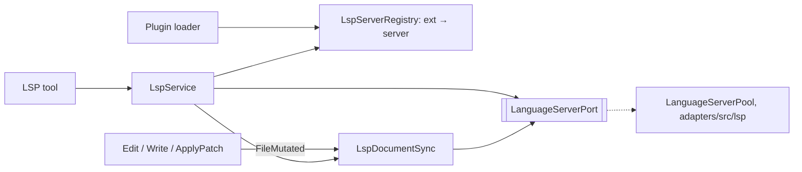
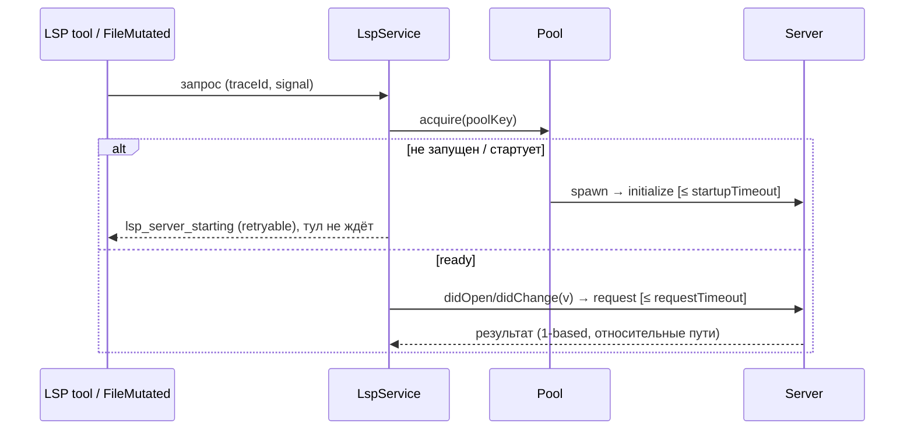

# LSP Tool и Language Server Runtime

Статус: **план** (2026-10-17), не реализовано. Сейчас `lspServers` в манифесте плагина
только показывается (`diagnostic-only`), имя `LSP` зарезервировано в
`packages/core/src/tool/provider-visible-order.ts`.

## 1. Цель

Дать агенту то, что даёт IDE:

- **ошибки после правок** — главная польза, как «Found N new diagnostic issues» в Claude Code;
- **навигацию** — definition, references, implementation, hover, символы файла и workspace,
  вместо шумного `grep`.

Вне V1: completion, rename/code actions, форматирование.

## 2. Конфигурация: только плагины

Встроенного TS-сервера отдельно от плагинов нет. Язык — это запись `lspServers` в
манифесте плагина в формате Claude Code (`.lsp.json`, inline-map или массив; поздний
одноимённый сервер заменяет ранний). Официальный маркетплейс уже содержит 12 таких
плагинов, кода под конкретный язык нет.

```json
{ "typescript": { "command": "typescript-language-server", "args": ["--stdio"],
  "extensionToLanguage": { ".ts": "typescript", ".tsx": "typescriptreact" } } }
```

Поля (сверено с <https://code.claude.com/docs/en/plugins-reference#lspservers>):
обязательные `command`, `extensionToLanguage`; необязательные `args`, `transport`
(`socket` принимаем, работаем по stdio), `env`, `initializationOptions`, `settings`,
`workspaceFolder` (внутри workspace), `startupTimeout` (default 30 с), `shutdownTimeout`
(default 5 с, затем kill tree), `requestTimeout` (default 60 с), `restartOnCrash`
(default `true`), `maxRestarts` (default 3), `diagnostics` (default `true`).
Подстановки `${CLAUDE_PLUGIN_ROOT}`, `${CLAUDE_PLUGIN_DATA}`, `${CLAUDE_PROJECT_DIR}`,
`${user_config.KEY}` — через существующие алиасы шаблонов.

- Неизвестный ключ или невалидная запись отключают **только этот сервер** (diagnostic
  `lsp_config_invalid`), а не весь плагин.
- Одно расширение у двух плагинов: побеждает более высокий приоритет загрузки,
  проигравший получает info-diagnostic `lsp_extension_shadowed`. Один файл — один сервер.

## 3. Выключатели

Всё включено по умолчанию, поэтому выключить можно на трёх уровнях:

| Выключатель | Что выключает | Хранение |
| --- | --- | --- |
| Общий «Code intelligence» (настройки) | Все серверы, тул и диагностику | sidecar |
| Плагин языка | Один язык | существующий enable/disable плагина |
| «Ошибки после правок» (детали плагина) | Только авто-диагностику у сервера | sidecar |

- Sidecar `~/.zcode/cli/fork_lsp_preferences.json`
  (`{ version: 1, enabled, diagnosticsAfterEdit: Record<serverId, boolean> }`), не
  `setting.json`. Владелец — CLI runtime (атомарная запись через `FileSystemPort`);
  битый или отсутствующий файл означает значения по умолчанию плюс `warn`.
- UI читает и пишет только через протокол `lsp/preferences/get|set` (Zod в
  `packages/shared/src/zcode-protocol/index.ts`). Изменения применяются без
  перезапуска со следующего запроса модели или следующей правки.
- Метрика шума: `info`-событие на каждый показ диагностики (serverId, число
  ошибок и предупреждений, задержка, сработало ли правило «нет baseline»), без текстов
  и путей.

## 4. Архитектура



| Состояние | Владелец |
| --- | --- |
| ext → server | `LspServerRegistry` (bootstrap, из `PluginLoadOutcome.lspServers`) |
| процессы, capabilities, рестарты | `LanguageServerPool` (adapter) |
| открытые документы, версии, диагностики | `LspDocumentSync` (core) |

- Edit/Write не вызывают LSP: они публикуют `FileMutated`, а `LspDocumentSync` шлёт
  `didOpen`/`didChange` и `didChangeWatchedFiles` (последнее нужно gopls и rust-analyzer).
- Правки вне тулов: у открытых документов перед запросом сверяем `mtime+size`.
  Своего watcher-а в V1 нет; серверы со своим watcher (tsserver, pyright) видят
  изменения сами.
- Не больше 50 открытых документов на сервер, лишние закрываются через `didClose` по LRU.
- Пул: один процесс на `(workspaceIdentity?.trim() || workspacePath, serverId)`, общий
  для сессий workspace; `rootUri` из `workspacePath`. Остановка через 10 мин без
  lease, не больше 4 серверов одновременно (LRU). Процессы гасятся через
  `mcp/process-tree.ts` и `windows-job-object.ts`.
- Remote: пул живёт там же, где Read/Bash. Фаза 0 подтверждает это, иначе remote
  явно выключен с ошибкой `lsp_remote_unsupported`.

## 5. Порядок событий



- **Старт не блокирует.** jdtls и kotlin стартуют до 120 с, а таймаут executor-а
  об этом не знает. Сервер прогревается при первом Read или правке файла его языка.
- **Падение:** висящие запросы получают `lsp_server_crashed`, сервер перезапускается
  до `maxRestarts`, затем `lsp_server_unavailable`.
- **Диагностика без «подождать N мс»:** pull `textDocument/diagnostic`, если сервер
  его умеет; иначе `publishDiagnostics` с `version ≥ v` (или первый publish после
  нашего `didChange`). Нет ответа — `status: "pending"`, а не «ошибок нет».

## 6. Ошибки после правок

- Результат Edit/Write сервер не ждёт. **Новые** диагностики (относительно baseline до
  правки) попадают в attachment к следующему запросу модели: «Found N new diagnostic
  issues in M files», не больше 20, сначала `error`. Контракт Edit/Write не меняется.
- Нет baseline (файл не был открыт или сервер стартовал): показываем только
  диагностики, пересекающиеся с изменённым диапазоном.
- TUI/V4: раскрываемая строка (`+`/`-`).

## 7. Тул `LSP`

Возможности как у Claude Code LSP tool. Точные имена в upstream не опубликованы,
поэтому перед реализацией сверяем их с реальной схемой.

- Вход: `operation` (`goToDefinition`, `findReferences`, `hover`, `documentSymbol`,
  `workspaceSymbol`, `goToImplementation`, `diagnostics`; позже call hierarchy),
  `filePath`, `line` (1-based, как в Read), `character` **или** `symbol` (имя на строке —
  рекомендуемо, модели плохо считают колонки), `query`, `includeDeclaration`.
- Позиции: конвертация 1-based ↔ 0-based UTF-16 в одном модуле `lsp-position.ts`
  (тесты: emoji, кириллица, CRLF).
- Выход: `locations` / `symbols` / `hover` / `diagnostics` с относительными путями и
  однострочным preview (≤ 200 символов), `status: "ok" | "pending"`, `truncated`, `total`;
  не больше 200 элементов, остаток уходит в artifact.
- Метаданные: `readOnly`, `concurrentSafe`, `needsApproval: false`,
  `sideEffectScope: "none"` (процесс запускается по доверенному плагину, команду модель
  не выбирает); `timeout` 65 с без override; отмена через `$/cancelRequest`.
- Видимость: тул регистрируется, только если есть доступный сервер (плагин включён,
  бинарь найден, workspace доверен). Без бинаря тула нет и в чате ошибок нет.
  Доступен главному агенту и `Explore`.
- Коды ошибок: `lsp_no_server_for_file`, `lsp_server_not_installed`,
  `lsp_server_starting`, `lsp_request_timeout`, `lsp_server_start_failed`,
  `lsp_startup_timeout`, `lsp_server_crashed`, `lsp_server_unavailable`,
  `lsp_operation_unsupported`, `lsp_invalid_position`, `lsp_symbol_not_found_on_line`,
  `lsp_workspace_untrusted`, `lsp_cancelled`.
- Подсказка модели: LSP — для символов и типов, grep — для текста и конфигов;
  `pending` не значит «ошибок нет».

## 8. Безопасность и платформы

- Сервер исполняет код workspace (`build.rs`, `go list`, плагины `tsconfig`), поэтому
  нужны включённый плагин (политика как у hooks) и доверенный workspace (workspace trust).
- Автоустановки бинарей нет. `env` и stderr целиком не логируются; сырой JSON-RPC
  пишется только в `debug`.
- PATH: Electron из Dock не видит `~/.nvm`, `~/.cargo/bin` и подобные пути, поэтому
  используем login-shell окружение, которое хост уже снимает
  (`packages/acp-agent-runtime/src/registry.ts`, shell snapshot в `adapters/src/exec`).
- Windows: `.cmd`-шимы через `PATHEXT` без shell-строки; регистр буквы диска в URI.

## 9. Языки

- Реализация общая. «Готовым» считаем TypeScript: e2e на реальном сервере, пороги шума.
- Остальные официальные плагины (pyright, gopls, rust-analyzer, clangd, jdtls, kotlin,
  csharp, php, ruby, lua, swift, liquid) работают после установки, но помечены
  «не проверено в ZCode».
- Чтобы не получился «только TS», fake server в тестах воспроизводит неудобные серверы:
  старт 60+ с, publish без `version`, без pull diagnostics и без своего watcher.
  Smoke-тесты pyright, gopls и rust-analyzer запускаются, если бинарь есть, иначе
  пропускаются с пометкой.
- Позже: свои плагины (JSON/CSS/HTML/ESLint, bash, yaml, vue, svelte, terraform, zig,
  elixir) и несколько серверов на файл.

## 10. Фазы

0. **Spike:** remote-сценарий, PATH в CLI-рантайме, `vscode-jsonrpc` или свой framing,
   замер tsserver на монорепо.
1. **Конфиг:** Zod-схема, загрузчик, diagnostics, `lsp` в component types, снять
   `diagnosticOnly`.
2. **Пул:** `LanguageServerPort`, `adapters/src/lsp`, fake server, тесты lifecycle,
   отмены, crash и Windows.
3. **Ошибки после правок** (§6) **вместе с выключателями и метриками** (§3); bundled
   TypeScript-плагин включён по умолчанию.
4. **Тул `LSP`** (§7) по всем разделам `00-tool-change-chain.md`.
5. **UI статуса** серверов (starting / running / not installed / crashed), desktop и
   mobile, i18n.
6. **Новые языковые плагины.**

При реализации обновить: `docs/claude-code-marketplace-plugin-compat.md`,
`docs/plan/trajectory/embedded-search-provider-visible.md:74`, README и
`00-tool-change-chain.md` в этой папке, `02-write.md`/`03-edit.md`, два SKILL.md в
`zcode-guide-plugin` («recorded but not executed»).

## 11. Решения (2026-10-17)

1. TypeScript включён по умолчанию, но работает только при найденном бинаре и
   доверенном workspace. Диалога рекомендаций плагинов в V1 нет.
2. Ошибки после правок включены по умолчанию и фильтруются (§6).
3. Выключить можно всё, отдельный язык или только ошибки после правок (§3).
4. Диагностика идёт раньше навигационного тула.
5. Архитектура мультиязычная, проверяем на TypeScript.

Открыто: несколько серверов на файл (TS + ESLint, Vue + TS) в V2.
