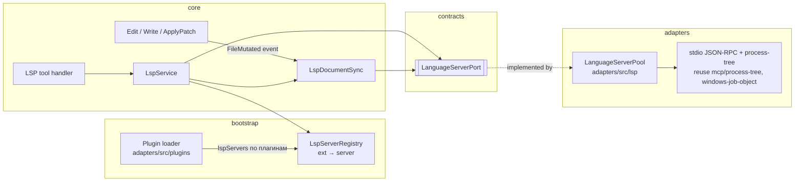
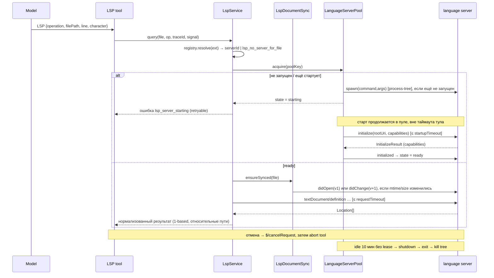

# LSP Tool и Language Server Runtime

Статус: **draft / план** (2026-10-17). Ничего из описанного ниже ещё не реализовано.
Сейчас `lspServers` в манифесте плагина только распознаётся и показывается
(`diagnostic-only`), а имя `LSP` лишь зарезервировано в
`packages/core/src/tool/provider-visible-order.ts`.

## 1. Зачем

Сейчас агент ищет определения и использования через Bash `grep`. В монорепо это
шумно (одноимённые символы, re-export, alias-импорты), а проверка типов после
правки стоит полного `pnpm typecheck`. Language server даёт:

- точные `definition` / `references` / `implementation` с учётом типов и алиасов;
- `hover` — выведенный тип без чтения половины файлов;
- `documentSymbol` / `workspaceSymbol` — структуру файла и поиск символа по имени;
- диагностику по одному файлу сразу после Edit/Write (самая большая ценность, фаза 4;
  в Claude Code это поведение по умолчанию: «Found N new diagnostic issues» под правкой).

Не цель V1: completion, rename/code actions (это записи — отдельный контракт),
форматирование, semantic tokens.

## 2. Ключевое решение: один источник конфигурации

Никакого «встроенного TS-сервера» отдельно от плагинов. Единственная схема
конфигурации — поле `lspServers` манифеста плагина, совместимое с Claude Code
marketplace. Официальный маркетплейс уже содержит 12 таких плагинов, поэтому
поддержка «других языков» не требует кода под каждый язык:

```json
{
  "typescript": {
    "command": "typescript-language-server",
    "args": ["--stdio"],
    "extensionToLanguage": { ".ts": "typescript", ".tsx": "typescriptreact", ".js": "javascript" },
    "startupTimeout": 120000
  }
}
```

TypeScript — просто первый плагин (`typescript-lsp@claude-plugins-official`),
позже его можно положить в bundled official roots, чтобы он был включён по умолчанию.

### 2.1 Схема `LspServerConfig` (contracts, Zod)

Источник — Claude Code Plugin manifest reference, раздел `lspServers`
(<https://code.claude.com/docs/en/plugins-reference#lspservers>, сверено 2026-10-17).
В официальных манифестах реально встречаются только `command`, `args`,
`extensionToLanguage`, `startupTimeout`; остальные поля взяты из reference.

Формы значения `lspServers`: путь к `.json`, inline-map `name → config` или массив
из них. Файл `.lsp.json` в корне плагина загружается первым, затем объявленное в
манифесте; одноимённый сервер, объявленный позже, заменяет ранний.

| Поле | Обяз. | Семантика (upstream) | ZCode V1 |
| --- | --- | --- | --- |
| `command` | да | Бинарь сервера; без пробелов, если не начинается с `/` | Резолв по `PATH` (+ `PATHEXT` на Windows) |
| `extensionToLanguage` | да | Map «расширение с точкой → languageId», ≥ 1 запись | Регистр ключа сохраняется (`.C` ≠ `.c`) |
| `args` | нет | Аргументы | Массивом, без shell |
| `transport` | нет | `stdio` (default) или `socket`; upstream принимает `socket`, но всё равно работает по stdio | Так же: принимаем, работаем по stdio |
| `env` | нет | Переменные окружения процесса | Мержится поверх окружения runtime; не логируется |
| `initializationOptions` | нет | Отправляется в `initialize` | как есть |
| `settings` | нет | Отправляется через `workspace/didChangeConfiguration` | плюс ответ на `workspace/configuration` |
| `workspaceFolder` | нет | Workspace folder для сервера | Должен лежать внутри workspace, иначе запись невалидна |
| `startupTimeout` | нет | ms на старт, целое > 0 | Default `LSP_DEFAULT_STARTUP_TIMEOUT_MS = 30_000` |
| `shutdownTimeout` | нет | ms на graceful shutdown; без значения — без таймаута | Без значения: `LSP_DEFAULT_SHUTDOWN_TIMEOUT_MS = 5_000`, затем kill tree (не оставляем зависшие процессы) |
| `requestTimeout` | нет | ms на ответ на запрос, default `60000` | Так же |
| `restartOnCrash` | нет | default `true` | Так же |
| `maxRestarts` | нет | ≥ 0 | Default `3` |
| `diagnostics` | нет | Пушить диагностику в контекст после правок, default `true` | Фаза 4 |

Подстановки (upstream): `${CLAUDE_PLUGIN_ROOT}`, `${CLAUDE_PLUGIN_DATA}`,
`${CLAUDE_PROJECT_DIR}` и `${user_config.KEY}` раскрываются в `command`, `args`,
`env`, `workspaceFolder`. Первые три также экспортируются в окружение процесса.
Используем существующие алиасы шаблонов ZCode.

Upstream-объект строгий: неизвестный ключ — ошибка валидации, плагин не
загружается. ZCode отклоняет только этот сервер (diagnostic
`lsp_config_invalid` на плагине), остальные компоненты плагина работают, как и в
остальной модели diagnostics из `claude-code-marketplace-plugin-compat.md`.

### 2.2 Конфликт расширений

Если два включённых плагина объявляют одно расширение, побеждает плагин с более
высоким приоритетом загрузки (существующий `FIRST_PLUGIN_PRIORITY` / `PRIORITY_STEP`
в `adapters/src/plugins`). Проигравший получает diagnostic
`lsp_extension_shadowed`. В V1 одному файлу соответствует ровно один сервер.

### 2.3 Fork-ограничения

- Не добавлять ключи в `setting.json`. Включение и выключение — только через
  enable/disable плагина (уже существующее состояние).
- Если позже понадобится per-workspace отключение отдельного сервера — хранить в
  `fork_`-prefixed sidecar/таблице, не в settings.

## 3. Архитектура и владельцы



| Состояние | Единственный владелец | Кто читает |
| --- | --- | --- |
| Какие серверы объявлены, ext → server | `LspServerRegistry` (bootstrap, строится из `PluginLoadOutcome.lspServers`) | `LspService` |
| Живые процессы, capabilities, restart-счётчики | `LanguageServerPool` (adapter) | через `LanguageServerPort` |
| Открытые документы и их `version` | `LspDocumentSync` (core, по одному на ключ пула) | `LspService` |
| Последние диагностики документа | `LspDocumentSync` | LSP tool, позже Edit/Write |

Правила:

- Edit/Write/ApplyPatch **не вызывают LSP напрямую**. Они публикуют событие
  `FileMutated { path, content, traceId }` после успешной записи; подписчик —
  `LspDocumentSync`. Это и есть «LSP-уведомление», которое обещают `02-write.md`
  и `03-edit.md`; отдельный `FileMutationService` для этого не нужен.
- Для каждого `FileMutated` (в том числе по файлам, которые не открыты)
  `LspDocumentSync` шлёт `workspace/didChangeWatchedFiles` (created/changed/deleted).
  Иначе gopls и rust-analyzer, которые полагаются на клиента в вопросе файловых
  событий, не узнают о правках в неоткрытых файлах.
- Изменения не через тулы (Bash, `git checkout`, внешний редактор):
  - для **открытых** документов перед каждым запросом сверяем `mtime+size`;
    при расхождении перечитываем через `FileSystemPort` и шлём `didChange` (full sync);
  - для **неоткрытых** клиент в V1 объявляет
    `workspace.didChangeWatchedFiles.dynamicRegistration: false` и не следит за ФС сам.
    Серверы с собственным watcher (tsserver, pyright) видят изменения сами. Остальные
    узнают о них при следующем `didOpen`. Это известное ограничение V1. Watcher через
    `FileSystemPort` добавляется в V2, если окажется нужен.
- Набор открытых документов ограничен `LSP_MAX_OPEN_DOCUMENTS = 50` на ключ пула.
  Лишние закрываются через `didClose` по LRU. Документ, закрытый в ФС
  (удаление через `FileMutated`), закрывается сразу.
- core использует только `LanguageServerPort`; `child_process`, `fs` и framing
  JSON-RPC живут в `adapters/src/lsp`.

### 3.1 Ключ пула и scope

`poolKey = (workspaceIdentity?.trim() || workspacePath, serverId)`, где
`serverId = <pluginId>/<serverName>`. Один процесс на workspace на сервер,
общий для всех сессий этого workspace (как MCP `isolation: "workspace"`):
jdtls/kotlin стартуют до 120 с, per-session процессы неприемлемы.
`rootUri` берётся из `workspacePath` (+ `workspaceFolder`), не из identity.

Сессии берут lease; при отпускании последнего lease сервер живёт ещё
`LSP_IDLE_SHUTDOWN_MS = 600_000` (это политика ресурсов, а не ожидание
синхронизации) и затем корректно останавливается. Лимит
`LSP_MAX_RUNNING_SERVERS = 4` на runtime; при превышении останавливается
самый давно неиспользованный сервер без lease.

### 3.2 Remote workspaces

Пул живёт в том же runtime-процессе, что и Read/Bash, то есть там, где лежат
файлы. Remote workspace получает свой сервер на своём Host автоматически;
Desktop Main и relay в этом не участвуют и состояния LSP не хранят.
**Фаза 0 должна подтвердить** это для текущей схемы remote-подключений;
если подтвердить не удастся, remote явно выключается в V1 с ошибкой
`lsp_remote_unsupported`, а не молча.

## 4. Жизненный цикл и порядок событий



**Старт не блокирует тул.** Таймаут executor-а (`timeout.defaultMs`) не знает
про холодный старт, а jdtls и kotlin стартуют до 120 с. Поэтому `acquire` только
запускает старт и сразу возвращает `lsp_server_starting`, а модель повторяет
вызов. Старт ограничен `startupTimeout` внутри пула. Чтобы повтор обычно не
требовался, пул прогревает сервер заранее: при первом `FileMutated` или Read
файла с подходящим расширением (upstream тоже стартует сервер при первой правке).
Read только прогревает сервер и не ждёт его.

Падение сервера: pool помечает его `crashed`, все висящие запросы получают
`lsp_server_crashed`; следующий `acquire` перезапускает (до `maxRestarts`),
`LspDocumentSync` для этого ключа сбрасывает открытые документы и открывает
их заново по требованию. После лимита — `lsp_server_unavailable` до перезапуска runtime
или повторного включения плагина.

### 4.1 Диагностика без «подождать N мс»

Операция `diagnostics` для файла:

1. `ensureSynced(file)` → известна `version` v.
2. Если сервер объявил `diagnosticProvider` → pull `textDocument/diagnostic` (точный ответ).
3. Иначе ждём `publishDiagnostics` для этого URI с `version ≥ v`.
4. Если сервер не присылает `version` в publish, принимаем первый publish,
   пришедший после нашего `didChange`/`didOpen` v.
5. Если до таймаута тула ничего не пришло — возвращаем
   `status: "pending"` и пустой список. Мы **не выдаём «ошибок нет»**, когда
   ответа не было: модель видит, что результат неизвестен.

## 5. Контракт тула `LSP`

Набор возможностей совпадает с Claude Code LSP tool (tools reference: definition,
references, тип по позиции, символы файла, поиск символа по workspace,
implementations, call hierarchy). Точные имена операций и поля в публичной
документации не опубликованы и в репозитории нет захваченной схемы. Имена ниже —
наше предложение в стиле upstream; перед фазой 3 сверить с реальным tool schema
Claude Code (например, по debug-логу запроса), чтобы модель получила знакомую форму.

### 5.1 Вход

| Поле | Тип | Обяз. | Описание |
| --- | --- | --- | --- |
| `operation` | enum | да | `goToDefinition`, `findReferences`, `hover`, `documentSymbol`, `workspaceSymbol`, `goToImplementation`, `diagnostics`; позже в фазе 3: `prepareCallHierarchy`, `incomingCalls`, `outgoingCalls`. |
| `filePath` | `string` | да* | Абсолютный или относительно cwd; проходит общий `path-policy`. *Для `workspaceSymbol` — любой файл нужного языка, чтобы выбрать сервер. |
| `line` | `number` | для позиционных | 1-based, как в выводе Read. |
| `character` | `number` | нет | 1-based колонка в символах строки. |
| `symbol` | `string` | нет | Альтернатива `character`: имя идентификатора на строке `line`; берётся первое вхождение по границе слова. Модели плохо считают колонки, поэтому это рекомендуемый способ. |
| `query` | `string` | для `workspaceSymbol` | Строка поиска. |
| `includeDeclaration` | `boolean` | нет | Для `findReferences`, по умолчанию `false`. |

Нужен ровно один из `character` / `symbol` для позиционных операций, иначе `lsp_invalid_position`.

**Позиции.** LSP использует 0-based строки и UTF-16 code units. Конвертация в
одном модуле `lsp-position.ts`: 1-based строка → 0-based; колонка в
code points → UTF-16 offset по фактическому тексту строки (суррогатные пары, CRLF).
На выходе — обратная конвертация. Покрыть тестами emoji/кириллицу/CRLF.

### 5.2 Выход (`runtimeOutputSchema`)

```ts
type LspOutput = {
  operation: LspOperation;
  server: string;                 // serverId
  status: "ok" | "pending";       // pending только для diagnostics
  locations?: Array<{ path: string; line: number; character: number;
                      endLine: number; endCharacter: number; preview: string }>;
  symbols?: Array<{ name: string; kind: string; path: string; line: number;
                    containerName?: string; children?: number }>;
  hover?: { contents: string };   // markdown, обрезанный
  diagnostics?: Array<{ path: string; line: number; character: number;
                        severity: "error" | "warning" | "info" | "hint";
                        code?: string; source?: string; message: string }>;
  truncated: boolean;
  total?: number;
};
```

Пути относительные к workspace, если файл внутри него; `preview` — одна строка
исходника, обрезанная до `LSP_PREVIEW_MAX_CHARS = 200`. Местоположения вне workspace
(`node_modules`, stdlib) возвращаются, но помечаются абсолютным путём.

### 5.3 Метаданные

- `readOnly: true`, `destructive: false`, `concurrentSafe: true`, `needsApproval: false`.
- `sideEffectScope: "none"`. Обоснование: тул не создаёт побочных эффектов на
  уровне вызова. Запуск процесса — следствие включённого и доверенного плагина;
  этот gate проходит при включении плагина и проверке доверия workspace (§6), а не
  на каждый вызов. Правило «subprocess ⇒ system» из чек-листа относится к тулам,
  чьи аргументы определяют команду; здесь модель команду не выбирает.
- `timeout`: default `65_000` (чуть больше default `requestTimeout = 60_000`, чтобы
  пул успел вернуть структурированную ошибку раньше executor-а), `maxMs` `65_000`,
  `allowCallOverride: false`. Холодный старт в этот таймаут не входит (§4).
  Если `requestTimeout` сервера больше, ограничение берётся по меньшему значению.
- `cancellation`: `$/cancelRequest` для активного запроса; процесс сервера не убивается.
- `resultBudget`: inline `20_000` chars; `findReferences`/`workspaceSymbol` —
  не больше `LSP_MAX_RESULTS = 200` элементов, затем `truncated: true` + `total`;
  полный список уходит в artifact.
- Видимость: только если есть хотя бы один включённый LSP-сервер; иначе тул не
  регистрируется (паттерн onDemand / capability-conditioned tool shape из
  `00-tool-change-chain.md`). Доступен главному агенту и `Explore`.

### 5.4 Ошибки (стабильные коды)

| Код | Когда | Подсказка модели |
| --- | --- | --- |
| `lsp_no_server_for_file` | нет сервера для расширения | использовать grep; перечисляет доступные языки |
| `lsp_server_not_installed` | `command` не найден (ENOENT, Windows `.cmd` тоже) | имя бинаря и источник плагина; **не** устанавливать автоматически |
| `lsp_server_starting` | сервер ещё инициализируется | повторить вызов позже; пока можно использовать grep |
| `lsp_request_timeout` | нет ответа за `requestTimeout` | — |
| `lsp_server_start_failed` / `lsp_startup_timeout` | spawn или `initialize` упали | stderr-хвост в логах, не в ответе |
| `lsp_server_crashed` / `lsp_server_unavailable` | падение / лимит рестартов | — |
| `lsp_operation_unsupported` | у сервера нет capability | — |
| `lsp_invalid_position` / `lsp_symbol_not_found_on_line` | неверные `line`/`character`/`symbol` | — |
| `lsp_workspace_untrusted` | workspace не доверен (§6) | — |
| `lsp_cancelled` | отмена пользователем | — |

## 6. Доверие и безопасность

Запуск language server — это исполнение кода, причём **часто кода самого
workspace**: rust-analyzer запускает `build.rs` и proc-macro, gopls вызывает
`go list`, tsserver может грузить плагины из `tsconfig`. Поэтому:

1. Плагин должен быть включён. Для сторонних маркетплейсов применяется та же
   политика, что и для hooks (`adapters/src/plugins/index.ts:376`); если она
   будет ужесточена, LSP следует за ней.
2. Workspace должен пройти существующую проверку workspace trust
   (`docs/specs/workspace-hook-trust*.md`). В недоверенном workspace — `lsp_workspace_untrusted`.
3. Никакой автоустановки бинарей и никаких вызовов package manager
   (согласно `claude-code-marketplace-plugin-compat.md`).
4. `env` из конфига и stderr сервера не пишутся в логи целиком; `info` — старт/стоп/рестарт,
   `debug` — сырой JSON-RPC.

## 7. Кроссплатформенность

- Windows: `typescript-language-server`, `pyright-langserver`, `intelephense` —
  это `.cmd`-шимы. Резолвить `command` через `PATHEXT` и запускать `.cmd` по тем же
  правилам, что и уже существующий MCP stdio transport; не через shell-строку.
- Убийство дерева процессов: переиспользовать `mcp/process-tree.ts` и
  `windows-job-object.ts`.
- URI: `pathToFileURL`/`fileURLToPath`; на Windows нормализовать регистр буквы диска
  при сравнении URI из `publishDiagnostics`.
- Регистрозависимость расширений (`.C` в clangd) сохраняется; сопоставление
  выполняется сначала точное, затем по lower-case.

## 8. Языки

Все официальные плагины работают одной и той же реализацией; отличаются только
бинарём и особенностями.

| Плагин (claude-plugins-official) | Сервер | Особенности |
| --- | --- | --- |
| `typescript-lsp` | typescript-language-server | Сам находит `typescript` в `node_modules` workspace. Время старта на этом монорепо — оценка, замерить в фазе 0. **Первый целевой.** |
| `pyright-lsp` | pyright-langserver | Нужен правильный venv (`settings.python.pythonPath` или `pyrightconfig.json`). |
| `gopls-lsp` | gopls | Корень — `go.mod`; при вложенных модулях понадобится `workspaceFolder`. |
| `rust-analyzer-lsp` | rust-analyzer | Тяжёлый (RAM, индексация минуты), выполняет build scripts → важен trust. |
| `clangd-lsp` | clangd | Без `compile_commands.json` результаты слабые. |
| `jdtls-lsp`, `kotlin-lsp` | jdtls, kotlin-lsp | Старт до 120 с — поэтому scope = workspace. |
| `csharp-lsp`, `php-lsp`, `ruby-lsp`, `lua-lsp`, `swift-lsp` | csharp-ls, intelephense, ruby-lsp, lua-language-server, sourcekit-lsp | Без особенностей для V1. |
| `liquid-lsp` (Shopify, в официальном каталоге) | `shopify` CLI | Не проверялся. |

Кандидаты для своих плагинов в `zcode-plugins-official` (фаза 6, тем же форматом):
`vscode-langservers-extracted` (JSON/CSS/HTML/ESLint), `bash-language-server`,
`yaml-language-server`, `@vue/language-server`, `svelte-language-server`,
`terraform-ls`, `zls`, `elixir-ls`. Vue/Svelte работают в связке с TS-сервером;
пока на файл приходится один сервер, такой связки не будет. Это ограничение V1.

## 9. Подсказки модели

В `modelInstructions` тула:

- Использовать `LSP` для определения символа, его ссылок, реализаций и типа;
  `grep` — для текста, строк, конфигов и файлов, которые сервер не покрывает.
- Указывать `line` из вывода Read и `symbol`, а не считать колонку.
- После правок TS-файла можно вызвать `diagnostics`, не запуская весь `typecheck`;
  `status: "pending"` не означает отсутствие ошибок.

## 10. План реализации

Каждая фаза — отдельный коммит или PR; spec обновляется в той же фазе.

**Фаза 0 — spike (без кода в main).**
Проверить, где исполняется runtime для remote workspace (§3.2). Выбрать framing:
`vscode-jsonrpc` (зависимость, проверить лицензию и `third-party/inventory.json`)
или свой (около 150 строк Content-Length framing). Замерить
typescript-language-server на этом монорепо: время старта и RSS.

**Фаза 1 — конфиг и загрузка.**
- `contracts/src/plugins`: Zod `LspServerConfigSchema`, `PluginLoadOutcome.lspServers`.
- `adapters/src/plugins`: убрать `lspServers` из `UNSUPPORTED_COMPONENT_KEYS`, резолвить
  шаблонные переменные, diagnostics §2.1/§2.2, namespace `serverId`.
- `bootstrap/src/plugins.ts`: `inferComponentTypesFromMetadata` добавляет `lsp`;
  `zcode-protocol/plugins.ts:499` — убрать `lspServers` из `diagnosticOnly`.
- `plugins/describe`: перечислять LSP-серверы и расширения.
- Тесты: парсинг официальных 12 манифестов, конфликт расширений, невалидная запись.

**Фаза 2 — порт, адаптер, пул.**
- `contracts/src/interfaces/language-server.port.ts`: `acquire/release`, `request`,
  `notify`, `onNotification`, `capabilities`, `status`; ошибки — коды из §5.4.
- `adapters/src/lsp/`: spawn + framing + `workspace/configuration` + process-tree +
  idle shutdown + restart + LRU-лимит.
- Тестовый fixture: `tests/fixtures/fake-lsp-server.mjs` (Node-скрипт, сценарии:
  ok, медленный старт, crash, без version в publish, pull diagnostics).
- Тесты: lifecycle, отмена, crash/restart, Windows `.cmd` резолв (unit c инъекцией PATHEXT).

**Фаза 3 — тул `LSP` (навигация).**
- `contracts/src/tools/lsp.ts`, `core/src/tool/handlers/lsp.ts` (+ `lsp-position.ts`,
  `lsp-format.ts`, каждый < 400 строк), `LspService`, `LspDocumentSync` (mtime-сверка).
- Регистрация по наличию серверов; проход по всем 12 разделам `00-tool-change-chain.md`
  (contracts → core → prompt → provider → permission → executor → adapter → budget →
  events/persistence → TUI/V4 projection → config).
- TUI и V4: карточка вызова (операция, файл:строка, число результатов).
- Тесты: контракт и `toContracts()`, позиции UTF-16, e2e на fake server и на реальном
  typescript-language-server, если он есть в PATH (иначе skip с явной пометкой).

**Фаза 4 — диагностика и синхронизация с правками.**
- Операция `diagnostics` (§4.1); событие `FileMutated` из Edit/Write/ApplyPatch →
  `LspDocumentSync` (+ `didChangeWatchedFiles`).
- Авто-диагностика после правок (upstream default, поле `diagnostics: true`).
  Результат Edit/Write **не ждёт** сервер. `LspDocumentSync` запоминает baseline
  диагностик файла до правки, а **новые** диагностики, пришедшие после неё,
  попадают в attachment к следующему запросу модели: «Found N new diagnostic
  issues in M files» плюс список с бюджетом `LSP_EDIT_DIAGNOSTICS_MAX = 20`
  (сначала `error`). Контракт Edit/Write не меняется; меняется сборка контекста
  (раздел 4 `00-tool-change-chain.md`). Холодный старт ради правки — только прогрев,
  без ожидания.
- TUI/V4: строка «Found N new diagnostic issues», раскрываемая (`+`/`-`).
- Обновить `02-write.md`/`03-edit.md`: строка «LSP/IDE 通知 missing» → реализовано.

**Фаза 5 — UI статуса.**
Статус серверов в деталях плагина (`starting` / `running` / `not installed` / `crashed`)
и ошибки «Executable not found» через новый метод протокола с Zod-схемой в
`packages/shared/src/zcode-protocol/index.ts`; desktop и mobile web; i18n (en/zh/uk).

**Фаза 6 — дополнительные языки.** Свои LSP-плагины из §8 в `zcode-plugins-official`.

## 11. Документы, которые нужно обновить при реализации

- `docs/claude-code-marketplace-plugin-compat.md`: строка `lspServers` в матрице и roadmap V2.
- `docs/plan/trajectory/embedded-search-provider-visible.md:74`: `LSP` больше не «暂不新增».
- `apps/zcode-cli/docs/design/v2/tool/README.md`: оглавление и матрица тулов.
- `apps/zcode-cli/docs/design/v2/tool/00-tool-change-chain.md`: раздел про LSP.
- `packages/zcode-guide-plugin/skills/{zcode-configuration-guide,diagnosing-plugins}/SKILL.md`:
  убрать `lspServers` из «recorded but not executed».

## 12. Открытые вопросы

1. Включать `typescript-lsp` по умолчанию (bundled official root) или только по установке?
2. Авто-диагностику после правок (фаза 4) включать по умолчанию, как в upstream, или
   оставить только явную операцию `diagnostics` до замеров шума?
3. Поддержать несколько серверов на файл (TS + ESLint, Vue + TS) в V2 — объединение диагностик?
