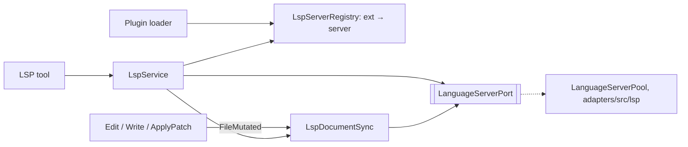
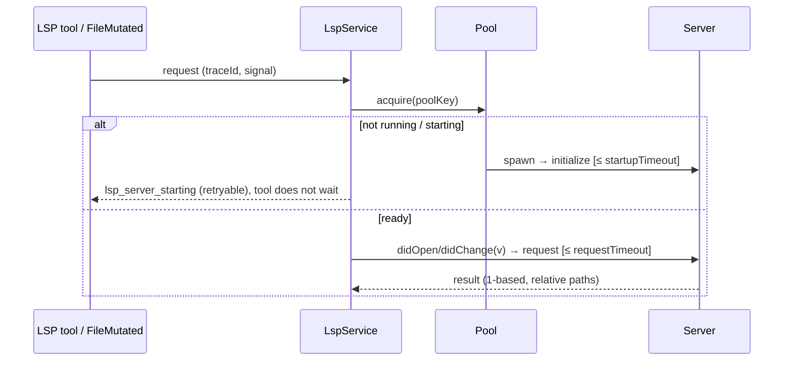

# LSP Tool and Language Server Runtime

Status: **plan** (2026-10-17), not implemented. Today `lspServers` in a plugin manifest
is only displayed (`diagnostic-only`), and the `LSP` name is only reserved in
`packages/core/src/tool/provider-visible-order.ts`.

## 1. Goal

Give the agent what an IDE gives a developer:

- **diagnostics after edits**: the main payoff, like Claude Code's "Found N new
  diagnostic issues" line;
- **navigation**: definition, references, implementation, hover, and file and
  workspace symbols, instead of noisy `grep`.

Out of scope for V1: completion, rename/code actions, formatting.

## 2. Configuration: plugins only

There is no built-in TS server separate from plugins. A language is an `lspServers`
entry in a plugin manifest, in Claude Code format: `.lsp.json`, an inline map, or an
array, where a later server with the same name replaces an earlier one. The
official marketplace already ships 12 such plugins, and there is no per-language code.

```json
{ "typescript": { "command": "typescript-language-server", "args": ["--stdio"],
  "extensionToLanguage": { ".ts": "typescript", ".tsx": "typescriptreact" } } }
```

Fields (checked against <https://code.claude.com/docs/en/plugins-reference#lspservers>):

- **Required:** `command`, `extensionToLanguage`.
- **Optional:**
  - `args`, `env`, `initializationOptions`, `settings`;
  - `transport`: `socket` is accepted, but we run over stdio;
  - `workspaceFolder`: must be inside the workspace;
  - `startupTimeout` (default 30 s), `shutdownTimeout` (default 5 s, then kill tree),
    `requestTimeout` (default 60 s);
  - `restartOnCrash` (default `true`), `maxRestarts` (default 3), `diagnostics`
    (default `true`).

The substitutions `${CLAUDE_PLUGIN_ROOT}`, `${CLAUDE_PLUGIN_DATA}`, `${CLAUDE_PROJECT_DIR}`
and `${user_config.KEY}` go through the existing template aliases.

- An unknown key or invalid entry disables **only that server** (diagnostic
  `lsp_config_invalid`), not the whole plugin.
- If two plugins claim the same extension, the higher load priority wins and the
  loser gets an info-level `lsp_extension_shadowed` diagnostic. One file maps to one server.

## 3. Toggles

Everything is on by default, so it can be turned off at three levels:

| Toggle | Turns off | Storage |
| --- | --- | --- |
| Global "Code intelligence" (settings) | All servers, the tool, and diagnostics | sidecar |
| Language plugin | One language | existing plugin enable/disable |
| "Diagnostics after edits" (plugin details) | Only a server's automatic diagnostics | sidecar |

- The sidecar is `~/.zcode/cli/fork_lsp_preferences.json`
  (`{ version: 1, enabled, diagnosticsAfterEdit: Record<serverId, boolean> }`), not
  `setting.json`. Its owner is the CLI runtime (atomic writes via `FileSystemPort`). A
  missing or corrupt file means defaults plus a `warn`.
- The UI reads and writes only through the protocol methods `lsp/preferences/get|set`
  (Zod in `packages/shared/src/zcode-protocol/index.ts`). Changes apply without a
  restart, from the next model request or the next edit.
- Noise metric: one `info` event per diagnostics attachment (serverId, error and
  warning counts, latency, whether the no-baseline rule applied). It carries no
  message text and no paths.

## 4. Architecture



| State | Owner |
| --- | --- |
| ext → server | `LspServerRegistry` (bootstrap, from `PluginLoadOutcome.lspServers`) |
| processes, capabilities, restarts | `LanguageServerPool` (adapter) |
| open documents, versions, diagnostics | `LspDocumentSync` (core) |

- Edit/Write never call LSP. They publish `FileMutated`, and `LspDocumentSync` sends
  `didOpen`/`didChange` and `didChangeWatchedFiles` (gopls and rust-analyzer need the latter).
- For changes made outside the tools, open documents are checked by `mtime+size`
  before each request. V1 has no watcher of its own, and servers with their own
  watcher (tsserver, pyright) see changes themselves.
- At most 50 open documents per server; the rest are closed via `didClose` (LRU).
- Pool:
  - one process per `(workspaceIdentity?.trim() || workspacePath, workspacePath, serverId)`,
    shared by the workspace's sessions, with `rootUri` taken from `workspacePath`. The
    identity alone is not enough: it can stay the same while the root changes (for example
    on reconnect), and a reused server would then answer for the wrong root;
  - a server stops after 10 minutes without a lease, and at most 4 servers run at once (LRU);
  - processes are killed via `mcp/process-tree.ts` and `windows-job-object.ts`.
- Remote: the pool lives where Read/Bash run. Phase 0 confirms this; otherwise remote
  is explicitly disabled with `lsp_remote_unsupported`.

## 5. Event order



- **Startup never blocks.** jdtls and kotlin take up to 120 s to start, and the
  executor timeout knows nothing about that. A server is pre-warmed on the first Read
  or edit of a file in its language.
- **Crash:** in-flight requests get `lsp_server_crashed`. The server restarts up to
  `maxRestarts` times, then reports `lsp_server_unavailable`.
- **Freshness.** A diagnostics result counts for the document's current version `v`
  only when one of these holds:
  1. it is a pull `textDocument/diagnostic` response for `v`;
  2. it is a `publishDiagnostics` carrying `version ≥ v`;
  3. it is a versionless publish attributed to `v`. `LspDocumentSync` counts
     `didChange`/`didOpen` sent for the URI since its last publish. A versionless
     publish is attributed to `v` only when exactly one change is in flight. With two
     or more it is ambiguous: we cannot tell a delayed result for an older version
     from a fresh one, so it does not resolve anything.

  Without a fresh result the status is `pending`, never "no errors". Rule 3 assumes the
  server publishes once per processed state. Phase 0 confirmed this for
  typescript-language-server: two quick changes produced one publish. Servers that
  send several partial publishes per version are out of scope for rule 3, and plugin
  status marks them.

## 6. Diagnostics after edits

- Edit/Write results do not wait for the server.
- **New** diagnostics (relative to the pre-edit baseline) go into an attachment on the
  next model request: "Found N new diagnostic issues in M files", at most 20, errors
  first. The Edit/Write contract is unchanged.
- Only results fresh for the document's current version (§5) are attached; older
  ones are dropped.
- A tool result is always followed by a model request. While building that request,
  the attachment source waits for fresh diagnostics of the files changed by the
  previous tool batch, at most `LSP_EDIT_DIAGNOSTICS_WAIT_MS = 2_000` from the last
  change. The measured first publish arrives after 0.9–1.3 s. This bound covers
  latency, not sync: on expiry the attachment says "diagnostics pending for N files",
  and the results join a later request once they are fresh.
- No baseline (the file was not open, or the server was still starting): report only
  diagnostics that overlap the edited range.
- TUI/V4: a collapsible line (`+`/`-`).

## 7. The `LSP` tool

It offers the same capabilities as Claude Code's LSP tool. Upstream does not publish
the exact operation names, so verify them against the real schema before implementing.

- **Input:**
  - `operation`: `goToDefinition`, `findReferences`, `hover`, `documentSymbol`,
    `workspaceSymbol`, `goToImplementation`, `diagnostics`; call hierarchy comes later;
  - `filePath` and `line` (1-based, as in Read);
  - `character` **or** `symbol`. `symbol` is the name on that line and is preferred,
    because models miscount columns;
  - `query`, `includeDeclaration`.
- **Positions:** 1-based ↔ 0-based UTF-16 conversion lives in one module,
  `lsp-position.ts` (tests: emoji, Cyrillic, CRLF).
- **Output:**
  - `locations` / `symbols` / `hover` / `diagnostics`, with relative paths and a
    one-line preview (≤ 200 chars);
  - `status: "ok" | "pending"`, `truncated`, `total`;
  - at most 200 items, with the remainder stored as an artifact.
- **Metadata:**
  - `readOnly`, `concurrentSafe`, `needsApproval: false`;
  - `sideEffectScope: "none"`: the process starts from a trusted plugin, and the model
    never chooses the command;
  - `timeout` 65 s with no override; cancellation via `$/cancelRequest`.
- **Visibility:** the tool is registered only when a usable server exists (plugin
  enabled, binary found, workspace trusted). Without a binary there is no tool and
  no errors in chat. It is available to the main agent and `Explore`.
- **Error codes:** `lsp_no_server_for_file`, `lsp_server_not_installed`,
  `lsp_server_starting`, `lsp_request_timeout`, `lsp_server_start_failed`,
  `lsp_startup_timeout`, `lsp_server_crashed`, `lsp_server_unavailable`,
  `lsp_operation_unsupported`, `lsp_invalid_position`, `lsp_symbol_not_found_on_line`,
  `lsp_workspace_untrusted`, `lsp_cancelled`.
- **Model hint:** use LSP for symbols and types and grep for text and config;
  `pending` does not mean "no errors".

## 8. Security and platforms

- A server executes workspace code (`build.rs`, `go list`, `tsconfig` plugins), so it
  needs an enabled plugin (same policy as hooks) and a trusted workspace (workspace trust).
- Binaries are never installed automatically. `env` and full stderr are never
  logged, and raw JSON-RPC goes only to `debug`.
- PATH: Electron launched from the Dock does not see `~/.nvm`, `~/.cargo/bin` and similar
  paths. We use the login-shell environment the host already captures
  (`packages/acp-agent-runtime/src/registry.ts`, the shell snapshot in `adapters/src/exec`).
- Windows: `.cmd` shims resolve via `PATHEXT` without a shell string, and the drive
  letter's case is normalized in URIs.

## 9. Languages

- The implementation is shared. TypeScript is the only language treated as "ready":
  it gets e2e tests on the real server and tuned noise thresholds.
- The other official plugins (pyright, gopls, rust-analyzer, clangd, jdtls, kotlin,
  csharp, php, ruby, lua, swift, liquid) work once installed but are labeled
  "not verified in ZCode".
- To avoid a TS-only design, the fake server in tests mimics awkward servers: startup
  over 60 s, publish without `version`, a stale publish after two quick changes
  (must stay `pending`), several partial publishes per version, and no pull diagnostics
  or watcher of its own.
  Smoke tests for pyright, gopls and rust-analyzer run when the binary is present and
  are skipped with a note otherwise.
- Later: our own plugins (JSON/CSS/HTML/ESLint, bash, yaml, vue, svelte, terraform, zig,
  elixir) and multiple servers per file.

## 10. Phases

0. **Spike (done 2026-10-17).** typescript-language-server 6.0.2 on this monorepo:
   - timing: `initialize` about 0.3 s, first request about 0.2 s, first publish 0.9–1.3 s;
   - memory: about 850 MB RSS across three processes;
   - diagnostics: no pull diagnostics (not even via dynamic registration), publish
     without `version`, and two quick changes produce one publish;
   - noise: with unbuilt workspace packages (`dist` missing) it reports
     pre-existing errors like "Cannot find module '@zcode/contracts'", which the
     baseline/overlap rules (§6) must filter;
   - framing: no JSON-RPC package is in the lockfile, so we write our own
     Content-Length framing.

   Remote scenario and PATH in the CLI runtime are checked during phase 2.
1. **Config:** Zod schema, loader, diagnostics, `lsp` in component types, and removing
   `lspServers` from `diagnosticOnly`.
2. **Pool:** `LanguageServerPort`, `adapters/src/lsp`, the fake server, and tests for
   lifecycle, cancellation, crashes and Windows.
3. **Diagnostics after edits** (§6), **shipped together with the toggles and metrics** (§3).
   The bundled TypeScript plugin is on by default.
4. **The `LSP` tool** (§7), following every section of `00-tool-change-chain.md`.
5. **Server status UI** (starting / running / not installed / crashed) on desktop and
   mobile, with i18n.
6. **New language plugins.**

When implementing, update `docs/claude-code-marketplace-plugin-compat.md`,
`docs/plan/trajectory/embedded-search-provider-visible.md:74`, the README and
`00-tool-change-chain.md` in this folder, `02-write.md`/`03-edit.md`, and the two
SKILL.md files in `zcode-guide-plugin` ("recorded but not executed").

## 11. Decisions (2026-10-17)

1. TypeScript is on by default, but works only when its binary is found and the
   workspace is trusted. There is no plugin recommendation dialog in V1.
2. Diagnostics after edits are on by default and filtered (§6).
3. The user can turn off everything, one language, or only diagnostics after edits (§3).
4. Diagnostics ship before the navigation tool.
5. The architecture is multi-language and validated on TypeScript.

Open: multiple servers per file (TS + ESLint, Vue + TS) in V2.
