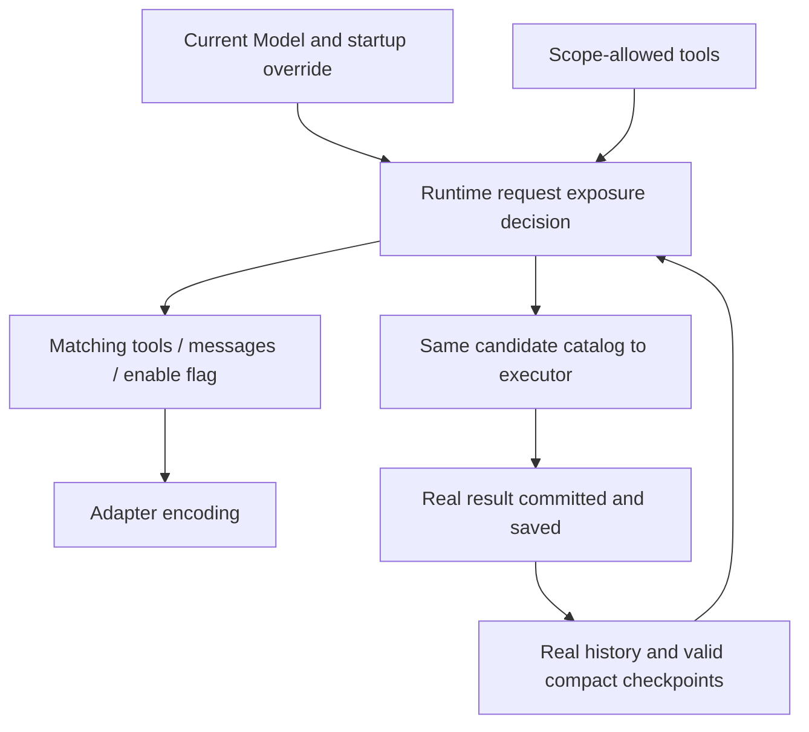

# ToolSearch: Enablement, Persistence and Cold Recovery

## App Settings mode

General settings provide `toolSearchMode: auto | local | off`, default `off`. `auto` picks Native/Local per request from the actual Model; `local` is fixed to Local and keeps the capability validation; `off` uses the full tool set. The CLI four-value argument and default Off are unchanged; the standalone CLI does not read App Settings.

The tool search settings row permanently shows an experimental note at the bottom: when the model provider does not fully support native ToolSearch, native mode may invalidate the cache and increase token usage. The Chinese and English copy have the same meaning and reuse the bottom-note area and theme text style of the settings row. The default Off does not override a user's saved Auto/Local choice and does not change when the setting takes effect.

```text
Settings -> Host SettingService / setting.json
  -> session/requestRuntimePreferences (runtime-materialization)
  -> runtimeConfig.toolSearch.mode fixed at create or cold recovery
  -> existing request projection, tool execution and subagent inheritance
```

A settings change writes only App settings and does not broadcast a runtime policy. Existing Runtimes (including pre-created drafts and hot resume) keep their value; new creation and cold recovery read the latest value. A fork inherits the parent Runtime policy, and subagents inherit through the existing chain. Local, desktop-attached remote and mobile shared-host use the same settings authority of the owning Host, adding no RPC, per-turn read, session mode persistence or database migration. A missing field in an old Host response is treated as Off. The delivery boundaries of desktop continuous and mobile replayable are unchanged.

Acceptance: read/write of the three values and rejection of illegal values; old settings/protocol default to Off; new creation/cold recovery read the new value, hot recovery is unchanged; fork/subagent inheritance; local/remote Host pass-through. The Desktop E2E saves through the real settings UI and checks the final provider wire: Off full, Auto using Native for Coding Plan and Local for ordinary providers, explicit Local search and wrapped calls succeeding, and after a change the current session keeps its old value while cold recovery projects existing references under the new value.

Verification status (2026-09-23): macOS Electron TS11 passed; app unit tests, Core regressions and CLI argument tests passed; two Bootstrap Cron denylist / Account Config failures reproduce on the original HEAD implementation. The CLI aggregate script lacks turbo, so package-level checks were used; existing max-lines lint errors are excluded by prior agreement. Not run: real phone device, Windows/Linux and real remote workspace; the remote Host has unit tests, and the new E2E stays pending and is not auto-promoted.

## Local ToolSearch and the three request projections

The only CLI entry is `--toolsearch-mode auto|native|local|off`; `--enable-toolsearch` and the old force value are removed with no alias kept. When the argument is not passed the default is off, and all providers use the full tool catalog. An explicit auto selects by the current actual Model: Coding Plan Anthropic uses native, other Models that support ordinary tool calls use local. An explicit native/local errors before sending when the capability is unsupported. The CLI startup override supports prompt/target/TUI/resume/continue, subagents inherit it, and it is not saved to the session or user config.

Native keeps native references and discovered deferred schemas; between two compacts Local sends a fixed set of resident tools, ToolSearch and DeferredToolCall, ordinary search never adds the target schema to tools; the discovery checkpoint of a successful compact promotes the currently allowed original deferred tools to ordinary tools of this context. Off sends the full catalog and hides the search control tools. With no deferred tools or with the search control tools unavailable, search is turned off and the reason is logged. `ModelRequest.toolSearchEnabled` represents only the Native protocol; enabling Local does not send beta/defer_loading/tool_reference.

Local expands consecutive references at the real result position from the same currently allowed Model tool catalog:

```text
reference A, reference B -> <functions>
<function>{"description":"…","name":"A","parameters":{…}}</function>
<function>{"description":"…","name":"B","parameters":{…}}</function>
</functions>
```

Expansion does not merge across results or intermediate text; order and Hook text are kept, and no empty container is output. Invalid references follow the existing remove/placeholder rules. The original history and `state.metadata.modelContent` still store real references, no schema snapshot and no repeated expanded body. The final projection takes part in token estimation, caching and media handling; the schema JSON is not truncated and no schema reminder is added. When definitions are unchanged, a new search does not change the old prefix; real changes of definition/permission/availability may change the projection.

Request preparation first scans the effective discovery set, then does the Native/Local/Off reference projection in one shared loop; Local no longer scans history separately after the generic filter. Unchanged entry/message/content reuse immutable references, and the corresponding result is copied only when a reference is removed or expanded. The Local schema encoding is reused per tool definition only within a request; different results keep their own containers and order; the next request re-reads definitions, introducing no cross-request cache or invalidation state. The announcement collection timing and the isolated copy of the final provider render keep the original contract.

`DeferredToolCall` input is strictly `{name: string, input: object}` and shares the outer callID. Only client-executed deferred tools allowed by the current request are accepted; resident, alwaysLoad, control tools and provider-native tools cannot be forwarded. A resident target returns an ordinary tool error hinting to call it directly, without executing the target Hook/approval/handler. "Not searched" is not an execution ban; an ordinary direct call keeps the existing rules. After unwrapping, the wrapper reuses the scheduling, validation, permission, Hook, timeout, cancellation, background task, result format, media and turn-stop of the ordinary call and does not recursively run a second executor.

```text
original wrapper call -> common admission -> target call with same callID + modelCallWrapper mark
                       -> internal history / ordinary scheduled execution / target events / SQLite
SQLite -> hydrate target call and result -> restore original wrapper at request render -> Model
```

Internal calls and results uniformly use the target name; the wrapper mark is only `modelCallWrapper: "DeferredToolCall"`. The target part stores this strict literal in metadata from pending on, with `tool` / `state.input` storing the original target name and inner arguments; re-store, history copy and branch recovery must preserve it. Execution arguments are isolated from history, and Hook, approval and handler must not modify the original history input. The wrapper input is not stored twice; the development-stage old modelToolCall format is deleted with no compatible reading or data migration. A failed admission stores only a wrapper failure record. Request rendering restores the wrapper call and result name within the existing traversal and strips internal marks; no new history scan or callID cache is added. Business judgments such as Todo use the internal target identity directly; microcompact classifies by sourceEntries and still estimates tokens with projected messages. V4 finalizes the tool row with the scheduled target event, and a late raw stream must not overwrite an already finalized input; desktop continuous and mobile replayable use the same target row and do not unwrap in each UI consumer. After a complete call the stream may drop without a scheduled event; V4 then consumes the existing tool_call_closed and, only while the row of the same callID is still DeferredToolCall, fills the display identity with the Core-confirmed target name and complete input. It does not add a tool row, reset state, or update Todo/approval/execution state early; ordinary rows, failed admission, missing input, other ledger states, expired turns and subagent mirror events in the parent session do not take part in the fill. Repeated events do not update repeatedly. The raw model stream, argument preview and Core scheduling timing are unchanged, with no incremental JSON parsing and no inferring permission from display data. Tool name, input and inputText are delivered in the same full row upsert, and cold recovery is still rebuilt from the persisted target part. No database column or migration is needed. Native/Local/Off switching changes only the request projection, keeping original results, announcements and wrapper calls, and does not fabricate direct calls. Compact stores discovered names and rebuilds the name announcement; Local promotes the currently allowed tools with a valid checkpoint, and references in the kept tail continue to be projected, without synthesizing search results. Both the direct and embedded allowlists of Explore include the search control entry and keep the original target tool scope; a custom scope lacking the control entry still turns search off under the existing rule. A pure Continue does not refresh the announcement. Desktop continuous and mobile replayable keep the original delivery boundary.

Acceptance covers multiple references and mixed text, six-way mode switching, scope/classification changes, direct vs wrapped execution comparison, concurrency/cancellation, real SQLite reopen and fork/rewind/compact recovery in a new Runtime, the final wire and stable prefix. Simulated provider tests do not equal verification of real model capability or cache hits; no test-only production entry is added.

### Verification summary (2026-09-22 / 2026-09-23)

- Boundary normalization (historical mark loss, duplicate input persistence, wrong product tool identity) was reproduced first, then fixed in the common boundary. Targeted regression passed (43 files, 678 items), including real SQLite reopen, fork/rewind, argument modification isolation, Todo reminder, microcompact and continuous/replayable projection. macOS Local CLI/PTY E2E 5/5 ran against real Anthropic/OpenAI HTTP requests (wrapper correction, successful execution, compact metadata, cold recovery, mode switching); Desktop default Off and cold recovery passed. An old "result only" assertion cannot prove that a tool executed successfully; completed assertions are required.
- Initial Local verification: targeted Core/Adapter/Bootstrap 40 files, 514/514; macOS WDIO merged batch 34/34 (new Local CLI/TUI specs stay pending, no new Docker admission). Root and CLI typecheck, architecture check (0 violations) passed.
- Known baseline failures not caused by this feature: two CLI provider registry cases and five non-ToolSearch Core failures reproduce on HEAD; the CLI full suite is not green (CUA lacks the adjacent producer checkout; other provider/bootstrap/packaging cases); CLI lint has existing max-lines failures; the CLI top-level script lacks turbo, so package scripts were used.
- No real cache usage evidence exists: a real third-party Anthropic/OpenAI attempt was refused (ECONNREFUSED). Fixed tools/history prefix assertions do not represent server cache hits.
- Not run: Windows/Linux, mobile real relay, Desktop Local wrapper approval UI; mobile verification stops at the protocol projection. No UI style, tool permission, database structure change or test-only production interface.

## Boundaries and owners

Native mode uses the tool reference protocol. Default off; the selection rules of explicit auto/native/local are above. The Runtime uses the mode fixed at startup, subagents inherit it, and it is not written to the session; the sources of App settings and the CLI override are above. When there are no deferred tools or a necessary control tool is disabled, the full definitions are restored and the reason is logged. MCP keeps its existing initialization; async readiness, search waiting, OpenAI native references, auto:N and automatic reinstallation of historical calls are not implemented.



The Registry stores the full tools and the Runtime is the sole owner of the request decision. Candidates are filtered by Model, visibility, allowlist/denylist and main/sub scope. Uncommitted/cancelled/discarded results do not become discovery facts. Changing the Model rebuilds the request; a request in flight is not rewritten.

### Standalone request preparation step

`prepareRuntimeProviderRequest` is the shared entry where the main/sub Agent, Goal verifier, Memory Extraction/Dream and Compact assemble real requests. Internally it runs ToolSearch preparation once, then calls the existing message projection; media capability, aggregate budget and each entry's execution/retry flow stay independent.

```text
this Model / startup policy / scoped full tool catalog / raw entries
  -> ToolSearch: enable decision, discovery set, schema and history reference/announcement projection (generates no new announcement)
  -> message projection (keeps latest real user attribution, appends verification/summary prompt as needed)
  -> matching request { messages, tools, toolSearchEnabled }
  -> existing media policy -> Adapter
```

- The caller must provide the full candidate catalog not trimmed by deferred; the old location no longer prepares repeatedly. The Registry only completes the metadata of candidate tools and does not widen permission or scope.
- Message projection no longer guesses ToolSearch state from the Model or startup config; display/record/estimation-only projections do not run search preparation.
- Goal degrades automatically with an empty tool catalog; Memory uses the catalog at scheduling time (without ToolSearch), keeps the original model/startup override boundary, and later loops reuse the prepared tools and enable flag. Compact keeps its own candidate policy.
- The interface capability validation of explicit native/local runs before sending; the override is not spread to auxiliary calls that did not inherit the flag.
- The prepared result contains the search context used by the executor, generates or returns no new announcement, and writes no history, DB or global state. Request projections of Compact/Memory/Goal are not written back to Main.
- History references, valid compact checkpoints and announcements must be handled before internal metadata is removed. Async consumers fix history members and the Model snapshot; degradation does not modify canonical history and builds no separate discovery cache.
- A same-model transport retry reuses the matching request; switching Model or reselecting compact history rebuilds from raw input.
- Regression covers first no-discovery, permission/catalog changes, repeated-preparation regression, announcement order and raw-history isolation; real SQLite/runtime verifies that after search a Goal judged incomplete does not fail-open to complete, and checks Memory multi-round requests, Compact fallback and the existing cold recovery/provider switching. The Desktop continuous and mobile replayable persistence/event delivery boundary is unchanged.

## Tools and protocol

Model requestCapabilities.toolSearch stores protocolSupported/defaultEnabled; requests carry toolSearchEnabled. ToolMetadata adds shouldDefer/alwaysLoad/searchHint; request tools add deferLoading; model content adds the strict `{type:"tool_reference",toolName:string}`.

Built-in resident list: Agent/AskUserQuestion/Bash/Edit/Glob/Grep/Read/ReportFindings/Skill/ToolSearch/Write. Only tools currently registered, allowed by scope and passing the original visibility rules are exposed; there is currently no ReportFindings implementation, and no tool is added because of the list. All other registered built-in tools declare shouldDefer: true in their own metadata, including the ZCode workflow tools (with FillWorkflowHole), ReplyToChannel, OffPeak, TodoRead, CronUpdate, js and subagent collaboration tools. The Task compatibility entry stays providerVisible: false and does not enter the request or search catalog because of the deferred classification. When ToolSearch is not enabled the full tool set is kept; when enabled the first turn sends only resident definitions, and after real search discovery the corresponding deferred schemas are added (Native); Local expands definitions at the real result position and calls through DeferredToolCall. Permission, execution, gradual rollout and embedded search filtering are unchanged. MCP defers by default and supports server alwaysLoad and `_meta["anthropic/alwaysLoad"]`, `_meta["anthropic/searchHint"]`. This metadata is neither authorization nor official trust. Provider-native tools keep the existing protocol.

Acceptance uses the real built-in registration catalog (including dynamic factories, typed submit_result and the js branch): check the first-turn tool list, that the announcement contains the other allowed tools, that after executing ToolSearch the next request carries the corresponding schema and deferLoading, that disabling ToolSearch restores full definitions, and that the Task compatibility entry still does not enter the model catalog.

Plugin `.mcp.json` and manifest server `alwaysLoad` are parsed and passed through uniformly by the plugin config converter, covering stdio, ordinary HTTP/SSE and official authenticated HTTP branches; only booleans are accepted, false is kept, and unconfigured or non-boolean values stay undefined per the plugin optional-field rule, with no string truthiness conversion. The field only controls schema exposure in model requests and does not change MCP initialization, async readiness, authentication or permission. Regression covers each config source/transport and the real chain of plugin discovery -> MCP tool list -> registration -> request preparation -> Anthropic wire: with no search history, resident tools have the full schema without defer_loading, and default tools are still deferred.

The App's `ZCodeAgentMcpServer` type and existing config conversion functions must pass through a boolean `alwaysLoad` in stdio/HTTP/SSE, keeping false; a missing or non-boolean value outputs no field, with no truthiness conversion. Regression verifies the JSON round trip and strict protocol schema from the App conversion entry; the Agent receiver keeps the existing pass-through. The current App callers are the MCP settings page connection/status queries; no MCP DTO injection is added for ordinary session creation; persistence, MCP initialization, Desktop continuous and mobile replayable boundaries are unchanged.

Input `query:string`, `max_results?:number` (default 5, no extra integer range); supports `select:A,B`, canonical/alias, MCP prefix, keywords and `+required`. Direct selection is not truncated; keywords search deferred only, and exact names can select resident tools. The JSON Schema for the model marks both `query` and `max_results` as required; the runtime schema still accepts an omitted `max_results`, following the existing execution chain: fill the default 5 first, then validate the JSON Schema. The declaration is completed only on the ToolSearch exported schema, without changing the generic converter or other tools; wire and executor are verified separately. Search generates results by tokenization, weights, stable sort and dedup. Output `matches/query/total_deferred_tools`; the successful model result is ordered references, and an empty match is text. Read-only, concurrency-safe, no external side effects, reusing the permission/Hook/trace/budget/cancel chain. "Not searched" is not an execution ban; a parameter validation failure of an undiscovered tool hints to search and load the definition first.

The `metadata.searchHint` of built-in deferred tools uses the following retrieval material, without changing provider description, parameters, ranking weights or resident tools; MCP keeps its own searchHint.

| Tool          | searchHint                                                  |
| ------------- | ----------------------------------------------------------- |
| WebFetch      | fetch and extract content from a URL                        |
| WebSearch     | search the web for current information                      |
| TodoWrite     | manage the session task checklist                           |
| EnterPlanMode | switch to plan mode to design an approach before coding     |
| ExitPlanMode  | present plan for approval and start coding (plan mode only) |
| TaskOutput    | read output/logs from a background task                     |
| TaskStop      | kill a running background task                              |
| SendMessage   | send messages to agent teammates                            |
| CronCreate    | schedule a recurring or one-shot prompt                     |
| CronList      | list active cron jobs                                       |
| CronDelete    | cancel a scheduled cron job                                 |

Native sends the full schema of resident and discovered deferred tools, with only the latter deferLoading; other tools are announced by name only. Add/remove announcements are appended only when the catalog changes. Turning off removes ToolSearch/DeferredToolCall/announcement/fields, deletes reference blocks, replaces an empty result with `[Tool references removed - tool search not enabled]`, and keeps the call/result pairing. When on, unavailable references are deleted and an empty result uses the tools no longer available placeholder. All deletions apply only to the request projection. The Adapter natively outputs tool_reference/tool_name and defer_loading, forbids JSON stringification, attaches the advanced-tool-use-2025-11-20 beta when on, and does not use server-side search. Media/cache/token estimation consume the same final projection.

The result budget aligns with reference block semantics: for a text/reference array containing a real `tool_reference`, the 100 KB budget limits only the text, and references are fully kept in unchanged order. The same projection is used after the first serialization and after a Hook append; when text exceeds the limit a truncation hint is given, and the reference array must not be degraded into a tool-name string. Display text derives from the final blocks, and byte accounting still counts tool names under the existing text serialization measure, so the exemption of references from truncation does not under-count; `truncated` reflects only actual text trimming. The budget contract of ordinary text, media and official CUA is unchanged. `max_results` or `select:` is not tightened: a large catalog result can still contain many references, and the corresponding schemas enter later requests. Acceptance covers real executor output over 100 KB, over-long Hook text, the final Anthropic wire, and atomic completed part saving with real SQLite cold recovery.

<a id="模型可见文案"></a>

### Model-visible copy

The Native ToolSearch description, query/max_results parameter descriptions and the name add/remove/restore announcements use fixed copy. No model judgment, experimental config or runtime state is added.

- The Native description keeps the model-side schema expansion note for `<functions>` / `<function>`; the client still sends real `tool_reference` and does not synthesize XML or tool call/result.
- A new-addition announcement lists the full names; a restore announcement summarizes names and counts per MCP server, and other tools keep their original names.
- A removal of at most 30 names is listed line by line, beyond that it is summarized in the same way; an ambient-context hint is appended after the removal section.
- Announcement sections are separated by blank lines, using the `<system-reminder>` wrapper and the existing incremental metadata.
- Restore/removal announcements describe only availability within the current scope and do not infer causes such as MCP disconnect or reconnect. A tool temporarily hidden by this turn's restrictions is still announced under the existing incremental logic; an identical catalog is not appended again. No pending/failed/authentication diagnostics, async initialization or search waiting is added.
- Only the copy rendering changes: `incremental fact -> copy -> existing commit/snapshot/request projection`; a pure Continue generates no announcement. Persistence, App protocol, Desktop continuous and mobile replayable delivery boundaries are unchanged.

The first sentence of the Local description states that deferred tools are called through `DeferredToolCall`; the search and return format notes keep the original `<functions>` / `<function>` structure and state that `parameters` describes the `input` of the wrapper call. It no longer claims the same encoding as the tool list at the top of the prompt and no longer uses the abstract classification note. Resident tools are still called directly. Only one short TodoWrite `<example>` is kept, showing top-level `name` and the full `input`, with no scenario dialogue or `<commentary>`; already loaded tools need no re-search. The example is validated against the current wrapper and target tool schema; CLI/PTY E2E checks the actual description in Local/auto and cold recovery requests, and the full Native copy is protected by existing wire tests. Only the Local description changes; result projection, call arguments, execution logic and repeated-search feedback are unchanged; the benefit to bench behavior needs separate verification.

The search corpus uses the final description, projected through the model contract and including modelInstructions. A second search corpus is not built for differently named interfaces. Existing tool descriptions are not rewritten here; for example TaskOutput already uses the corresponding description, while Cron keeps its description of ZCode-specific behavior such as persistent automation.

Verification fixes the full description/parameter notes, and the add, single/multiple restore, MCP grouping, 30/31 removal names and mixed add/remove bodies; real Runtime -> Anthropic wire checks the copy and continuation dedup, continuing to reuse compact/SQLite regression.

Copy verification (2026-09-17): old-copy failures were reproduced first, then 10 files / 55 items passed; a standalone comparison with the extracted CC original function showed an identical default description and 120 groups of announcement bodies (repository tests do not depend on local CC files). Desktop/mobile E2E and a real remote provider were not re-run.

With compact on, Read/ToolSearch/MCP candidates are re-filtered; with it off the existing summary strategy is kept and no new summary execution loop is added. The branch must satisfy the current Model/flag, ToolSearch available among candidates and the existence of deferred tools; when ToolSearch is disabled or all candidates are alwaysLoad, the original threshold applies to the ordinary tool catalog (ToolSearch not counted): at most 100 keeps full definitions, more than 100 sends an empty tool catalog. Regression checks the actual Runtime compact request.

### Announcement collection and continuation timing

Announcements keep the attachment collection boundary and are committed by the Runtime history owner; request projection consumes only existing announcements and must not append reminders while preparing each request.

```text
normal input / full tool batch -> collect and commit announcement -> copy raw request snapshot -> request projection
pure max-token Continue -> reuse snapshot, append Partial / Continue -> request projection
Compact success -> rebuild announcement from kept history -> replace context -> later requests
```

- The normal reminder stage skips output-token recovery like Todo; the announcement first enters canonical and turn-local history, then requestEntries is copied. A pure Continue does not call the announcement generator and existing announcements stay with the snapshot.
- When the catalog changes during a pure Continue, add/remove announcements wait for the next normal collection; per-request schema, reference, permission and enable judgment still run. MCP pending/failed/authentication states are not extended.
- After a successful summary Compact calls the same pure announcement generator: full uses empty kept history, and a tail-keeping compact compares with preservedEntries. The announcement joins postCompactReminderEntries; failure, cancellation or skip does not commit. Auto/Reactive triggered during Continue rebuild likewise and do not wait for the next normal reminder collection.
- The Compact announcement reads the tool catalog that continues to run and must not use the candidate tools trimmed by the summary request. The internal getContinuationTools callback reuses this turn's tool scope filter; manual compact uses the current Runtime/Model. The summary tool policy is unchanged and no second state is created for the scope.
- Announcements remain derived reminders in in-memory history, with no new persistence field; rebuilt at the first normal collection after a cold start. Discovered tools are still restored only from real references and compact checkpoints; P/C, App protocol and multi-end delivery boundaries are unchanged.
- Regression captures the real Runtime Model requests and canonical history: three consecutive continuations and the next input each carry only one first announcement; catalog change, normal tool batches, full/tail-kept/during-continuation compact, failure/cancel, scope, provider switching and SQLite cold recovery keep this boundary, covering streaming on/off and the final adapter request body.

### Announcement incremental record

`RuntimeMessageMetadata.toolSearchAnnouncement` records only the facts of this announcement:

```ts
toolSearchAnnouncement?: {
  addedNames: readonly string[];
  removedNames: readonly string[];
  readdedNames: readonly string[];
};
```

The three arrays are always present, deduplicated and sorted; readdedNames is a subset of addedNames. No full catalog snapshot or addedLines is stored; the fully listed names are addedNames − readdedNames. History copy copies the three arrays separately and must not share mutable references.

```text
currently kept incremental announcements
  -> sequential added / removed -> currently announced available A
  -> merge added - readded -> once fully listed L
current scope: all tools T, deferred tools D
  -> added = (D - A) ∪ (D - L)
  -> readded = (D - A) ∩ L
  -> removed = A - T
  -> same computation generates body and metadata
```

Normal collection and compact use the same generator and scan only the currently effective history. The body renders per the model-visible copy above, a restore can use a separate hint; name facts still come from the incremental sets, and state is not derived from the announcement copy. No change means no announcement is committed.

Bug root cause: the old metadata was the full catalog but the body listed only increments, so when compact kept the later one it wrongly assumed old names were still in context; the old removal judgment looked only at the deferred set and would announce still-resident tools as unavailable. Incremental facts support tail re-listing, removal looks at the full tool pool, and deferred → alwaysLoad → deferred does not misreport.

The announcement body and incremental metadata are persisted with the hidden synthetic message/text part using the existing JSON metadata, with no new DB column, migration, session cache or announcement checkpoint. Normal collection saves the announcement first, then commits Runtime history and the request snapshot; a pure Continue adds no announcement. An announcement rebuilt by Compact is saved with the successful history replacement, and rolled back together with the summary on failure. Fork/resume/rewind follow the effective branch and compact boundary, restoring the announcement body and strictly validated incremental fields in place, and do not re-announce unloaded tools when the catalog is unchanged. The announcement connects to the tool_search_announcement attachment/MCS, using a user reminder when unsupported, hidden from UI/transcript; turning ToolSearch off hides the announcement only in the request projection and does not delete stored facts. The real modelContent and preCompactDiscoveredTools are unchanged. Announcements not stored in old sessions are not backfilled or inferred from search results and still follow the original first-collection rebuild; this change does not extend compatibility.

```text
normal collection / compact success → announcement body + incremental metadata → existing Session Store
                                                     ↓ effective branch / fork boundary
next request ← derive increment from announcement ← hydrate restores body + metadata in place
```

Regression uses real SQLite: close and reopen the database, create a new Runtime, covering search-then-fork/cold recovery, recovery after compact, announcements after a boundary not inherited, provider projection off, and three Continues with no duplicate announcement. Acceptance covers add/remove/restore/restore-only announcements, incremental tail and consecutive compact actual Model requests, history copy isolation, and uses the real built-in catalog to verify checklist/cancel/active and +required hits. A temporary CC pure-function differential check does not become a repository runtime dependency; the Desktop continuous and mobile replayable boundaries are unchanged.

Verification (2026-09-17): the new contract failed on the old implementation first, then passed; widened ToolSearch, continuation, compact, main/sub scope and wire regressions passed except the Explore background completion notification test `can launch Explore in the background and inject completion on a later turn` (`subagent-explore.test.ts:4424`, expects no system-reminder wrapper), which fails identically on the pre-change source and was not touched. The production announcement generator and the extracted CC functions agreed in all 52,488 comparisons over 729 three-step state sequences, kept-history suffixes and successor catalogs (this does not cover the enable switch or MCP diagnostics). Existing Desktop TS01/TS04 search, execution and cold recovery smoke tests passed; real provider and mobile UI were not re-run; App/remote protocol unchanged.

## Persistence and recovery

No SQLite column/migration change. The terminal part's `state.metadata.modelContent` optionally stores an ordered text/reference array, upserted together with completed; schemaVersion stays 1. `output` is display text, media keeps attachments/layout. `loadedTools` or schema is not stored separately. The final model content after existing result processing is saved. Public metadata parsing is also used for error parts and must keep compatibility with the existing string modelContent, so V4 transcript cold recovery does not drop the display in the same metadata. ToolSearch writes and hydrate still accept only strictly validated text/reference arrays; strings and failed results produce no discovery record. Cold hydrate first selects the active branch/valid compact, restores by callID/declaration order; valid modelContent takes priority, missing/corrupt falls back to media/output, and corruption records a diagnostic. Interruption/failure produces no discovery; references are not cleaned up early for the current provider.

Compact merges real discovered names from the raw effective history and the previous checkpoint and writes the existing preCompactDiscoveredTools, also saved while off. Only a successfully effective boundary takes part in recovery. Live/cold use the same function to attach boundaryId/discovered names to the internal metadata of the summary entry, not into the body and not fabricating calls. Copy/rewind/fork keep the metadata and do not scan abandoned branches. A request takes the intersection of discovered names and currently allowed deferred tools and uses the current schema; a discovery record does not guarantee the definition is still expanded in context.

## Search result hint and announcement projection (2026-09-24)

This round only adds the success hint, parameter error guidance, announcement reminder projection and MCP short-name selection. The definition snapshot, historical schema retention of unavailable tools and their cache stability are deferred to a separate implementation; no metadata field or migration is added, and current schema/reference filtering, enable conditions, execution catalog and permission are unchanged.

```text
real ToolSearch result → Native reference filter → valid result callID → Tool loaded. outside the result batch
                   → Local expansion → Loaded guidance inside the result / already-loaded reminder
normal announcement collection → raw attachment + incremental metadata → persistence/recovery → MCS or user reminder
```

For each Native search result that succeeded and still has valid references after projection, one `Tool loaded.` is derived, placed outside tool_result, after the whole batch of results. Local uses only the load and call guidance inside the result and appends no external hint (see the per-item feedback contract below). The hint is not written to canonical history or the database; it is not generated for Off, errors, no match and all-references-invalid. It reuses existing reference and message traversal, keeping the media real-user index, sourceEntries and cache marks. When Continue and compact rebuild request records after filtering query-local Continue, they reuse the valid result callID set already computed by this reference projection; the position and number of success hints agree with the actual request, with no re-scan of references or persisted hints. Regression checks the actual Model request, the ModelRequest event and the main-turn state snapshot together, keeping the rule that Continue does not enter records.

When parameter validation fails and the target is a currently undiscovered deferred tool, a full correction paragraph is appended after the original error with a blank line: it explains that the definition is not yet in the discovered set and that arrays, numbers and booleans output as strings cause parameter validation failure; then it gives the exact `select:<canonicalName>`, retry guidance and the current full input schema. Native uses the common paragraph; Local keeps the DeferredToolCall call note on a new line at the end of the paragraph. Regression asserts the full paragraph and its concatenation with the original validation error, not just keywords. "Not searched" does not become an execution ban; discovered/Off/nonexistent tools keep the original errors.

Announcements participate in the existing MCS projection as the `tool_search_announcement` attachment source; when unsupported, a plain system-reminder is output. The body is stored only once and the incremental metadata is kept through cold recovery; only old synthetic announcements with valid announcement metadata are adapted, and user body is not inferred. An announcement lists names only, loads no schema, and introduces no tool_addition, nameOnlyAnnouncements or strippedReferences. Continue does not collect, and the timing that only a successful compact rebuilds is unchanged.

select prefers canonical/alias, then matches the MCP raw short name and the short name normalized by the existing naming rules; multiple servers all match and dedupe in catalog order, without copying the normalization rules or changing ordering, count or scope.

Acceptance covers the final wire hint, mixed/parallel/invalid references, mode switching, MCS/non-MCS, real SQLite cold recovery and Continue/compact, nonexistent tool errors, MCP same-name/alias conflicts. Desktop continuous and mobile replayable delivery boundaries are unchanged; UI, auto-compact estimation and the MCP connection lifecycle are not modified.

## Impact and acceptance

### E2E formal admission (2026-09-18)

The user confirmed that this and the previous 8 ToolSearch specs are promoted (29 items: 7 Desktop, 14 CLI/TUI, 8 Runtime/HTTP integration). Original assertions and execution entries are kept, production implementation is unchanged, and no test-only production interface is added.

Model responses move to a case-local provider fixture of each spec, and the manifest request list mirrors the fixture id and metadata item by item. The Desktop data-plane proxy and the CLI's isolated HTTP server must actually read these responses; merely keeping an unconsumed fixture does not count as replay. Stage selection for dynamic catalog, error/cancel and streaming on/off continues to be orchestrated by the original test harness, the fixture owns only the response content; an unknown response id fails directly with no fallback.

```text
real UI / CLI / PTY / Runtime input → original test harness identifies request stage
    → case-local fixture responds as is → product tool execution / SQLite / request projection
    → existing HTTP, UI and raw history assertions
```

After the transactional audit of fixture check, promotion dry run and apply, they enter the formal direct-root directory, the default E2E acceptance runs and references are updated. The existing document index and generated statistics required for admission are corrected, without loosening audit rules. The Docker preset still needs extra container isolation verification; this local promotion is not automatically equal to Docker admission.

### Unit test completion contract (2026-09-18)

This round adds only tests and docs. No E2E/unit test may modify production implementation, add test-only switches, exports or injection entries for testing; reuse the existing executor, Hook, ModelFactory and SessionStore contracts. A found product defect is recorded as a failure, and production code is not changed or assertions loosened to make tests pass.

| Scenario                           | Must assert                                                                                                                                                                                                                  |
| ---------------------------------- | ---------------------------------------------------------------------------------------------------------------------------------------------------------------------------------------------------------------------------- |
| Execution boundary                 | A legal call to an undiscovered deferred tool still executes and generates no discovery; a discovered tool's parameter error no longer hints to search; with search closed or search context missing ToolSearch fails with no references |
| Hook result cold recovery          | After real search with PostToolUse appending text, the final ordered references/text are saved together with completed; after closing SQLite and hydrating in a new Runtime, callID/block order is kept, and the first request carries native references and the discovered schema; covers streaming on/off |
| Search fine-grained input          | Tokenization of explicit MCP metadata, intersection of multiple required terms, regex special characters matched literally, full ranking and truncation of name/hint/description competition                                  |
| All references invalid while on    | With ToolSearch kept on and all targets removed from the result, an empty result uses the tools no longer available placeholder; call/result pairing is kept, raw history and discovery facts are unchanged                 |

```text
real ToolSearch → PostToolUse text → existing result processing → completed part / SQLite
    → close database → new Runtime hydrate → references / schema of the first Model request
```

Tests orchestrate only Model responses and existing dependencies and do not replace result processing, persistence or hydrate implementation; the App protocol, Desktop continuous, mobile replayable and earlier E2E acceptance boundaries are unchanged.

This round added 16 unit tests (4 test files); together with ToolSearch, adapter wire, generic executor, hydrate, message history and Memory scope regressions, 19 files / 275 items passed. Line coverage of search-related collected files is 100% and branch coverage 97.09%; this number does not represent repository-wide coverage or that all feature branches are covered. Root typecheck, lint (0 errors, 43 existing warnings), lint of the new tests, format and architecture checks passed. The CLI aggregate typecheck could not start because turbo is missing in the current environment, so the workspace ran `typecheck` of each CLI package recursively, all passed. E2E was not re-run in this round; earlier E2E evidence and platform boundaries are unchanged.

A codegraph scan was not run (tool unavailable); sources of CLI/bootstrap/runtime/executor/adapter/storage/hydrate/compact/subagent were checked by hand. App/TUI reuse the display with no new setting/queue; Desktop continuous and mobile replayable use the original chain, and workspace identity isolation is unchanged.

| ID   | Accepted scenario                              | Assertion                                                                  |
| ---- | ---------------------------------------------- | -------------------------------------------------------------------------- |
| TS01 | First search and call                          | First turn has no undiscovered schema; native reference and later definition match |
| TS02 | Auto/force/provider switching                  | on/off/on keeps the original history; force on an unsupported interface errors |
| TS03 | Reopen SQLite/runtime after search             | callID/block order/next-request definitions are consistent                 |
| TS04 | Cold start after compact while on or off       | Valid boundary restores discovery                                          |
| TS05 | rewind/fork/permission/catalog change          | Abandoned branches and unavailable tools are not exposed                   |
| TS06 | Cancel/concurrency/old records/bad fields      | No ghost discovery, compatible old recovery                                |
| TS07 | CLI entries and restart                        | The flag takes effect this run; a restart does not bring back auto         |
| TS08 | Desktop/mobile                                 | Existing display and delivery boundaries unchanged                         |

Tests first, then code. Real SQLite reopen, a new runtime and the final request body are the recovery acceptance surface. Real Coding Plan, force on non-Coding-Plan Anthropic, and Desktop E2E record their evidence separately, and mocks are not passed off as live. Run the affected unit tests, typecheck, lint, format, architecture and related E2E; formal cases follow the pending/review/promotion flow.

Memory Extraction / Dream keep the existing restricted execution policy; ToolSearch is outside their executable scope: requests keep the full ordinary tool schema and degrade references in inherited history at request level without modifying Main history.

## Implementation verification summary (2026-09-15 to 2026-09-18)

- Plugin MCP alwaysLoad pass-through fix: a regression reproduced the lost boolean (actual Anthropic request lacked resident tools); after the fix the plugin source/transport matrix and the local real HTTP MCP -> Anthropic wire chains pass (8 files / 113 items). No UI/protocol, database or MCP initialization change.
- Request preparation refactor: reproduced with real SQLite/runtime and Adapter message conversion (after search a tool-less Goal verifier errored and the goal was fail-open saved as complete); after moving to the shared preparation entry the goal stays active with real references and callID unchanged. Core regressions 20 files / 426 items and Adapter wire/capability/MCP 9 items passed.
- Announcement timing fix: announcement counts for the first request, three Continues and the next input were `[1,1,1,1,4]` before and `[1,1,1,1,1]` after the fix, with one announcement in canonical history; streaming on/off, native Anthropic wire body and SQLite reopen verified.
- Initial capability verification: tests for search semantics, exposure decision, concurrency/cancel, subagents, SQLite cold recovery, MCP metadata, native wire body and CLI entries. Core related regression 275 of 276 (the only failure is the original Explore background notification wrapper assertion, also failing on HEAD); Adapter 42/42; CLI 182 of 184 (two provider registry assertions also fail on HEAD). Real network closed loop with BigModel Coding Plan API (GLM-5.3, auto on) and ZAPI Anthropic (GLM-5.3, CLI force on) succeeded: SQLite shows completed ToolSearch, native TodoWrite reference and completed TodoWrite, with isolated config.
- Pre-commit review (2026-09-17): ToolSearch / MCP / transcript hydration 15 files, 138 items and shared MCP config 18 items passed; Desktop TS01/TS04 smoke passed with a mocked provider (not counted as real network verification); real BigModel Coding Plan auto-on and ZAPI Anthropic forced-on re-run succeeded. Repo-wide format and CLI lint baseline problems are not part of this change.
- E2E completion boundary (2026-09-17): real CLI process and Desktop request-level acceptance follow the TS sub-scenarios of the root `docs/testing/conversation-session-e2e-coverage-matrix.md`. Cold recovery checks the first request; a provider-degrade request must also be captured and must not be filtered by "contains the ToolSearch schema", which would miss the off branch. The test provider only orchestrates responses and injects no Runtime history or discovered set. 6 specs, 20/20 passed (19 new scenarios) with a controlled provider; later added 1 TUI PTY item and 8 Runtime/HTTP integration items for catalog/consecutive compact/classification change (streaming on/off). macOS formal WDIO merged regression 29/29; Windows native process batch 22/22 (14 CLI/TUI E2E + 8 integration), which does not represent the Windows Electron GUI. Current gaps follow the root coverage matrix. Only the test directory constructs a dynamic catalog through registry injection; no MCP hot update product capability was added.
- E2E promotion (2026-09-18): this and the previous 8 ToolSearch specs moved into the formal directory after the fixture/check/promote transactional audit; the formal default E2E entry passed 29/29. Model responses were actually read from 8 case-local JSON files; stage selection and cancel timing are still driven by the original harness. Only tests and docs changed. No new Docker admission.
- Re-run Desktop pending E2E (historical command, spec now promoted):

```bash
ZCODE_E2E_MANUAL_REVIEW=1 pnpm --filter @zcode/desktop test:e2e -- --spec test/e2e/conversation-session/manual-review/pending/conversation-session-toolsearch.test.ts
```

<a id="local-逐项反馈与-compact-后提升"></a>

## Local per-item feedback and promotion after compact

Local judges in current effective history order whether a definition is already visible, comparing canonical names and not requiring consecutive searches. Real user input and other tool calls do not clear the loaded set. All searches in the same assistant batch use the set before the batch and do not treat parallel sibling results as already delivered to the model. A future result cannot change earlier feedback backwards.

| Search result                          | tool_result projection                                         | After result batch |
| -------------------------------------- | -------------------------------------------------------------- | ------------------ |
| A, B both unloaded deferred            | A, B schema + merged Loaded call guidance                      | no hint            |
| A loaded deferred, B unloaded          | B schema + B Loaded guidance + A already-loaded reminder       | no hint            |
| A, B both loaded deferred              | merged reminder, no duplicate schema                           | no hint            |
| A resident (incl. compact promotion)   | A schema, still called directly                                | no hint            |
| A resident, B loaded deferred          | A schema + B already-loaded reminder                           | no hint            |
| Error, no match, all references invalid | original text/error/placeholder                               | no hint            |

All Local feedback is inside tool_result and no longer derives an external `Tool loaded.`; Native still appends that hint after the whole batch of tool_result for valid successful results. The existing reference projection collects the external success-hint callIDs for Native only, and the actual request, Continue and compact record rebuild share the same set; discovery set, success state or persistence are unchanged. The reminder is deduplicated once by name within the result and says the definition is already visible and that execution uses `DeferredToolCall {name,input}`; the search itself does not execute the tool. The reminder text uses the common `<system-reminder>` wrapper and still belongs to the current tool_result, generating no attachment or standalone system message; the MCS switch does not change its position, role or the `Tool loaded.` rule. When a deferred definition is actually expanded for the first time, one call guidance is also appended after the functions content of the same tool_result:

```text
<system-reminder>
Loaded: TodoWrite. Call it now with DeferredToolCall {"name":"<tool name>","input":{...}}, using the exact tool name and filling input according to its schema above. No additional ToolSearch is needed before calling these tools.
</system-reminder>
```

Multiple newly added tools change only the opening to `Call them now`, the rest of the template is the same:

```text
<system-reminder>
Loaded: TodoWrite, WebFetch. Call them now with DeferredToolCall {"name":"<tool name>","input":{...}}, using the exact tool name and filling input according to its schema above. No additional ToolSearch is needed before calling these tools.
</system-reminder>
```

The names include only the deferred tools actually expanded this time, deduplicated in reference order and merged into one; the `input` placeholder must be filled per the corresponding schema. Resident, compact-promoted, invalid references and failed results produce no such guidance. A mix of new and old results gives the guidance for the new definitions first, then keeps the original already-loaded reminder; a purely repeated result has only the already-loaded reminder and no `Tool loaded.`. It is derived only in the existing reference projection, with no new history traversal or persistence field; it does not accumulate across later requests, Continue and cold recovery re-projection. The copy guides the next step directly but does not auto-issue a call and does not promise the definition never expires. Native/Off are unchanged. Consecutive new definitions share the functions container, without merging across text or results; Hook order is kept, and success of loading cannot be judged by matching functions text in a Hook. Resident exact names, alias and select selection still return schema normally; keywords search only the current deferred classification.

```text
effective history -> discovery scan (discovery set + compact checkpoint)
         -> current scope classification (Local promotes original deferred inside the checkpoint)
         -> reference projection (visible set before batch -> schema + Loaded guidance / already-loaded reminder)
         -> request render / Continue / compact record rebuild
successful compact -> new checkpoint + kept tail -> rebuild announcement -> commit history -> next request ordinary tools
```

Promotion applies only to the Local current context: checkpoint names are intersected with the currently allowed and available original deferred catalog, and ordinary schemas carry no defer_loading. Exposure, keyword search, announcement and wrapper admission share the classification; a wrapper call of a promoted tool follows the "call directly" error and does not execute the target. When all deferred tools are promoted the two Local control entries are still kept. Promotion is based on a successfully effective checkpoint, consistent for full/tail compact, and failure/cancel does not commit. A new search is promoted only at the next compact. Registry, alwaysLoad, permission and historical wrapper calls are not modified.

The raw result still stores full real references; the request projection decides dedup and reminders, adding no DB field, schema snapshot, session state, cross-request cache or full-history traversal. Native/Off are unchanged. Cold recovery, fork and rewind use effective-branch checkpoints; Local/Native/Off switching still does not promise cache continuity. The existing filtering for definition change/tool disappearance is kept; unavailable schema retention is not implemented, and UI, auto-compact estimation and multi-end delivery boundaries are not adjusted.

Acceptance: the combination table, parallel/non-consecutive/alias/short names, Hook order preservation, invalid references, prefix stability, ordinary calls after promotion and wrapper rejection (zero execution), full promotion, scope, Continue/compact success/failure/cancel, SQLite cold recovery and branches. Real-process E2E outputs model-io, and prompt trajectory then checks count, position and pairing; simulated prefix assertions cannot replace the real bench's task success rate, repeated-search rate or server cache usage.

### Verification (2026-09-28 / 2026-09-29)

- Local removal of the out-of-result hint (2026-09-29): the adjusted assertions reproduced 18 failures first; after implementation Core ToolSearch 186 items and adapter wire 5 items passed. WDIO 30 of 31 passed, covering Native/Local, both interfaces, streaming, MCS, mode switching, SQLite cold recovery and Continue/Auto/Reactive compact request records. The TS10-TUI re-verification still timed out (see Open items), so this round's E2E cannot be reported as all green. The prompt trajectory audit of 34 real main requests (strict conversion) showed zero Local external hints with internal guidance retained, segmentation only at compact, and complete call/result pairing.
- First-search call guidance (2026-09-29): new assertions had 7 failures first; after implementation Core ToolSearch 186 items, adapter wire 5 items and TS13 real-process E2E 4/4 passed; reminder content, position and call/result pairing passed the trajectory audit.
- Inline reminder wrapper: the two new assertions for MCS on/off failed first; after the fix 6 related test files, 107 items passed, TS13 real-process E2E 4/4; the reminder tag sits inside the original tool_result.
- Core 33 files, 391 items passed on Node 24.14.0 (ToolSearch, Continue/records, compact success/failure/cancel, SQLite cold recovery, post-promotion fork/rewind, media regression). macOS formal WDIO: 4 specs, 31/31; the new TS13 four items stay pending; CLI on covers real process exit/reopen SQLite; streaming off and explicit compact use real Runtime child process/HTTP. Prompt-trajectory strict conversion (ignore-tool-search-changes not enabled): 34 main requests, only two `post-compaction` segments per compact scenario, no unexpected non-incremental-change, all calls/results paired.
- CLI (root turbo entry, 30 tasks) and root typecheck, root lint, architecture, E2E fixture validation, conversation coverage index audit, changed-code format and diff whitespace checks passed. CLI full lint is still blocked by existing diagnostics (max-lines; the compact-active over-length and unused executionMaxOutputTokens were not fixed in passing). Root fmt:check scans existing HTML syntax and binary problems in docs/hidden work trees; it is not claimed that all repo-wide gates pass.
- Not run: Windows/Linux, mobile device, real provider. The bench lives on a LAN machine not accessible locally; repeated-search rate, task success rate, token cost and server cache usage await that environment, and controlled responses do not prove the model will search less. Production changes were only 4 files, with no test-only production interface, database field or UI/multi-end chain added.

## Open items

- TS10-TUI E2E is not green: the ordinary prompt is blocked by the existing login check (`Model not set, send /login to login.`) before reaching the search stage.
- Real bench metrics (repeated-search rate, task success rate, token cost, server cache usage) are unverified; no real cache usage evidence exists for Local.
- Definition snapshot, historical schema retention of unavailable tools and their cache stability are deferred.
- Windows Electron GUI, mobile shared-host/replayable UI on a real device and Linux are unverified.
- Docker preset admission of the promoted E2E specs needs separate container isolation verification.
- Existing baseline failures not attributed to this feature: Explore background completion notification wrapper assertion (`subagent-explore.test.ts:4424`), two CLI provider registry cases, CLI full-suite failures and CLI lint max-lines.
