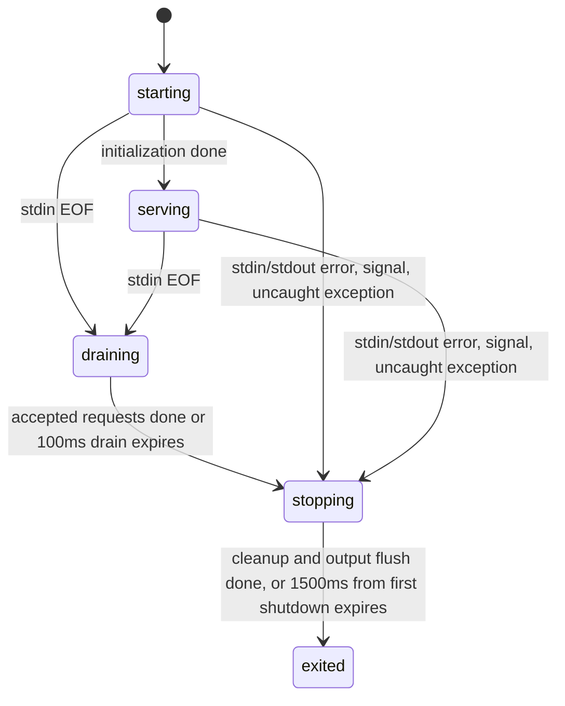

# ZCode Protocol Agent Server

## Background

The z-code desktop app will no longer be compatible with multiple agents through the ZCode app-server, and will integrate only zcode-cli as a private agent server. In desktop, SSH and Docker scenarios, the GUI/host process connects to zcode-cli as a thin client, and the server uniformly owns the session, model, thought level, mode, messages and runtime state.

## Scope

- Add the `zcode app-server --stdio` entry; its output carries only ZCode Protocol NDJSON frames.
- `agent-server --stdio` is an alias of the same capability, to ease a later naming switch.
- The ZCode Protocol schema is still exported as a single file, `packages/shared/src/zcode-protocol/index.ts`, of the outer z-code workspace.
- v1 implements only the stdio transport; WebSocket is left for cloud IDE/remote sandbox to reuse the same envelope later.

## State ownership

The plugin `plugins/referenceCatalog` and `plugins/referenceCatalogWithCategory` project the optional `description` / `descriptionI18n` by full plugin ID along the existing listing join. The fields are only for the Picker to show descriptions by language, and do not enter the capability identity frozen in the Session or the model-only reminder; when an old Host lacks the field the UI leaves it blank. Language fallback and acceptance rules are in [Plugin conversation reference](../../../../../docs/plugin-reference-mention.md#2-已确认的四项产品决策).

- The server maintains the core session state: current model, selectable models, last model, thought level, mode, permission, projection, eventSeq, stateRevision, messages and events.
- TUI/GUI maintain only display preferences, such as scroll position, focus, panel collapse state and uncommitted draft.
- `session/subscribe` returns a subscription acknowledgement, gap events and an optional snapshot; the client must not mistake this wrapper for a snapshot.

## Entry chain

```txt
zcode app-server --stdio
  -> runZCodeProtocolAgent
  -> ZCodeProtocolNdjsonConnection
  -> ZCodeProtocolAgentServer
  -> createZCodeApp / AgentRuntime / SessionStore
```

## stdio output boundary

The stdout of `app-server --stdio` and `agent-server --stdio` is a strict ZCode Protocol NDJSON frame channel, not a generic log stream. The host keeps running strict schema parsing on every non-empty stdout line; non-JSON lines must not be ignored for the sake of tolerating pollution.

After recognizing a stdio protocol command, the CLI must install a process-level console boundary before loading `run.ts`, bootstrap and third-party SDKs: `console.log/info/warn/debug/error` all write to stderr, and only protocol output may write to stdout (including the startup storage status frame). The boundary is kept until the process exits; standalone assembly tests restore the original console through a disposer. The entry and run reuse the argument definitions and enable the lifecycle only by the actual command, and must not mistake the values of options such as prompt/cwd for app-server.

```txt
ZCodeProtocolNdjsonConnection -> stdout -> Host JSON/schema parser
console.* / dependency logs    -> stderr -> Host log collector
```

This boundary applies to both desktop-local and SSH/WSL/Docker remote agents; it does not change protocol messages or the delivery semantics of desktop continuous or web remote replayable.

## Protocol process lifecycle

The CLI entry takes over stdin/stdout and signals before the first async initialization, and owns the single shutdown deadline. At startup it catches protocol bytes with a backpressured input buffer, and must not drop requests in order to observe EOF. bootstrap receives the cancel signal through `RunZCodeProtocolAgentOptions.lifecycle`, initiates exit and reads the same absolute deadline; it only releases runtime resources and does not decide the process exit code. The `--prepare-storage` Worker and plugin-host keep their own lifecycles.



- EOF stops accepting new work; a bounded set of accepted requests may complete their responses, and a hung handler cannot extend the exit indefinitely. The first shutdown locks the reason, exit code and deadline; later SIGTERM, EOF and error do not reset the budget.
- A stderr-only error does not close a healthy protocol. The entry installs a write boundary on the real stderr: both a synchronous throw and an async error only mark the output unavailable, after which the stream is not written again and the write failure is not reported recursively; all console/diagnostics share this boundary.
- Model, tool and request errors already handled by the business layer keep the original protocol behavior. An unknown uncaughtException/unhandledRejection that reaches the process boundary is diagnosed only once, then the run is cancelled, cleaned up and the process exits with a non-zero code.
- The server first rejects new requests, cancels reverse requests and operations, then closes all created apps, and finally releases the gateway. A late app creation must also be closed. This path does not call the product session/close, emits no session.removed, and does not delete persisted sessions. Within the same remaining budget bootstrap closes the sampler, MCP/broker, shared storage, Registry and telemetry; a single failure cannot stop the others from being tried.
- The Host invalidates the old protocol at once, but keeps collecting stderr until the stream closes or a bounded drain; the exit report is bound after the drain to the original runtime identity and the first reason. Normal EOF has a 1800 ms grace, and the process-tree force kill is still bounded by the original total budget. CLI E2E coverage may reserve an extra 500 ms for disk write, and the Host keeps using the coverage EOF window.
- The Host creates a new generation through the existing on-demand mechanism and does not automatically resend the user command. A mobile attachment disconnect does not trigger the shared CLI to exit; the owner and recovery semantics of desktop continuous / mobile replayable are unchanged.

Acceptance includes: a real pipe break does not self-excite, a stderr-only disconnect still responds, EOF during startup/idle/in-flight, bounded exit on unknown exceptions and repeated signals, a short request responding after half-close, hung and late handler cleanup, and last-line diagnostic collection.

## v1 methods

- session: `create`, `resume`, `list`, `read`, `messages`, `events`, `subscribe`, `send`, `stop`, `setModel`, `setThoughtLevel`, `setMode`, `close`
- workspace: `readState`
- process: `childProcesses` — returns the MCP child processes that the MCP tracker memory still holds as live, `{ pid, serverName, mcpSource, pluginName? }`. Purely in-memory, no I/O; `pluginName` comes from the `plugin:<name>:<key>` namespace, and MCP injected by the host CLI for an official plugin (such as `node_repl`) is looked up in reverse by `OFFICIAL_PLUGIN_DEFINITIONS.hostMcpServerNames`. The desktop resource manager uses it to attribute pids on the Host-side `ps` process tree to built-in / community plugins (see the desktop repo `docs/electron/resource-manager.md`); CPU/memory sampling is not done inside the CLI.
- blocking request: later extended through server-to-client requests by `interaction/requestPermission`, `interaction/requestUserInput`

## Verification

### Startup convention of the desktop bytecode trial

- `ZCODE_DESKTOP_AGENT_BYTECODE=1` is an experimental switch the Dev desktop launcher passes to the Host, off by default; an ordinary Dev launch explicitly turns it off, `pnpm dev:desktop:bytecode` explicitly turns it on. When it is off, leftover bytecode is ignored.
- Only the workspace dist resolution path of Electron selects the same-directory `zcode.bytecode.cjs`; an explicit `ZCODE_AGENT_SERVER_COMMAND` keeps the highest priority, and non-Electron/remote keeps the original entry.
- When on, a missing bytecode entry errors directly; falling back to JS is forbidden, to avoid distorting A/B data.
- The `app-server --stdio`, `--surface`, cwd, stdin EOF, stdout frame and stderr diagnostic contracts are unchanged. `storagePreparationEntry` still points to the ordinary `zcode.cjs` and does not change the Host Worker preparation protocol.
- Bytecode is bound to the Electron/Node/V8, platform/architecture and V8 cache identifier at generation time, and must be rebuilt after an upgrade. The coverage build is mutually exclusive with the bytecode trial; the full build/measurement boundary is in the [desktop packaging doc](../../../../../docs/electron/desktop-bundle.md#桌面-stdio-agent-字节码试验).

- bootstrap unit tests cover the return shape of create/read/subscribe and the `state.updated` notification of a server-owned model state mutation.
- CLI unit tests cover `app-server --stdio` dispatching to `runZCodeProtocolAgent`.
- The CLI protocol entry test covers third-party code calling `console.debug` while stdout stays empty and the log goes to stderr, and verifies the console is restored after the command ends.
- A real child-process regression uses an MCP server that does not declare the `tools` capability, requiring `mcp/list` to return legal JSON and the transport to show no `protocol_parse_error`.
- The app integration smoke test covers `IZCodeAgentService.initialize()` starting the stdio agent, `session/create` returning a snapshot, and `session/read` reading the same session.
