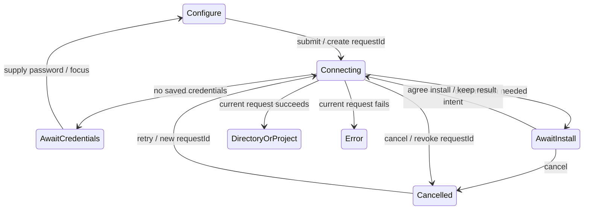
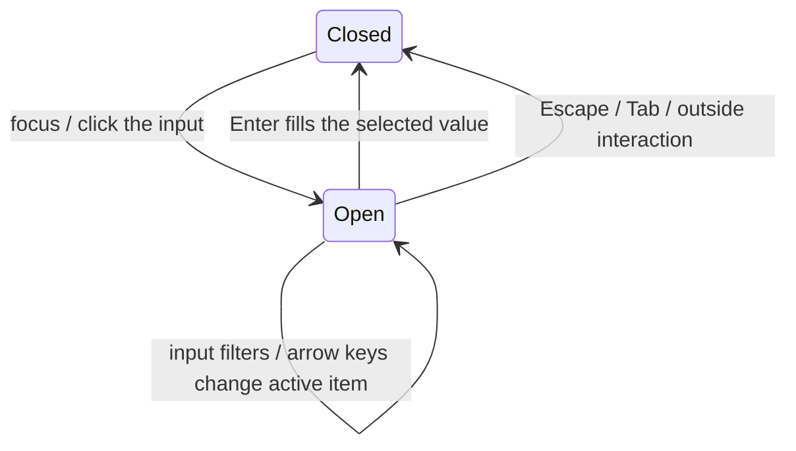

# Remote device connection entry and status presentation spec

Current interaction contract for SSH / WSL / Docker and the dev Server entry. The three-screen wizard and the five-state table are the only presentation rules; the old five-step wizard, device grouping and connect-and-chat UI no longer apply.

Next-round target confirmed 2026-10-12: [separate project creation from remote connection management](../issues/remote-connection-ux/15-project-device-selection-and-connection-management.md) (ready-for-agent, not implemented). When that ticket is implemented, its target spec replaces the rules on the generic three-screen entry, mixed discovery list, "connect success always enters the directory screen", sidebar minimize progress location, and "close clears all drafts"; the five states, error classification, logs, credential saving and install confirmation stay as in this document. The current-state text below does not mean the new target is done.

- Project entry, in-place reconnect, disconnect and restart recovery: [project navigation spec](../remote/project-first-remote-navigation-spec.md).
- Identity, install and version gate: [R3 main spec](r3-source-server-remote-architecture.md). Provider auto push: [dedicated spec](../remote/provider-provisioning.md).
- Device management offers no model editing / manual sync entry; model settings always bind to the local Environment. Skills/MCP/plugin sync keep their own scope.
- No change to workspace identity, Host/task owner, desktop continuous or phone replayable boundaries.
- Acceptance and evidence: [case catalog](../conversation-session-case-catalog.md) and [coverage matrix](../testing/conversation-session-e2e-coverage-matrix.md); an actual run is not a manual promotion.

<a id="三屏向导与统一选择2026-09-28rdux-10"></a>

## Three-screen wizard and unified selection (2026-09-28, RDUX-10)

Replaces the old five-step sidebar wizard, "offline recent directory not clickable" and "auto popup on minimized failure". The project/chat entry shows only "select device -> connect -> select directory" at the top; the settings entry shows no step bar (RDUX-27). The new-connection form belongs to the first screen; first entry marks no step done. The dialog's top edge is fixed at 10% of the viewport and its height grows downward with content; long lists scroll inside.

- The first screen is always a searchable unified list grouped into saved devices (with state and recent-directory chips), SSH config Hosts, WSL distros (Windows only), and running Docker containers (only when Docker is available). Clicking an item connects immediately; an offline recent directory is also clickable and keeps the directory intent until connected and opened. Discovery loading and failure do not block other sources or the manual entries.
- At the bottom: new SSH, manual WSL (Windows only) and Docker; the dev Server entry and its hint appear only in a dev runtime. Form layout is RDUX-27: host and port side by side, segmented auth switch, show/hide password, collapsed advanced options, footer with back-to-list left and connect right.
- The form is a real form: Enter submits, port validated as a decimal integer 1-65535, host and username trimmed. Switching screens moves focus to the first actionable control (the host field on the form screen); selecting an alias shows an association tag. Docker dropdown and manual input are mutually exclusive and label-associated; Docker unavailable and no running container are distinguished.
- A config Host missing a password asks for it on the connect screen without re-entering Host info. A missing username returns to the pre-filled form. A saved Profile missing credentials keeps the supplement-credentials flow.
- Minimizing only changes visibility and keeps all drafts, aliases, targets and requests. The top of the project area shows a two-line card: device name with phase percentage, current phase, and a progress bar below; the percentage is the completion ratio of existing phases. After failure it stays minimized, the card turns danger-colored with the reason until clicked to restore. On success the directory screen opens (or the existing directory opens directly) and the card disappears.
- Restoring a minimized card restores only the same flow. A new explicit connect entry has its own intent id; idle flows (failed, cancelled, form, or awaiting credentials) yield to it. Even with the same Profile, WSL distro or target values it must be consumed again with the latest parameters; before acceptance revoke the old epoch and clear pending confirmation and the old directory intent; late credentials/results must not revive the old flow. A flow that is actually connecting/updating or connected-awaiting-directory is kept and not preempted.
- Close cancels the current connection, revokes request ownership and clears all form drafts; persisted input history is kept. Late discovery/credential/connect results after close must not reopen the old flow.
- Minimizing from the select, configure or directory screens also gets a matching restore card; non-connecting states fake no progress. The directory navigation path is kept by the wizard; unmounting the browser instance revokes the old request, and after restore an old response cannot overwrite the new directory. Connect-success finishing removes the card; changing target clears the directory path.

```text
list / form -> useRemoteConnectionFlow (the single wizard session owner) -> existing connect commands
                   ├─ current requestId / epoch -> result, wait points, directory intent
                   ├─ minimize -> the same session renders the sidebar card directly (portal only registers a DOM container)
                   └─ close -> revoke epoch / cancel request / clear drafts
Host, attachment, snapshot and recovery boundaries of desktop continuous and phone replayable keep the existing contract.
```

Acceptance interfaces follow the parent spec: wizard DOM + service ports, and real SSH desktop E2E (config first-connect effort, offline recent directory, minimized failure, close-clears-drafts). The full layout of the connecting and directory screens is RDUX-11.

<a id="新建连接表单rdux-272026-10-14"></a>

## New-connection form (RDUX-27, 2026-10-14)

Defines the form shared by the settings entry "新建连接" and the project/chat entry "新建 SSH 连接". It changes only presentation and front-end interaction, not connect flow, protocol or form-state semantics. Ticket: [#27](../issues/remote-connection-ux/27-new-connection-form-polish.md).

```text
settings entry                              project/chat entry
┌ New connection              — × ┐      ┌ 1 select device - 2 connect - 3 select directory  — × ┐
│ root@10.0.0.5:2222 (live preview)│      │ New connection [SSH]                         │
│ [SSH|WSL|Docker]  Import from SSH config v │ user@host:22                              │
│ (linked Host dev-box x)          │      │ host + port / username / auth / advanced     │
│ host + port / username / auth / advanced │ ├────────────────────────────────────────────┤
├──────────────────────────────────┤      │ <- Back to list                     [Connect] │
│              [Cancel] [Add and connect]│ └────────────────────────────────────────────┘
└──────────────────────────────────┘
```

- **Header**: both entries are titled "新建连接 / New connection", with no description sentence. Under the title a monospace live preview of the connection target (SSH `user@host:port`, Docker container name, WSL distro); light placeholder when empty. The project/chat entry shows a type tag next to the title; the settings entry does not, since the type switch already shows it. The settings entry shows no step bar.
- **Type switch**: SSH / WSL (Windows only) / Docker as a segmented control, each with a type icon; the selected item uses the type color's light background, border and foreground (same source as `RemoteConnectionKindTag`). Each type-switch item is a connection type tag, within the DESIGN.md allowance "type tokens only for type tags"; other tabs keep the neutral selected state.
- **SSH config import**: only the settings entry offers "从 SSH config 导入 ▾" (import from SSH config) at the right of the type-switch row, opening the existing searchable popover; with no Host the button is disabled with a reason, a read failure shows a warning below without blocking manual entry. After selecting a Host, an SSH-colored association tag "已关联 Host xxx ×" (linked Host xxx) with the hint "修改任一字段会自动解除关联" (editing any field unlinks automatically) appears above the host field. The x only unlinks and keeps filled values. The project/chat entry has no alias entry (the previous list screen already offers config Hosts); returning from the list to the form still shows the association tag. The edit-connection dialog keeps alias selection inside advanced options.
- **Field layout**: host and port on one row (port about 6rem, also side by side on narrow screens), username on its own row; the "认证方式" (auth method) label and segmented control on one row with the credential input right after. Advanced options are a compact text trigger without dashed dividers. Field labels use `text-ui-sm`.
- **Paste split**: pasting `user@host`, `user@host:port`, `ssh user@host -p N` (including `[IPv6]:port`) into the host field splits into host, username and port and shows a success hint "已识别 ..." (recognized ...) under the host; other content pastes as is. A paste counts as a manual edit and unlinks the alias. Triggered on paste only.
- **Focus**: on open, focus is on host. After importing a Host, focus moves to the first empty required field, or to the primary action if all are filled.
- **Validation**: on submit; errors show under the field (`aria-invalid` + `aria-describedby`) and focus moves to the first erroneous field; afterwards a field that becomes valid clears its error. The footer shows no validation text and the primary action is not disabled. Real connection failures still use the top error bar. The only source of validation rules is `collectRemoteFormFieldErrors`, reused by `buildRemoteTarget` and the edit-connection dialog.
- **Docker / WSL**: the top description paragraph is removed. Docker input mode (choose a running container / manual input) uses a neutral segmented control; when Docker is unavailable a warning card shows under the selector, with no running container a neutral hint. Container candidate rows show a Docker-colored icon block at the left. The warning that WSL runs as root stays a warning card.
- **Colors**: existing tokens only. Type colors for the type switch, association tag, candidate icon blocks and the project entry type tag; warning cards use `warning-surface`, paste recognition uses `success`, field errors use `destructive`; primary action and auth switch stay neutral.
- **Footer**: settings entry "取消" / "添加并连接" right-aligned; project/chat entry "← 返回列表" at left and "连接" at right. The footer has a single divider.

## Wizard P0 and flow ownership (2026-09-27, RDUX-04)

When a manually created connection directly reuses an online connection, show "这台设备已通过 `<connection description>` 连接，已直接使用现有连接" (this device is already connected via ..., the existing connection is used directly). The description comes from the connection target the Host actually reused, not from this form's values; a password or key passphrase that did not take part in authentication this time is not saved and does not overwrite saved credentials. The hint stays visible after entering the directory or the original project; the description reuses the unified presentation model (for example `SSH · dev@host:22`). Whether to hint belongs to the original new-connection intent; supplement-credentials, install confirmation and update retry keep their behavior; choosing a saved device, connecting from settings, choosing a directory on an online device and background reconnect do not hint. The Host's connect result carries an optional `reusedConnectionTarget` (redacted target) passed through Main by requestId; the UI must not guess reuse from its own snapshot. The window registry may project reuse of an existing entry; when there is no entry it must keep consuming the Manager's physical-connection reuse result. Before connecting, the Host registers only a Profile without new credentials, and commits this time's credentials only after the connection actually completes without reuse; failure, cancel, same-device merge or concurrent join must not overwrite saved values. The only exception wait point is "already authenticated, then upgrade needed": only the request that performed the authentication may save credentials at that wait point, a call that joined the same request cannot commit another password, and the management service may continue the update with the original Profile.

The wizard's entry intent, install wait, cancel, minimize/close and result destination are owned by `useRemoteConnectionFlow`; form drafts stay in `useRemoteConnectionForm`; the real connection and credentials still belong to the Host. Missing credentials stop at the connect step, with the primary action "补充密码" (supply password) returning to configuration and focusing the password or key passphrase; after filling, the original directory and download mode are kept. While connecting the primary action "取消连接" (cancel connection) immediately revokes UI ownership of that request; an active cancel shows "已取消" (cancelled), keeps a retry entry and does not enter the error panel.



Minimize only hides the current flow; success enters the directory, failure keeps the sidebar result (RDUX-10 governs); close revokes the current request and releases unconfirmed sessions. Late results of a revoked request must not overwrite later flows, and late temporary sessions are only reclaimed. This extraction changes no Host, workspace identity, desktop continuous or phone replayable recovery boundary.

<a id="统一展示合同2026-09-27rdux-03"></a>

## Unified presentation contract (2026-09-27, RDUX-03)

Replaces the four-state mapping, pending->offline, status borrowing connection-type colors, and engineering terms in this document and the old design spec; the old connect flow is governed by the [project navigation contract](../remote/project-first-remote-navigation-spec.md). Layout contracts: RDUX-10/11/13 here and the project navigation spec.

### Remote connection presentation model (unified UI presentation)

A pure function module mapping "connection facts of devices and projects" to "what the user sees". The following surfaces **must** take status presentation only from it and never compute it themselves:

- sidebar project rows, detail cards, conversation header, conversation banner
- settings device cards, wizard, task-row device tags
- status dot of settings navigation, "open remote project" menu
- device selection of the create-project dialog (layout in [create project dialog layout](../specs/project-editor-dialog-ui.md))

The remote-control Header reads the attachment via the existing workspaceIdentity session resolver and does not require a tab to carry `remoteSessionId`. The device name comes from the shared window project directory Host for the same identity, with the desktop device-management name taking precedence; borrowing another device by path is forbidden. After a connection is removed it shows not connected and updates after re-registration; no connection or retry is added.

The existing three mappings (device aggregate status mapping, sidebar project connection status mapping, settings status label and display helpers) are removed and merged into this module.

Inputs:

| Input                         | Meaning                                                                       |
| ----------------------------- | ----------------------------------------------------------------------------- |
| Device aggregate status       | Device-level state from the Source authority projection                       |
| Project attachment status     | Whether the project mount is ready; device online does not mean project ready |
| Install and identity          | Not installed / installed / identity to confirm (connection target changed)   |
| Upgrade need                  | None / optional update / remote must update / local desktop must update       |
| Disconnect origin             | User disconnect / abnormal disconnect / not yet connected at startup          |
| Auto recovery progress        | Currently attempt n of 3                                                      |
| Latest error                  | Classified connection error code and phase                                    |
| Credential completeness       | Whether a saved password or key passphrase is missing                         |
| Connection method and address | SSH / WSL / Docker, plus address, distro or container name                    |
| Device display name           | A user-changed name wins; default is the SSH alias                            |

Outputs:

| Output                          | Description                                                                                                                                           |
| ------------------------------- | ----------------------------------------------------------------------------------------------------------------------------------------------------- |
| Visible state                   | One of 5                                                                                                                                              |
| State copy and short state text | Short text replaces the device name in the project row                                                                                                |
| Semantic color                  | success / in-progress (new) / neutral / warning / danger                                                                                              |
| Icon                            | The project row has a single icon slot                                                                                                                |
| Primary action                  | Connect / Disconnect / Cancel connection / Update remote / Update desktop / Install and connect / Confirm new device / Supply password / Retry / none |
| Reason and fix action           | From error classification                                                                                                                             |
| Recovery progress text          | Such as "自动恢复 2/3" (auto recovery 2/3)                                                                                                            |
| Connection description          | Such as `SSH · dev@localhost:2222`, generated per connection method                                                                                   |

The 5 visible states:

| Visible state                | Trigger facts                                                                                                | Semantic color                                   | Project row icon       | Primary action                                              |
| ---------------------------- | ------------------------------------------------------------------------------------------------------------ | ------------------------------------------------ | ---------------------- | ----------------------------------------------------------- |
| Connected (已连接)           | Device online and project attachment ready                                                                   | success (shown only in detail card and settings) | neutral cloud, no mark | Disconnect                                                  |
| Connecting (连接中)          | Explicit connect, in-place reconnect or auto recovery in progress; or device online but attachment not ready | in-progress                                      | single spinner         | "Cancel connection" inside the wizard, none elsewhere       |
| Not connected (未连接)       | User disconnect, not yet connected at startup, offline before auto recovery                                  | neutral                                          | crossed-out cloud      | Connect                                                     |
| Needs action (需要处理)      | Install needed, remote must update, local must update, identity to confirm, credentials missing              | warning                                          | cloud + `!`            | The action matching the reason                              |
| Connection failed (连接失败) | Latest explicit connect failed or auto recovery exhausted, and the reason is not "needs action"              | danger                                           | cloud + `✕`            | The fix action of the error classification, default "Retry" |

Decision rules:

- **"Needs action" beats "connection failed".** Whenever an executable fix exists, show "needs action".
- **A user disconnect always maps to "not connected".**
- **"Updating" overrides old copy**; the earlier "needs update" or error text is no longer shown.
- **An optional update does not change the visible state**; it only affects the secondary info on the device row (a neutral "Update to vX") and the expanded-area banner. The settings navigation no longer shows a summary status dot (removed 2026-10-24).
- **Non-online states must have text** (short state text or detail-card text), never color alone.
- **Device online but project read failed** (for example the remote database cannot be opened): the device's project rows show "Connection failed"; the detail card shows the error category and "Copy error", whose text is the error from this read. This is part of the "connection failed" row above.

### Connection error classification

- **Error code contract.**
  - For every transport or deploy failure, main and host produce exactly one error code from the code set, plus a non-empty message.
  - A domain error code already confirmed by the adapter takes precedence over text inference from `cause`; an unclassified `AggregateError` and phase wrappers keep looking for the inner error code.
  - An empty or unrecognized message falls into the "unknown" class and an error response is never dropped because of schema validation failure (the root cause of "connection refused stays at connecting forever").
  - Probe classifies only failures of the remote environment check itself as "pre-check failed": probe script non-zero exit, unsupported remote platform, Linux remote glibc below the Source Server floor (2.28). Transport failures while establishing the connection or running the probe command (handshake timeout, disconnect before handshake) get no phase fallback and fall into "unknown" when unrecognizable; when disconnect auto recovery exhausts its budget this shows "自动恢复已停止" (auto recovery stopped) and does not hint at install environment problems.
  - Shared types and runtime schema extend together. When the UI meets an unknown error code it falls back to the generic "unknown" copy for backward compatibility.
- **Classification and display:**

| Class                                        | Typical source                                                           | Title                       | Fix action                                                                                                                                                                                                                                    |
| -------------------------------------------- | ------------------------------------------------------------------------ | --------------------------- | --------------------------------------------------------------------------------------------------------------------------------------------------------------------------------------------------------------------------------------------- |
| Authentication failed                        | Wrong password or key                                                    | SSH 认证失败                | Change password or key: re-enter the password or key passphrase in place on the connecting screen (same interaction as "password needed"); when the username or key file must change, return to the form, focus that field and mark the error |
| Missing credentials                          | No saved password or passphrase                                          | 需要密码                    | Supply password (belongs to "needs action")                                                                                                                                                                                                   |
| Connection refused or unreachable            | ECONNREFUSED, EHOSTUNREACH, ECONNRESET                                   | 无法连接到主机              | Check address and port; retry                                                                                                                                                                                                                 |
| Timeout                                      | ETIMEDOUT                                                                | 连接超时                    | Retry                                                                                                                                                                                                                                         |
| Host not found                               | ENOTFOUND                                                                | 找不到主机                  | Edit the host                                                                                                                                                                                                                                 |
| Host key changed                             | host key mismatch                                                        | 主机身份已变化              | See the security note; no one-click ignore                                                                                                                                                                                                    |
| Download, upload, pre-check, install failure | Deploy phases; pre-check contains only remote environment check failures | Names the failed phase      | Retry; "改用设备直接下载" (use direct download on the device) additionally only for SSH with local download                                                                                                                                   |
| Remote space or permission insufficient      | Deploy or start phase                                                    | 远端空间不足 / 没有写入权限 | View details                                                                                                                                                                                                                                  |
| Version incompatible                         | Handshake phase                                                          | 需要更新                    | Update remote or update desktop (belongs to "needs action")                                                                                                                                                                                   |
| User cancelled                               | Cancel install or cancel connect                                         | 已取消                      | Reconnect; not shown in error style                                                                                                                                                                                                           |
| Unknown                                      | Fallback                                                                 | 连接失败                    | Retry + details                                                                                                                                                                                                                               |

- **Raw error** is folded into "详细信息" (details) and can be copied.
- **Extra verification**: an interactive prompt explicitly asks for a dynamic code (such as "Verification code" or OTP) -> category "Server requires extra verification". Second-factor verification is not supported yet; the fix is to use a private key or the SSH agent instead.
- **Unsupported remote system**: a native Windows host or an architecture other than x64/arm64 -> category "This device's system is not supported". The details state that only Linux and macOS on x64 and arm64 are supported.
- **Probe failures** are classified as "preflight failed" only when the environment check itself fails (the probe script exits non-zero). An unsupported remote platform (for example, `uname` reporting Windows such as MSYS) falls into "remote system not supported" instead.
- **Copy** differs per connection method, with WSL and Docker variants. All copy exists in Chinese and English.
- **Where shown**: errors display in place in the wizard panel, device card, conversation banner or project row. A toast is only for background events and must carry "查看详情" (view details) that jumps to the device.
- **Capability fallback**: if the current transport cannot reliably recognize a host key change, classify as "unknown"; do not guess.

### Terms and copy

| Word the user sees       | Meaning and usage                                                                                                        |
| ------------------------ | ------------------------------------------------------------------------------------------------------------------------ |
| 远程设备 (remote device) | One remote machine; a WSL distro or a Docker container each counts as one device                                         |
| 连接 (connection)        | One way to reach a device, shown by the connection description; with several it is called "其他连接" (other connections) |
| 项目 / 任务              | Unchanged                                                                                                                |
| ZCode Server             | Appears only in install and update scenarios                                                                             |
| 发行版 / 容器            | Replace distro, and command names like docker exec / docker cp                                                           |

- **Words forbidden in the UI**: 链路, 线路, Source Server, 换代, 正史, canonical, direct-tcpip, 远端组件, short device ID. The device ID may only be copied from "更多 -> 设备信息" (More -> Device info).
- **Identity generation change is rewritten in user language**, e.g. "连接目标的身份已变化" + "作为新设备使用".
- **"Connecting" phase copy** is generated per SSH, WSL and Docker.
- **New and rewritten copy** needs Chinese and English, and English copy must also be checked for project-row width.

### Design system

- **Add an "in-progress" semantic color** with surface and foreground tokens, written into the design spec and token docs. "Connecting" no longer borrows the SSH type color or amber.
- **SSH, WSL and Docker type tokens** are used only on type tags; the new-connection form's type switch, association tag and candidate icon blocks count as type tags (RDUX-27).
- **Clean up non-conforming usages**: font sizes outside the scale, hard-coded colors, arbitrary-value colors, icon sizes and radii not in the spec.
- **Dark theme**: re-check contrast of status labels, sidebar and settings navigation.

### Ownership and acceptance

```text
Host connection state / Directory install identity -> existing management snapshot
project attachment / auto recovery facts -> UI pure-function presentation model -> status, primary action, color everywhere
user action -> existing connection wizard / update command -> Host owner -> next snapshot
attachment recovery paths of desktop continuous and mobile replayable keep their existing boundaries
```

- Device error code/raw text and project errors are separate inputs: a project error may already be localized and must not override the device error raw text used for authentication classification. Root forwards existing project recovery facts to header/task rows through a read-only Context; the presentation result keeps the profileId that produced the state so the right connection is repaired.
- Two public seams: `resolveRemoteConnectionPresentation` (state projection) and `classifyRemoteConnectionError` (error classification); neither holds mutable business state.
- Table-driven coverage of the parent spec's state combinations, all 02 public error codes and the unknown fallback, SSH/WSL/Docker copy and the local-download gate.
- Components assert model output via DOM; first reproduce the local update direction, pending state, double spinner and invisible recovery progress problems.
- After an active disconnect, sidebar and settings are both neutral "not connected"; real SSH E2E verifies and syncs the case catalog.
- Token contrast, forbidden-word and zh/en key-consistency checks; desktop light/dark theme and narrow-screen checks plus existing phone recovery regression.

## Device names and compatibility

### Default device name

- On the first handshake of a new Source, if the current SSH Profile's `target.sshConfigAlias` is non-empty, the default `displayName` is the trimmed alias.
- Without an alias keep using `hostname · osUser`; if both are missing fall back to `sourceServerId`.
- An existing Source's `displayName` always wins, so user renames are not overwritten.
- A new Source discovered after an identity-change confirmation follows the same rules.
- The alias still takes no part in `workspaceIdentity`, Profile dedupe or device identity decisions.

### SSH credential downgrade compatibility and self-healing

- The Source Profile remains the SSH credential authority of the current version. When writing `lastWorkspaceSession` for an old Desktop, each workspace uses its own `remote-workspace:<legacyIdentity>:*` mirror, so an old version closing one workspace does not delete the shared Profile secret.
- The rollback snapshot must first write the Profile secret into the legacy mirror through `credentialService` and only then the matching credential key; if the mirror write fails the settings reference must not be committed.
- When one exact SSH route has several legacy workspaces, non-sensitive target metadata still comes from the entry with the latest `lastOpenedAt`, and password/passphrase each from the latest entry that "actually has a value".
- Profile migration writes the `connection-profile:<profileId>:*` reference only after the secret copy succeeded; empty references no longer propagate as new dangling references.
- `SourceServerDirectory.initialize()` runs an idempotent audit over SSH Profiles with migrationVersion=1: when the canonical secret is missing, restore it only from legacy siblings of the same `routeKey`; if no real secret is found keep the "interactive credentials needed" semantics, without fuzzy matching.
- The dialog must not call SSH when neither the password nor the key authentication chain is complete; the connect screen shows that credentials are needed and allows returning to configuration. This gate is defense in depth and does not replace mirror and migration repair.
- Host Directory connections handle it the same way: a Profile secret that cannot be decrypted counts as missing. `resolveProfileTarget` returns `credentials-required`, and startup reconnect skips that Profile without affecting other devices; supplying credentials overwrites the original.
- The Renderer treats an unreadable Profile secret the same way (device connection flow, reconnecting the original project): opening that device from the sidebar or settings shows the supplemental-credentials prompt, not a generic failure.
- A value this machine cannot decrypt is treated as empty when choosing the newest real value for a legacy route.
- No change to workspace identity, Profile schema, credential encryption format or Mobile attachment semantics.

### Menu and minimize

- The device "more" menu has a stable minimum width and non-wrapping action rows; the maximum usable width is still bounded by content and viewport.
- In every installed state (online, offline, failed, retrying, needs upgrade, updating, etc.) the device "more" menu offers "移除设备" (remove device); removal deletes only the local record and credentials, does not depend on the remote connection, and Host `removeSourceServer` first idempotently disconnects and then deletes the record. "在侧边栏中显示" (show in sidebar) is offered only when the device has open projects, locating the existing project without depending on online state; the menu must never be empty.
- The minimize button is no longer gated by `loading || connectedSessionId`; it is visible at every step.
- Minimize is not close and cleans no state; close semantics keep the original contract.

## Install and update progress

- While an automatic or manual update is running, the subtitle shows "正在更新远端服务" (updating the remote service), taking precedence over the last connect's needs-upgrade error; after failure or cancel the retryable error scene is kept.
- The upload percentage represents archive transfer only, not install completion. After transfer it enters the extract phase immediately; the remote CLI emits optional `--progress` output as line-by-line JSON events `{type:"source-server-install-progress", phase}` with phase `verify-archive`, `extract`, `verify` or `restart`. Default CLI output and the last-line result JSON are unchanged.
- During command execution the Adapter validates and forwards progress, reusing the Host operation log; unknown/non-progress output is not a basis for phase or success. Failure still uses the exit code and final result, keeping staging cleanup, the running-task guard and rollback semantics.
- The connect screen's install phase shows localized sub-captions for upload, extract, verifying the package or verifying service files; only the current upload phase shows a percentage. Other phases keep an in-progress indicator and simulate no percentage. `restart` enters the existing "启动服务并握手" (start service and handshake) step and completes only on a real handshake and connection ready.

```text
before: upload 100% -> [extract / verify / restart, no events] -> result
after:  Adapter upload/extract -> CLI verify-archive/extract/verify/restart
        -> Host operation log -> UI phase projection -> handshake -> ready
```

Progress facts belong to the remote installer; connection state still belongs to the Host manager; the UI only projects existing events. No persisted state or retry is added and the session recovery boundaries of desktop continuous and phone replayable are unchanged. SSH/WSL/Docker share the Adapter progress parser.

Acceptance: during a delayed verify the verify phase is shown with no upload percentage; phases are visible while the command has not finished; chunked output and non-JSON logs do not affect the result; a verify/restart failure cannot show ready; during auto update there is no stale failure subtitle, and after cancel/failure the error remains visible.

## Connection logs and failure contract

- Feedback from SSH, WSL and Docker connection failures turns diagnostic log upload on by default; the user can uncheck it before submitting. The prefilled, redacted most-recent 30 connection log lines and the diagnostic ZIP are two separate attachments; logs in the body must not be turned off by default.

- The Host forwards only progress that the connect pipeline reports actively via `onLog`; console and other services' diagnostics never enter the user-visible log. Absolute paths, credentials, tokens, connection profiles and device identifiers are filtered uniformly; paths containing spaces are filtered by quotes or an explicit path-field boundary, keeping the non-path failure reason after the path; unquoted, non-disambiguable path tails stay conservatively masked, keeping only explicit diagnostics such as exit codes; the wizard, recent log and feedback use the same filtered result. Known secrets such as passwords and key passphrases are masked only as whole tokens (when the secret is bordered by letters, digits or underscores, the adjacent characters must not be of that kind either); substring replacement is forbidden, because a short password would turn fixed copy like `device` into `[redacted]ice` and leak the password.
- Waiting for install confirmation is logged as info. A failure response always contains a non-empty message and a shared-registered error code; a confirmed domain code beats cause-text inference, and unclassified AggregateError and phase wrappers use the recognizable inner error. SSH authentication and known private-key decryption failures get `remote-authentication-failed` at the SSH adapter boundary and the phase fallback does not override that classification; the UI's zh/en classification is synced, and old codeless text keeps a compatible fallback. Connection refused/unreachable, timeout, DNS, trusted host-key error, download, upload, pre-check, install, space, permission, cancel and unknown are classified separately with zh/en mapping synced.
- The Host connection management service is the only owner of recent operation logs; each device keeps the latest connection or update, up to 100 lines, in runtime memory only. Connections not yet handshaken are isolated by profile; after the handshake they belong to sourceServerId and different routes of one device share the latest operation. A new operation replaces the old log; late output from an old operation cannot overwrite the new one. The internal reconnect after an update belongs to the same update.
- `getRecentOperationLogs(profileId)` queries the latest log of the owning device and remains readable after closing/reopening the wizard or settings page; it is cleared when the device/route is deleted and on Host exit. The settings device card and unfinished connections both offer "查看最近日志" (view recent log); the remote identity details in the sidebar/chat project menu read the same log while connecting and show only phase, progress and elapsed time, never the raw log (see [connection progress details](../remote/project-first-remote-navigation-spec.md#连接进度详情2026-10-15)). The query result is a display projection; the UI keeps no independent log history.

```text
connect/update -> SourceServerConnectionManager accepts the operation -> explicit progress -> uniform filter -> bounded in-memory log
                                                └-> event notification -> UI queries the latest log
failure -> shared error classification + non-empty message -> Host schema -> Main -> zh/en copy
```

This contract concerns only the device connection-management RPC and connection logs; the desktop continuous / mobile replayable recovery boundary of task streams is unchanged.

## Connecting and directory screens (RDUX-11, 2026-09-29)

As in the approved prototype 06: the connect screen is titled by device name, connection method and full address; the vertical phases are establish channel (named per SSH / WSL / Docker), identify device, install components, start connection. There is no "connection ready" phase; success goes directly to the directory or restores the specified project. The current phase is bold and shows elapsed time, completed items keep their duration; install sub-steps show upload/download progress, size, speed and estimated remaining time; when speed is unknown it explicitly shows estimating. Waiting for password/key passphrase, install, device reinstall confirmation, forced-update confirmation and classified errors are embedded in the respective phase. The log is collapsed by default and expanded on failure, and copy-log appears only after expansion. While running or waiting for the user, the footer has "在后台继续" (continue in background) at left and "取消连接" at right; a failed terminal state switches to "返回列表" (back to list) at left and "关闭" (close) at right, and an existing failure must not be rewritten as an active cancel. Retry is allowed after cancel. The install-complete marker shows install done and waiting for start, and does not regress to verifying files.

Install info comes from the Host's remote probe and the same release descriptor: version, absolute install path, and the package's actual byte size (explicitly labeled package footprint; the archive size is not passed off as post-extraction footprint); unknown info shows "暂无法获取" (currently unavailable), no fake values. The read-only install preview neither uploads nor installs; after confirmation it reuses the existing install command. The running-task list comes from the remote task owner's activity projection, and forced update still passes the force=false guard first. When an old remote provides no list, explicitly show that the list is unavailable and do not fabricate tasks. If extra reads of the install preview, release metadata or running-task list fail, the confirmed install/forced-update wait point is kept and information-unavailable is shown; the release resolution and verification needed by the actual install keep failing strictly and cannot bypass the force=false guard or confirm a forced update on the user's behalf.

```text
user select/retry -> wizard flow owner (requestId / epoch) -> Host connection owner
                   ^ read-only state, install preview, log, task activity projection v
              inline confirmation -> existing install/identity-confirm/update commands
cancel/close -> settle cancel telemetry immediately -> revoke epoch -> drop late results; minimize only changes visibility
explicit new entry -> flow owner clears old wait points/intent -> new epoch consumes; card restore keeps the original epoch
directory chip -> browser's latest navigation request -> success path -> open project
```

The directory screen shows the full path, with recent and remote records on separate rows; chip navigation must update directory content and an earlier request cannot overwrite a newer navigation. A read failure shows a friendly reason; during failure or loading an unconfirmed directory cannot be opened; the footer keeps "稍后选择" (choose later). The device name can be saved in place: success shows "已保存" (saved), failure keeps the draft with feedback; the status bar shows only connection state, connection method/route and known version, without repeating the device name or filling placeholders.

First-use notice: restore the original "本地离线，任务照常运行" intro page and remove the one-line hint on the directory page. It shows after a successful active connect, before continuing device completion / directory / original project; the first explicit remote directory browse of an already-connected device reuses the same confirmation entry. Background completion and silent startup recovery do not pop it; a background result shows it only when the user explicitly continues. When another confirmation dialog is occupying, the connect flow keeps the completion action and continues after release; closing the confirmation or changing entry revokes it. While reading the read state or saving, minimizing must also keep the completion result and wait for the user to continue explicitly: no automatic intro, no handing over the original completion callback. Only clicking "知道了" (got it) writes `remoteBoundaryIntroAcknowledgedVersion: 1`; showing, cancel, unmount, read failure and stale responses never record read. Version 2 covered both the old dialog confirmation and automatic read from the one-line hint and the two cannot be told apart reliably, so users whose new marker is unset (including old-field version 2) see it once more, and with the new marker 1 it does not repeat. The old field stays `remoteBoundaryOnboardingVersion?: 2`, for rollback compatibility only, and is not evidence of confirmation by the new version. A persisted old-field version 3 is migrated to old-field 2 and new marker 1 before full schema validation; SettingService reads via the existing write lock, re-reads, migrates and saves atomically, and the migration cannot overwrite concurrent preference updates. An old client strips the new marker and can still read and save the original settings, so rollback needs no extra compatibility release; rolling back then upgrading again may show the intro once more. A read/save failure keeps it unread and does not turn an intro failure into a connect failure; later active use can confirm again. The intro page's look and copy reuse the original component; Escape/backdrop do not count as confirmation; once the operation's entryEpoch/form epoch is invalid the old navigation does not continue. Task owner, identity isolation and recovery chain of desktop continuous and phone replayable are unchanged.

Intro body copy: Chinese is 「关闭 ZCode 或休眠本机，\n远程任务继续运行。」 with an explicit line break after the comma; English is "Remote tasks keep running, even when you close ZCode or put your computer to sleep." with balanced wrapping and no fixed break position. The body keeps the newline and still wraps on narrow windows, so the last line never holds just one or two Chinese characters. Existing dialog width, font size and theme are kept; at the default 14px both languages take two lines, at 16px Chinese still takes two lines and English may take three. Visual verification mounts the real dialog directly, covering desktop and a 390px narrow window, light/dark themes and 14/16px font sizes, with no remote server needed.

```text
old behavior: directory hint shown -> automatically record old marker 2
stored old marker 3 -> schema migration -> SettingService saves old marker 2 + new marker 1 under the write lock
new behavior: active connect success / explicit use of a connected device -> intro page -> "知道了" -> new marker 1 -> original flow
background completion -> wait for user to continue -----------┘
cancel/change entry -> revoke the original epoch -> drop late results
```

Acceptance: wizard DOM covers inline waits, auth retry, cancel and late responses, real install info, phases and transfer, directory navigation/errors/rename; real SSH covers auth failure / connection refused / first-install info / non-blocking notice, with screenshots covering light/dark themes and 900px.

Running-task list contract: Core keeps deriving the active set from the owner facts of `turn.started/turn.terminal`, isolated by `workspaceIdentity || workspacePath` + sessionId; the Supervisor heartbeat/task-activity gains an optional list. `running-tasks --json` returns that list read-only (null when unknown), and the Host reads it after the forced-update guard refuses and shows it via the management snapshot. This extension changes neither the persisted `status.json`, the version rollback format, App <-> Agent messages, desktop continuous nor phone replayable delivery.

## Settings guards, edit connection and machine labels (RDUX-05)

- The edit-connection dialog reuses existing connection fields; device name and connection name are validated and saved separately, and a device-name error must not show a connection-name error. Confirmation of dangerous operations focuses Cancel by default and Enter must not run a dangerous operation by default; before disconnecting an inline note explains the impact.
- The settings page never shows the "正在编辑：本机 / <设备名>（远程）" (editing: local / <device> (remote)) hint row and its icon, covering general, plugins, MCP, skills, commands, hooks and subagent lists and edit forms; desktop and phone, light/dark and zh/en are consistent. The scope menu keeps the device name; settings read/write ownership follows the existing service scope.
- Device operations are de-duplicated and mutually excluded by the same sourceServerId (profileId when unrecognized); unrelated device operations, read-only details and log viewing stay available, and one device's long update cannot lock the whole panel.
- "在设置中管理" (manage in settings) and starting an update only locate the matching device card; only an explicit "查看详情" (view details) intent opens the failure details. A device's current failure does not mean every locate action pops a modal.
- Failure reasons and update info of different connections of one device display independently; only the same reason of the same Profile can be de-duplicated, and another connection's update banner must not mask a failure.

## Settings device list and update prompts (RDUX-13)

Device list (compact list with inline expansion, 2026-10-24; replaces the 2026-10-15 device card layout):

- **List and order**: each recognized device is one row in a single list container. Order is "recently used", newest first: online devices come first; other devices sort by the newer of "last online" and "last opened project". Ties keep the snapshot order. Order is computed once when the snapshot first becomes ready; afterwards only new devices are inserted at the top and removed devices are deleted. Status changes update row content but not position.
- **Search**: a search box sits at the right of the "Devices (N)" title row. The trimmed, case-insensitive query matches device name, any connection address, host name and known project display names; with no match an empty state is shown inside the list. There is no status filter.
- **Collapsed row**: from left to right: connection-method icon, device name, connection address (monospace, truncated, full text in title), secondary info, short status, primary action, "More", and the expand arrow.
  - Secondary info shows one item by priority: a warning icon with "N pending" when the device has pending connection history (title "Connection history needs attention"); otherwise a neutral "Update to vX" when an optional update exists and "Later" was not chosen.
  - When the list container is narrower than 36rem, the address moves to a second line under the name and the secondary info is hidden, so same-named devices remain distinguishable.
  - The row shows a primary action only when attention is needed (connect, retry, update remote, update desktop, reinstall and connect, use as a new device, supply password). "Disconnect" and "Edit" for a connected device live in the "More" menu.
  - Clicking the device name button or empty row space toggles expansion; the primary action, "More" and its menu do not toggle it. The name button exposes `aria-expanded`.
- **Short status**: the row shows short status text only, for example "Update needed" instead of "Needs attention · Update needed"; colors still follow the five states. Auto-recovery attempts still show ("Connecting · auto-recovery 2/3"). Other places such as the connection wizard keep the full status.
- **Expansion rules**: everything is collapsed when the page opens; several rows may be expanded at once; expansion state lives only in panel memory and resets when the panel remounts. Failed devices do not expand automatically. The "Recent log" follows the same default-expanded-on-failure rule after expansion.
- **Expanded area**: the former card body, in order: the progress block for an operation in progress (see the table below), the connection rows, error or update banners, other connections awaiting identity confirmation, recent projects, the footer, and connection history that needs attention.
  - **Connection rows**: the connection description uses type tokens and prefers the actually online connection, followed by the remote version, or "last online" when offline. A device with one connection shows no "Current / Default"; with several, the same neutral small tags mark "Current" and "Default".
  - **Recent projects**: under the "Recent projects" heading, known projects are listed by `lastOpenedAt` descending. Each row has a folder icon, display name, full remote path (monospace, truncated, full text in title) and relative open time; a project already open in this window gets an "Open" tag. Three rows show by default, with "Show all (N)" expanding inside the row.
  - **Footer**: below a divider, two collapsible entries, "Other connections (N)" and "Recent log". The recent log is collapsed by default and expanded by default when the device's presentation state is failed; once the user toggles it, the user's choice wins.
- **"More" menu**: in order: Edit, Disconnect (connected devices only; the item carries the note "Remote tasks keep running after disconnect."), Show in sidebar (only when the device has open projects); after a separator come the device info (version, host name, system user, device ID), the remote service lifecycle actions and "Remove device".
- **Progress display**: when collapsed, progress is shown with a 2px progress line on the row's top edge plus a status label; when expanded the line hides and the full progress block appears at the top of the expanded area. Inline actions such as "Update remote" do not auto-expand the row; "View or handle" and "Cancel this connection" expand it.

| Scenario                                                                                       | Collapsed                                                                                | Expanded                                                                                  |
| ---------------------------------------------------------------------------------------------- | ---------------------------------------------------------------------------------------- | ----------------------------------------------------------------------------------------- |
| Background connection (wizard minimized)                                                       | progress line grows with percent; status "Connecting N%"                                 | background progress block: title, percent, current phase, bar, "View or handle", "Cancel" |
| Background connection waiting for user input (password, install or forced update confirmation) | no progress line; status "Needs attention" (warning)                                     | block shows "Waiting for confirmation or input" and "View or handle"                      |
| Background connection finished, failed or cancelled (continue, handle or close)                | no progress line; status "Needs attention" (warning)                                     | block shows "Connection finished · Continue / Close", or the failure reason and "View"    |
| Update remote                                                                                  | progress line grows with update progress, or loops without a value; status "Updating N%" | update banner shows the phase, bar and "Update log (N)"                                   |
| Auto-recovery                                                                                  | progress line loops; status "Connecting · auto-recovery n/3"                             | top shows "Recovering the connection automatically (n/3)"; steps go to the recent log     |
| Other connection in progress (startup reconnect, etc.)                                         | progress line loops; status "Connecting"                                                 | steps go to the recent log                                                                |

- **Locating**: every entry that locates a device shares a one-shot intent `{ sourceServerId, details? }`, including the project menu's "Remote device settings", pending-detail entries, the "View details" action of an update failure toast, updates started from a toast, and creating a device inside settings. When the snapshot is ready and the target exists, the search is cleared, only the target row expands, the row is scrolled into view (centered) and focused, and it is highlighted. A click on another row, collapsing the target row or leaving the page clears the highlight.
- **Page order**: description text and "New connection" -> "Devices (N)" with the search box and device list -> "Unfinished connections" without a sourceServerId (collapsed by default; supports retry, delete and cleanup after confirmation) -> archived connections -> connection preferences. The "Hide device names on project rows" preference is shown under the preferences heading (see "Project row device-name display preference").
- **Typography**: per the DESIGN.md type roles, page descriptions, device names, banners, project names, group titles and preference titles use `text-ui-base`; addresses, secondary info, project paths and times, preference descriptions and logs use `text-ui-sm`; `text-ui-xs` is only for badges.

```text
Panel mounted -> snapshot ready -> ordered once by recent use -> deviceOrder (panel memory)
  ├─ device status changes  -> update row content only, position unchanged
  ├─ new device in snapshot -> insert at the top
  └─ device removed         -> delete from the list
Locate intent { sourceServerId } -> snapshot ready and target exists
  -> clear search -> expand only the target row -> scrollIntoView(center) + focus -> highlight the row
  user clicks another row / collapses the target / leaves the page -> highlight cleared
Progress: Host management snapshot (state, recovery count) + background connection progress (the single wizard owner) + Host operation log
  -> collapsed: top-edge progress line + short status     expanded: full progress block
```

Sorting, expansion, the search query and highlighting are display state inside the panel. They are not persisted and not written back to the Host. Progress and logs read only the existing owners (Host management snapshot, background connection progress, Host operation log); the panel keeps no second copy of that state.

Optional updates show only a neutral "Update to vX" in the row's secondary info and a neutral banner (later / update) in the expanded area; no toast. A mandatory update uses a warning banner in the expanded area that states the version and impact, and its action is placed on the device row. The automatic-prompt dedupe key is sourceServerId + availableVersion, persisted in a versioned UI local preference; disconnect, connection change and restart do not clear it. "Later" hides the optional prompt until the next available version.

```text
Host state event -> management snapshot -> five-state presentation model -> device row
                        -> notification controller -> UI persistent dedupe (device + target version)
user update -> updateSource(force=false) -> running-task guard
         -> read the task list from the same Host snapshot -> user confirms -> force=true
```

The task list is read-only from the existing owner; an old remote without a list explicitly shows unavailable. Project identity, desktop continuous and phone replayable keep their original contracts.

## Stop and restart remote service (RDLC-01, 2026-10-20)

Implementation ticket: [Stop and restart remote service](../issues/remote-daemon-lifecycle/01-stop-restart-remote-service.md). CLI semantics: [R2 §8.1](r2-server-cli-and-daemon.md#81-stop---wait-and-the-whole-process-tree-restart2026-10-20). Host close-out: [R3 main spec](r3-source-server-remote-architecture.md) §8.4.5.

- **Entry point**: only in the device row's "More" menu, after "Device info" and "Copy device ID" and before "Remove device", set apart by a separator. "Stop remote service" is a destructive menu item. The sidebar, the session banner, failure details and mobile/Web offer no entry.
- **Semantics**: restart = restart the remote service of the whole device and connect again; stop = disconnect locally and stop automatic recovery first, then stop the remote service, leaving the device disconnected. Stop leaves no persistent marker; whether the next launch reconnects is still decided by "Reconnect on startup".

| Device state                                                                   | Restart remote service                                       | Stop remote service             |
| ------------------------------------------------------------------------------ | ------------------------------------------------------------ | ------------------------------- |
| Connected                                                                      | available; connects again when done                          | available; becomes disconnected |
| Disconnected (user disconnected)                                               | available; connects when done                                | available; stays disconnected   |
| Connection failed                                                              | available; connects when done                                | available; becomes disconnected |
| Connecting / updating / another operation on this device                       | disabled                                                     | disabled                        |
| Needs attention                                                                | hidden                                                       | hidden                          |
| Last handshaken remote version is below the first supported version or unknown | disabled, hint "Available after updating the remote service" | same as left                    |

- **Availability details**: "Needs attention" is judged by the five-state model's `pending` state, including install needed, upgrade needed, identity pending and credentials needed; all hide both actions. When the SSH password is not saved and the device shows disconnected, the menu item stays available and a supplemental-credentials prompt appears on click. The version-gate hint is a small muted line inside the disabled item, not a hover tooltip (disabled items ignore the pointer). Availability is computed by `resolveSourceServerLifecycleActionAvailability` (`packages/ui/src/lib/sourceServerUpdateAction.ts`) for both stop and restart. "Restart remote service" is a normal item placed before "Stop remote service"; both confirmations share the interruption text `settings.source.remoteServiceInterruptionDescription`, with `data-confirm-intent` values `source-server-restart` and `source-server-stop`.
- **Confirmation**: on click the running tasks are read first, then a destructive confirmation opens (cancel is focused by default; Enter does not execute). The text, in order: all running tasks on this device are interrupted and do not resume automatically; the task list (same display as the forced update; when unavailable it says the device did not provide a list); ZCode on other computers may restart the remote service; and, for stop with "Reconnect on startup" enabled, the next launch of ZCode restarts the remote service. The list is read through the management service `getSourceRunningTasks(sourceServerId)`, giving either a list or "unavailable". Each row reads `sessionId — workspacePath`, formatted by the same `formatSourceServerRunningTasks` as the forced update; an empty list shows "No tasks are running on this device"; unavailable shows "The device did not provide a task list" (stop/restart keys, not the forced-update `remote.runningTasksUnavailable`). When the remote service is not running the read fails; right after the remote service starts, before the Core's first heartbeat (10-second period), it returns `null`; both show unavailable. When the read fails with `credentials-required`, no confirmation opens and an inline error and toast prompt for supplemental credentials; other read failures continue the confirmation with the list marked unavailable. Reading, confirming and executing sit inside the same `source:<id>` exclusion, and both menu items are disabled while reading. The text is assembled by `getRemoteServiceLifecycleDescription` (`packages/ui/src/lib/sourceServerUpdateAction.ts`), with a blank line between paragraphs; the confirmation's `scrollableDescription` limits the text area height and scrolls it, wraps long paths, and keeps the title and buttons visible.
- **Feedback**: success and failure both show a toast and are written to the device's "Recent log"; a failure toast can open failure details. During a restart the device shows "Connecting". Stop returns the device to "Disconnected".

## Project row device-name display preference

The remote device page's preferences heading has a "Hide device names on project rows" option next to "Reconnect on startup", off by default. It is a local UI display preference, not part of the Source or connection configuration, and it applies to all desktop windows. It only affects the desktop inline device label on project rows; mobile and the full identity details keep the device name.

## Reinstall remote service (RDRI-01, 2026-10-30)

Ported from upstream 3.17.1 (fix #51 UI half; upstream issue 03-corrupted-release-recovery). After a remote release's files are damaged, `serve --daemon` fails during Node's loading stage and the UI only shows "connection failed"; a same-version reinstall used to be rejected by the immutable conflict. The CLI-side damaged-release replacement is already in the fork (PR #365); this section defines the user entry.

- **Semantics**: reinstall the remote service from the same-version archive carried by this Desktop, then connect. Damaged program files are replaced wholesale; projects, tasks, settings, sign-in information, and the device identity are unchanged. Without damage the installer reuses the release as-is, equivalent to a restart within the update chain.
- **Execution chain**: reuse the update chain `runSourceServerUpdate` -> management `updateSource` -> Host `updateServer`; no new Host interface, state, or error code. The running-task guard, force-update confirmation, `updating` state, operation log, and progress presentation all follow the update.
- **Entries (three, sharing one availability rule and one confirmation)**:
  1. Device row "More" menu: a normal item with a one-line muted hint "Uses this computer's version. Projects and tasks are kept." The fork has no restart/stop lifecycle items yet, so the item sits after copy-device-id, right before "Remove device".
  2. Device row error bar: when the device is "connection failed", a button to the right of the error text.
  3. Connection wizard failure page: when the device is "connection failed", a secondary button after "Retry" in the error panel's button row. The sidebar "Connect", the session banner "Reconnect", and the input error bar "Reconnect" all open that page for a failed device, so they add no button of their own. Mobile / web remote control does not show remote device failures and offers no entry.

| Device state                                                                          | "More" menu | Error bar / wizard failure page |
| ------------------------------------------------------------------------------------- | ----------- | ------------------------------- |
| Connected / disconnected                                                              | available   | —                               |
| Connection failed                                                                     | available   | shown                           |
| Connecting / updating / another operation in progress on this device                  | disabled    | —                               |
| Needs attention (needs-install, needs-upgrade, identity pending, missing credentials) | hidden      | hidden                          |
| Uninstalled (primary action is already "Reinstall and connect")                       | hidden      | hidden                          |
| Last seen remote version newer than the local version                                 | hidden      | hidden                          |

- **Availability rule details**: computed once by `resolveSourceServerReinstallAvailability` (`packages/ui/src/lib/sourceServerUpdateAction.ts`). No minimum remote version gate: the install is executed by the local-version CLI bundled in the archive and does not depend on remote control commands. When the remote version is newer than local, the same entry would actually be a downgrade; downgrades keep their own confirmation upstream and are not ported to the fork, so the entry hides instead. The wizard shows no entry without a saved profile.
- **Wizard device-state source**: the wizard's own failure only decides whether the failure panel appears; whether the device is "connecting / updating" reads the Host management snapshot, the same projection as the device card. While the device card or another window is updating the same device, the wizard failure page hides the entry; it comes back after the operation ends and the device returns to connection failed. The Host allows concurrent updates of the same device, so the UI must not leave this check to the Host.
- **Confirmation**: a normal (non-destructive) confirmation with `data-confirm-intent="source-server-reinstall"`, title "Reinstall the remote service?", description "ZCode Server {version} will be reinstalled on {source}. Damaged program files are replaced. Projects, tasks, settings, and sign-in information are kept.", confirm button "Reinstall". When the remote has running tasks, the update chain's `force=false` is rejected by the guard and the existing "Force-update this device?" confirmation follows.
- **Feedback**: the device card keeps the update toast channel with reinstall copy ("{source} was reinstalled and reconnected." / "{source} could not be reinstalled…"); the failure toast can open that connection's failure details. A wizard failure shows in the existing error panel; after success the original connection intent continues under the post-update rules (no automatic update loop).
- **Copy**: uniformly "remote service"; zh and en stay in sync, English "Reinstall remote service"; uk reuses the existing "віддалений компонент" term.

```text
Device row "More" / device row error bar / wizard failure page
  -> confirmation (source-server-reinstall) -> runSourceServerUpdate (force=false -> force confirmation when the guard rejects)
  -> Host updateServer -> transport uploads the same-version archive -> remote bootstrap CLI `update --from-archive`
  -> immutable promote: reuse / repair the damaged copy / fail on conflict -> current.json -> connectForSource
  -> management snapshot -> device card / wizard continues the original connection intent
```

## Visual and accessibility finish (RDUX-A11Y, 2026-09-29)

- Auxiliary text in remote UI, sidebar device tags and settings navigation uses `remote-foreground-muted` and reaches 4.5:1 on the actual surfaces of the four built-in themes; type tags and five-state tags are verified separately, and contrast is not met by lowering font size.
- Auth and resource-download segmented buttons provide a localized group name and `aria-pressed`; input labels associate with unique ids. Connection status offers readable semantics and dynamic status labels use a polite live region.
- Remote input placeholders are uniformly sans, path values keep mono. Description text uses natural wrapping and `text-pretty`; step numbers and directory buttons follow the radius spec.
- The dialog's close name follows language switching; the project drag preview keeps the same device name as the project row (same Source name projection).
- In sidebar project rows and the chat project list, the project name keeps `text-ui-base` and the device name `text-ui-sm`; both texts align on the text baseline in one container, with the cloud icon and selection mark centered vertically in the outer layer. Long names stay single-line with ellipsis and do not push out trailing row actions; desktop and narrow screens, light/dark themes and 14/16px UI font sizes all follow this rule.
- Keyboard covers wizard form, password show/hide, download choice, directory confirmation, sidebar details/more and settings card actions; light/dark x zh/en x 1400/900px screenshots all fix the sidebar at 264px.

Expansion, active item and password show/hide of history candidates are owned by the field component; input values still go back to the owner through the original form's `onChange`.



When history opens, focus stays in the input and `aria-activedescendant` points to the active candidate; Escape only closes the candidates and Tab continues native focus movement. The password show/hide button does not submit the form.
