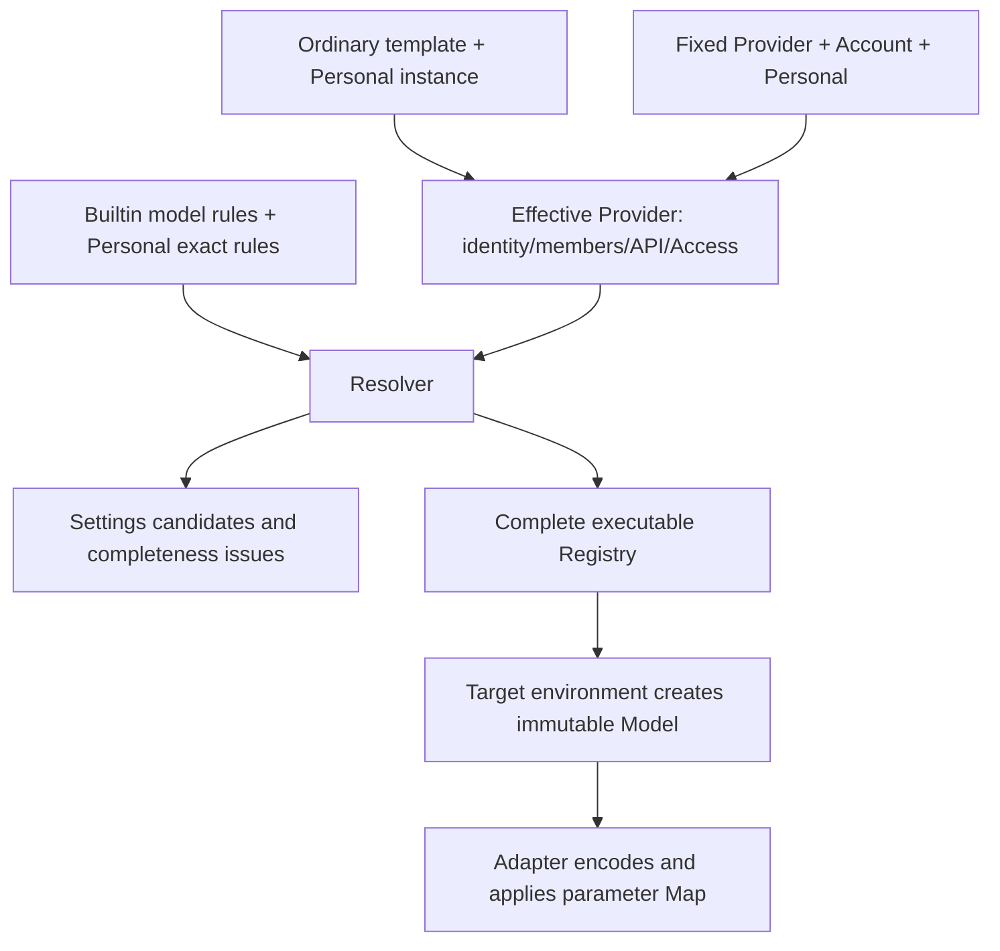

# Template and Model Rule Configuration Spec

## How configuration becomes a call

A template answers "which models are called through which product entry, protocol and access method"; a model rule answers "which capabilities these models have and how logical options are encoded as request parameters". The two paths meet in the Resolver; the settings page and the execution catalog use the same resolved result and must not each guess capabilities from model name or domain.

| Concept           | Meaning and maintenance boundary                                                                                                                       |
| ----------------- | ------------------------------------------------------------------------------------------------------------------------------------------------------ |
| Builtin Release   | The complete configuration shipped in the package or downloaded dynamically; Provider templates/fixed Providers and model rules are versioned together |
| Template          | The connection and member baseline of an ordinary vendor; `templateId` is a stable template identity, not a user instance identity                     |
| Provider instance | A set of concrete connection configuration identified by `providerId`; model identity is `providerId + modelId`                                        |
| Account           | Projects dynamic configuration and entitlements only for known fixed-account Providers; never writes user credentials into ordinary templates          |
| Personal          | The user's explicit overrides and personal model members; undeclared fields keep inheriting, and the whole resolved result is not stored               |
| Effective         | The configuration produced by layering in order; it may still be incomplete and is not what should be written back to a user file                      |
| Registry          | The complete, executable Provider/Model set; the settings page also keeps incomplete candidates and issues for repair                                  |
| Execution Model   | An immutable execution fact created from the Registry of the target execution environment; later refreshes affect only newly created Models            |



An ordinary template instance inherits the template and then layers Personal; a fixed Provider layers Account first and then Personal. Account can act only on built-in fixed identities. Configuration updates must not overwrite a user's explicit address, name or options, and must not use a local Host's credentials or resolved results in place of a remote Host's facts. The mobile UI uses the projection of the target Host. Account dynamic credentials are obtained at request time, and the vendor still gives final authorization on every request.

## Single source of files and types

| File                                                                          | Responsibility                                                                                      |
| ----------------------------------------------------------------------------- | --------------------------------------------------------------------------------------------------- |
| [Production JSON](../../config/provider/zcode-builtin.json)                   | The only hand-edited source, with templates, fixed Providers and model rules                        |
| [Test JSON](../../config/provider/zcode-builtin.test.json)                    | A complete Release generated from the production configuration; models are not edited independently |
| [Generator script](../../scripts/sync-test-builtin-provider-config.mjs)       | Test endpoint mapping and derivation of the corresponding Site rules                                |
| [Rule schema](../../packages/provider/src/config/rule-data-schema.ts)         | Fields of each layer, match formats and source write permissions                                    |
| [Provider schema](../../packages/provider/src/config/provider-data-schema.ts) | API, Access, template metadata                                                                      |
| [Model schema](../../packages/shared/src/model-config.ts)                     | Capabilities, options and completeness                                                              |
| [Resolver](../../packages/provider/src/resolver.ts)                           | Template inheritance, members and the final executable configuration                                |

The file shell is `{schemaVersion: 1, revision, config}`. A content change uses a new revision to avoid the same number with different content; pure doc cleanup does not bump it. The revision differs from the product version number; delivery is in the [Delivery spec](./delivery.md). Do not hand-extend fields the schema does not accept.

## Templates, members and rules

`providerConfigRules.templateRules` defines ordinary API templates. Maintain `templateId`, localized name, Logo, `access`, `api.type/baseUrl`, the key management link and `builtinModelIds`. A template carries no user key and is not a directly executable Provider; instances inherit from the template and then layer Personal.

The current API types are only `anthropic-messages`, `openai-chat-completions` and `openai-responses`. Access still includes ordinary `api-key`, the manual plan `zhipu-coding-plan-api-key` and the fixed account `zhipu-account`. A later plan to unify manual plans into ordinary keys must not be written as current implementation.

When adding a Logo key, check the [resource mapping](../../packages/ui/src/settings/model-provider-section/ProviderLogo.tsx), theme resources and source records; check localization for new names. A pure-configuration dynamic update cannot create image resources that are not in the installed package.

`builtinModelIds` decides template members; `templateModelRules` keyed by `templateId + modelId` decides each member's default enablement and differences. Adding a rule does not add a member; `modelOrder` only sorts existing members. Today every template member has an exact enablement declaration; keep this reviewability when adding.

### Field ownership and identity stability

The template outer layer has only `templateId`, `templateNameMap`, `config`; the name map supports `zh-CN` / `en-US`. The template `config` accepts only `logo`, `access`, `api`, `builtinModelIds`, and Access forbids carrying `apiKey`. Never write instance fields, account state or personal models into a template.

The instance rule outer layer stores `providerId`, optional `templateId/providerName/enabled` and `config`. The instance master switch `enabled` differs from the model `config.enabled`; a fixed-account Provider does not use the master disable switch and is still bound by account entitlement and model enablement. `group` is the product grouping and `visibility` is display control; neither replaces authentication or completeness checks.

`api` stores `type/baseUrl` and optional static `headers`; the URL must correspond to a concrete product and protocol and the vendor's marketing home page must not be used as an API address. Template ID, original model ID and instance name are maintained separately; changing a template display name must not rename saved instances. Prefixes, slashes and case in a model ID are used in requests as is.

Members are formed in source order with built-in first and personal after; a single collection de-duplicates keeping the first occurrence, and when personal and built-in share a name the built-in source is kept. `modelOrder` sorts existing members and creates none. A candidate with a missing template, missing key, bad URL or incomplete capability may be shown in the settings page but must not enter the Registry because of that; a disabled model also cannot execute. `selectable` is also limited by Provider visibility; hidden is not deleted and does not lose the internal exact lookup identity.

## Rule layers

```text
modelRules                    model-general capabilities
  → modelApiRules             model x API protocol differences
  → providerSiteRules         differences of a concrete Base URL, may be limited to model and protocol
  → templateModelRules        exact override by templateId + modelId
  → builtinProviderModelRules exact override by fixed providerId + modelId
  → Personal exact rules      user overrides
```

Within a layer, array order applies and later entries override only declared fields; there is no "most specific match wins", length sorting or extra priority. Omission means inherit, `null` means explicit clear, and a concrete value means override; array values are replaced per the field contract, and automatic merging of thinking levels must not be expected. The Effective value in the settings page must not be written back whole into Personal.

Records in each array use the following match fields and `config`; the file does not repeat the in-memory layer's `type`, and uses no `providerMatch` or cross-layer conditions:

| Array                       | Match fields                                         |
| --------------------------- | ---------------------------------------------------- |
| `modelRules`                | `modelMatch`                                         |
| `modelApiRules`             | `modelMatch + apiTypeMatch`                          |
| `providerSiteRules`         | `modelMatch + baseUrlMatch`, optional `apiTypeMatch` |
| `templateModelRules`        | `templateId + modelId`                               |
| `builtinProviderModelRules` | `providerId + modelId`                               |

Personal allows only smart exact overrides or manual configuration for a concrete Provider/Model; one identity cannot be in both sets, and there is no personal global regex layer. Manual mode fixes the product-opened editable fields and the system fields still come from rules; maintaining Builtin must not rewrite these user intents in passing. Field ownership of the smart/manual switch can be verified in the [manual configuration implementation](../../packages/provider/src/config/manual-model-config.ts).

### Matching and simplification

- Model/Model+API use simple prefix/suffix regexes over a finite maintained set, such as `.*deepseek-flash.*`; a literal decimal point is still escaped. The resolver matches the whole string, model-name matching ignores case, and the request ID is not changed.
- General rules first, specific variants after. Do not auto-sort by string length; the full inherited result must be verified.
- Normalization-equivalent forms of the same concrete Base URL may share one Site rule; different domains or paths are not merged by alternation. Keep several rules when the model or protocol conditions differ and must be split.
- Template/Provider exact rules match by full identity and are not relaxed into model wildcards. A Site `modelMatch` still matches as the schema supports and must not be mis-written as exact-model-only.
- The general baseline is currently `contextWindow=1000000` and `maxOutputTokens.max=128000`. Known smaller windows/output limits must be overridden explicitly; the baseline is neither an upstream measured promise nor a per-request output budget.
- Delete only truly inheritable duplicates. If an earlier-layer family changes to a smaller value, a specific model returning to the general value still needs an explicit override.
- Keep semantic exceptions, such as the `(?!v)` exclusion of vision models in the GLM-4.6 Messages rule and the override order of Flash and FlashX. Historical alias conversion must not widen its scope because a matcher was relaxed.

These choices are based on a finite maintained set: use explicit order to express family and variant differences, reducing duplicate declarations and complex edges, and do not promise accuracy for infinitely many unknown models. Revision 32 changed the general window from 200000 to 1000000 and the output cap from 32000 to 128000; two Model rules were deleted (one setting a million window only for `[1m]`, one setting a 128000 cap only for a preview alias) because they can inherit the new baseline. Protocol-level reasoning mapping, member identity and explicit request budget are not changed by deleting these two rules.

### Capabilities and Option Map

Properties include context capacity, input/output forms, tool calling, structured output, native search, mid-conversation System messages and MFJS Schema requirement. Verify each field separately: a native vision badge is not a media input switch, image support is not video/PDF support, and tool support is not native search support.

A complete execution configuration needs `enabled`, complete properties, a non-empty ordered `reasoningLevel.values/map` and `maxOutputTokens.max/map`. A model with no reasoning also needs a valid option contract; do not guess defaults by model name.

| Field group                   | Leaves that must be verified                                                                                                                          |
| ----------------------------- | ----------------------------------------------------------------------------------------------------------------------------------------------------- |
| `properties`                  | `contextWindow`, `requiresMfjsToolSchema`, `supportsToolCall`, `supportsJsonSchemaOutput`, `supportsNativeWebSearch`, `supportsMidConversationSystem` |
| `properties.inputFormat`      | `supportsText`, `supportsImage`, `supportsVideo`, `supportsAudio`, `supportsPdf`                                                                      |
| `properties.outputFormat`     | currently only `supportsText`; must not be used to declare image or audio generation support                                                          |
| `optionSpecs.reasoningLevel`  | ordered `values` and `map`; no separate `type`, and existing off levels are not renamed automatically                                                 |
| `optionSpecs.maxOutputTokens` | capability cap `max` and `map`; no separate request default budget                                                                                    |

Sparse rules write only differences, and completeness is proven by the resolved configuration. A new model should verify all capabilities; even when a family rule is borrowed in the end, leave the basis on which the inherited value applies. MFJS is a tool parameter Schema requirement and MCS allows mid-conversation System messages; neither can be derived from "supports tool calling".

```text
Adapter encodes the base request
  → reasoningLevel.map
  → maxOutputTokens.map
  → final HTTP Body
```

A Map uses a restricted CEL whose input is the corresponding option value and whose output is a JSON Merge Patch; no IO, environment reads or dynamic code. `{}` leaves the request unchanged, and `null` in the Patch deletes a field. `values` are ordered low to high, and raw values such as `none/disabled` are not renamed globally. Verify the final request for every legal value; a compiling expression alone is not enough, and a Map cannot replace the Adapter's support for media, streaming tool calls and responses. Implementation: [Option Maps](../../packages/model-option-map/src/option-maps.ts) and the [request application point](../../apps/zcode-cli/packages/adapters/src/model/model-option-map-fetch.ts).

## Production and test configuration

```text
edit production JSON → sync-test → test JSON → check-test → same MR
```

The generator re-derives from the complete production file and does not patch the old test file incrementally:

- Only the known production endpoints of the fixed `zhipu-account` Provider are converted, including personal/team, Start, off-peak and speed-up cards; unknown account endpoints fail explicitly.
- Ordinary manual API templates, third-party addresses and key management links keep their original values. So ordinary templates in the test package may still call the production vendor and incur real cost.
- The production Site rules are kept and followed immediately by appended test endpoint rules that inherit the same model/API conditions, capabilities and Map.
- Templates, model members, the remaining rules, schemaVersion and revision stay from the same source. Test environment differences must not be used to maintain a second set of model capabilities.

```bash
pnpm provider:config:sync-test
pnpm provider:config:check-test
```

If a new ordinary template really needs a different test endpoint, first confirm the environment requirement, then change the generation strategy and the script tests; never hand-edit the test JSON.

### Current account endpoint mapping

| Production Base URL                              | Test Base URL                                    |
| ------------------------------------------------ | ------------------------------------------------ |
| `https://api.z.ai/api/anthropic`                 | `https://api.z.ai/api/anthropic`                 |
| `https://open.bigmodel.cn/api/anthropic`         | `https://open.bigmodel.cn/api/anthropic`         |
| `https://zcode.z.ai/api/v1/zcode-plan/anthropic` | `https://zcode.z.ai/api/v1/zcode-plan/anthropic` |
| `https://zcode.z.ai/api/v1/off-peak/anthropic`   | `https://zcode.z.ai/api/v1/off-peak/anthropic`   |
| `https://zcode.z.ai/api/v1/highspeed/anthropic`  | `https://zcode.z.ai/api/v1/highspeed/anthropic`  |

This table drives only the fixed-account Provider address conversion and the derivation of the corresponding Site rules, and does not change ordinary templates with the same URL. A new test address also needs a check of the existing Adapter's admission for the official-version request safety validation; the product environment switch itself does not grant access to a new domain.

### Build source selection and final resources

The shared [build entry](../../scripts/builtin-provider-config.mjs) owns the environment source selection: an explicit non-empty `ZCODE_ENV` wins; otherwise `.env` is read first, then `.env.production` for `NODE_ENV=production`, and otherwise `.env.development` and `.env.development.local` in turn. Values from later-read files override earlier ones, and missing files are skipped. The final value is trimmed and lower-cased, empty defaults to `test`, and an invalid non-empty value is an error.

`production` selects `config/provider/zcode-builtin.json` and `test` selects `config/provider/zcode-builtin.test.json`. `NODE_ENV` decides only the env file group above and not the product environment directly; the branch name takes no part in the selection.

```text
ZCODE_ENV and env files → select complete JSON → reuse the Release Decoder to validate
                                     ↓
                   package resource or embedded constant → Builtin Source → Registry
```

| Consumer form              | Configuration landing point and verification requirement                                                                           |
| -------------------------- | ---------------------------------------------------------------------------------------------------------------------------------- |
| Desktop installer          | `resources/config/provider/zcode-builtin.json`                                                                                     |
| Ordinary CLI               | `dist/provider/zcode-builtin.json`, the build refreshes the adjacent resource                                                      |
| SEA single executable      | resource key `zcode-provider/zcode-builtin.json`                                                                                   |
| HTTP / Remote / Server CLI | the full JSON is compiled into a constant; check the final JS/package artifact                                                     |
| Desktop development        | locate the repo source file by the same compile environment; the priority of an explicit configuration path injection is unchanged |

A read, JSON parse or Schema validation failure terminates the build directly, with no cross-environment fallback. The build only reads the selected local file; it does not download online configuration, run sync implicitly or overwrite source files. On Windows the file path is converted to a `file:` URL before loading the decoder so that the drive letter is not taken as a protocol.

The build cache must cover `ZCODE_ENV`, the env files, both configurations and the shared build tools. The current CLI Turbo inputs and the Desktop E2E fingerprint include these inputs, the Server embedded content takes part in the artifact hash, and bootstrap rebuilds the Agent JS and refreshes the adjacent configuration resource. Parallel builds for different environments use independent worktrees/output directories and must not write the same dist concurrently.

The build decides only the initial in-package configuration; whether the client adopts it is further limited by the effective cache and revision, see [Delivery and recovery](./delivery.md). A regression for an environment change must check the actual source selection, bad-file failure, cache invalidation and final embedded content with Releases of different content, and must not claim to pass because the two files happen to be identical.
