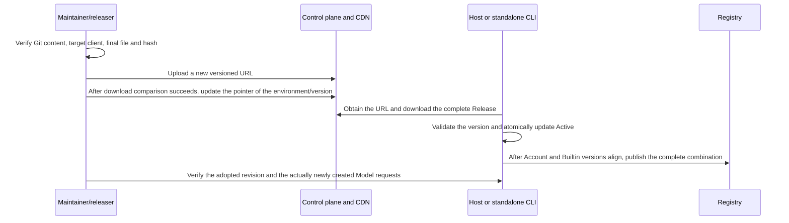

# MR, Version and Dynamic Configuration Delivery

This page explains how template/model configuration is delivered and does not authorize maintainers to publish automatically. Creating an MR, merging, releasing a version and changing the online configuration pointer are different actions, each keeping its own result and responsibility.

## Git and MR

The production configuration is the only edit source; the test configuration and the necessary docs/tests are submitted in the same MR. A content change uses a new revision; the two environment files keep the same revision, with content derived per environment. After a merge conflict, re-check the latest upstream revision; do not only resolve the text conflict and reuse a version number already taken by different content.

The MR description must at least list template and model additions/removals, default enablement, concrete differences in capability/Map/URL, production/test derivation results, official evidence, real validation and gaps, the effect on old instances/selections, the delivery method and the rollback plan. Content is organized into five chapters:

| Chapter | What this area should state |
| --- | --- |
| TL;DR | The concrete problem and the changed behavior; the real file count and added/removed lines |
| Goal | Background, original behavior, the entries/models integrated or fixed, design intent and acceptance conditions; for a bugfix, root-cause evidence, feedback linkage and this directory's work record |
| Change scope | The actual changes to production/test configuration, code, tests, this directory's spec and inventory, and non-goals |
| Validation | The actual commands and results, the key/region/plan/protocol matrix and unvalidated items; for a bugfix the corresponding regression case, and evidence when interaction changed |
| Risk and rollback | Old instances, personal overrides, target client versions, release method and recovery plan |

Commit titles use `<type>(<scope>): <subject>`, for example `docs(provider)` for doc cleanup; content changes are separated from pure docs. File size comes from `git diff --shortstat origin/staging...HEAD`; the description contract follows the repository `zcode-mr` skill, and root causes, feedback linkage or validation results must not be invented.

Create/update the MR with the repository `zcode-mr` tool: on a clean feature branch first run `python3 .agents/skills/zcode-mr/scripts/zcode_git_workflow.py setup` to check authentication, write the five-chapter description into a temporary UTF-8 file, then run `python3 .agents/skills/zcode-mr/scripts/zcode_git_workflow.py mr --description-file <description file> staging`. The tool keeps the push hook, looks for a same-source/target MR and creates one only when missing. Check the real MR URL returned; merely generating a prefilled link does not count as created. For an existing MR, body changes also need to be updated via glab and verified. On authentication failure keep the local result and never write credentials into the description or commands.

An ordinary catalog change goes through a configuration MR; a new protocol, Access, Adapter, Logo resource or UI behavior needs corresponding code and tests, and "just a model update" must not skip checks. A change lacking a key keeps the pending-validation state clearly in the MR, and whether to accept an exception is decided explicitly by the responsible role.

## Choosing the delivery method

| Case | Delivery method and condition |
| --- | --- |
| Routine template/model maintenance | Ship the complete configuration with the product version and verify the final package resource |
| Uses only fields, protocols and capabilities the target client already supports, and the catalog/rules really must be updated early | Dynamic configuration may be evaluated; it still comes from reviewed Git content and final-file verification |
| New Schema/Access/protocol, Adapter behavior, image resources or UI capability | Deliver the client capability first; never push only JSON to old clients |
| Online content is wrong | Publish the corrected content under a higher revision; also fix the Git/in-package baseline so the two chains do not diverge long term |

The same `schemaVersion=1` does not prove that all old clients understand new fields, values or Maps. Before a dynamic update, confirm the actual decoder, Adapter and known behavior for the target product version/platform; do not verify only on a development branch. Canary, version split, executor and permissions follow the actual control plane; this repository provides no one-click configuration publish/auto-rollback tool that may be assumed to exist.

## Delivery with a version

1. The merged production source and the derived test source each pass their checks.
2. Build with the real `ZCODE_ENV` and check the revision, hash and target templates of the actual in-package/embedded content, not just the source. Environment source selection, Desktop/CLI/SEA/Server resource locations and cache requirements are in the [Configuration spec](./configuration.md#build-source-selection-and-final-resources).
3. Record the product version containing the commit and the test/production artifacts, and confirm the configuration the target Host adopts after install; an effective cache with a higher revision may keep priority, so effect must not be inferred merely from a package upgrade.
4. According to this change, check newly added instances versus existing inheriting instances, personal overrides and actual model requests. Record the platforms/remote modes not covered.

## Going live dynamically when necessary

The existing client uses a two-stage download: the control plane `/api/v1/client/configs` returns `data.configs.builtin_provider_config_json` by app_version/platform, which is an HTTPS download URL; the URL content is the complete Release. A missing field means no release this time and existing configuration is not cleared.

Operation order:

1. Confirm necessity, target client/platform, production or test environment, release responsibility and authorization, and record the previous content and the recovery plan.
2. Prepare the final file from the Git content to be delivered, run the Decoder, completeness and this change's rule/request validation on that file, and record the hash. Validate and deliver production and test separately; the two files of the same revision must not be mixed.
3. Upload a **new URL**, compare hash/full content after download, then switch the corresponding control plane pointer. Do not overwrite an old URL with a long cache, and do not hand-edit JSON online to bypass Git.
4. Verify the actual client's download result, Active revision, complete Registry and the requests of subsequently created Models. A successful download is not successful adoption, and a changed page list does not mean all callers have updated.
5. Observe authentication, parameter rejection, tool streaming and user feedback of the affected entries; recover per the boundary below. Record the adoption evidence and update the delivery state of the work item.

The downloader restricts to HTTPS, no URL userinfo, no redirects, and carries no account token/key; the total budget of the two requests is 20 seconds, and the body is limited to 10,000,000 actual bytes. The [download implementation](../../packages/provider-node/src/zcode-builtin-download.ts) is authoritative; do not copy a second release client.

## Effect and recovery boundaries

- At startup the higher revision is picked among compatible valid in-package/Active candidates; a lower online version is ignored, same version with same content is unchanged, and same version with different content is rejected. When startup meets a same-number cache content conflict it falls back to the trusted in-package candidate.
- Provider and Model rules are replaced as a whole; structural validity does not guarantee business correctness. A download failure keeps the baseline, and automatic rollback of a wrong business configuration is not promised.
- Host/standalone CLI own the refresh: check every minute, download again one hour after success by default, and back off exponentially by the minute up to one hour on failure. A manual force bypasses the due-time limit but not a valid lease.
- The cache is isolated by platform, App version and control plane Endpoint; changing the CDN URL does not reset the source version. Test/production must not be judged to have identical content merely by an identical revision.
- A Managed Worker does not download on its own; mobile uses the target Host. When Builtin and Account are not aligned the previous complete Registry is kept, and a mixed state must not be published.
- Personal intent is not overwritten and existing execution Models are not changed in place; do not promise that the current request or all existing runs switch immediately.
- Rollback publishes **a higher revision of verified old behavior/corrected content**. Merely pointing the URL back to a lower revision cannot roll back clients that have already upgraded; if the client code is incompatible, a fixed client or a verified delivery restriction is needed.

Implementation checks: [Release Source](../../packages/provider-node/src/zcode-builtin-provider-config-source.ts), [refresh coordination](../../packages/provider-node/src/zcode-builtin-remote-synchronizer.ts), [Registry version pairing](../../packages/provider/src/registry-service.ts). The current online pointer was not queried this round; no historical online revision can substitute for today's production state.
