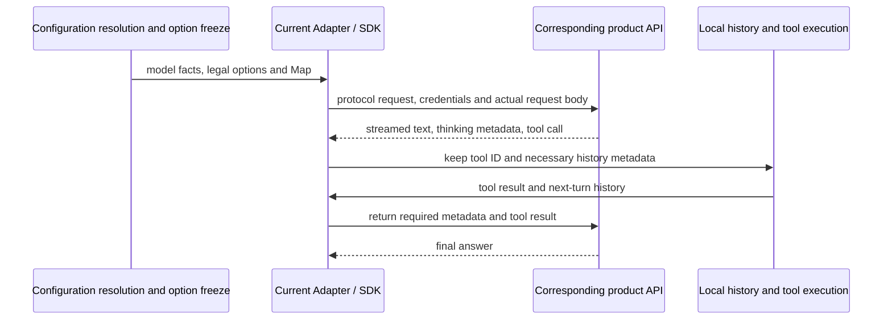

# Mainstream Vendor and Model Expansion Plan (2026-10-14)

## Conclusions and evidence boundary

Implementation first fills new models of already-maintained vendors, then the aggregator intersection, then expands Tencent TokenHub, Volcano Ark and other entries by protocol evidence. Lifecycle and catalog deviations of existing entries are verified in parallel; items involving modification/deletion are discussed separately and are not a precondition of independent additions. The Google native protocol and Mistral paths that need response conversion are postponed; every other entry needing no extra adaptation may proceed. StepFun and SiliconFlow follow; the compatible APIs of Azure and Bedrock are validated separately and no longer lumped together as "must develop a new protocol". Besides new ordinary entries, the coding plans of existing brands must also be checked.

The upper part of this page keeps the 2026-10-14 research evidence. The execution principle confirmed afterwards: additions within existing capability proceed directly, and adjusting/deleting existing items is discussed first. Confirmed again on 2026-10-15: paths needing extra adaptation are all postponed this round, other entries may be integrated, and a batch only expresses order. Material, key validation, configuration implementation and delivery are recorded separately; the batch plan is below, and an earlier candidate order cannot override later explicit decisions.

- Check date: 2026-10-14; repository baseline: staging `68fac8de4fcc`, Builtin revision 33, 21 templates, 246 template member entries, production/test configuration from one source. Full inventory in the [current state](./current-state.md).
- Done: read official catalogs, release and retirement notes; anonymous GET of public Models APIs; ran repository Release decoding, rule resolution and Option Map compilation and inspected the actually generated request patches.
- Not done: post-login catalog queries, billable inference, plan entitlement verification, real desktop/remote tool loops. "Present in the catalog" below must not be written as "supported".
- Dating: explicit release, effective and retirement dates are written in the entry; pages without a date record only this check date and no release date is guessed. A public catalog `created` is not automatically a release date.
- Trade-off: existing user usage and demand ranking of new vendors were not obtained; the order is based on Agent relevance, official availability, current gaps, expiry risk and maintenance cost, an engineering suggestion.

## First priority: risks in existing entries

### MiniMax needs a migration decision before 19 October

The [official model overview](https://platform.minimax.cn/docs/guides/models-intro) announces that the M2.5/M2.7 series **stops opening to new users on 2026-10-19 and the pay-as-you-go API goes offline on 2026-11-18**; for plan users the old names route to M3.1 Flash Preview from 19 October. The current `minimax` template still enables M2.7 and highspeed by default; first check how the ordinary API and plans each handle it.

`MiniMax-M3.1-Flash-Preview` is currently offered only through M Plan / MiniMax Code and cannot be added to the ordinary pay-as-you-go template and declared usable. Suggestions:

1. The account collaborator checks the key product, actual endpoint, plan members and old-name routing. If endpoint or credential requirements differ, split the template; even if the same, record the entitlement difference.
2. For the ordinary API validate first the listed M3 as the migration candidate; after confirmation adjust the maintenance level of the old series, keeping the historical selection handling, and do not silently change to another model.
3. If a plan keeps the old ID, re-check the rules by the actual capability after routing. An unchanged `modelId` does not mean the thinking parameters and capabilities are unchanged.
4. If no key is obtained before the deadline: keep an explicit pending-validation state and owner, and do not write migration as done in the current state.

The [official Messages parameter description](https://platform.minimax.cn/docs/api-reference/text-anthropic-api) states: M3.1 Flash Preview does not allow turning off thinking and supports `low/medium/high/xhigh/max`; M3 thinking can be turned off; M2.x accepts the off parameter but does not truly turn it off. The current rules still resolve M3.1 offline to `disabled/enabled`, so model completion must come with a rule fix. The docs use a new domain while the repository uses the old one; a domain change also needs compatibility validation, and the user's entry must not be replaced merely because the docs were updated.

### Ten old members in aggregator catalogs need verification

GET results of this round, without key and without inference calls:

| Public catalog | HTTP / entries | Comparison |
| --- | --- | --- |
| [OpenRouter Models](https://openrouter.ai/api/v1/models) | 200 / 462 | 4 of the current 59 members do not appear in this catalog |
| [OpenCode Zen old catalog](https://opencode.ai/zen/v1/models), [new catalog](https://opencode.ai/inference/v1/models) | both 200 / 85 | the two JSONs are identical; 6 members are missing in the union of members of the existing three Zen protocol templates |
| [OpenCode Go old catalog](https://opencode.ai/zen/go/v1/models), [new catalog](https://opencode.ai/inference/go/v1/models) | both 200 / 40 | the two JSONs are identical; no missing members in the existing three Go protocol templates |

| Entry | Configured IDs not listed in this catalog | Current default state |
| --- | --- | --- |
| OpenRouter | `qwen/qwen3.8-max` | enabled |
| OpenRouter | `openai/gpt-5.6`, `qwen/qwen3-vl-plus`, `qwen/qwen3-vl-flash` | disabled |
| Zen Messages | `qwen3.7-max` / `qwen3.7-plus` | the former enabled, the latter disabled |
| Zen Chat | `hy3-free`, `ling-3.0-flash-fin-free`, `mimo-v2.5-free`, `nemotron-3-ultra-free` | all enabled |

Validate first the **6 default-enabled members** among them. One missing public-catalog entry does not prove the inference entry has failed: first confirm the catalog, aliases and request results with an authorized account, then decide whether to turn off the default, keep compatibility or remove from the template. Also one entry going offline must not be spread to all vendors.

The old and new OpenCode **Models** endpoints are both readable, which does not justify forcibly migrating the template URL nor asserting that the old and new inference endpoints are equivalent. The [Go access guide](https://opencode.ai/v2/docs/console/go/) also requires a stable `x-opencode-session` per session. Before implementing check whether the current request satisfies it; a static template Header cannot replace a dynamic session identity. If runtime wiring is needed, describe and test it separately and do not mix it into a pure model-list update.

## Maintained vendors: additions and retention suggestions

The table covers the current official brands; aggregator entries are listed separately later. Unless stated, the source page gives no unified release date. Key candidates are considered for default enablement only after real validation; whether the original key models drop to general maintenance is a separate explicit decision.

| Subject | Current difference and suggestion | Source / time |
| --- | --- | --- |
| OpenAI | Add `gpt-6.1-sol` and `gpt-6-luna` first, filling general coding and the low-cost tier respectively; keep Astra. Evaluate `gpt-6-sol` as a still-usable previous-generation candidate and do not enable everything for version completeness. 6.1 Sol does not support `none`; Chat tool calling of 6 Luna works only in non-thinking mode, so the existing official Responses template is better to validate first | [6.1 Sol](https://developers.openai.com/api/docs/models/gpt-6.1-sol), [6 Luna](https://developers.openai.com/api/docs/models/gpt-6-luna); the [changelog](https://developers.openai.com/api/docs/changelog) records 6.1 Sol released on 09-29 |
| Anthropic | Add `claude-opus-5-5`, `claude-sonnet-5-5`, `claude-haiku-5-5`; keep the Fable series. The existing broad rules for Opus/Sonnet already cover the five adaptive levels and need no rewrite by version number; Haiku 5.5 needs its own rule. Do not disguise Sonnet's `between_tools` as fully off thinking | [model catalog](https://platform.claude.com/docs/en/models/overview), [effort](https://platform.claude.com/docs/en/build-with-claude/effort) |
| Z.AI | Ordinary API candidate `glm-5.3-flashx`; also check `glm-5.2`, missing from the ordinary template, which can be general maintenance. The official FlashX ID is lower case and must not be changed in case from the display name; saved old IDs are not renamed in bulk. Coding Plan entitlement is proven separately | [catalog](https://docs.z.ai/guides/overview/overview), [Flash / FlashX](https://docs.z.ai/guides/vlm/glm-5.3-flash) |
| BigModel | Check FlashX, 5.2 and the plan catalog separately. The Chinese official model body is readable, but this round did not obtain product evidence for FlashX equal to Z.AI, so do not mirror directly | [official model description](https://docs.bigmodel.cn/cn/guide/models/text/glm-5) |
| xAI | Add `grok-4.7`: 500,000 context, image input, `low/medium/high/xhigh`; after validating Responses reasoning history and tool loop, decide the default state of 4.6 | [model card](https://docs.x.ai/developers/models/grok-4.7), [reasoning protocol](https://docs.x.ai/developers/model-capabilities/text/reasoning) |
| MiniMax | First finish the lifecycle handling above; M3.1 Flash Preview is a plan candidate, not blindly added to the ordinary API; M2.1/M2 must not be declared retired along with the M2.5/M2.7 notice | [model overview](https://platform.minimax.cn/docs/guides/models-intro) |
| Kimi | The current official mainline K3, K2.7 Code, highspeed and K2.6 are already in the template; no duplicate IDs to add. K2.8 Preview appears on some platforms and must be validated from that platform's catalog; it is not derived as available on the original API. The Kimi Coding product is investigated separately | [official catalog](https://platform.kimi.com/docs/models); the original retirement date of K2.5 / moonshot-v1 is 08-31 and this cannot be used to delete same-named members of aggregating entries |
| DeepSeek | Keep `deepseek-flash` and `deepseek-v4-pro`. The former already points to V4.1 Flash; re-check multimodal, thinking and old aliases; do not add a guessed original-vendor `deepseek-v4.1-flash` | [official changes](https://api-docs.deepseek.com/updates/): 09-10 release and alias routing; states V4 Pro continues to be served after 09-14 |
| Qwen / Bailian | The current 3.8 Max/Flash cover the mainline; validate domestic Messages and international Chat separately. 3.8 Omni Flash is an extra multimodal candidate: first confirm this product's input/tool needs; audio output and realtime interfaces do not automatically enter chat templates. Also check the independent Coding Plan entry | [model catalog](https://help.aliyun.com/zh/model-studio/models), [plan FAQ](https://help.aliyun.com/en/model-studio/coding-plan-faq) |
| MiMo | Revision 33 already added the ordinary API / Token Plan two templates and V2.6 Pro/Flash; not added again this round. Focus on real validation, V2.6 in aggregating entries and later plan member changes | [plan access](https://mimo.mi.com/docs/zh-CN/tokenplan/Token%20Plan/quick-access), [Messages API](https://mimo.mi.com/docs/en-US/api/chat/anthropic-api); the repository already implements this |

OpenAI's retirement table also gives exact shutdown dates and the Models API `shutdown_date`. A 10-14 announcement about the GPT-4 series was read; this must not be inferred to mean current GPT-5/6 members are shut down. Old model catalog labels, stopping new users, formal shutdown and continued service of aggregating entries are recorded separately. [Official retirement notes](https://developers.openai.com/api/docs/deprecations)

### Additions for aggregator entries

The following IDs appeared in this public catalog but were not verified per Messages / Chat / Responses inference. Keep each platform's original ID; do not infer by splicing original-vendor IDs.

| Entry | Add first | Extra constraints |
| --- | --- | --- |
| OpenRouter | `openai/gpt-6.1-sol`, `openai/gpt-6-luna`; `anthropic/claude-opus-5.5`, `anthropic/claude-sonnet-5.5`, `anthropic/claude-haiku-5.5`; `x-ai/grok-4.7`; `z-ai/glm-5.3-flashx`; `xiaomi/mimo-v2.6-pro`, `xiaomi/mimo-v2.6-flash` | The current template is Messages. Verify mapping, output and routing capability one by one; `-pro` and `-ultraspeed` are reviewed separately, `:batch` does not enter ordinary chat templates |
| OpenCode Zen | `gpt-6.1-sol`, `gpt-6-luna`, the three Claude 5.5 models, `grok-4.7`, `mimo-v2.6-flash-free` | Allocate to the existing three templates by the official protocol table; `-backup` is not a free copy of an ordinary model |
| OpenCode Go | `gpt-6-luna`, `claude-haiku-5-5`, `grok-4.7`, `mimo-v2.6-pro`, `mimo-v2.6-flash` | The Go catalog and plan quota are independent of Zen; first confirm the current key can access |

Aggregating members of Google, Mistral, Tencent and StepFun are evaluated by the established scope principles and the protocol evidence of that entry, and may proceed once the addition conditions are met, without waiting for per-brand approval; postponing the original-vendor direct connection does not automatically forbid compatible aggregating entries. This catalog shows `google/gemini-4-argon`, `mistralai/mistral-large-4-0`, `tencent/hy4-preview`, `stepfun/step-5-preview`; this does not mean all corresponding original-vendor models, protocols and regions are covered. `gemini-4-argon-contributor` of Go has a product suffix, and its usage conditions must be clarified separately and not treated as an ordinary Argon.

## New vendors and product entry planning

### New vendor candidates and protocol boundaries

| Vendor / product | Starting models and rationale | Integration path and missing evidence |
| --- | --- | --- |
| Google Gemini API (native postponed) | `gemini-4-argon` and `gemini-3.8-flash` are key candidates; 3.5 Flash-Lite as a cost tier to check later. Fills the currently missing mainstream model family | The native protocol is not among the existing three API types and is postponed in the short term; a Chat-compatible entry may proceed if validated to need no extra adaptation. Whether an aggregating service is usable is judged per entry. Argon's 1,048,576 is a combined input+output window and the ordinary synchronous output cap is 65,536; million-token long output is another execution capability and cannot be written into the ordinary cap. `minimal` of 3.8 Flash is not supported |
| Mistral API | `mistral-large-4`, `mistral-small-2603`; `mistral-medium-3-5` can be general maintenance; covers flagship and light Agent models | Check Chat requests, reasoning control, streaming tool calls and model aliases. The 256k context of Small / Medium must be overridden explicitly and the 1M baseline cannot be applied. The current catalog puts Devstral 2 / Small 2 in the retirement zone; do not prioritize adding old code models |
| Tencent TokenHub | `hy3` as a stable candidate, `hy4-preview` default off for observation; fills the original Hunyuan entry | Officially supports Messages and Chat, with Responses capability varying by model. Validate Messages first. The current docs give Guangzhou `https://tokenhub.tencentmaas.com/v1` and Singapore `https://tokenhub-intl.tencentmaas.com/v1`; old and new docs differ in domain, so decide regional templates after measuring, and do not build directly from old Hunyuan SDK material |
| Volcano Ark | The Coding Plan docs list `doubao-seed-2.1-pro` and `doubao-seed-2.1-lite`; `doubao-seed-evolving` as a rolling alias candidate | Verify the ordinary API, Coding Plan and Agent Plan separately. The model evidence here comes from the plan catalog and cannot be filled directly into the ordinary API; the corresponding original Model / Endpoint ID, endpoint, protocol and key must be obtained. Evolving needs alias upgrade and reasoning-history compatibility recorded |

Sources: [Argon model card](https://ai.google.dev/gemini-api/docs/models/gemini-4-argon) (updated 10-13), [3.8 Flash model card](https://ai.google.dev/gemini-api/docs/models/gemini-3.8-flash) (updated 09-02), [compatible entry](https://ai.google.dev/gemini-api/docs/openai), [Mistral catalog](https://docs.mistral.ai/models), [Large 4](https://docs.mistral.ai/models/mistral-large-4-0), [Small 4](https://docs.mistral.ai/models/mistral-small-4-0-26-03), [Medium 3.5](https://docs.mistral.ai/models/mistral-medium-3-5-26-04), [TokenHub call overview](https://cloud.tencent.com/document/product/1823/130079) (updated 10-13), [Ark plan changes](https://docs.volcengine.com/docs/ark/coding-plan-personal-model-release?lang=zh) (Seed 2.1 Pro/Lite: 09-23).

The confirmed addition authorization applies to candidates the existing execution chain can express and does not require all vendors to finish at the same time. Mistral's official note says streaming `delta.content` in high mode returns a list of thinking chunks and requires returning them in history; this round's check of the installed `@ai-sdk/openai-compatible` found the response schema `message.content` / `delta.content` still accepts only a string or null, and assistant history also uses strings. The current execution adapter uses this SDK directly and does not assemble such block conversion. So the thinking mode needs at least response and history adaptation, which is postponed this round, and appending a template alone is not enough. This judgment comes from code and protocol comparison and has not been reproduced with a real request. [Official thinking response contract](https://docs.mistral.ai/studio/conversations/reasoning)

### Later batches and evidence gaps

| Subject | Suggestion and boundary | Evidence level |
| --- | --- | --- |
| StepFun | Investigate Step 3.7 Flash first, Step 5 Preview as a default-off candidate; ordinary API and Step Plan separate. Do not take OpenRouter's `stepfun/step-5-preview` as an original-vendor ID | [Official platform](https://platform.stepfun.com/) search body and the [3.7 release](https://www.stepfun.com/news/step-3-7-flash) are readable; direct fetch of the main site timed out, exact original catalog/parameters still need evidence; 3.7 release date 05-29 |
| SiliconFlow | Domestic aggregator candidate, maintaining the intersection with approved upstreams; check billing/routing prefixes such as `Pro/` and do not strip them | [Quickstart](https://docs.siliconflow.cn/docs/userguide/quickstart) and [Messages API](https://docs.siliconflow.cn/docs/api/messages-post) are readable; account catalog and per-model parameter evidence needed |
| Azure / Microsoft Foundry | First validate the v1 compatible entry with resource URL + Deployment + static API key; developing a native protocol first is not required. A deployment name can be arbitrary and capability may not be derivable from a model-name regex, so an exact override or identity mapping must be explicit | [v1 docs](https://learn.microsoft.com/en-us/azure/foundry/openai/api-version-lifecycle?tabs=key) confirm `/openai/v1/` needs no date-style `api-version`; Entra automatic refresh is another capability path |
| AWS Bedrock | First investigate the API Key + Responses path; it can no longer be asserted that everything must use SigV4. Verify Region, runtime / mantle, Profile ID and model authorization separately; IAM refresh is designed separately | [Responses docs](https://docs.aws.amazon.com/bedrock/latest/userguide/inference-responses-api.html) readable; server tools, state storage and model IDs of runtime and mantle are not equivalent |
| Groq | Introduce when there is a clear low-latency need, checking GPT-OSS 120B / 20B first; do not treat the platform's built-in Agent system as an ordinary model, and do not append all Llama indiscriminately | [model catalog](https://console.groq.com/docs/models), [tool support](https://console.groq.com/docs/tool-use/overview) readable; the combination of streaming, structured output and parallel tools needs separate testing |
| Together | Evaluate by the intersection with maintained upstreams; Serverless and Dedicated do not share one model list | [public catalog](https://docs.together.ai/docs/serverless/models) readable; no project demand/key evidence yet supports putting it in the first batch |
| Cerebras, Fireworks, NVIDIA hosted API, Cohere, Baidu Qianfan, Vertex | Keep as a scope scan and enter the next round by user demand, unique model value and maintainability; do not create empty templates all at once merely because they are "mainstream" | This round did not finish per-product catalog and protocol verification; the Cerebras catalog fetch failed. No implementable concrete IDs are given and integration research is not claimed done |

Open-weight models are also in scope: GPT-OSS, Llama, Qwen, DeepSeek, StepFun and others should be reviewed by "available inference entry x exact ID x Agent capability". When a model publisher has no public API, cover it preferably through maintained aggregating entries and do not create a publisher template in which credentials cannot be filled in. This round does not cover model training, download and deployment, Embedding, image/speech generation or realtime audio products.

### Plan gaps of existing brands must also be checked

Adding new brands must not hide missing product entries of existing ones. Collect in parallel the credentials/catalog of Bailian Coding Plan, Kimi Coding and MiniMax M Plan; when adding a new brand also check Ark Coding/Agent Plan and Step Plan. Priority follows the plans users actually hold; the same brand does not mean an ordinary key can be reused.

The official Bailian FAQ clearly distinguishes plan keys from ordinary keys, and the dedicated entry with `coding`; a wrong combination may go through pay-as-you-go billing. So the current Bailian ordinary API template cannot be described as supporting plans. The plan's automation usage limits, usage window, model quota and extra-paid fallback also need confirmation by collaborators, and real validation follows the interactions the product allows. [Plan description](https://help.aliyun.com/en/model-studio/coding-plan-faq)

## How rules need adjusting

### Actual resolution results, not just whether the JSON has the model

This round used the repository [Release decoder](../../packages/provider-node/src/zcode-builtin-release.ts), [rule resolver](../../packages/provider/src/config/model-config.ts) and [Map compiler](../../packages/model-option-map/src/option-maps.ts) for a read-only probe of the production configuration. The input contains real templates, API type and Base URL; candidate models are not written into the member table. For each resolved thinking level the Map is compiled and applied with an output budget of 1024, inspecting only the generated request without network requests.

| Probe subject | Actual result at revision 33 | Impact on implementation |
| --- | --- | --- |
| official `gpt-6.1-sol` | 1M, text input, `disabled/enabled`; disabled generates `reasoning.effort=none` | Add an explicit model rule; the official API does not support none, so adding the template member alone is not enough |
| official `gpt-6-luna` | Also falls into the general two levels and text input | Complete levels and capabilities; express the tool constraints of Chat / Responses separately |
| official `grok-4.7` | 1M, text input, two levels; disabled generates none | Fix to the evidence-supported 500k, image and four levels; the output cap needs evidence and cannot be inferred from context |
| Claude Opus / Sonnet 5.5 | Already inherit image/PDF and the five adaptive levels; the output patch contains `output_config.effort` | The existing base mapping can be reused; add exact assertions and measurement, avoid pointless refactoring |
| Claude Haiku 5.5 | General two levels, text input | Add dedicated capability and levels; do not inherit Haiku 4.5 or general rules |
| MiniMax M3.1 Flash Preview | The broad M3 rule gives image/video, 32k output, two levels and allows disabled | A more specific rule is needed to suppress the broad M3 rule; add output cap evidence; old plan alias migration may also be affected |
| Z.AI `glm-5.3-flashx` | Already hits the 5.3 family capabilities and three levels; Chat requests carry several thinking fields | It is not "no rule at all"; verify which fields the current gateway actually supports before deciding whether to slim down, and compatibility fields cannot be deleted brand-wide |
| OpenRouter `moonshotai/kimi-k3` | Resolves to three levels, generates `output_config.effort`, no `thinking` field | The Site K2 match range does not cover K3, but Model+API already provides the mapping; a missing regex alone cannot be judged a bug, real request evidence is needed |
| OpenRouter `openai/gpt-6.1-sol` | General Messages two levels, can generate `thinking.type=disabled` | Model rules and Map of the original vendor and the aggregator must be checked together, not just fix Responses |

A new model passing structural validation does not mean the recommended levels and requests are valid. Unknown models keep the established 1,000,000 context / 128,000 output baseline; **this plan does not revoke that established decision**. Known real differences must be overridden, and passing validation on the unknown baseline is not completion for a new member.

### Suggestion: keep layering, tighten validation

1. **The Model layer writes model facts, the API layer writes protocol mapping, the Site layer writes product differences.** Put more specific rules after the broad rules they must override; case insensitivity is for matching only and the original request ID stays unchanged. When new and old generations have different semantics, split rules explicitly rather than keep widening one regex.
2. **Thinking control lists legal combinations per model.** Opus 5.5 forces adaptive; Sonnet 5.5's `between_tools` is a special mode and not disabled; Haiku 5.5's disabled and high levels have combination restrictions. In the first batch prefer the adaptive levels the current setup can express clearly; a new special mode needs its product semantics confirmed first. [Official control description](https://platform.claude.com/docs/en/build-with-claude/effort)
3. **Capacity distinguishes context, input, output and execution mode.** Gemini's ordinary output of 65,536, Mistral Small/Medium 256k context and the like must be overridden. Dynamic long output and server-side background tasks do not get support through one big number. Models whose output budget includes thinking consumption go into low-budget acceptance.
4. **Native capability and entry-available capability are checked separately.** Having function calling does not mean parallel tools, strict JSON, streaming and multimodal can be combined; having a vendor search product does not mean the current Adapter has integrated native search.
5. **Rules only declare and map requests; they cannot supply the response protocol.** Encoding of new fields, opaque reasoning content, streaming blocks, tool-call IDs and history replay must be measured on the current Adapter/SDK. When loss is found, locate this layer first, not hide it by widening a regex or ignoring errors.
6. **Default enablement is separate from model existence.** After validation, pick appropriate mainlines for new flagship and low-cost tiers; Preview, free temporary routing, backup, ultraspeed and pro variants are evaluated separately and do not all turn on with ordinary models.
7. **Keep the old-selection boundary.** This work does not automatically change a user instance's URL, Model ID or thinking value; if the prompt, invalidation handling or automatic migration after model retirement must change, propose an explicit behavior plan separately.

The validation chain of the tool loop is below; if any link is missing it must not be written as "supports Agent":

The current [execution adapter](../../apps/zcode-cli/packages/adapters/src/model/model-execution.ts) assembles the Responses, Messages and Chat paths; the [request patch](../../apps/zcode-cli/packages/adapters/src/model/model-option-map-fetch.ts) is applied after the SDK generates the request. Validate on this real chain and do not let a standalone HTTP example pass in place of product compatibility.

## Split implementation and manual collaboration

| Batch | Scope | Start condition / acceptance focus |
| --- | --- | --- |
| Batch 1: new models of existing brands | OpenAI two, Claude 5.5 three, Grok 4.7, Z.AI FlashX, 7 models in total; BigModel awaits separate evidence | Split configuration MRs by vendor; add exact capabilities and request mapping, keeping existing members, rules and enablement unchanged. Without a key, default-off additions can be prepared first |
| Batch 2: aggregator intersection | OpenRouter 9 items, Zen 7, Go 5 from the table above, 21 candidate member entries in total | Validate per entry, protocol and product catalog; these are not 21 different models, and original-vendor validation cannot replace aggregator validation. Handling of old members is not mixed with additions |
| Batch 3: new vendors | TokenHub and Ark verified vendor by vendor and submitted separately; Google native and Mistral paths needing response conversion postponed | Confirm product entry, exact ID, protocol, capability and validation collaborator; Ark plan evidence cannot be filled directly into the ordinary API template |
| Later: plans and second-batch vendors | Bailian/Kimi/MiniMax plans; StepFun, SiliconFlow; Azure/Bedrock and other cloud entries needing no extra adaptation | All proceed if no extra adaptation is needed; ordered by evidence maturity; new authentication or Adapter behavior postponed this round |
| Parallel: verification and discussion of existing changes | MiniMax deadlines, the 6 default-enabled catalog gaps; OpenCode session Header and old endpoint compatibility | Verify the near dates first, give a concrete before/after difference per item; do not change existing configuration before confirmation, and do not block independent additions of the first three batches |

Suggested: first apply for validation resources for the **first batch of 7 models, existing aggregator entries and the MiniMax lifecycle check**; prepare one restricted test account/key for each new vendor. Manual collaborators handle activation, real-name/region requirements, model authorization and billing quota; maintainers handle tests and redacted records. For each credential record the product, region, usable models, budget cap, expiry date and the collaborator role. Keys are supplied via a secure channel or restricted local environment and never enter Git, docs, screenshots or MRs.

### Expected Git scope per batch

Batch 1 is split into four independently verifiable configuration MRs by OpenAI, Anthropic, xAI and Z.AI. Each MR first states the models, capabilities, legal levels and acceptance in this directory, then adds tests and modifies configuration. The aggregator intersection proceeds separately for OpenRouter, Zen and Go; new vendors proceed per product entry, without waiting for the whole batch before submitting.

| Scope | Expected change | Boundaries that must be kept |
| --- | --- | --- |
| Production configuration | Add members or templates, exact enablement and necessary Model/API/Site rules in `config/provider/zcode-builtin.json`, and bump the revision | Acts only on added identities; do not change capabilities, default levels, enablement, ordering, URL or Access of old members |
| Test configuration | Derive `config/provider/zcode-builtin.test.json` with the existing generator | Two environments share revision and model facts; ordinary vendors still use the original product endpoint, with no separate test model catalog |
| Affected tests | Configuration integrity and model/Map scenarios in `packages/provider-node/test/`; for new templates add inheritance scenarios in `packages/provider/test/` as needed | Write scenario assertions first; compare the resolved results of all existing members and adjacent IDs before and after the addition, covering retention of user explicit overrides |
| Maintenance docs | The plan, current state and related specs of this directory | Official evidence, missing keys, actual validation and delivery state recorded separately; candidates not written as supported |
| New brand display resources | When a brand Logo is needed add the asset and extend the resource mapping of `packages/ui/src/settings/model-provider-section/ProviderLogo.tsx` | Verify theme, display and localization as needed; do not change settings interaction or ordering policy in passing |

A new model rule may also hit a model of the same name that the user already added manually, or hit other entries through an aggregator prefix. Beyond static template members also check these identities and existing exact rules; when old resolution results change, raise that part for discussion as an existing change, and do not judge "no impact" merely because the model is not yet in a template.

All batches are limited to the existing execution chain; configuration maintenance of templates, members, capability rules and the existing Option Map continues. If a candidate needs an extended API type, Access or runtime request/response handling, postpone that path and record the gap, while other additions needing no extra adaptation continue. OpenCode dynamic session Header, Mistral response/history block adaptation and automatic cloud credential refresh are not implemented this round, and neither an SDK upgrade nor new compatibility code may bypass this boundary.

Each configuration MR contains at least:

- The scope, official evidence date, candidate/validated state and the reason for default enablement stated in this directory.
- A single-source production configuration change, a bumped revision, the generated test configuration, and a check of allowed environment differences. The "test configuration" of ordinary vendors may still call real billable APIs and is not a vendor sandbox.
- Behavior assertions: positive/negative matches, default levels, the real request patch of every legal thinking value, output fields, Site override, and personal overrides not broken. When adding capability write the test first and then change the implementation.
- Authorized minimal real validation: streaming text, at least two rounds of tool calls with returned tool results, each thinking level, representative images, structured-output combinations and failure messages; record the concrete model/base URL/protocol/account product, not secrets.
- One full Agent task with the current client; if protocol, history or UI is changed, add the corresponding CLI / desktop / remote regression. Platforms not modified still need their applicability boundary stated, and a direct HTTP validation cannot count as desktop E2E.
- Items without a key are explicitly marked "pending validation" and are not declared complete together with passed items. Independent passed items can ship first without waiting for all vendors.

Execution details and evidence format are in the [validation spec](./validation.md), and production/test generation and the rule contract in the [configuration spec](./configuration.md). This plan only arranges Git changes and validation, and executes no merge, release or dynamic go-live; those actions are recorded separately per the [delivery spec](./delivery.md).

## Reinforcements for ongoing maintenance

The existing rhythm of "weekly check of releases/retirements, monthly scope re-check" stays. Three fixed checks are added without creating another runtime catalog source:

- **Lifecycle check**: list stop-new-users, shutdown and plan old-name redirects separately as dated to-dos; re-check an approaching event immediately, especially the two MiniMax dates this time.
- **Catalog diff check**: save a small redacted snapshot or digest per entry with time, outputting added/missing/default-enabled-missing. Public GET can collect candidates automatically; templates are not changed automatically and nothing is deleted straight from a catalog gap.
- **Behavior diff check**: when a candidate enters an MR run the Resolver + Map scenario assertions; also record the official contract and the measured request/response, not just compare model strings.

Monthly adjust the queue by user demand, key availability, the last two validation states and maintenance cost. The first round introduces no new remote model database, automatic approval mechanism or extra lifecycle Schema; first prove the demand with this directory's maintenance records and existing tests, then decide whether tooling is needed.

Additions within the above scope are already permitted to proceed directly and need no per-item approval. Modification/deletion of existing default enablement/rules/endpoints/members first gives a plan for discussion. Paths needing extra adaptation such as special thinking modes and new Adapter/cloud identity capability are postponed this round and confirmed separately later. Real API availability still needs a person's credentials and quota.

## To-discuss list for existing changes

The following items record only evidence and candidate actions for now; **no concrete change was confirmed and no configuration was modified**. A near shutdown date also does not trigger automatic deletion or migration:

| Subject | Current state | Candidate action and impact to make explicit in the discussion |
| --- | --- | --- |
| MiniMax M2.7 / highspeed | Default enabled in the ordinary template; shutdown date announcement received | Whether to first turn default off, when to remove from the template, how existing selections are handled; rules after routing of plan old IDs listed separately |
| OpenRouter `qwen/qwen3.8-max` | Default enabled, not listed in this public catalog | After key verification choose keep, disable or switch to another explicit ID; a replacement ID must state the effect on historical selections |
| 5 default-enabled gaps in Zen | `qwen3.7-max`, `hy3-free`, `ling-3.0-flash-fin-free`, `mimo-v2.5-free`, `nemotron-3-ultra-free` | Verify each; do not infer retirement in bulk; propose an enable/remove plan per item |
| OpenCode endpoint and session Header | Existing `/zen/` endpoint; old and new public catalogs are the same | If migrating to `/inference/` or adding a dynamic session Header, first list the URL, Site rule, instance override and request behavior differences |
| Existing family rules, default levels and capacity | Actual resolution results at revision 33 | Any slimming, level change, cap change, default adjustment or matcher widening first compares all affected old identities and is not mixed into addition MRs |

The above discussion does not block spec, test and configuration preparation for independent new models. Production/test configuration always come from one source; the current runtime is still revision 33. What this round put in place is the principles for addition authorization, discussion of existing changes and protocol postponement, and candidates not yet implemented are not written as added to the inventory.
