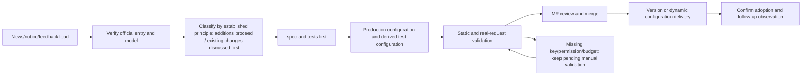

# Ongoing Maintenance Workflow

## Responsibilities and states

Each piece of work names its roles, without fixing personal names in the docs: the maintainer owns material, configuration and MR; the product owner discusses and confirms adjustments and deletions of existing configuration and proposals beyond existing capability; the validation collaborator provides accounts/keys and budget; the code reviewer checks rules and compatibility; the release owner records version or dynamic configuration delivery. One person may take several roles, but the actual results are recorded separately.

These are maintenance phases and do not replace the work item's `Status:`. This directory creates no automated news monitoring or auto go-live task.

Maintenance items use local Markdown and no remote Issue is created. An existing complete spec can serve directly as the work item without copying the body; new maintenance specs and research records of this area live in this directory with explicit date, goal, acceptance and the status in the table below. If a standalone Issue is needed, the repository location is `docs/issues/<feature-slug>/<NN>-<slug>.md`, which records only the status and the reference to this directory's spec; the maintenance background and requirements stay complete in this directory.

| `Status:`         | Applies when                                                                                                                                  |
| ----------------- | --------------------------------------------------------------------------------------------------------------------------------------------- |
| `needs-triage`    | The lead is not yet classified, scope to be judged                                                                                            |
| `needs-info`      | Missing official facts, reproduction or other necessary information                                                                           |
| `ready-for-human` | Waiting for a manual account, key, budget or product ruling                                                                                   |
| `ready-for-agent` | Goal and acceptance are clear and it can be implemented                                                                                       |
| `in-progress`     | Work has started                                                                                                                              |
| `done`            | The acceptance declared by this item is complete; a task that finished only the configuration MR still lists the undelivered state separately |
| `wontfix`         | Decided not to integrate or handle, with the reason recorded                                                                                  |

Write `Status:` under the file title, use local links for dependencies, and append `## Comments` for necessary discussion. The Issue status and the delivery state of MR, version and dynamic configuration are recorded separately; `done` cannot replace evidence of online adoption.

## One configuration change

1. Branch from the latest staging, record the baseline commit, and run `node scripts/check-workspace-freshness.mjs`. First check this directory's current state, research records and maintenance items to avoid duplicate projects for the same vendor.
2. Collect the exact entry, protocol, original ID, capability, levels, parameter mapping, region/plan and retirement evidence. Classify by the [boundary for additions and existing changes](./scope.md#authorization-boundary-for-additions-and-existing-changes): additions within scope that need no extra adaptation proceed directly; candidates needing a new protocol, authentication, dynamic Header, request/response or history handling and SDK compatibility changes are postponed with the gap recorded and no adaptation developed in passing. Any adjustment, downgrade or removal of existing configuration first gives the concrete before/after difference and is discussed and confirmed.
3. Update the corresponding spec or maintenance spec in this directory, stating target behavior, rationale, non-goals and acceptance; first write tests that can express the goal and retained boundaries. A new template covers inheritance and instance identity; a rule change covers order, no false hit on adjacent models and the final request.
4. Edit the production JSON with a new content revision; add Logo/localization as needed for a new brand. Run `pnpm provider:config:sync-test` and include the test JSON in Git. Change the generator only when the address conversion contract changes.
5. Do the [validation](./validation.md), distinguishing production/test configuration, ordinary/plan keys, the three protocols and different entries. A user-interface change adds E2E as the repository requires and is not tested only on JSON strings.
6. Update the [current state](./current-state.md) and this item's evidence; reconcile members, default enablement, resolved capabilities, exact rules and known exceptions. Review whether personal overrides were written unintentionally, request budgets modified or other templates changed.
7. After the applicable checks and a diff self-check, commit a Conventional Commit and create an MR toward staging per [MR content and operation](./delivery.md). An MR lacking measured evidence is explicitly marked pending validation and must not claim go-live readiness.
8. After merge, the authorized releaser executes along the [Delivery spec](./delivery.md) and records the actual package or dynamic configuration adoption result; an MR merge is not online completion evidence of the maintenance work.

## Minimum record per work item

The maintenance background, decisions and acceptance records go into the corresponding spec, maintenance spec or dated research of this directory; a standalone Issue only links the task and does not store a second copy of the spec body:

| Field                | Required content                                                                                                                                         |
| -------------------- | -------------------------------------------------------------------------------------------------------------------------------------------------------- |
| Identity and status  | templateId / original modelId / protocol; maintenance phase and Issue Status                                                                             |
| Scope decision       | Add/adjust/retire; key/general maintenance; the applicable confirmed principle for an addition, or the manual confirmation record for an existing change |
| Sources              | Official links, publication date, effective date, check date; conflicts or unknowns                                                                      |
| Configuration diff   | Members, enabled, capabilities, Map, URL, Access, production/test conversion                                                                             |
| Manual collaboration | Which kind of account/key, region/plan, required permissions, budget and safe delivery method is missing; no Secret recorded                             |
| Validation           | Baseline commit/revision, configuration hash, cases, actual request protocol, results and uncovered items                                                |
| Git                  | commit, MR, target branch, review conclusion and follow-up tasks                                                                                         |
| Delivery             | Planned method, compatible clients, final file hash, actual version/dynamic revision and adoption result                                                 |
| Follow-up            | owner role, trigger of the next re-check, retirement date or condition to unblock                                                                        |

## Scope expansion and cleanup

Monthly re-check whether key/general models still fit demand, whether manual items have gone unhandled for long, whether the aggregating catalog misses maintained upstreams, and whether official retirements and aliases changed. Scope expansion reviews evidence and maintenance resources under the confirmed principles without re-asking addition authorization one by one; candidates beyond existing protocol capability are postponed. "Supporting more" is not a reason to enable all models by default.

An invalid template member is first handled by real entry evidence; capability rules and exact rules are checked separately for their purpose. Deleting a template requires checking template references of existing instances, user-defined URLs, saved model selections and necessary migration. Restoring defaults, disabling a model, removing a member and removing a template are different actions and cannot be replaced by one large batch deletion.

## Documentation sync

This directory fully carries the domain concepts, contracts, rationale, acceptance and current inventory needed for template maintenance. New rules must be explained in this directory and "see other design/to-do" cannot replace the body; code is for verifying the implementation and official material for tracing external facts. Historical investigation keeps the evidence of its time. Entries and AUF outside the directory may reference here but do not maintain a second current spec or an executable model catalog.

Once a new principle or exception is confirmed, immediately update the corresponding body and affected flow in this directory and do not wait for the next configuration MR. Every configuration MR checks production/test single-source, the current inventory, research state and old entry navigation. When only organizing docs, do not fix configuration in passing, do not bump the revision, and do not write found problems as resolved.
