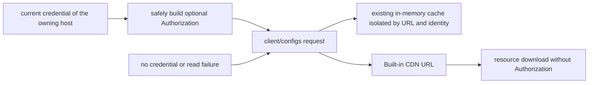

# Standalone client config service (phase 1: plugin ordering)

## Scope

A standalone ClientConfigService exists, but the legacy read path is not migrated.
Phase 1 only moves the plugin-ordering read added with it out of
CodingPlanSubscriptionService; subscriptions, security checks, forced updates,
off-peak, help, Built-in, Desktop Main gray-release, and the standalone CLI keep
their existing read duties; the optional login request header follows the unified convention below. The Nacos
pluginStoreOrder format is unchanged; already-published config needs no adjustment.

## Responsibilities and interface

- `packages/shared/src/clientConfig.ts`: public config response schema and the
  trimmed ClientConfigSnapshot.
- `packages/services/src/client-config/clientConfig.ts`: the IClientConfigService
  contract and service channel.
- `packages/services/src/client-config/clientConfigService.ts`: request, validation,
  caching, refresh, and in-flight merging.
- `getSnapshot({ forceRefresh? })` returns validated public fields; currently
  pluginStoreOrder, zsrcUrl, and uiPluginRecommendations. It never returns the whole
  remote response and never exposes account or provider data to the Renderer.
- On service success with a missing/withdrawn pluginStoreOrder it returns null; a
  single malformed pattern still degrades per the existing ordering contract.
  Envelope/HTTP/network failures reject that read and keep the service's existing
  snapshot; the business side decides default display.

```mermaid
flowchart LR
  D[desktop plugin store] --> P[client-config RPC]
  M[mobile shared-host attachment] --> P
  R[remote workspace service view] --> P
  P --> C[window Local Host ClientConfigService]
  C --> A[injected ApiClient and window network policy]
  A --> E[/client/configs]
  O[existing subscription consumers] --> L[legacy read path, unchanged]
```

## State and timing

- One instance per window-scoped Local Host; the remote workspace set explicitly
  injects and registers that same instance — no separate remote ordering-config
  owner. Mobile uses it through the existing attachment, with no extra request or
  Host.
- Plain Web/server Hosts get their own instance from createLocalServices. The Web
  home page without a connected Host returns an empty public snapshot and sends no
  network request.
- Config may still be read anonymously, credentials=omit; when logged in, the
  current ZCode JWT is sent as a Bearer Authorization. The Host injects the
  credential through a read-only callback; the config service creates no
  credential store. The cache key is the actual request URL (canonical endpoint,
  app_version, platform) plus the optional identity of the read; the request context is injected by the Host
  assembly. Different contexts share no snapshot/in-flight request, and late results
  write back only to their own key.
- A valid snapshot has a 1-hour TTL; in-flight requests merge within the same
  context. A forced refresh bypasses the valid snapshot but does not clear it. While
  a forced refresh runs, plain reads still return the valid old snapshot
  immediately; only a successful refresh atomically replaces it.
- Before each config read, expired cache entries with no in-flight request are
  removed, releasing old identities' cache keys and snapshots. In-flight entries
  stay until the request completes so cleanup does not cause duplicate same-identity
  requests; unexpired entries are still reused within the original TTL.
- The HTTP request and body read use a 15-second overall AbortSignal budget;
  failures are not cached as errors and never permanently lock the in-flight state.
- Callers get a copy of the snapshot so same-process consumers cannot mutate the
  cache. The UI adds no extra request TTL; the existing hook generation keeps
  isolating unmount/overlapping refresh/late results from different services.
- Task/session/owner/queue/stream are untouched; desktop-continuous and
  web-remote-replayable recovery semantics are unchanged. Public ordering config is
  not bucketed by workspacePath or workspaceIdentity.

## Impact

Layers changed: option-source / persistence (in-memory cache owner) / delivery (new
plain service channel). must-inspect: Local Host assembly, IServiceAccessor,
RemoteServiceAccess, remote workspace service set, Web home-only,
usePluginStoreOrder. should-inspect: list ordering after service failure/switch,
refresh and mode switching. invariant-only: all legacy client/configs read paths,
plugin lifecycle, Main/relay, and session recovery. The shared component is
PluginStoreListView; the UI still reads from the hook, and category ordering and
category-migration rules are unchanged. The product capability map has no dedicated
ClientConfig node yet; record it as a graph gap for platform public config
capability — this feature's semantic graph seeds the real code and the unique owner.

## Acceptance

| ID     | Setup / action / assertion                                                                                                                                                                      |
| ------ | ----------------------------------------------------------------------------------------------------------------------------------------------------------------------------------------------- |
| CCF-01 | Parallel reads of the same URL and identity → one HTTP request only; reads after login, account switch or logout never reuse another identity's snapshot                                        |
| CCF-02 | Valid snapshot exists → plain reads during a forced refresh return the old value; on refresh failure the old value stays readable, and a successful withdrawal returns null                     |
| CCF-03 | Switch endpoint/version/platform, late old requests → snapshots stay isolated per key, no cross-overwrite                                                                                       |
| CCF-04 | Error envelope/HTTP/hanging body → rejected and retryable; timeout cancels the whole request                                                                                                    |
| CCF-05 | RPC getSnapshot → strictly typed public fields, unknown fields not passed through, callers cannot mutate the cache                                                                              |
| CCF-06 | Multiple remote workspaces / server remote service sets → the same injected instance is registered                                                                                              |
| CCF-07 | Real dev / browser → Code, Work, refresh, empty categories, and legacy guides merging hold; logs use client-config.getSnapshot                                                                  |
| CCF-08 | Diff the three subscription source files against the MR target branch → zero changes from this MR, legacy-path tests pass                                                                       |
| CCF-09 | Reads of different identities under a controllable clock → the next read purges expired entries; in-flight entries are kept and deduplicated per identity, unexpired snapshots are still reused |

Browser E2E keeps the existing manual-review/pending cases, injecting the new
service contract; cases are not promoted on their own.

Known limitation: real mobile shared-host/SSH/WSL/Docker setups have not been
integration-tested on devices; same-instance reuse at the service assembly layer has
unit tests.

## UI recommendation field

`uiPluginRecommendations` returns a validated `{ pluginId, surfaceId }[]`; a missing
or invalid value returns an empty array and does not affect other public fields. The
recommendation entry reuses this service and adds no request caching or polling.
Configuration and exposure rules live in
[plugin marketplace spec](plugins/plugin-market-interactions-scope.md#side-pane-服务端推荐配置).

## Optional login header for client/configs (2026-11-03)

All `/api/v1/client/configs` consumers follow one request rule: send
`Authorization: Bearer <jwt>` when there is a current ZCode JWT, omit it otherwise.
It reuses the character validation of `toBearerAuthorization`; a failed credential
read, an empty value or illegal characters all count as an anonymous read, with no
token or raw credential error logged and no change to the login state. The rule does
not extend to client/scenes, agent/configs or other business APIs.

Covered: Host ClientConfigService, plan config, Built-in config, Desktop help, startup
forced update, the shared fetcher of Desktop Context/Renderer Action gray release, and
Web help. The standalone CLI Built-in read uses its own credential store. Main and Host
do not call each other's login flow; Web uses the existing browser OAuth store.



- Identity is re-resolved before every actual read; help, general-config and plan-config
  caches and in-flight requests are isolated by identity, and an old request can only
  complete its own cache entry, never clear or overwrite a newer identity's in-flight request.
- Original TTL, refresh triggers, public field trimming and desktop/mobile service
  ownership are kept. No login-triggered polling; the frozen Host feature switch and the
  Built-in Registry release rule are unchanged.
- For Built-in only the first hop (client/configs) carries the optional JWT; the second hop
  (CDN) does not inherit it and still rejects redirects.
- Main's native net.request sets `Cache-Control: no-cache` explicitly, so that when the
  server allows public HTTP caching Chromium does not reuse an anonymous response after
  login. Web optional auth only reads the session and does not trigger cleanup of
  incomplete/expired credentials.
- Acceptance: anonymous, login A, login B, logout, credential errors and illegal
  characters; same-identity dedupe, identity switch and late responses; real
  Node/Electron/Chromium request headers and the standalone CLI first/second hop
  isolation. Do not assert constructor arguments only.
- Cache cleanup regression: 6 items pass with a controllable clock and local HTTP
  requests, covering expired-identity release, valid cache reuse, first-request in-flight
  dedupe, expired-snapshot forced-refresh in-flight dedupe, failed-entry release, and the
  cache size after repeated identity switches; 3 of them failed before the fix. Cleanup
  runs on the next read and adds no timer.
