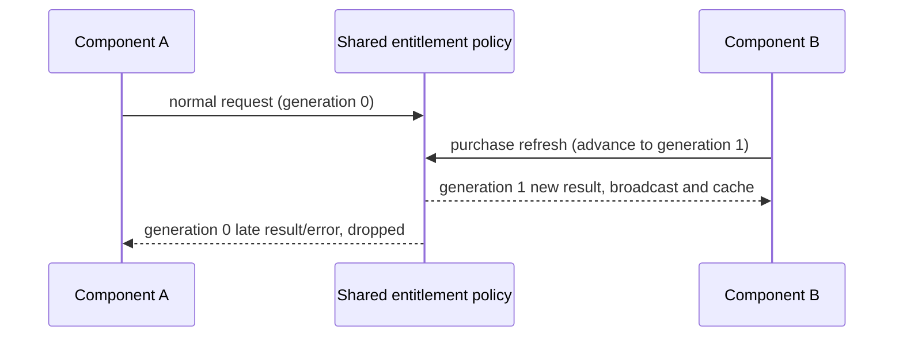

# Coding Plan context panel display spec

## Background

The composer's context panel aggregates lightweight state for Context window,
Coding Plan, and Start Plan. It is a narrow hover panel and does not carry full
usage details.

## V4 composer display boundaries

- The V4 composer's context dot and the legacy input bar share the same
  `ChatContextUsage` component; the hover panel aggregates current context capacity,
  Coding Plan remaining quota, Start Plan today's balance, and cache hit rate.
- Before the first model request completes, the panel may show
  `0 / current model context capacity`. This value is derived only by the UI from
  the current effective model metadata, to help the user confirm model capacity; it
  must never be written back into session usage authoritative state.
- After the first model request completes, the panel uses
  `usage.contextWindow` from the v4 session snapshot/delta as the context-capacity
  authority. `usedTokens` and `maxTokens` come from the Agent runtime projection,
  and cache hit rate and breakdown follow the `usage.contextWindow` projection too.
- The cache hit rate shows only the cumulative hit rate of main conversation turns;
  sidecar requests (title, compaction, prompt enhance, target completion) must not
  overwrite the input-bar context meter even when they carry usage or contextWindow.
- On cold-start recovery, transcript synthetic history events and the usage seed
  share the Registry capacity queried exactly by the recovered model identity. A
  missing thinking tier must not block metadata lookup; with no matching model or
  valid capacity, project contextWindow=null while keeping the real historical
  usage internally — never fabricate a 200k denominator. The final watermark comes
  from runtime / persisted messages (including the Compact boundary) and must not
  overwrite new events during recovery.

## V4 state chain

```text
ModelComplete(main_turn)
  -> Agent runtime payload: usage + cacheHit + contextUsageBreakdown
  -> ProductProjection usage.contextWindow
  -> v4 snapshot / delta
  -> V4ComposerToolbar
  -> ChatContextUsage hover panel

Renderer modelProviders / settings / entitlements
  -> current Coding Plan or Start Plan source
  -> ChatContextUsage quota sections
```

- Desktop continuous and Web remote replayable both consume the same v4 session
  snapshot/delta; desktop main and the external relay hold no context, quota,
  cache, or breakdown business state.
- Mobile `/remote` reuses the existing host/session through the shared-host
  attachment; on recovery it reads only the replayable snapshot/delta and never
  spins up an independent runtime or quota-query authority for the context panel.
- BigModel Team Plan reuses the BigModel Coding Plan provider id, but quota binds
  to the team project source. When the current connection mode is Team Plan, the
  input area must show the matching team project quota by sourceId and must not
  fall back to personal Coding Plan quota.

## Start Plan today's balance

- Start Plan's `Today's balance` and the settings-page Plan Card use the same
  `UsageEntitlementSnapshot`.
- The remaining percentage and progress bar use
  `quota.limits[].remaining / quota.limits[].number`, where `remaining` comes from
  the backend `remaining_units`.
- The balance bar's width transition matches the Coding Plan quota bar:
  `transition-[width] 500ms ease-out`, with the `motion-reduce:transition-none`
  accessibility fallback.
- The settings-page Plan Card shows the plan expiry time to the right of the
  `Today's balance` title, sourced from `snapshot.subscription.details[0].expireTime`;
  that time only expresses the expiry date and does not participate in quota
  calculations.
- The settings-page Plan Card's balance mini-card orders content as model name,
  remaining percentage + renew time, progress bar, remaining/total; the bottom
  remaining/total uses full numbers with thousands separators, not K/M
  abbreviations. The input-area context panel keeps showing only percentage, renew
  time, and progress bar, without the plan expiry time.
- `available_units` only means the currently available amount after in-flight
  reservations; it is not used for the `Today's balance` remaining display.

### Context hover refresh and loading (Start Plan and Coding Plan symmetric)

- Start Plan and Coding Plan connection modes are mutually exclusive; the silent
  access refresh entry opened by the context hover must cover both segments:
  `codingPlanUsageRemaining.onAccess ?? startPlanBalance.onAccess` — either present
  triggers `refreshCodingPlanEntitlements({ silent: true, reason: "access" })`.
  Start Plan must not rely only on passive sync after settings/sidebar refreshes.
- A silent refresh with a cached snapshot does not set entitlement.loading to true;
  the Start Plan title spinner condition is `loading || refreshing`, where
  `refreshing` follows the promise triggered by this hover (seq-guarded against
  crossover), matching the Coding Plan segment's header refresh icon semantics.
- When `onAccess` exists, the context trigger stays even without a snapshot, so a
  first hover can issue the first balance request (aligned with the Coding Plan
  segment's `onAccess && entitlements.length > 0` fallback semantics).
- The 60-second access sharing window and in-flight merging apply to Start Plan
  too; repeated hovering must not amplify billing/balance request volume.

## 5-hour quota reset time

- The Coding Plan 5-hour quota shows only the reset time in the context panel,
  never the date.
- Even when the reset is not today, keep showing `HH:mm` only.
- The date dimension is left to the Usage page and fuller usage panels, keeping the
  context panel from crowding its three-column quota layout.
- Weekly quota and monthly tool quota still show dates.

## Start Plan shared balance snapshot

The account availability check and the usage query share `zaiStartPlanBilling`,
isolated by ApiClient, credentials, and URL. Within 1 second of a request, the same
complete response is reused (failures included); unfinished requests keep merging.
A query after a successful purchase/claim explicitly invalidates the matching
record, and a late old request cannot overwrite the new one.

```text
account check ─┐
               ├─ balance single-read owner ─ request/1s snapshot ─ plans + balances
usage query ───┘                                 ├─ account availability
                                                 └─ page plans and usage
```

Desktop and mobile share the Host service; continuous/replayable session boundaries
are unchanged. Transport failures like 429 must keep the error and trigger frontend
backoff; a subscription already confirmed for the same identity is kept on refresh
failure, showing "refresh failed". Without historical results, Start Plan keeps its
own title and offers retry — no duplicate error cards and no forced re-login.

Acceptance: sequential/concurrent calls issue one request; refresh works after one
second; credential isolation; failures are reused; invalidated records are
re-queried; a failure does not overwrite a confirmed subscription.

## Reusing the snapshot when the purchase entry refresh fails

The purchase entry decides whether complete usable data exists; a recent refresh
error never negates a historical success. The authenticated personal/Start
snapshot and a successfully confirmed `no_plan` stay usable; only without a valid
snapshot does it show loading or retry. Team results are isolated by family, login
identity, and business credentials; after a Provider view update, credentials are
re-checked; a refresh failure for the same source keeps the successful result
(including an empty list), and a successful empty list overwrites old plans. An
identity change immediately stops using old results, and expired async requests
must not write back. Errors keep being recorded in logs and the original
entitlement state.

```text
personal/Start entitlement hook ─ valid snapshot ─┐
                                                 ├─ purchase entry: complete data ready, missing data loading/error
team query -> entry hook single owner ───────────┘
           success: replace; failure: keep for same identity; identity change: invalidate
```

Acceptance covers first failure, refresh in progress/failed while a snapshot
exists, no_plan, empty team results, credential changes, and account switching.
Desktop and mobile share this hook; service and session-recovery protocols are
unchanged.

### Purchase refresh vs stale request ordering

The shared entitlement policy holds a request generation per service instance and
freshness identity. A purchase/claim refresh advances the generation first, then
requests the service and invalidates the balance cache. A stale generation's
success and failure must not update components, the shared snapshot, the
persistent cache, or backoff state; a new-generation normal request must not reuse
a stale in-flight request. Different identities never affect each other. Desktop
and mobile use the same hook rules; the remote-control recovery boundary is
unchanged.



Acceptance: with two hooks sharing an identity, once the purchase result returns,
an old no_plan or old failure cannot overwrite the new result; a pending request
for another identity still takes effect normally; a normal refresh after purchase
does not reuse the pre-purchase request.
