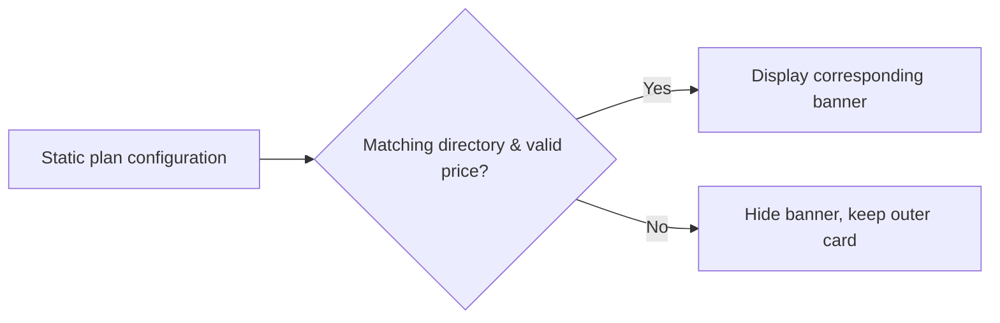

# Static Plan Configuration and Purchase Banner Display

2026-09-14: Phase 1 removes the fallback only; does not add Provider ID compatibility.

- Personal banners are determined by the effective product prices in `codingPlanStaticProducts` for the current provider; when loading, missing fields, key mismatch, request failure, or no valid price exist, the banner is hidden. Explicitly sold-out display semantics are preserved.
- Delete the personal ¥49 and generic team ¥598 fixed banners. Keep the outer plan cards, login entry, and valid trial products.
- Team purchase banners require a corresponding static directory in `codingPlanStaticTeamProducts`; cannot fall back to real-time pricing directories. Post-purchase team status queries still use real-time pricing.
- Configuration state is held by the existing hook; Detail only derives display; no caching, timers, or new interfaces introduced.
- Desktop and mobile Web, light/dark themes, Chinese/English use the same display conditions; the continuous/replayable pipeline is not modified.
- This phase exactly matches the existing providerId: no server configuration changes, no builtin/account aliases or migrations added.

Verification: Unit tests cover empty directories with no fixed prices, no config means no personal/team banners rendered, valid trial products preserved; browser regression covers desktop/mobile and light/dark theme missing-config states.

Browser test: `packages/ui/test/browser/manual-review/pending/coding-plan-no-fallback.test.mjs`. Precondition: unauthenticated ZCode Dev opens BigModel model settings, the public config lacks usable builtin/account product directories; run `node --test <test-path>`, covering 390/1200 width and light/dark themes. Verify login entry remains, personal/team banners and fixed prices are absent. This test is a manual developer regression check and is not auto-promoted to CI.

## Phase 2: Static Configuration Key Compatibility

Compatibility is scoped to the Service's `client/configs` boundary; personal and team directories are both mapped by family. Priority reads the own-key `builtin:{family}-coding-plan`; only when that key does not exist does it read `account:{family}-individual-coding-plan`; keys returned to UI are unified as the latter (team directory existing contract also uses the personal provider bucket). Explicit empty arrays take priority; do not merge two directories; do not revive products closed by the old directory with a new one. No other namespaces are compatible; runtime Provider identity is not changed. When neither key exists, the bucket is not created, continuing the Phase 1 banner-hide rule.

Verification matrix: two configs × two families × old-key-only / new-key-only / two-key conflict / old-key empty array / both keys missing; verified through real Service API endpoints, and confirmed that OAuth is not required.

Phase 2 live verification: with `app_version=3.12.1`, `platform=darwin-arm64`, real responses parsed by the Service show 9 items each for personal BigModel/Z.ai and 8 items for team BigModel, 0 for Z.ai. The development environment default config request returns different data from this request — the default request is missing the static product fields, so do not claim that valid product banner UI verification is complete based on that alone.

## Unauthenticated Team Directory Load Fix

**Cause:** The team hook's `enabled` dependency relies on `soldOutVisible` (purchase login credentials); when unauthenticated, the static directory is never read. After the fixed team banner was removed, no real directory replaced it.

Use the existing hook's `staticOnly` mode for the unauthenticated team banner on the Settings page: `getStaticTeamProducts` → current provider bucket → static price groups → banner; no public or authenticated pricing requests. After login `staticOnly=false`, maintaining the original static directory + real-time pricing pipeline. Missing directories still hide; clicking static banners still requires login first. Other callers' default behavior is unchanged; desktop/mobile data transfer or caching is not modified. Browser regression must verify unauthenticated, personal, and real team banners all display correctly, and prices match the static directory.

User confirmation: display only one "Team Plan" banner. Merge all team tiers in the effective static directories and take the lowest valid price; do not display separate Standard/Pro entries. Clicking passes the `team` audience; do not pre-select any tier.

Plan purchase banners do not display the 150% quota activity badge; personal/team/trial entries only present name, actual price or quota, and description. The outer status card's badges are out of scope for this change.
