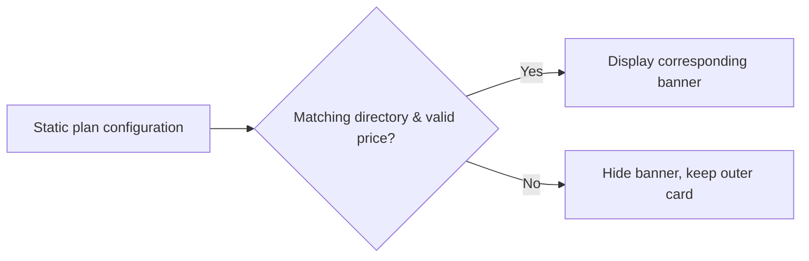

# Static Plan Configuration and Purchase Banner Display

## Rules (Phase 1: fallback removal, no Provider ID compatibility)

- Personal banners are determined by the effective product prices in `codingPlanStaticProducts` for the current provider. When loading, fields are missing, the key mismatches, the request failed or no valid price exists, the banner is hidden. Explicit sold-out display semantics are preserved.
- The personal ¥49 and generic team ¥598 fixed banners are deleted. The outer plan cards, login entry and valid trial products stay.
- Team purchase banners require a corresponding static directory in `codingPlanStaticTeamProducts`; they cannot fall back to real-time pricing directories. Post-purchase team status queries still use real-time pricing.
- Configuration state is held by the existing hook; Detail only derives display. No caching, timers or new interfaces.
- Desktop and mobile Web, light/dark themes and Chinese/English use the same display conditions; the continuous/replayable pipeline is not modified.
- The phase matches the existing providerId exactly: no server configuration changes, no builtin/account aliases or migrations.

Verification: unit tests cover empty directories with no fixed prices, no config meaning no personal/team banners, and valid trial products preserved. Browser regression covers desktop/mobile and light/dark missing-config states.

Browser test: `packages/ui/test/browser/manual-review/pending/coding-plan-no-fallback.test.mjs`. Precondition: unauthenticated ZCode Dev opens BigModel model settings and the public config lacks usable builtin/account product directories; run `node --test <test-path>`, covering 390/1200 width and light/dark themes. Verify the login entry remains and personal/team banners and fixed prices are absent. It is a manual developer regression check and is not auto-promoted to CI.

## Phase 2: static configuration key compatibility

Compatibility is scoped to the Service's `client/configs` boundary; personal and team directories are both mapped by family.

- Read the own key `builtin:{family}-coding-plan` first; only when it does not exist read `account:{family}-individual-coding-plan`. Keys returned to the UI are unified as the latter (the team directory's existing contract also uses the personal provider bucket).
- Explicit empty arrays take priority; the two directories are not merged; products closed by the old directory are not revived by the new one.
- No other namespaces are compatible; runtime Provider identity is not changed. When neither key exists, the bucket is not created, continuing the Phase 1 hide rule.

Verification matrix: two configs × two families × old-key-only / new-key-only / two-key conflict / old-key empty array / both keys missing, through real Service API endpoints; OAuth is not required.

Live verification: with `app_version=3.12.1`, `platform=darwin-arm64`, real responses parsed by the Service show 9 items each for personal BigModel/Z.ai, 8 for team BigModel and 0 for Z.ai. The development environment's default config request returns different data (it lacks the static product fields), so valid-product banner UI verification must not be claimed complete on that alone.

## Unauthenticated team directory load

The team hook's `enabled` depends on `soldOutVisible` (purchase login credentials), so when unauthenticated the static directory was never read; with the fixed team banner removed, no real directory replaced it.

- The Settings unauthenticated team banner uses the hook's `staticOnly` mode: `getStaticTeamProducts` -> current provider bucket -> static price groups -> banner; no public or authenticated pricing requests. After login `staticOnly=false`, keeping the original static directory + real-time pricing pipeline.
- Missing directories still hide; clicking a static banner still requires login first. Other callers' default behavior is unchanged; no desktop/mobile data transfer or caching change.
- Browser regression verifies unauthenticated, personal and real team banners display correctly with prices matching the static directory.
- Display only one "Team Plan" banner: merge all team tiers in the effective static directories and take the lowest valid price; no separate Standard/Pro entries. Click passes the `team` audience without pre-selecting a tier.
- Plan purchase banners do not display the 150% quota activity badge; personal/team/trial entries present only name, actual price or quota, and description. Badges on the outer status card are out of scope.
