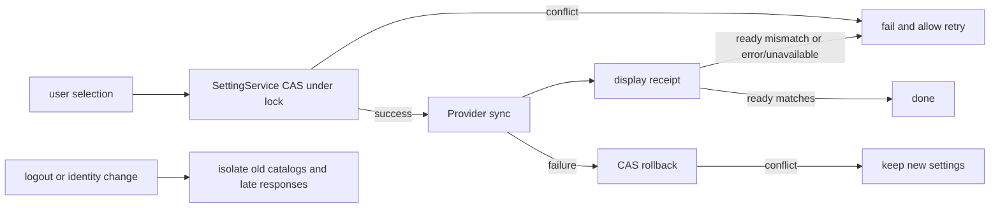

# Composer model and thinking-tier merged entry

## Interaction

The normal input's model and Think controls share one entry. The entry shows no Provider prefix:

```text
[ GLM-5.3-Flash High ▾ ]  → [ GLM-5.3-Flash ▮ ] → [ model icon ▮ ]
```

The menu shows a Models (zh: 「模型」) section title in `text-ui-sm` with secondary text color; model names keep the base font size and capability tags stay as is.

`High` uses secondary text color. The green bar is display-only inside the same button and never responds to clicks itself; it shows strength by the model's declared tiers and is an empty slot when off or the selection is invalid.

The model menu is center-aligned to the entry (`align="center"`) and keeps viewport-edge avoidance.

The entry keeps the original `rounded-lg` button style — no capsule shape. While the menu is open the entry keeps the theme hover gray background even when the pointer moves into the menu; after close it returns to the ghost background. The button width is measured before expanding; while open the width is locked to the larger of the original width and an `8rem` minimum, so short model names or the icon state cannot truncate 「选择模型」. While expanded, model and tier are hidden and replaced by a centered Select model (zh: 选择模型) with no down arrow; after close the fixed width is released and the model, tier, and original compression priority return. Width is captured once per expansion and never re-measured when the tier or model changes.

With no model selected, the entry shows 「选择模型」 in secondary text color in both open and closed states, with no thinking-tier placeholder dash and no green bar. The accessibility name shows only the Select model copy without appending `· —`; once a model is selected, the button and accessibility name show model and valid tier. The plain tooltip always shows the action copy 「选择模型」 plus its shortcut — never model and tier — and hides while the menu is open; guide hints keep their dedicated copy.

The Think slider uses a capsule track, discrete tier dots, and a white round thumb. Below the top tier, the selected track is success pure green; only a valid selection at the top tier shows a right-to-left blue→green gradient (right blue, left green). Blue uses the slider-dedicated variable `--composer-thought-max-accent` (blue-500), kept high-saturation in both themes; green uses the success theme color. The gradient uses OKLCH shorter-hue interpolation passing green, cyan, blue left to right, preserving chroma and never including purple. Leaving the top tier fades the gradient back to pure green over 200 ms; the toolbar vertical bar keeps success green; the unselected track and dots use theme-neutral colors; off or invalid tiers stay unfilled. The track stroke is drawn only on the unselected gray area: the stroke is the underlay and the gradient fill covers it over the selected area without insetting into it. Track 24 px high, thumb 28 px, hit area 32 px; one dot per tier, positioned like the native range's discrete indices. Native range keyboard, pointer, and touch behavior and the existing focus protection are kept — only the visuals are custom.

On click or keyboard tier changes, thumb position and gradient fill transition together with 120 ms ease-out. Dragging tier by tier keeps the same short transition so thumb and fill move in sync. Switching model, Provider, or the tier catalog resets only the visual layer: no cross-model tweening, no native input rebuild, no focus move. `prefers-reduced-motion` cancels the transitions.

Popup structure: provider icon, name, access tag (arrow at the right) → divider → Models title and model list → divider → Effort title (`text-ui-sm`) and current tier (base size, same row at the left, `mb-1`) → discrete slider. No lowest/highest tier labels and no reserved row space; desktop and mobile Web share this layout; the slider's keyboard, pointer, touch handling and accessibility tier text are unchanged. The manage-models entry and the existing provider family connection methods stay reachable. Dividers in the main menu and provider submenu use `border/50`.

Provider row, left to right: current provider icon, name, access tag; the submenu arrow sits at the right; there is no Provider heading. Icons reuse the provider config logos and existing light/dark assets, falling back to the generic model icon. In the provider submenu the access tag follows the name (8 px gap) instead of being pushed to the row end; the selected marker stays on the right; Manage models sits under the last divider; the merged popup footer does not repeat it. An empty catalog still opens the submenu to reach model management. Other screens using `ModelConfigSelect` keep their original layout.

The access tag reuses the catalog's `labelBadge`: account plans show personal/team/free, API key access shows API. It is generated from configured access, never inferred from names, and exposes no credentials.

The submenu uses a Portal so the parent menu cannot clip it. When side space is tight, the submenu may overlap the parent while avoiding the Provider trigger row, at a higher z-order; Provider selection and model-switch logic are unchanged.

Provider rows are browse-only (2026-10-23 ISSUE-058 user ruling, see [`specs/composer-model-picker-browse-only-providers.md`](../specs/composer-model-picker-browse-only-providers.md)): clicking, keyboard-confirming, or hovering a Provider only switches which group the Models list shows — it never changes model, tier, or account connection. Only selecting a model row changes the selection; a new model takes the target model's default tier by the existing rules, and re-selecting the current model does not rewrite the tier. While browsing a non-current Provider, Think shows 「—」 disabled and the popup stays open. The slider steps through the Option Spec's original order — no sorting, no conversion to a Token Budget. Selecting a tier keeps the popup open; clicking outside or Escape closes it. Desktop restores input focus after close; mobile does not pop the soft keyboard.

### Model menu close behavior

- Confirming an available model (including re-selecting the current one) keeps the menu open so the tier can still be adjusted; a locked model does not submit or close. Browsing Providers and changing tiers also keep the menu open.
- The normal input and the floating input in fullscreen plugins share one menu open state. A single click outside the menu closes it, including over plugin webview areas; that click only closes the menu and must not trigger the underlying plugin action. Escape keeps its close behavior.
- After close, existing focus rules apply: desktop restores the input, mobile does not pop the soft keyboard. Model selection owner, submission, and protocol are unchanged.

```text
confirm an available model -> existing model selection callback -> menu stays open
pointer outside the menu    -> host outside-menu interaction  -> menu open=false
Provider / Effort action    -> existing selection chain        -> menu stays open
```

Outside-click rationale: with a modal Radix menu open, `body` has `pointer-events: none`, but the plugin webview explicitly sets `auto` and keeps receiving clicks; guest-page events do not bubble to the host document, so the menu never saw the outside pointerdown (event sampling confirmed the click had activated a plugin button while the menu stayed open). While the merged menu is open, a transparent pointer layer sits above the plugin page and below the Composer and its popovers, reusing Radix's outside-close logic and keeping toolbar menu inter-switching. The layer shares the menu's open state and stores nothing extra.

Regression coverage: menu component unit tests plus Electron webview / mobile-width iframe interactions across both themes cover keep-open after model selection and the following single outside click. Browser candidates run via `node --test packages/ui/test/browser/manual-review/pending/composer-menu-dismiss.test.mjs`; artifacts in `packages/desktop/.e2e-artifacts/composer-menu-dismiss/`. Not covered: Windows/Linux native windows, mobile real devices, remote connections; plugin resources were test pages — plugin install and Agent handshake are not verified.

## Overall compression priority

`useComposerToolbarFit` measures all left/right controls and spacing and moves to the next level only on overflow:

1. Computer text collapses.
2. Mode text and arrow collapse.
3. Plan text collapses.
4. Merged entry High and arrow become the green bar; the model name stays complete.
5. Model name becomes the model icon; the green bar stays.

There is no intermediate stage with a hidden green bar, name-only, or truncated name. Unrendered controls are skipped; widening expands in reverse order; buttons are never remounted by compression, so open menus, focus, and selections survive. The existing dedicated indicator for Highspeed-locked models and its separate thinking control keep their behavior.

## State and boundaries

```text
ModelSelectionView (supported models and tiers)
                 ↓
browse Provider     -> popup-local browse state (no draft write)
select a model row  -> existing onSelectModel / connection-switch owner -> Composer draft
merged popup        -> existing onSelectModel / onSelectThought -> Composer draft (single selection owner)
                                                     ↓ on send
                                               frozen Submission
```

The popup owns only its open state and the browsed Provider; it never duplicates model or tier state. Request mapping, service protocol, accepted queue, and realtime streams are unchanged: desktop `desktop-continuous` and mobile `web-remote-replayable` keep their existing paths. Ctrl+M opens the merged entry; Ctrl+T keeps cycling tiers.

## Verification scope (component-level)

- Component interactions: Provider browse-only (click/keyboard change neither model nor tier), select model after browsing, re-select current model keeps tier, no available models, menu stays open after model selection, visual tags, discrete slider, single tier / invalid tiers, inherited connection methods, manage entry.
- Layout: each compression level and reverse restoration, missing Computer/Plan, final icon + green bar; real-browser desktop and mobile widths, both themes.
- Desktop E2E: model and tier edits still update the Composer; normal mode no longer renders a separate Think entry; merged menu and Mode are mutually exclusive.

## Focus during tier changes

Real desktop E2E showed the Host View briefly loading after a tier or model change; the old implementation cleared the catalog too, making the menu height flicker. A native `disabled` would move focus from the range back to the menu and later arrow keys would no longer adjust the tier. The merged menu instead uses `aria-disabled` plus event gating to pause interaction while keeping the same range node and focus. During an input re-read on the same Host, the Hook keeps only the revision/providers catalog view — not stale resolved results like `effectiveSelection` or `preferredSelection`. The Toolbar reads that catalog; the current selection still comes from the Composer draft, and submission still requires ready. Rapid switching keeps the existing generation/requestId stale-response guard. On Host switch, disable, or unavailability the old catalog is dropped immediately — desktop continuous and mobile replayable boundaries are unchanged, and focus is never restored via a timeout. When a new catalog arrives it updates in place. With no tier selected, the first cell position is not a user selection; only an explicit change, keyboard release, or pointer release commits.

The same rule covers Provider switches. A re-read that still has a retained catalog must not disable the menu entry (avoiding button-opacity flicker); first load, error, unavailable, and runtime lock keep the original gating. Regression tests watch the real DOM: no empty frame in the model list during tier, model, and Provider switches, no momentary disable of the entry, plus cross-Host cleanup and stale responses under rapid switching.

### Tier dots

Dots on the filled area use 30% white in both themes — never black; unfilled areas keep the gray. When the pointer is within 10 px horizontally of a dot, it scales to 1.75× and becomes fully opaque over 120 ms ease-out, reverting on leave. Touch and disabled states do not trigger the hover; reduced-motion cancels the transition. Dots are display-only; the native range keeps receiving clicks and drags.

### Top-tier bubble

The existing gradient and colors are kept, with 12 low-opacity white dots overlaid inside the fill: 2–4 px, 2.6–3.6 s periods, staggered phases drifting right-to-left while fading in and out. The bubble is clipped to the track, sits below the tier dots and thumb, and receives no pointer events. It renders only for an adjustable, valid top tier; it is removed on tier-down, switching to a single-tier or invalid model, or menu close. `prefers-reduced-motion` hides it and disables the animation; no new canvas, timer, or state.

### Collapse after slider interaction

The native range's pointerdown must bubble to `document` so Radix DismissableLayer clears its internal click marker; only `click` is prevented from selecting menu items. After adjusting the tier by click or drag, the first click outside the menu closes it — no second click needed. Disabled states still `preventDefault` the adjustment.

### Open-state responsiveness

The width locked while open (at least 128 px) applies only to the roomy text state. The toolbar keeps compressing in the existing priority Computer → mode → Plan → think → model icon; at the model-icon state the width and minimum-width locks are released, showing the model icon and thinking bar and hiding the centered Select model copy and the down arrow. Widening restores the original open width and copy using the same trigger button and menu instance — options, focus, and open state are not reset. Desktop panel resize and mobile Web share this rule.

### Effort display by tier count

Two or more tiers use the discrete slider, including Off/On and Low/High and Off/High binary sets; a single tier (on or off) shows only the title and current value text — no slider, no toggle, no cycle shortcut; an empty capability catalog (`levels=[]` in a ready catalog that already contains the model) hides the whole Effort area and its divider. This rule supersedes the earlier binary-toggle and hide-Off-only rules. While a selection exists but the catalog is not ready (`groups=[]`), keep the disabled slider to preserve focus. Raw values and catalog order are preserved; the control is never chosen by translated text. The slider keeps the existing `onValueChange`, keyboard, pointer, and touch handling with no second selection state. Unavailable Providers cannot adjust tiers; menu Escape and first-outside-click close rules are unchanged.

The current tier text reuses `RollingToolbarLabel`: on change it rolls up and fades over 200 ms, animating only `{level}` while the title and slider positions stay. No entrance animation on first open; rapid consecutive changes follow the current draft; reduced motion replaces the text directly. No new state or submission path.

Slider background transition: the success pure-green base is unchanged; the top-tier gradient uses a resident pseudo-element layer toggled between opacity 0 and 1 over 200 ms ease-out — fading in when entering the top tier, out when leaving, and fast reversals continue from the current opacity. Fill width and thumb position stay at 120 ms; bubbles keep the top-tier rules; reduced motion cancels the background transition.

Effort title row: on the left, Effort and the current tier; on the right, the shared `ControlShortcutBadge` showing the effective `cycleThoughtLevel` shortcut, fed from the Toolbar's existing `thoughtShortcutLabel` — never a hardcoded Ctrl+T, and no empty keycap when unbound. Two or more tiers show slider and shortcut; a single tier shows text only. No new key handling or state. The keycap reuses `ControlHintTooltip` styling: `h-4`, `rounded-md`, `tooltip-tag` background/text, `text-ui-xs`, platform-specific symbol font. The generic `Kbd` with an undefined muted token renders bare text and is not used here; other `Kbd` entry points are unchanged.

Mode entry animation: the V4 permission mode button uses the shared `RollingToolbarLabel` with the same 200 ms roll-up fade, no first-render animation, and the reduced-motion rule. Plan's independent checkbox, mode draft ownership, icons, colors, and responsive compression are unchanged.

Merged entry open/close animation: with a model selected, opening/closing animates between "model name + tier" and the centered Select model with a 200 ms roll-up and fade; no first-render animation; reduced motion switches directly. The animation only presents the existing open state — no second selection copy, no delayed open — and keeps the original button, open-state locked width, narrow icon + thinking bar, focus, and one-outside-click rules. Open-state copy shows no arrow; the closed state keeps the arrow and compression rules; the narrow open state stays icon + thinking bar. Width assertions measure the actual Select model copy, not outgoing-text overflow.

## E2E coverage boundaries (2026-09-28 review)

These are enhancements to existing presentation-layer CT cases — no new product semantics, provider requests, or candidate specs. The boundaries come from the interaction spec above and the user rulings on the merged entry, one-click close, and icon + thinking bar.

- accepted: slider click and drag each start from the lowest tier and explicitly change the target; assertions cover both the range and the Composer config reaching the target, then one outside click closes with no rollback.
- accepted: with the pointer outside the menu and the slider focused by keyboard, narrowing and restoring the open state keeps the same button, menu, range node, and slider focus; model/Provider/tier are not rewritten by resize; the narrow state still adjusts via End with the thinking bar and config in sync; close-reopen is still icon + thinking bar.
- pruned: theme/language/all-widths are not fully cross-multiplied with desktop E2E; shared-CSS browser visual evidence is listed separately and never counts as mobile `/remote` real-device or native sidebar-drag coverage. E2E sets the toolbar container width to trigger a real ResizeObserver deterministically — no fake compact properties.
- kept coverage: Provider browse then model selection, model/Provider switches not clearing the catalog, tooltip action copy, top-tier gradient and bubble, mode-menu mutual exclusion, manage models, scope reset.

Impact boundary: must-inspect is `V4ComposerToolbar` → `ModelConfigSelect`/`ComposerModelMenu` and `useComposerToolbarFit`; selection authority stays the Composer draft, layout measurement only projects the DOM. `AutomationEditView`, `OffPeakEditView`, `SubagentsSection`, and workflow settings reuse `ModelConfigSelect` but have separate persistence boundaries and do not enable composerOptions — isolated. No codegraph index was available; verification used current source call sites and existing cases, and does not claim a codegraph impact scan.

One standing blocker: the repo-wide conversation coverage audit is blocked by a `REQUEST_LEDGER_METADATA_MISMATCH` between two syntheticReason entries in the unmodified Highspeed card fixture and the manifest — not a toolbar test failure.

## Provider submenu geometry

The submenu uses `max-content` width instead of the old fixed 224 px: width follows the longest name + access tag + checkmark, still constrained by Radix's available viewport width. Long names stay on one line on regular desktops; on narrow screens names may wrap with the tag after the name and the checkmark at the right. Portal and narrow-screen avoidance are kept.

Main menu and provider submenu keep a 12 px viewport safe margin and `no-drag`. On wide screens the provider submenu frame top-aligns with the main menu with a 4 px gap; on collision, visibility wins. Provider highlight uses `menu-hover/50`. The provider list scrolls independently while Manage models stays fixed.

Below 640 px, the provider page renders inside the same menu with a localized back entry at the top — no stacked side-by-side layers. Menu page state is owned solely by `ComposerProviderMenu`; it resets naturally on close. Back does not modify the model; selecting a provider only switches the browse grouping and returns to the models page without selecting a model. Widening the viewport restores submenu navigation. The models page still scrolls only the Models list; desktop/remote data paths are unchanged.

Multi-model and window-drag boundaries: the merged main menu's outer layer never scrolls; the provider rows, Models title, dividers, and Effort do not shrink — only the Models list shrinks with the available height and scrolls vertically (`max-h-60` kept). The main menu and provider submenu declare `app-region: no-drag` explicitly, so they keep receiving mouse events over Electron's top drag region.

## GLM Highspeed / FlashX top-tier visuals

The special style is enabled only when the currently selected model's display name contains `glm` and contains `highspeed` or `flashx` (case-insensitive). It is never guessed from provider names or model values. The menu and the entry bar share this one name check; no new state.

- Top tier: left-to-right blue → purple, only the 0% blue and 100% purple stops, OKLab interpolation, final colors `blue-500 → purple-500` (no green start). Normal models keep green → cyan → blue with a green low tier; matched GLM Highspeed/FlashX models use a blue low tier: normal-tier fill and the entry vertical bar (open, closed, and icon-compressed states) use `blue-500`; Off stays an empty slot; other models keep success green.
- Top-tier bubble: 32 dots for GLM Highspeed/FlashX (12 for normal models), ~0.8–1.2 s periods, right-to-left, 2–4 px, at most 40% opacity; removed on tier-down; hidden under reduced motion. The existing 200 ms gradient opacity transition and the model-switch visual reset are unchanged. The chain is model name → derived visual variant → top-tier fill/bubble; no new state, timers, or protocol.
- Standalone FlashX (without GLM), plain GLM, and other brands' Highspeed do not enable any of this; matching is case-insensitive on the display name only. Down-tier, switching back to a normal model, and reduced motion follow the existing rules.

## Models scroll edge fade

The Models list reuses `ScrollFadeViewport`'s 24 px top/bottom fade mask. No mask without overflow; at the top only the bottom edge fades, in the middle both, at the bottom only the top. It uses the shared component's scroll/ResizeObserver updates — no new model state or timers. `max-h-60`, flex shrink, and the fixed Provider/Effort layout are preserved; both themes and desktop/mobile Web share it.

## Team entries in the Composer provider list

The layout keeps 「Provider → Models → Effort」 with no connection-method row. Each provider submenu lists, per brand, the personal Coding Plan and then concrete teams: `BigModel [Individual]`, `BigModel [团队名称 1]` (team name 1), `BigModel [团队名称 2]` (team name 2); a weak divider after the team block separates the original API provider list. Start Plan and API rows keep their existing behavior — no brand or API merging. The main menu top shows the current brand and the current personal/team label.

Team entries come from the subscribed products of the existing enterprise pricing, use real organization names, and carry the identity family/productId/organizationId/projectId. Incomplete identity or a missing organization name produces no entry; same-name entries with different identities must not be deduplicated. An unselected team's unknown quota does not mean unpurchased; entries follow the purchased catalog and the executing model is validated after selection.

```text
click a personal/team row -> browse that row's models only (no settings write, ISSUE-058)
select a model on that row -> root settings save the full identity -> existing Provider refresh -> target Host available models
                                                        ↓
                         user-selected model -> Composer model owner -> checkmark/title
failure -> restore original settings and sync -> keep the original model and show a retryable error
```

Shared settings are the single source of plan identity; the Composer keeps model selection. Team rows are a catalog projection — no new Provider or extra runtime. While syncing, provider, model, and Effort duplicate operations are disabled and the main menu stays open; the new menu identity is adopted only after the full sync. Async results bind to the Host and `workspaceIdentity.trim() || workspacePath`; remote must compare the root/target Provider connectionKey so an old team's same-name model is not misread as success. API selection does not write plan settings. Closing the menu and the narrow-screen back do not modify the model; use the existing narrow back navigation, theme tokens, and i18n. Desktop continuous and mobile replayable message paths are unchanged.

### Same-name models across personal/team

Same-name models across personal and team of the same account family are mapped by the existing Effective Selection resolver, preserving valid reasoning options — they must not go through the generic model-selection intent rebuild, which cleared reasoning and re-read the catalog on input change, making Effort briefly disappear and then show 「—」. When the target lacks a same-name model, the generic selection flow still applies. No default top tier, no extra tier memory, no delay logic.

Presentation chain (from the same-name wait review): raw `composerDraft.modelSelection` → Host `resolveEffectiveModelSelection` → `useDraftConfigControl.draftConfig` → toolbar encoded value → connection-switch presentation confirm. A same-name personal/team switch never rewrites the raw intent; the ready view maps to the current account provider and keeps valid reasoning, so the target encoded value can end the pending state. Never mix the persisted intent with the effective presentation selection in one layer, and never use the raw provider as the presentation completion condition. Regression coverage uses the real effective-selection resolver with both sides' same-name models and old-provider candidates, `waitForPresentation` on, asserting each pending ends, `high` is kept, no generic reselection is called, and the second connection command is reachable.

When a tier change makes the read state briefly loading, the menu keeps the same-Host catalog, but the draft selection handler must not read only the ready view: active selection completion reuses `loading.catalog`, which is used only to build the new intent — never as `effectiveSelection` or proof of submission readiness. Otherwise the written Selection lacks `reasoningLevel` and permanently shows 「—」. Cross-Host does not keep the catalog.

For personal → plain API → team: the connection sync's returned target catalog already contains the team models, but a generic selection callback closing over the stale API catalog would fail completion. The connection switch must build the full model selection from the synced target catalog and pass `reasoningLevel` atomically with the model identity to the draft owner — never select-model-then-adjust-thinking, never an arbitrary delay.

### Connection-switch loading

Personal→team, team→personal, personal→API→team, and team→API→personal all enter the same `connectionSwitch` pending lifecycle; plain API no longer bypasses this owner. API still writes no plan settings; it reads the target Host model catalog and writes the selection. Selecting a model or adjusting thinking within the same connection shows no connection loading. The provider main row uses `connectionSwitch.pending`, showing a loading icon in the fixed `size-4` slot where the right arrow was — no new row, no overlay, no minimum display time. The selected name, model, and thinking tier are kept; the main row is marked `aria-busy`; duplicate switches, model, and tier operations stay disabled. Success and failure both end loading by the actual sync result; failure keeps the retryable error. Desktop and narrow screens share the state; the loading label uses the existing `common.loading` i18n and the icon follows motion-reduce.

Flicker cause: connection RPC completion and the Renderer's Selection resolution are two separate events. Ending loading at the RPC return exposed mixed frames of the new config and the old catalog. Pending must persist until the target selection appears in the ready view; meanwhile `ModelConfigSelect` holds the previous complete menu presentation, keeping the current owner's pending/error. Adoption happens once at completion; error/unavailable also ends the wait — never a timeout or minimum animation duration. That snapshot is display-only and never participates in submission.

### Team availability

Hide a row when its pricing item explicitly has `apiKeyStatus=unavailable` (items without their own status inherit the product's); do not render disabled items. Unknown still counts as a purchased full identity and is discovered. When every team in a loaded catalog is unavailable, do not fall back to a generic Team row; only while the catalog has not arrived may the currently executable team's entry remain.

### Provider availability filtering

The availability source is `ProviderSettingsView`'s `accountState.availability`: personal, API, and other non-team providers are hidden only when explicitly unavailable; unknown or absent state keeps them. Teams share a Provider ID whose availability describes only the current connection choice: when the current team is explicitly unavailable, hide only team rows matching the current full product/org/project identity; other teams follow their own `apiKeyStatus`; unknown stays. If the model catalog lacks the team provider, other teams may still be supplemented from settings and purchased records — but the confirmed-unavailable current team and any generic Team row must not come back. The settings page details stay visible. Desktop and mobile share this projection; no new requests, timeouts, or state caches.

A connection-sync failure rollback must verify the brand, version, and connection identity this operation wrote; if another window has changed brand or version, the old request must not restore the global brand or overwrite the new connection.

### Logged out and empty configuration

Logged out but with API providers configured: the Composer selects API and models normally; team-catalog OAuth errors must not pollute the API menu. With the account state explicitly logged out, no authenticated team catalog is requested. Once configuration has loaded and no provider is selectable, clicking the model button goes straight to Provider settings — no empty menu. Connection-switch errors show in the Provider selection area; model-load errors stay in the model area; a normal logged-out or empty configuration shows no errors.

### Connection concurrency, auth catalogs, and display finality (2026-10-12)

- The sole owner of connection settings is SettingService. Both submission and failure rollback use `update(patch, expectedAccountSettings)` and compare family, the full connection map, and the existing `providerFamilyDomainUpdatedAt` operation version inside the write lock. A missing persistent version compares as 0; every full connection-map write must supply the expected family, full map, and operation version — SettingService rejects writes without a version and increments it on successful commit. The settings page, OAuth init/callback, invalidation suggestions, and Host Provisioning commit/rollback all use the same admission rule. Ordinary settings patches keep the old contract. A CAS conflict fails explicitly, never auto-retries; the user can choose again. On rollback conflict the new settings are kept and no restore catalog is published; re-choosing the same connection in another operation is still protected by the version comparison.
- Team catalogs are isolated by service, family, account, and login session. Closing the normal menu may keep the same-identity snapshot; logout, account change, or family change hides old snapshots immediately, and late responses must not republish old catalogs. The team usage-source cache binds to service, family, userId, and authSessionSeq; logout clears the source, hides old quota, and disables team entitlement queries before the Provider refresh. Late entitlement responses never enter the shared/local cache.
- Display receipts follow the target catalog revision: a retained old ready view is not a receipt for the current operation; loading or an old snapshot below the target revision keeps pending. The current ready view is final: matching means success; mismatch, error, or unavailable means failure and releases the operation lock. A display refresh failing while an old ready exists keeps the old catalog but must still publish a failure receipt bound to the current service/input and the event revision; a failure at the target revision releases the connection lock, while a failure from an old revision or old owner must not end the new operation. Every connection operation explicitly asks the current display owner to re-read with the current input and reuses its request sequence number to isolate late responses; a same-revision retry with no event still gets an independent final state, and a successful re-read clears the failure receipt. Keep the retryable hint; after failure the current connection can be chosen again; no timeouts.



Regression covers: two deferred requests read-then-write, concurrent writes after rollback checks, the second request failing synchronously, retry after ready mismatch, logged-in team catalog into logout, and late pricing during logout. Desktop and mobile share the hook and owner; continuous/replayable transports are unchanged.

### Supplemental plan-entry i18n

After a team activation, the personal plan may be absent from the target Host's executable model catalog; the Composer supplements its entry from root `ProviderSettings`. That projection must reuse the same intl-generated labels as the normal catalog — zh shows 「个人」, en shows Individual; real team names are never translated. Desktop and mobile Web share the projection; plan, model, connection, and tier state are unchanged.

### Provider list horizontal boundary

The personal, team, and API lists scroll vertically only. A plan/API divider inside a list must not use the menu root's negative horizontal margin; otherwise the divider crosses the right edge by 4 px and `overflow-y-auto` makes the horizontal overflow compute as auto, showing a horizontal scrollbar. Only that divider covers the horizontal margin; global dividers and connection pending are unchanged. Electron sampling across wide/narrow screens and both themes verified `scrollWidth <= clientWidth` for all mounted lists during personal→team→personal, with vertical scrolling intact.

## Display-read consumer isolation (MR review)

An explicit refresh returns a ready or superseded receipt; reads superseded by a newer request or input of the same owner — whether they succeed or fail — must not decide the connection's final state. The current request's failure still rejects and publishes a failure receipt. The Composer settles only after the re-read ends, against the current presentation state and the target revision/selection. After an OAuth session succeeds, connection-domain initialization is a separate auxiliary step: a CAS conflict keeps the concurrent new settings, records the init failure separately, continues the Provider refresh and the login-success marker, and does not auto-retry the init.

An OAuth connection init conflict permanently disables auto-connection correction for that login operation: it only reads the latest App settings snapshot, refreshes the Provider facts, and completes the login-success marker. It must not re-read the new version to regain CAS write eligibility for the old login operation; normal initialization still runs the existing auto-selection flow.

## Verification status

All rounds above (component unit tests, Electron toolbar/mode/Turbo/team E2E, real-browser frame sampling, typecheck incl. `typecheck:e2e`, lint, architecture checks) passed at their dates; FlashX evidence is in `packages/desktop/.e2e-artifacts/desktop-e2e-20261012-094941-814/`. Standing gaps, repeatedly noted across rounds: mobile `/remote` real-device links, Windows/Linux native windows, Docker admission/replay, real-account authenticated flows, native OS window-drag hit testing, and plugin install/Agent handshake were not exercised; browser-level evidence covers CSS/DOM behavior only and must not be reported as native or mobile-remote coverage. Desktop E2E account precondition readiness for some team cases remains a separate open item.
