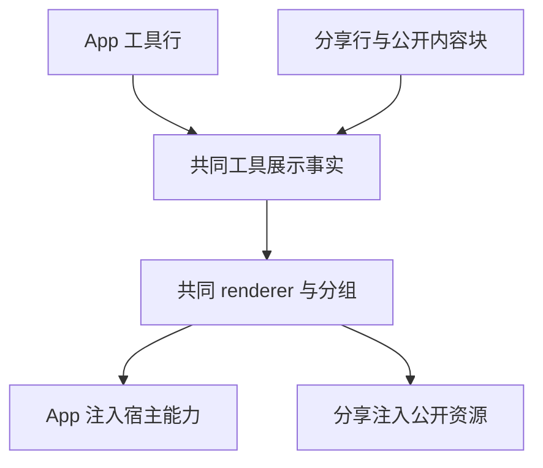

# Conversation Share and Continue Work V1

## Status

- Current-state spec, dated 2026-08-31.
- API baseline: share API revision 27 plus the 2026-08-12 joint-debugging agreement.
- Governs the publishing Desktop, the Desktop import side, and the standalone share landing page contract of `packages/web` in this repo.

## Product boundary

V1 supports sharing from Desktop local, SSH, WSL, and Docker workspaces. Mobile `/remote` and regular Web must not publish shares; `packages/web`'s `/cn/share/:share_code` only consumes the preview API and wakes Desktop via deep link. Desktop Server Remote is not supported in this phase.

A running session can share product turns that already finished; a running turn may display but cannot be selected. Selection identity is `productTurnId`; `rowId` is for timeline locating only. The title defaults to the current task title and may be edited for this share only. When a new share draft opens the settings popover, permission defaults to `public_importable` (anyone with the link can import and continue); after an explicit permission change, later scope adjustments or reopening the same draft keep that choice.

```text
Desktop UI
  -> workspace-scoped ConversationShareService
       |- target Environment JWT / Share API
       |- local/remote Conversation Rows + fileChanges
       `- local/remote artifact staging
  -> prepare -> upload -> confirm -> share URL

Web preview
  -> https://zcode.z.ai/cn/share/<share_code>
  -> zcode://share/import?code=<share_code>
  -> Desktop continuation
  -> new task/session in current local workspace + shared_context + all artifacts
```

The share landing page is a standalone static build: `pnpm run build:web-share` uses Vite `base=/cn/share/`, published by `Dockerfile.web-share` and `nginx.web-share.conf` to both the `/cn/share` and `/share` language entries. Both share one SPA and one asset set; the path prefix picks the zh-CN or en UI locale. It uses a separate image, Deployment, CI job, and rollback version from `/remote/v4`. Public preview is anonymous; private preview uses same-origin Web OAuth.

The trimmed build installs only the dependency closure of `@zcode/web-share`. Reused Web/UI sources must not depend on the full workspace `node_modules` links; Vite uses exact source aliases for `@zcode/shared` root entry resolution so Web-directory resolution cannot fail, and must not rewrite `@zcode/shared/*` subpaths to `index.ts/*`. Every `@zcode/shared/*` subpath in the share closure (e.g. `test-ids`, `zcode-protocol-v4`) must be registered with an exact source alias in `packages/web-share/vite.config.ts`. Isolated-build regression tests cover this constraint.

Manual acceptance of the image and nginx routes uses `scripts/test-web-share-build.sh` (local Docker required; no CUA Git credentials). It checks build output lands under `/cn/share/assets`, both entries `/cn/share`, `/share`, and the callbacks are reachable, and `/remote/v4` is not served. These base paths and route isolation are not covered by unit tests; run it once after changing the Dockerfile or nginx config.

OAuth callbacks are per-language entries `/cn/share/callback` and `/share/callback`; credentials still go to the same-origin `BrowserOAuthCredentialRepo`, so after login both share entries, `/remote`, and other Web paths share one Web session. The Web JWT never enters the Deep Link or reaches Desktop. The two entries do not redirect to each other, so an English page is never switched to the zh-CN locale; static assets and callbacks are hosted by the share image alone.

Permission mapping is fixed: `private` requires owner Web OAuth before preview/import; `public_readonly` and `public_importable` previews are fully anonymous. When an anonymous request hits a private share, both `401/3213` and the cloak-policy `404/3211` may only show a generic login hint; a `404` while logged in must not leak share existence or owner info. Desktop continuation carries optional login state; the client must not skip the request just because it has no local JWT — final import permission is decided server-side from share code, access mode, and optional user identity.

### Share not-found page

When logged in and Preview returns `not_found`, keep the centered status card showing 「找不到分享内容」 and 「链接可能无效、分享已被移除，或当前登录账号无法访问。」, plus a separate hint 「Z.ai 与 BigModel 的账号数据不互通。请检查是否选错了登录平台或使用了其他账号。」 The account hint is troubleshooting advice only; it does not imply anything about share existence, platform, or owner. zh-CN and en carry equivalent copy.

Actions, left to right: an outlined 「重试」 and a primary 「回到首页」. Home reuses the existing site URL `https://zcode.z.ai`, navigating in the same tab without clearing login state. Buttons sit side by side; wrapping is allowed on narrow screens or long copy. Use existing theme and UI font-size tokens; works on desktop, mobile Web, and both themes.

```text
Preview not_found → 现有 Loader
  ├─ 无 token → 登录选择页
  └─ 有 token → 找不到分享内容 + 账号排查提示
                   ├─ 重试 → 当前 token 再请求 Preview
                   └─ 回到首页 → 官网导航
```

State stays solely owned by `ConversationShareLandingLoader`; state components only render. Do not touch error mapping, OAuth, other error pages, Desktop continuous, or mobile remote replayable paths.

Acceptance case SHARE-NF01 (pending): start `pnpm dev:web-share:mock`, then run `node packages/web/test/e2e/manual-review/pending/share-not-found.mjs`. It walks anonymous fixture access → login → check the account hint → retry → same-tab home navigation, plus zh/en, 320px mobile/desktop viewports, both themes, no horizontal overflow, and no new content on the expired page. Home requests are intercepted by the browser test; no external network. Component unit tests cover the other error states in isolation.

Local share verification entries: `pnpm dev:web-share:test` starts the same production `@zcode/web-share` Vite entry pinned to the test environment; then open `http://localhost:5173/cn/share/<share_code>` (zh-CN) or `http://localhost:5173/share/<share_code>` (en). The share code is read only from the URL path; no env vars. `pnpm dev:web-share:mock` uses the dev fixtures `/cn/share/mock-private`, `/cn/share/mock-readonly`, `/cn/share/mock-importable`, `/cn/share/mock-expired`, and `/cn/share/mock-not-found`. Both commands start Vite only — no Desktop, relay, or standalone Agent. Two cross-version fixtures: `/cn/share/mock-partial-unsupported` (unrecognized rows are skipped with a soft banner) and `/cn/share/mock-outdated-client` (payload version above this build shows 「需要更新 ZCode」, not 「格式无效」).

The share runtime of the target Environment always uses the real Share API, resolved from `ZCODE_ENV`; there is no runtime mock switch. `ConversationShareMockApiClient` is for service unit tests and protocol fixtures only and cannot produce cross-process share links.

The public page body reuses `packages/ui`'s read-only presentation layer: `buildConversationTurnRenderUnits` preserves Desktop's turn and work-segment order, with the same `ConversationUserInputBody`, `ConversationUserInputContent`, `MessageResponse`, `Reasoning`, `ToolLayout`, and `ToolSummaryRow`. Share injects only locale, theme, and code preview defaults — never Host, workspace, or file service. Desktop actions, file opening, editing, retry, and feedback stay Desktop-only. Continuous tools (Explore/Execute/CUA) also pass through Desktop's `buildAssistantWorkRenderItems` grouping first; the public page shows only safe summaries and read-only detail, so each tool result is not rendered as its own giant card.

The share page owns its own vertical page scrolling and does not change the global `body/#root { overflow: hidden }` Desktop/remote convention. The scroll root is also marked `data-markdown-table-layout-root` so long Markdown tables scroll horizontally inside while the page scrolls vertically. `MessageResponse` public mode consists of a one-off `TooltipProvider`, a read-only external-link handler, and citation scrubbing: local citations leak no paths, and protocol directives without a matching public artifact are not rendered.

The fixed top bar of the public share page stays a single 64px row. The `ZCode` brand, share title, and continue CTA share one continuous geometry track; when a full CTA cannot keep a minimum visible title width, it switches to an icon-only CTA that keeps an accessible name, and the title then shrinks via CSS ellipsis. The full title stays in the accessible name/`title`. `public_readonly` never shows a CTA; this responsive policy affects only the Web landing display, not Deep Link, permissions, or Desktop/remote behavior.

When the share is importable, the end of the body timeline also shows a "去 ZCode 继续" button styled and behaving like the top CTA, horizontally centered inside the content column and reusing the same `zcode://share/import` deep link. Either entry starts the same auto-open prompt flow; `public_readonly` still shows no continue entry. The bottom button belongs to the body flow, must not cover the last shared item, and does not change read-only semantics.

The public metadata "artifact count" counts only `kind: "artifact"` rows inside the public `rows` — the artifact cards the timeline actually renders. `preview.artifacts` is the full download manifest shared by artifacts and `userInput.attachments` and must not be used as the artifact count; user input attachments still participate in URL/name mapping and downloads but do not count as "artifacts".

Image attachments of user input show thumbnails by `mime`, resolved first through `previewRef`, then `ref`, from the existing artifact URL mapping; clicking a thumbnail opens the original at the attachment `ref` URL. Plain attachments, images without an available URL, or load failures keep the file name, size, and original-file download entry. The Desktop read-only share preview reuses the same presentation, wrapping and constraining width on narrow mobile screens; both themes and zh/en accessible names come from existing rules, with no new host read or upload channel.

## Protocol precedence

When historical designs, API examples, and this document disagree:

1. confirm submits only `selected_product_turn_ids`, `projection.rows`, the two integrity hashes, and the disclosure confirmation.
2. title, schema version, access mode, client request ID, and payload hash are submitted only at preparation.
3. Preview/Continuation integrity is only `projection_sha256` and `artifact_set_sha256`.
4. A successful artifact upload response must include non-empty `safety_status`; the client does not branch on its value.
5. HTTP 409 / code `3215` is a non-terminal safety check; poll serially with the same preparation and byte-identical confirm DTO, preferring a legal Retry-After, else 5 seconds, total wait capped at 2 minutes.
6. TTL, quotas, and the artifact allowlist follow capabilities only; PDF opens only after an explicit server declaration.

## Cross-version compatibility discipline

Shared content flows between **4 parts that upgrade/roll back independently**: the publishing Desktop, the Share API backend, the independently deployed landing image (see "separate image, Deployment, CI job, and rollback version" above), and the importing Desktop. They can never be version-locked, so the public projection is in effect a **cross-version data exchange format**. The discipline below is mandatory:

1. **Tolerant on responses, strict on requests.** Inbound schemas (capabilities / preview / continuation / error envelopes / artifact descriptor echo) are non-strict and pass unknown fields; outbound schemas (preparation / confirm / continuation request) stay `.strict()` — an extra field is a bug on this side and must throw immediately. Adding `.strict()` back to an inbound schema means the next backend field addition kills every existing client.
2. **Integrity is verified only against server-sent raw values**, never against zod parse output (`verifyConversationShareIntegrity`). zod strips unknown fields by default; recomputing hashes from parse output misreports purely additive row evolution as "share file integrity failure". Digest and schema awareness must stay decoupled forever.
3. **rows are additive only.** New fields must be `optional`; **never delete fields, never narrow enums, never change field semantics** — deleting fields and narrowing enums both make the peer drop content, just in opposite directions.
4. **A new row kind or enum value = old clients skip that row** (`decodeConversationShareRows` degrades row by row; the UI shows the "部分内容需要更新 ZCode 查看" soft banner). Before adding one, ask: is the share still self-consistent with that row skipped? Only a semantic change that cannot be skipped justifies rule 5.
5. **Bump `schema_version` only for unskippable row breakage**, and check the version distribution of existing clients and deployed landing images first — one bump makes them all unable to read new shares. A version above local knowledge maps to `unsupported_schema_version` ("upgrade ZCode"), never to `invalid_contract` ("invalid share format").
6. **The exhaustive switch in `projectRow` (`conversationSharePublicProjection.ts`) is a deliberate compile-time gate; do not add a `default`.** A new row kind must fail the build and force the developer to decide per rule 4, instead of silently starting to emit things old clients cannot read into the public projection.

Regression coverage lives in the "cross-version forward compatibility" section of `packages/shared/test/conversationShareContract.test.ts` and the "import a share published by a newer version" end-to-end case in `conversationShareImportService.test.ts`. Run both after any inbound-contract change.

## Authority and security boundary

### R3 Source Server share authority (2026-09-16)

Shares of an R3 remote workspace are executed by the target Source Server, which reads the target Environment's current OAuth/JWT, network settings, sessions, and files. Desktop only forwards requests and supplies trusted attachment context; even a local account different from the remote one must not change the share owner. Provisioning may write remote credentials first, but each share reads only the remote production Store — it does not read the Desktop JWT online and does not fall back to a local account when logged out or expired. This rule replaces the old SSH mixed-service "remote files + local JWT/API" combination; local workspaces keep executing locally.

```text
Desktop attachment（覆盖不可信 caller 上下文）
  → SSH/WSL/Docker → Source Server Share RPC
                    → 远端 OAuth + 远端 HTTP + 远端 Rows/File
                    → 复用同一 V4 trusted carrier / 已握手连接
  server 直连 → 保持一期禁用
  手机 attachment / Source 的普通 Web 入口 → 拒绝发布和导入
```

Source Share RPC accepts only desktop-continuous downstream context over a trusted Host transport; Rows/File queries reuse that transport's existing Agent scope, which namespaces the downstream connectionId — no new connection or handshake. Raw renderer fields on Desktop must be overwritten by trusted attachment truth; Source Web clients must not forge that field. Source-side publish state, preflight caches, temp files, and HTTP are managed by its existing ShareService; reconnect rebuilds the RPC attachment without new stream, queue, or recovery semantics. Desktop continuous and mobile replayable keep their existing boundaries.

Share data carries `workspaceIdentity` and `remoteSessionId`; the isolation key stays `workspaceIdentity?.trim() || workspacePath`. Source identity conversion reuses the existing canonical mapper. JWT, signed URLs, Rows bodies, and file content must never enter logs. `remote:server:...` is an identity format; it must not be read as the user choosing direct Server connectivity over SSH.

Regressions: the full chain of a real remote factory → Share RPC → trusted Agent; with local account A and remote account B only B may be used, and after the remote logs out, reject instead of falling back to A; direct Web/mobile and Server-direct stay rejected; handshake context must match existing sessions. SHARE18 runs standalone: write an explicitly provided Team profile to the remote via existing Provisioning, then access the matching production Share API from the remote. Models use case-local replay; it must really generate files and verify publish success and artifact bytes.

### Public share page defenses against third-party content

The public share pages (`/share`, `/cn/share`) render **publisher-controlled bodies** to anonymous visitors, so bodies are untrusted content at this entrance. Both defenses below must be in place:

1. **Render-side stripping**: `normalizeConversationShareMarkdown` (`packages/ui/src/v4/conversationShareMarkdown.ts`) demotes remote image syntax in bodies and tool output to plain links (`` → `[alt](https://x)`). Only `http:` / `https:` / protocol-relative `//` are handled; `data:` makes no network request and relative paths stay on our own origin, so they are left as-is; syntax inside code fences is protected unchanged by `findMarkdownCodeRanges`. Rationale: the read-only timeline passes no `workspacePath` / `sessionId` / `readAttachment`, so `MarkdownImage` falls back to `` and every visitor automatically calls third parties chosen by the publisher on page open, leaking IP / UA / Referer — equivalent to a publisher-controlled tracking pixel. Doing it render-side means **already-published old shares are fixed immediately**.
2. **Transport-side CSP**: `img-src 'self' data: blob:` in `nginx.web-share.security-headers.conf` catches anything the first line misses. That file also provides `X-Frame-Options` / `X-Content-Type-Options` / `Referrer-Policy`, and **must be explicitly included by every `location`**: nginx `add_header` does not inherit — any `add_header` in a child (e.g. `Cache-Control`) drops the whole server-level set.

Two hard CSP constraints (read before changing, or the live page breaks silently):

- `script-src` must carry `'wasm-unsafe-eval'`: shiki highlighting defaults to the oniguruma wasm (`createHighlighter` in `packages/ui/src/lib/shikiHighlighter.ts`); `'self'` alone disables all code highlighting on the share page. It only unlocks wasm compilation; `eval` / `new Function` remain blocked (verified).
- `connect-src` stays `https:`: the API origin is injected at Vite build time from `ZCODE_ENV` (`packages/web-share/vite.config.ts`); hard-coding one origin would need one conf per environment for test/production.

Artifacts open only via `window.open`, never ``, so they are unaffected by the tighter `img-src`.

## Publish projection

The public projection is built from formal `ConversationRow[]` — never reconstructed from DOM, legacy MessageWithParts, or Web DTOs.

- Allowed kinds: `turnHeader`, `userInput`, `assistantText`, `reasoning`, `toolCall`, `timelineMarker`, `artifact`.
- `subagent` detail is filtered, but that Agent's toolCall and other public rows of the same turn are kept.
- Each row kind creates a fresh object via an allow-list, dropping actions, source/root command IDs, client IDs, approval IDs, active progress, and local artifact references.
- Public product-turn, turn, row, entity, tool-call, and artifact IDs are rebuilt deterministically; row order and reference closure stay stable.
- Descriptors send no `original_path`. Artifact refs are fixed at `zcode-artifact://share/<artifact_id>`.

The selection must include at least one terminal product turn. Each selected ID must have exactly one `turnHeader` whose state is not `running`. Any paginated revision/log epoch mismatch must fail before preparation.

### Workflow tool display

`toolCall.display` supports `create_workflow`, `get_workflow_run`, `list_workflow_runs`, `eval_workflow_snippet`, `saved_workflow_list`, `list_models`, `resume_workflow_run`. The client validates and copies the full display with the formal `toolCallDisplaySchema`; the server mirrors its nested objects, enums, optional fields, array bounds, and UTF-16 string lengths field by field; unknown types, unknown fields, and invalid values are still rejected. Images keep the existing artifact conversion; no inline Base64 or local URIs.

What is shared is the display snapshot taken at tool execution: the tool row must be terminal, but the workflow status inside the snapshot may still be `running`; background workflow completion is not required. RunId, in-graph station, and stage IDs are snapshot data, not execution grants on the share side; live workflowRuns state is not published, and no run, resume, or subscribe actions are added. The share page reuses the existing workflow components: Create/Amend static stage graphs with compile diagnostics, Get run summary/stages/subagents/logs, List run lists, Eval diagnostics/results, Saved workflow lists, Resume result notes. Display is snapshot-only; no local files, session, edit, run, or resume callbacks are injected. Historical rows lacking display fall back to the generic tool card; ListModels uses the shared model catalog renderer. The import side keeps display; `schema_version` stays 1. Readable and expandable on desktop/mobile, both themes, zh/en; narrow-screen card headers may wrap and workflow names must not be pushed out by status; the page never calls desktop host services.

Acceptance: all 7 display kinds pass full projection, server confirm validation, and import decoding; nested unknown fields, type/enum errors, out-of-bound arrays/strings/integers, and explicit nulls fail with row and nested field paths in the error; plain tools, image conversion, and share integrity checks do not regress. Both sides' tests use the same workflow display JSON samples. Browser acceptance SHARE-WF01 (pending): start `pnpm dev:web-share:test`, run `node packages/web/test/e2e/manual-review/pending/share-workflow.mjs`; the test intercepts the preview API and covers desktop/mobile, zh/en, Zai Light/Dark basic display, expanded diagnostics, historical fallback, read-only, and no horizontal overflow.

### Extensible read-only content blocks

Besides `rows`, the public projection allows optional `content_blocks`, each with `type`, an independent `version`, a public product-turn anchor, `fallback_row_id`, `captured_at`, and `resource_ids`. First type: `workflow` v1 — run graph and status, completion notice, and six kinds of user artifacts. It is not a passthrough of live workflowRuns; after publishing it is an immutable snapshot. The publisher also emits a summary row of existing `assistantText` kind that old readers can read; new readers replace the summary with the card only when the block is recognized and renders successfully. Unknown or corrupt blocks keep the summary and do not affect the rest of the turn.

The server declares capability via optional `content_block_versions: { workflow: 2 }`; version 1 stays compatible, version 2 adds frozen text previews. When the capability is absent, only the summary and allowed plain resources are published. `schema_version` stays 1. New block fields are validated by strict allowlist; resources must be closed within this manifest; blocks use their own `content_blocks_sha256` while existing rows/artifact hashes are unchanged. Preview, continuation, and import archive all keep blocks; integrity is checked on wire-raw values before per-block decoding.

```text
所选终态轮次 → Share Service → 原 Agent 的 journal 事件冻结读取
                              → 同一 reducer 生成 run 状态与产物版本
                              → 指定版本字节 / 截止 sequence 的看板条目
                              → 公开字段投影 + 摘要 + 上传 → Server 不可变快照
                                                           → Web / 导入只读展示
```

Workflow events are read in pages keyed by `afterSequence`; sequences must strictly increase across pages; an empty unfinished page, a repeated cursor, a read failure, or a cumulative total over 20000 marks that run unavailable. Reading to `hasMore=false` forms an append-only prefix whose last sequence is the cutoff point (not the moment of the first request); continued appends also count against the total limit. Board paging filters entries after that watermark; files are read at the artifact version recorded by the reducer. Never substitute a conversation revision for the journal watermark. Running background workflows do not block sharing completed product turns; their cards are clearly marked as snapshots at share time. When history linkage or source data is unreadable, keep the summary with the reason — never fake success, zero counts, or an empty board. Other conversations'/subagents' transcripts that were not selected are not shared; stop, resume, approval, or local directory operations are not enabled. Cards and boards reuse pure display components and algorithms; the public bundle pulls in no Desktop service/store.

Preflight and publish use the same collector; publishing re-freezes and does not reuse the previous preflight's runtime state. Files go through the existing upload review; structured boards count toward the payload quota as part of the block and participate in content moderation. Every new content type must declare a public schema, collector, summary, resource policy, and read-only renderer; unknown types render as read-only summaries and never auto-execute plugin code.

Artifact download file names use the source-type extension; dots and version numbers in the title do not change the file type. Content block, artifact row, bytes, and resource budget are registered together only after text decoding and public schema validation all pass; failed artifacts keep only a "not included" note and do not enter the upload set. The synthesized workflow summary is display-only; preflight and publish must never treat its title or error text as workspace file references again. File discovery for real assistantText keeps existing behavior.

Artifact URLs returned by the public API must be HTTP(S) only. Tool images lacking host read capability or a matching public resource show a static "preview unavailable" — never a Loading with no async task behind it. Unknown HTTP errors are not treated as response-contract corruption; a 403 without a business code keeps the hidden-share `not_found` semantics, known business codes take precedence, and a genuinely malformed success response is still `invalid_contract`.

Acceptance SHARE-WF02: full run card, completion card, board/table/chart/metrics, actual opening of Markdown and files; selecting completed turns, running-time snapshots, cross-version summaries, resource closure/tampering, no Desktop dependency, and mobile/desktop, Zai Light/Dark, zh/en layouts. Data absent from old shares can only be restored by republishing.

## Artifact discovery and upload

Share candidates are the current turn's `userInput.attachments`, the Assistant preview cards finally shown in the current turn, and embedded images of completed tool output. A formal `artifact` row is no longer an independent discovery source; it enters the share via a preview-card candidate only when it also produced a preview card.

Preview-card candidates must be produced uniformly by the shared candidate builder; the UI and Share Service use the same ordering, dedupe, and visible-count limits. `~/...` paths in plain text, Bash input/output, workspace scans, orphaned `fileChanges`, and files that never formed a preview card are not candidates. `fileChanges` only drives the active/reverted association of Markdown/HTML cards and never discovers files independently.

Candidate files are statted on the owning execution side first, then the finally visible card set is taken; a nonexistent Assistant card file counts as "card not shown" — excluded from the share with no warning. User input attachments keep their nonexistent-attachment warning. PDF, Office, Markdown/HTML, video, and audio can all be preview candidates, but video/audio currently only produces an "exists but unsupported type" warning and never enters the uploadable artifact manifest. The same canonical path uploads at most once.

```text
正式 attachment / assistant 文件引用
                 |
                 v
    PreviewableArtifactCandidate（文件预览候选集合）
                 |
       +---------+---------+
       |                   |
       v                   v
  UI preview card     Share Artifact Row
```

Files pass realpath containment, regular-file, type, size, and mtime checks on the owning execution side. Remote files enter Desktop temp staging in chunks via `readFileRange`, hashing SHA-256 while writing; size/mtime drift before or after, empty chunks, disconnection, or out-of-range all fail closed. After prepare, only the staged immutable bytes upload. Uploads are serial in stable manifest order; any failure aborts confirm; `finally` cleans staging.

`userInput.attachments` are authorized per `rowId + entityId + attachmentIndex` through the current Agent connection scope; the Renderer must never pass attachment paths directly as read targets. Long text pastes keep the existing `~/.zcode/tmp/paste-attachments/<date>/<uuid>.txt` handling and are not re-inlined into the body at send time; sharing reuses the same read chain. When a file was cleaned up, reading fails, or bytes changed, only that attachment is skipped with an `input_attachment_unavailable` warning in the publish success state; the dead path never enters the public projection. Available attachments are rewritten to `zcode-artifact://share/<artifact_id>` without inserting an extra `artifact` row — they close via the manifest directly.

The share artifact types add `text` (`txt` / `text/plain`); the server runs it through the same synchronous safety review as Markdown/HTML as UTF-8 text. `text` opens only after the client, server, and standalone landing page are all upgraded in sync.

## UI state machine

The top share button opens a non-modal popover anchored to the button (suggested 360px wide, auto edge avoidance) with no full-screen overlay and no Composer replacement. The popover shows title, a full-row share-scope button, permission, the sensitive-info confirmation, and 「生成分享链接」. The scope button merges the summary, a conversation icon, and a right chevron; clicking anywhere on the row opens the existing selection panel; there is no separate 「调整」 label. While preflight runs (including stale), that button shows a loading state and 「正在检查分享内容…」 in place — no extra row; when the check finishes the scope summary returns and the button height stays constant. Preflight problems use a compact hint (e.g. 「有内容无法分享，查看问题」), with details in the opened layer. The hint uses sm font, left-aligned, a fixed 16px icon aligned to the first line; when wrapping in a narrow window, text stays left-aligned. The scope chevron and permission dropdown chevron are unified at 14px with 8px right padding; diagnostic details and repair actions keep their existing entries. The popover main title uses `text-ui-lg`, field labels `text-ui-base`, helper text the secondary size. The popover uses 12px compact padding and field spacing; inputs, scope button, and permission selector share the lg control spec; the bottom generate button alone is 40px tall with `text-ui-base` text, while form controls above stay 32px. The sensitive-info confirmation uses no card background, border, or orange side line — just a normal checkbox with secondary text.

Confirmation copy, publish stage names, diagnostic body, success-page fields, and links use `text-ui-base`; notes, preflight hints, and secondary actions use `text-ui-sm` — never demote helper text to `text-ui-xs`; the main popover title keeps the confirmed `text-ui-lg`. The scope-check layer reuses the shared Popover default offset, border, and shadow, with 12px padding, base body text, and sm group/notes — no arrowheads, dividers, orange dots, or separate footer tint. Opening focuses the popover without auto-selecting the title. Defaults: all completed turns selected, permission `public_importable`. Running turns are unselectable; the share title does not modify the task title.

```text
顶部分享 → 分享设置浮窗 → 生成 → collecting → uploading → checking → published / failed
                    │
                    └ 调整 → 现有左侧选择面板（临时勾选）
                                  ├ 确认 → 写回范围、关闭选择面板
                                  └ 取消 → 丢弃临时勾选、关闭选择面板
```

`ConversationShareSelectionStore` uniquely owns confirmed scope, temporary checks, popover visibility, and publish state per sessionId. Visibility is expressed by `open`, scope editing by `pendingExcludedRowIds != null`; the old scope/stage/view and global dropdown state are gone. The body only carries locate-and-display; checks and select-all are transactional commands of the scope panel; `ConversationSharePreflightStatus` only shows problems with retry/remove-turn actions, without the old next-step and bulk-select controls. 「调整」 copies the confirmed scope into the temporary selection; per-turn checks use productTurnId identity, and multiple queries in one turn change together. The selection panel reuses the existing question/answer summaries; clicking a list row (text, summary, or blank) and the checkbox both toggle the temporary selection; the separate locate button on the right only jumps the body and never changes checks. Keyboard Enter/Space toggles the text button; the locate button is independently focusable; running entries cannot be checked but can still be located. Selection panel rows use uniform 8px vertical padding and 4px title-summary spacing, with the old first-item indent removed; titles are base regular weight, summaries sm. The checkbox is vertically centered with the first-line prompt; message and prompt are left-aligned. The selector is 320px wide, capped at viewport minus 16px on narrow windows; the prompt stays one line, the message up to two lines then truncates. The scroll viewport uses 32px transparency masks fading top and bottom: shown only when content exists in that direction, removed at either end, no fade without overflow; masks never affect the scrollbar or bottom action area. The fixed top select-all checkbox aligns left with list checkboxes: tri-state all/none/partial; clicking partial selects all, clicking all clears; it operates only on completed selectable rows. Bulk changes write only to the current selection draft, take effect on confirm, and are undone on cancel; disabled when no selectable rows exist.

The panel is three layers: fixed top select-all, scrolling middle list, bottom status and actions. The bottom shows the selected turn count by default; over-limit it is replaced with a warning-colored 「超出上限 N 行」 and confirm is disabled. While preflight runs, the check status shows and confirm is disabled; empty selection also disables confirm. Row count and limit come from the existing service preflight — no hardcoded 500, and turn counts are never used as row counts.

Data path: check → selection store `pendingExcludedRowIds` draft → reuse per-turn cache/preflight → aggregated row count → panel state. Confirm saves the draft; cancel discards it and restores the original selection's preflight; without a draft, the confirmed selection applies. Keep workspace/session isolation and stale-response handling. Acceptance covers all/partial/none select, deselect-to-recover after over-limit, cancel rollback, confirm disabled while checking, and desktop/narrow windows with both themes. Checks use the shared Checkbox; unchecked turns stay readable in the body, only running disabled items are dimmed; hover uses the unified light background. The bottom bar is fixed with 「已选 N 轮」「取消」「确认」, count in sm, buttons uniform 32px, list scrolls internally; confirm is disabled with no selection. The popover count updates only on confirm; cancel keeps the original scope and sensitive-info check; after a scope change, confirm resets the sensitive-info check. While adjusting, the popover stays visible and generate is disabled; no second-level pages, collapsible lists, or new pickers.

Clicking outside either panel or Esc first cancels the temporary selection and closes only the selection panel; a further outside click or Esc collapses the popover. Clicking body locate targets, the popover, or its permission/diagnostic layers must not close the selection panel. Collapsing the popover keeps the current session draft and restores it on reopen. Switching sessions must never mix selections, titles, permissions, publish progress, or success results.

Generate is blocked when the title is empty before publish, nothing is selected, scope adjusting is in progress, or preflight failed. When sensitive info is unconfirmed, clicking generate only locates and focuses the checkbox, shows the confirmation text in warning color, and shakes the checkbox-plus-text row once horizontally (280ms, max 4px) — no background or border change, no auto-publish; repeated clicks restart rather than stack the animation; checking or unmounting cancels it immediately. With reduced-motion enabled, only the warning color remains. After checking, the text immediately returns to normal color and generate must be clicked again. When the confirmation item is already visible, no scrolling; when locating is needed, scroll only the popover body while the outer page and fixed bottom buttons stay stable. During publish, modification and closing are locked; failure shows reason, diagnostics, and retry in place, keeping the draft.

The generating popover keeps 12px spacing, shows up to two lines of task title, a thin progress bar, and the three-stage list; the auxiliary progress note shows only for the current stage, while the current-stage progress (e.g. upload counts) is the primary information in `text-ui-base`; the bottom turn/permission summary uses `text-ui-sm`. Font sizes scale with interface settings; icon sizes do not. In-progress icons spin, completed ones check, pending ones dim. Remove the duplicated top progress text and the non-actionable bottom generate button; keep the turn/permission summary; after failure the retry entry returns. Success shows, in place, the read-only title, the real link, copy-link, and open-in-browser; after copying a brief "copied" state shows and the popover stays. The success popover drops duplicate notes and the 「分享标题」 label; the task title is up to two lines; the link box is 32px with select-to-copy. Uniform 12px padding, no bottom divider; the two actions are equal-width, 40px tall, open-in-browser secondary and copy-link primary, with success icon and title centered. After success, closing and clicking the top share button again starts a fresh share setup: title and permission are kept, scope resets to all current completed turns, the previous success link, diagnostics, progress, and publish attempt are cleared, and the sensitive-info confirmation resets to unchecked; scope can be re-adjusted before generating again. Drafts that never published successfully restore their settings on reopen, and failed retries reuse the original attempt. The new round only resets local state; old links are not revoked. State ownership stays with `ConversationShareSelectionStore`: published → closeShare (collapse) → openShare (new setup) → publish (new attempt). Skipped files keep non-blocking warnings. Without a real confirm success, no link may be shown.

The popover body scrolls independently and the generate button stays visible; the selection panel's bottom buttons are likewise never pushed out by the list. When a narrow window cannot fit them side by side, limit the settings popover height during adjustment and move the selection panel below it, keeping all actions of both. Compatible with narrow windows, Zai Light/Dark, and zh/en. Mobile remote and regular Web still have no share entry; Desktop continuous and mobile replayable permission/recovery boundaries are unchanged, as are the publish API, Host authority, and idempotent retry mechanism.

Acceptance SHARE34: open/collapse keeps the draft; adjusting the temporary selection does not change the confirmed scope; cancel rollback, confirm apply, empty-select disable; text locate does not close the panel; Esc/outside click closes layer by layer; running turns unselectable; publish lock, failed retry, successful copy; cross-session isolation. Browser component integration cases stay under manual-review/pending and do not count as real Desktop publish or mobile-remote tests.

The selection-stage `SharePreflight` is an independent read-only check: it uploads nothing, does not read full attachment content, and does not change the selection draft. It binds to the current `sessionId`, `workspaceIdentity/workspacePath`, `remoteSessionId`, selection, rows `revision/logEpoch`, capabilities fingerprint, and candidate fingerprint; after any change to selection, candidate set, file-change state, or session watermark, old results must be marked stale.

Preflight results fall into these classes:

- **Blocking**: stale selection, missing product turn, turn/body/tool/sub-agent/compact/goal verification still running, local or inline URLs, unclosed artifact references, stale watermark, known capacity over-limit, or nothing shareable at all. Blocking items show in the share settings and forbid link generation.
- **Skippable**: existing-but-unsupported preview-card files, explicitly missing or changed user input attachments. Continue is allowed; publish skips the file and shows a warning in the success state.
- **Card vanished**: an Assistant preview candidate that does not exist at stat time counts as a card the UI does not show — excluded with no warning.
- **Deferred confirmation**: cases that cannot prove a file missing, such as insufficient permission, remote disconnect, or stat timeout. The selection stage only hints "will be re-confirmed at publish"; publish decides by the actual read result.

  Classification must use the protocol's stable fault codes (`ZCODE_ATTACHMENT_FAULT_CODES`), never error-text matching. `conversationAttachmentStat` is a metadata-only probe; its `totalBytes` bound (`attachmentStatMaxBytes`) and the byte-moving read channel bound (`attachmentPreviewMaxBytes`) are two independent limits: stat must be able to express a real file size beyond transport capability, or the deterministic "known capacity over-limit" blocking degrades into "deferred confirmation" and publish silently drops the attachment. Type checks come before size checks — an unsupported type never uploads at all, so its size is irrelevant and must not escalate to blocking.

- **Silently removed**: `forkNotice`, `forkCreated`, `checkpointRestored`, and other completed internal markers that cannot be expressed on a linear public timeline are dropped from the public projection outright — no warning, not counted as skipped, no user turn cancellation required. Only if a selection has nothing else shareable after silent removal does "nothing shareable" block.

The share popover shows a `checking` state during preflight; blocking items show the specific turn and a "cancel that turn" action (removing the whole turn by the issue's `productTurnId`; `turnOrdinal` is display copy only — the two numberings differ, and resolving via the ordinal cancels the wrong turn); when skippable files exist, the action row shows the skip count. Confirm and publish must re-run the same checks — revision/log epoch, file stat, size, and SHA-256 — guarding against file or session races after preflight.

Preflight results are cached by the current share flow's renderer-local owner keyed by `productTurnId`, not re-checked per whole selection. First popover open batch-checks only turns not yet hit; later additions check only new, unhitted turns. Unchecking checked turns, re-checking them, and confirming scope all read the cache without new preflight RPCs. The cache binds to `workspaceKey`, `remoteSessionId`, `sessionId`, `productTurnId`, rows revision/log epoch, turn/candidate fingerprint, fileChanges state, and capabilities fingerprint; when turn content, candidate set, file-change state, or capabilities change, only affected turns are invalidated. The cache never enters the database or conversation snapshot; it is cleared when sharing is canceled/finished or the session/workspace switches.

The share popover interaction lives in the managed module `packages/ui/src/conversation-share-interaction/`. The module provides the popover, preflight hints, scope transaction actions, and preflight request/response handlers; callers go through registered entries. The selection store still exclusively owns the scope draft, SessionPane still exclusively owns the preflight cache and publish state; the module adds no persistence or independent business state. Mobile remote gets no share entry.

A preflight response-processing exception must also end the check: turns not hit by the current request get a retryable transport blocking item, the selection is kept, generation is forbidden, and the problem details offer 「重新检查」. Exception logs are recorded separately from server-failure logs. Metadata and cache commit only after all response entries build successfully, so a failed response's capabilities fingerprint cannot immediately invalidate the recovery; stale requests write no state. State order: `checking → ready (blocking) → re-check → checking → ready (success or blocking)`.

## Publish error detail contract

A publish failure must not show only the first error or one context-free toast. The Host must run one SharePreflight before prepare and return at most 5 desensitized `issues` on failure; beyond that, only a count. Each issue may include the turn ordinal, file name (basename only), artifact type, extension, MIME, actual value, and capability limit — never absolute paths, URLs, file content, hashes, tokens, or internal persistence IDs.

Structural problems split at least into: running turn, streaming row, active tool call, active subtask, running compact/goal verification, user input attachment, local/inline URL, unclosed artifact reference, and stale revision. Completed fork/checkpoint internal markers are not user-actionable errors and must be silently removed; embedded tool images follow the artifact conversion rules below. Blocking items merge by turn with a cancel-that-turn action. Artifact allowlist problems must show the file name, actual type/extension/MIME, and the formats the current capabilities allow; Markdown's `html + text/markdown` combination must be distinguished from HTML's `html + text/html`.

Row counts, artifact counts, per-file size, total artifact size, and JSON payload size must report actual value and limit together, never collapsing to "over the share limit". Network, upload, and safety-check errors must carry the failed stage; when the server returns nothing locatable, show only the stable error kind, stage, and safe retry advice — never raw server text.

HTTP error classification is source-first: a non-JSON 5xx error page from a gateway/load balancer (502/504 HTML) is infrastructure failure and must classify as `service_unavailable`, distinct from no-response network errors, and must not classify as `invalid_contract` because the body does not parse (that kind means the server violated the API contract and misleads triage and user hints). Artifact upload is a large transfer the user actively waits on: single-request timeouts relax dynamically with artifact bytes (floor-bandwidth estimate), not the default JSON timeout; the same relaxation rule applies beyond confirm.

The share dock stays open; a failed publish stays in the publishing dock with a scrollable error detail shown inline under the progress info; no top error toast on publish failure. The error state keeps 「调整」, popover close, and 「重试生成链接」; editing selection, title, or permission clears the old detail. All detail copy must work in zh/en, light/dark, and narrow layouts.

Publish, import, and web preview share business-code and HTTP-status classification: 3216 says content failed the safety check and needs adjusting; 3217 says the safety service is temporarily unavailable, retry later; generic 5xx says the share service is temporarily unavailable. Raw numeric codes are always kept, including unknown ones. Empty 401/429 hint login and retry-later respectively; HTML error pages also classify by HTTP status. 3211/3212 at publish prompt regenerating the link and clear the old attempt to get a new request ID; import-side 3211/3212/3214 and unsupported versions offer no verbatim retry, prompting check link/account, ask the sharer to regenerate, read-only shares cannot be imported, update ZCode respectively. 3210 never asserts files lost — uniformly hint that the upload did not finish or the share state changed. 3215 keeps the existing bounded serial polling, preferring a legal Retry-After-Ms.

Server validation-failure `data` accepts only bounded structural fields rule/path/field/row_index/row_kind and ignores raw content and other fields; invalid diagnostic fields do not affect classification. The main hint stays one-sentence cause plus next step; technical locations go into error details. The server request ID prefers `x-request-id`, falling back to a legal response logid; never substitute the client request ID. The web error page also exposes HTTP/code/server-request-ID detail; import failure logs keep these fields for triage.

```text
HTTP 响应 → shared 分类/诊断校验 → Host 或 Web 客户端错误
                                 ├─ 3215 → 原有 confirm owner 有界串行轮询
                                 └─ 终态 → 原有 UI 错误态 → 原因/行动 + 按需诊断详情
                                      └─ 3211/3212 → UI 清除已失效 attempt → 手动重试生成新请求 ID
```

The server `x-request-id` in error details is not shown inline in the error dock by default; the guidance copy ends with a click-only error-details button that opens an upward Popover showing and copying a legal server request-id. When the HTTP response has no request-id, the entry remains, showing a stable missing-note with no copy action; a client-generated header ID must never impersonate the server ID. Multiple issues share one detail entry instead of repeating the request-id per issue. The button shares the error copy's content column, uses a 24px hit area and the destructive semantic color, and supports keyboard trigger, Esc/outside-click close, narrow-screen collision adjustment, and both themes. Canceling the scope panel discards the pending draft but keeps the confirmed scope, title, permission, and error draft; clicking the popover scope button again opens a new edit transaction. Body locate does not close the panel.

When the error detail card has a single actionable message, it uses a compact single-line layout: copy, error-details button, and close action vertically centered, equal vertical padding, the smaller `p-2`, and card-to-action-bar spacing narrowed to `mb-2`; the extra list spacing returns only with multiple issues, so a single-line error leaves no unnecessary whitespace at the bottom.

The user must explicitly confirm; the system never auto-recognizes sensitive info. The panel cannot close during publish. A real `share_url` shows only after confirm succeeds; no demo URLs or fake loading. Retries with the same title, permission, selection, and content reuse the clientRequestId; changed inputs get a new ID.

Publish failures must show actionable hints per stable error kind, never a blanket "please retry". The target Host executing the share logs `operationId`, stage, kind, HTTP status/code, and safety counts; active rejections such as Server Remote log an explicit reason. Logs must not contain JWT, signed URLs, Rows bodies, file names, or absolute paths. Public-projection and artifact-staging failures additionally log a stable `reasonCode` (e.g. `input_attachment`, `running_turn`, `artifact_changed`, `unsafe_url`) plus safe `rowKind/rowId/artifactType/phase` diagnostics; the UI hints the next action by reasonCode and never shows raw underlying error text.

When a success HTTP response fails to parse, the HTTP client logs `responseFormat` (`invalid_json` or `schema_mismatch`), response bytes, endpoint path, request ID, and up to 10 safe field paths and types of validation problems; it never logs the raw response, field values, or raw validator messages. Unknown dynamic field names are masked as placeholders. The UI explains that ZCode could not read the share service's response, suggests retrying later, and offers copying the request ID from error details to contact support if failures persist; an HTTP 200 is never reported as publish success.

## Import and continue work

The Web CTA uses `zcode://share/import?code=<share_code>`; the deep link carries only the share code. The main process only parses, caches, and delivers the intent; the Renderer does not pre-intercept on local login state — it always calls the Host import service, and the continuation API returns the final access verdict. Target-window resolution for share deep links follows the other deep links: it must use the caller-injected `resolveApplicationWindow` (excluding auxiliary windows like the CUA indicator). When windows are not ready, the cached pending import must bind to the target window's webContents id, be delivered only to that window, and be cleaned when it closes — never delivered to whichever renderer is ready first: the import writes `.zcode-share` into the target window's active workspace, so wrong-window delivery means creating the session in the wrong workspace.

Import creates a new conversation task/session in the current local workspace; a remote workspace falls back to the default local conversation workspace. Artifacts are written to `<workspace>/.zcode-share/<share-id>/shared-artifacts/`, idempotently reused per `workspaceKey = workspaceIdentity?.trim() || workspacePath` and share code; different workspaces each create their own session. After creating the import-owned pending marker:

1. Call continuation and validate schema and both hashes.
2. Download all artifacts to same-filesystem staging and re-verify size/MIME/SHA-256. Downloads must have a per-request timeout (a hung connection counts as network failure; never stall forever in the downloading phase) and pre-check `Content-Length` before reading the body: when it exceeds the manifest's declared `size_bytes`, abort immediately instead of reading a known-oversized response into memory — integrity checks after an unbounded download guarantee correctness but do not protect client resources.
3. Atomically rename to `shared-artifacts/`.
4. `SharedContextFormatterV1` produces deterministic Markdown in original row order, rewriting artifact refs to relative paths.
5. In one SQLite transaction, create the session, the unique model-only `shared_context` message, and the `v4/shared_context_import` provenance with initial state `pending`.
6. Delete the marker, activate the workspace/session, and show the Share URL handover.

Integration constraint (Todo103): the import runs no model and does not depend on current Provider availability. The shared context message keeps the current structured `modelSelection` storage contract: keep it when explicitly selected; when unbound, do not fabricate a model source and do not rewrite the old `model.providerID/modelID` fields. Atomic import and later normal model validation are two separate boundaries.

### Selection initialization on first import (Todo139)

After the import service returns `reused=false` and before activating the session, the Renderer prepares that session's independent Composer draft from the actual workspacePath/workspaceIdentity in the result. An initialized Root draft copies only mode/modelSelection (including an explicit empty selection) — never body, attachments, or mentions — and does not clear the Root. An existing target draft is not overwritten; `reused=true` initializes nothing. Without an initialized Root, save an `initializeFromNewTask` pending marker in the same draft; plain new tasks and this marker share one initialization function: Recent full selection and mode first, else the common default selection/build. When the Registry is not yet ready, open the content first; the marker prevents an empty Session snapshot from initializing first; initialization completes once when common reads are ready. If the user changes model/mode early, the default-init intent ends and a late result must not overwrite; body edits do not clear the pending marker. Existing history is never treated as an empty model for first-import inference.

```text
import result (reused=false) → seed independent draft → activate returned workspace/session
                                  ├─ initialized Root → copy selection only
                                  └─ pending marker → shared new-task initialization when View ready
reused=true → existing session/draft unchanged
user submission → existing context_refs + full modelSelection/mode → accepted updates Recent
```

No new Host/CLI fields or sync mechanisms; Renderer drafts stay separate from the desktop-continuous/mobile-replayable authoritative message chain. The marker belongs only to the existing draft store, never the session database, and never backfills historical import records.

V4 projection carries `sharedContextImport` snapshot metadata additively: `contextId`, title, canonical Share URL, and `pending/reserved/attached/discarded` state. Deleting a session does not delete ordinary workspace files; a share expiring after import does not affect the local copy.

At import, the public rows and artifact metadata also land in `<workspace>/.zcode-share/<share-id>/shared-conversation.json`; the session top renders a **read-only block + divider** from it (reusing the share page's `ConversationShareReadonlyTimeline`). The divider's clickable and static forms uniformly use the Lucide `SquareArrowRightEnter` icon to avoid confusion with Fork's branch icon; keep existing sizes, theme colors, and multi-platform layout. Below the divider is the user's own live conversation. The read-only block never re-sources, so it opens offline even if the share expired or is offline; it is not a `timelineMarker` row, does not enter transcript export, and does not participate in re-sharing.

Artifact cards in the Desktop import block offer open actions only when the local copy has a legal `workspaceRelativePath`: the primary button reuses the normal preview card's `OpenSplitButton` to open the PreviewPane, and the dropdown reuses the same editor-choice and absolute/relative path copy capabilities. The path must remain inside `.zcode-share/<share-id>/shared-artifacts/`; render-side validation is a shape allowlist (exactly four segments `.zcode-share/<dir>/shared-artifacts/<file>`, no `..`/`.`/absolute), not a cross-check against shareId — the metadata is written self-consistently by the import service, and copying sanitize rules into the UI risks drift; see the `resolveImportedArtifactPath` comment in `ConversationShareReadonlyTimeline.tsx`. Missing, absolute, or `..`-containing metadata falls back to pure read-only display. The public share landing page still uses only the server `artifactUrls` to download; resource card buttons uniformly show 「下载文件」/「Download file」 on desktop and mobile browsers, with no Host, workspace, file service, or local open menu injected.

`ConversationShareReadonlyTimeline` is the security-boundary file shared by the public landing page and Desktop, so `OpenSplitButton` and its open-with subtree (platform hooks, tab store, file-tree model, editor preferences) are **never statically imported by that file**; the Desktop consumer (`ConversationShareImportNotice`) injects them as the `artifactOpenAction` component. The timeline file keeps only `import type` for `@/OpenSplitButton.js` (erased at build). This physically keeps the subtree out of the anonymous public bundle; anyone adding dependencies to the shared timeline must first consider the public page bundle size and the no-Desktop-host runtime (`window.zcode`, PlatformProvider). This is mechanically guarded by `packages/ui/test/conversationShareBundleBoundary.test.ts`: the guard normalizes import specifiers in the boundary file (relative paths resolved against the boundary file's directory and folded back to the `@/` alias form) before matching the denylist, covering four import forms — `import`/`export ... from` with a from clause (only `type` clauses allowed), side-effect `import "..."`, and dynamic `import("...")` (the latter two have no type-erasure variant; any hit fails). The guard's extractor has fixture self-tests so regex or normalization changes cannot silently open blind spots.

The model side still receives content only via the hidden `shared_context` message: visible means it attaches with the first message, so there is no Composer Share URL chip, no centered handover empty state, and no automatic sidebar share page after import; the share page opens only when the user clicks the divider. The `discardSharedContext` command and `discarded` state are kept but have no UI entry yet. The session title is fixed at import to the prefixed form (`来自分享：…` / `From Share: …`, `titleSource: "custom"`).

The startup cleaner scans only markers under `.zcode-share/<share-id>/` with a matching import ID. Import directories without provenance are deleted; sessions with transaction records but not yet activated get their index rebuilt and are activated. Failure cleanup may delete only this importRoot/staging — never recursively delete the user workspace.

## Acceptance invariants

### Import progress toast

One Share Deep Link import operation may occupy exactly one global toast. Download progress, install, and session-creation stages update in place within that toast — no per-stage toasts. On success the progress toast is replaced in place by the final result including the session title; no separate "share import finished" notice. On failure it is replaced in place by the error and retry entry, leaving no stale progress notice. A fast import may skip intermediate progress but must keep the final result notice.

Per-id progress updates compose with the existing dedupeKey dedupe; updates staged before mount are also merged into the final item before dedupe, so the settings page must not stack duplicate notices because of share.

The progress notice uses the existing top-center toast container, existing `--color-toast`, and `text-ui-*` hierarchy; in-progress and workspace-fallback use neutral info semantics, not yellow warning. This display constraint affects only the Desktop renderer's notification orchestration — not `ConversationShareImportProgress` stages, the Share API, the import transaction, `workspaceIdentity` isolation, or the Desktop `desktop-continuous` / mobile `web-remote-replayable` boundary.

- private: owner-only preview/import; public_readonly: anonymous preview, no import; public_importable: anonymous preview. Desktop sends an optional JWT for continuation and treats the server response as the import permission source; `authentication_required` displays as a non-retryable login restriction.
- No mobile publish entry exists, and a mobile attachment calling the RPC directly is still rejected.
- local/SSH/WSL/Docker share one public projection and API DTO set; remote only replaces Rows/File authority.
- `pending/reserved/discarded` shared_context injects no provider; `attached` injects exactly once after hydration/compact, producing no visible history bubble.
- The first Share URL input keeps queue/guide semantics: after queue/guide acceptance it enters `reserved`, atomically attaching with the user message at actual consumption; deleting the queued input restores `pending`.
- Merge wiring constraint: the share `context_refs` and the current full Submission submit together; none of the three paths — existing session, prewarmed first send, no-prewarm create-then-send — may lose modelSelection/mode. The shared context does not choose a Provider and does not restore Registry waiting before send.
- One Browser Tab per session/context; the Web renderer and the built-in Browser use different OAuth sessions.
- A failed publish or import leaves no half share, no half-visible local workspace, no broken artifact directory, no half session.
- "Previewable means shareable" holds only for file-backed preview candidates allowed by capabilities; a localhost URL-only preview is never auto-converted into a share artifact.
- No full-workspace file watching; Python/Bash intermediate files not explicitly referenced by the model or registered by tools are neither displayed nor shared.

### Publish failure attribution and diagnostics

- Local content problems, HTTP contract anomalies, and network request/response-body failures must be presented distinctly; `invalid_contract` must not map to suggestions about canceling running turns or images.
- `checking` means publish confirmation; a safety-check rejection must not be asserted from the stage alone. After failure, keep the selection and the existing idempotent retry identity.
- Response-body read failure classifies as `network`; save HTTP status and server request ID before reading. Client and server request IDs are kept separately and reach error details via the existing RPC details; operationId correlates the whole publish.
- Diagnostics record only request method, endpoint path, HTTP status, request IDs, response media type, response bytes, and whether redirected — never response bodies, auth material, or URLs with query parameters.

### Embedded tool images and selection-stage consistency

- `node_repl_images` of completed tools convert to existing image artifacts in original order, inserted after the corresponding tool; the public payload carries no base64; upload reuses the existing manifest, SHA-256, prepare/upload/confirm, and import download chain.
- Preflight and publish share one conversion entry; preflight handles only embedded data already read with the rows and reads no attachment files. Image types come from server capabilities; unsupported or corrupt image data keeps the tool text and clearly hints that the image is skipped — never silently lost.
- Public row counts are cached per turn and recomputed with the current selection; canceling a turn drops the old whole-group over-limit error; the fingerprint includes tool display, so image changes must invalidate old preflights.
- Known single-file, total-size, and count limits for supported images are checked at preflight; publish still regenerates the snapshot and re-verifies. Running tools still block; intermediate images never masquerade as final artifacts.
- API exceptions and network failures never require canceling turns; a failed publish keeps the selection and idempotent identity. Audio/video and arbitrary file formats are carried only when the existing protocol and server capabilities support them; never fake MIME or extension to bypass limits.

Acceptance: completed turns with embedded images pass preflight, upload raw images, and produce downloadable/importable artifacts; unsupported or corrupt images produce precise warnings; image-capacity over-limits surface at selection; HTTP 405 HTML and interrupted response bodies display as API/network errors with correlation IDs in details.

### Workflow share display consistency (SHARE-WF03)

The share selection list builds from product turns, including background-completed turns without a realUser bubble; plain-question navigation is unchanged. A CreateWorkflow that failed compilation and created no run keeps only tool diagnostics, generating no unavailable run card. Run cards reuse the client card header, stage graph, and artifact strip; completed turns show only the completion delivery card and four statistics, without repeating the stage graph. Artifact rows claimed by content blocks no longer show an extra large download card; unknown blocks keep the original summary and resources. Workflow content version 2 adds optional `preview_text` for file/markdown (text/plain and text/markdown only, at most 64 KiB in both UTF-8 bytes and characters). The publisher sends it only when server capabilities.workflow>=2; the body comes from the same frozen version bytes and enters the block hash and existing safety review; downloadable resources stay. Readers prefer snapshot body text and do not depend on OSS CORS; v1 shares stay compatible, and completion turns previously missed need republishing.

The share read-only view does not render workflow placeholder blocks marked unavailable with no run state and no artifacts, and also drops that block's fallback summary and snapshot notice; normal or partially populated workflows still render. No localhost/127.0.0.1 website cards are generated; raw text in message bodies stays as-is. This rule also applies to old shares.

Share preflight must keep stable classifications for auth, network, service unavailable, rate limit, feature-not-enabled, workspace connection, response contract, and authorization-claim errors, reusing their explicit action hints. Pure transport/auth blocking uses the "暂时无法检查分享" title and never masquerades as a content problem; only real content problems show the content-blocking title. Unknown causes show no empty stage placeholders.

## Unified tool presentation (tool-presentation v1)

The public timeline reuses all App tool renderers, group summaries, and public details, with product defaults: Explore/terminal/CUA grouping on, changes grouping off, thinking shown, Todo hidden; personal settings are not uploaded. The read-only share boundary is unchanged — no new child sessions, workspace operations, or plugin interaction apps.

A new content_blocks type tool-presentation version=1 negotiates via `content_block_versions`; the top-level `schema_version` stays 1. It binds the toolCall `fallback_row_id` and contains strictly allowlist-filtered `display`, image resource references, and agent type; it excludes formatted summaries, themes, run authorization, and raw payloads. Workflows keep their existing content block. Media reuses artifact upload and resource closure, displayed by tool attribution and original order.

Old shares co-render as their original tool rows without guessing lost facts; old servers keep V1 publishing and note that structured presentation was not fully preserved. Unknown/corrupt content blocks fall back to the original row and must not make the whole share unopenable. Rollout order: server, share site, App.



### Tool presentation failure and host-capability regressions

- Embedded images display directly when they have a resource URL; otherwise a read capability loads them. Missing capability or empty results show unavailable; read exceptions show load failure and log. Switching path or capability immediately invalidates old images; late requests must not overwrite current results.
- Approval dialogs reusing tool renderers directly must also inject App presentation capabilities. Approval only previews pending content and never launches plugin interaction pages. App tool rows keep the plugin entry when they have a legal plugin UI declaration and session binding; without one they use the dedicated renderer. The public timeline gains no plugin permissions.
- Preflight reads no artifact file bytes, only existing metadata and stat; workflow files check single-file, total-byte, and count budgets by `version.bytes`. When a declared size is missing, preflight reads nothing extra; publish reads and validates then. Removed standalone artifact rows are not re-materialized.
- Import contract/integrity corruption cannot be retried as-is; network request failures, interrupted response bodies, service unavailable, and unknown are retryable, keeping the import request ID. An HTTP error must not classify as contract corruption merely for being non-JSON.

```text
图片输入变化 → 当前读取 → 成功 / 不可用 / 失败
             └→ cleanup 失效旧读取 → 迟到结果丢弃
App 宿主 → 展示能力 Provider → 工具行 / 审批预览
导入请求 → HTTP 分类 → 传输故障可重试 / 契约损坏不可重试
```
