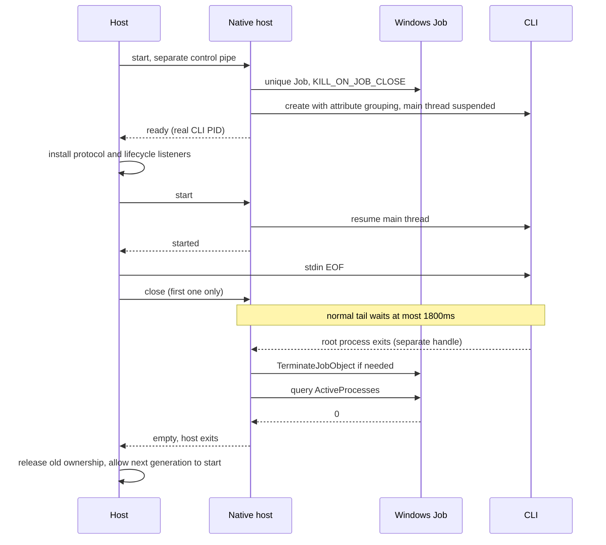

# Agent shutdown latency

## Goals and boundaries

Normal shutdown first lets the stdio CLI receive EOF and finish its protocol, SQLite and session tail inside its 1500 ms total exit budget; when it does not respond, the whole managed process group is reclaimed. Protocol invalidation, root process exit and the whole group being empty are three separate facts and must not stand in for each other.

Shared CLI and workspace ownership rules are in [shared-task-cli](../shared-task-cli.md). This doc changes no session data, App-CLI protocol, or the input and recovery boundaries of desktop-continuous and mobile-replayable.

## Windows: ownership is established at creation

Windows 10 / Server 2016 and later use the native `zcode-runtime-host.exe`: it creates a separate, uniquely named Job with `KILL_ON_JOB_CLOSE`, and puts the CLI into it at creation through `PROC_THREAD_ATTRIBUTE_JOB_LIST` with the main thread suspended. After the Host has installed protocol and lifecycle listeners it sends start; the native host resumes the main thread and confirms started. If grouping fails, startup is refused; there is no fallback to PID/PPID/CIM inference.



- CLI stdin, stdout and stderr pass through unchanged; the control pipe carries no business protocol. Only the three stdio handles are inheritable; the Job, control connection and Host handles are not.
- The CLI PID is used for resource management, network capture and lifecycle events; the PID/exit of the Node `ChildProcess` belong to the native host. The two are kept apart.
- The normal tail keeps the full 1800 ms and does not first subtract query/force reserve time. A repeated close does not extend the grace. When the root has already exited, leftover members can be cleaned at once.
- The normal path succeeds only when the Job's active member count is zero and the host has exited. The native host queries its own Job, not the system process table, and calls no PowerShell/CIM/taskkill and does not rediscover descendants through reused PIDs.
- When the Host process handle ends or the control pipe breaks, the native host terminates the Job at once; if the host is killed, the last Job handle closes and the kernel terminates the members. Creating with the attribute avoids a suspended unmanaged CLI between create and a later assign.
- An abnormal host exit may not have delivered empty. The Host must first wait for the old host to exit, then run the read-only `--check-empty <jobName>` of the same binary: cleanup is done only if the original Job is gone or has zero active members. A named object is destroyed by the kernel only after the last handle closes and all associated processes exit. On access failure or remaining members, ownership is kept and a later active request re-verifies.
- A timeout is not evidence of empty. A failed cleanup wait does not break the control connection, caches no permanent failed Promise, and does not allow a new instance to overwrite the old ownership. In-flight cleanup shares one Promise; a retry must not reassign this round's deadline. Passive queries do not start cleanup.

## Exit budget and concurrency

Main ordinary exit and update install share a 7.5 s force-end of the Host and a 9 s total wait upper bound; an early finish returns at once. Cron and Host start concurrently; update install still keeps its own resource scan and installer handoff.

The Host's local service cleanup and remote registry cleanup start in parallel. The local service first closes Agent admission and starts CLI reclaim, so cloud content, terminal or remote connection cleanup cannot use up the normal EOF grace. One Agent cleanup round and its internal retries share a 3250 ms deadline; the service phase waits at most 3500 ms. Other services and remote connections remain with their original owners.

stderr is kept until the stream closes or a 250 ms bounded drain after root exit, and diagnostics are reported with the old runtime identity. A stderr fault alone cannot close a healthy protocol.

## macOS/Linux

Keep using the separate process group and the discovered member snapshot established when the Host spawns. The snapshot is saved before EOF; afterwards signals are sent and the registered identity is verified. When a PID is reused, no signal may be sent to the new process. When the process has already exited, return at once; on failure the owned process is kept and the next active request retries.

This change reverts the earlier incremental patches for Windows CIM/taskkill and does not extend the behavior of the generic process-tree tools. Other independent callers that still use those tools are outside this CLI Job ownership boundary.

## Build and acceptance

- Native source, CMake and process acceptance are in `scripts/windows-runtime-host/`; the build entry is `scripts/build-windows-runtime-host.mjs`.
- Desktop dev/packaging, Windows Web Server dev and Windows Source Server stage all prepare this component. Windows supports MSVC x64/ARM64; cross builds need the matching MinGW toolchain. The artifact check verifies the PE architecture, and the dev cache verifies source and binary digests. Desktop release keeps the existing signing and signature consistency checks.
- Native acceptance checks normal 1450 ms tail, an unresponsive tree, descendants after root exit, control disconnect, helper killed, and suspended-start cancel, each holding handles on the root and a descendant to confirm exit. Host scenarios also check retry after failure, shared concurrency, move and passive query.
- In-container cross compile, Wine, Linux Host and desktop/mobile regressions are recorded separately. Wine is not native Windows verification; Windows hardware, real nested Job/MCP/browser, signed installers and ARM64 runs are deferred by agreement.
- No database migration. The new mechanism is established on the new CLI after an upgrade restart and does not try to take over processes left by an old App.

Repeatable native Windows acceptance (run at the repository root):

```powershell
cmake -S scripts/windows-runtime-host -B .tmp/runtime-host -A x64
cmake --build .tmp/runtime-host --config Release --target zcode-runtime-host zcode-runtime-host-acceptance
pnpm exec esbuild packages/services/src/windows-runtime-host/index.ts --bundle --platform=node --format=cjs --outfile=.tmp/runtime-host/Release/adapter.cjs
.tmp/runtime-host/Release/zcode-runtime-host-acceptance.exe .tmp/runtime-host/Release/zcode-runtime-host.exe
node scripts/windows-runtime-host/host-acceptance.cjs .tmp/runtime-host/Release
```

An acceptance timeout must keep its logs; a process that is still running must not be read as a pass. Container runs additionally need the matching cross compiler and Wine; the Node 20 compatible run is for Wine only, and the real App still uses the runtime the repository specifies.
