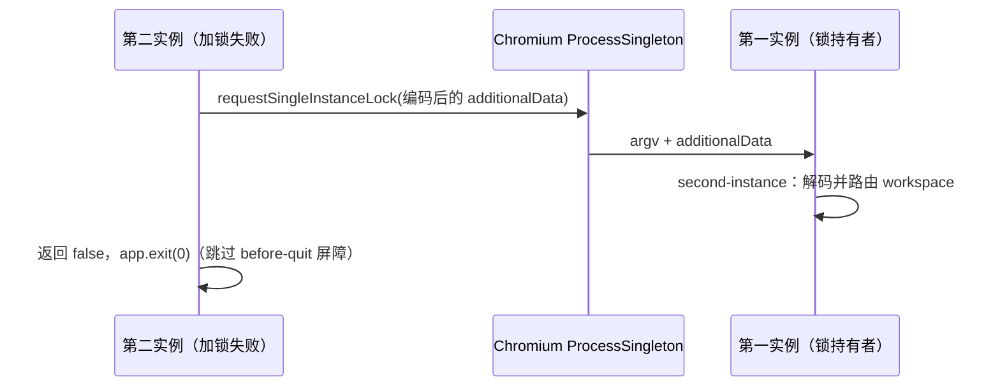

# Desktop Open Folder From System Context Menu

## 背景

系统文件管理器的文件夹右键菜单需要提供一个入口，把用户当前选中的本地文件夹交给 ZCode。该入口语义等同于主界面输入框上方空态菜单里的 `Open folder`：跳过目录选择弹窗，直接把指定目录作为 workspace 打开。

## 范围

- 触发点在 macOS Finder 的文件夹右键菜单服务，不在 ZCode App 内新增 UI。
- Finder 服务展示名跟随 ZCode 应用语言：`zh-CN` 显示为「在ZCode中打开」，`en-US` 显示为 `Open in ZCode`。
- 只支持单个文件夹。多选时系统服务脚本应只传第一个目录。
- 只支持本地绝对目录路径，不支持远程 workspace、手机 `/remote`、文件管理器空白处当前目录。
- macOS 侧接受 `zcode://workspace/open?path=<encoded-absolute-directory>`。
- Windows 侧接受 `--open-workspace <absolute-directory>` 或 `--open-workspace=<absolute-directory>`。

## macOS 数据流

1. ZCode Desktop 在 macOS 启动和应用语言切换时安装或更新 `~/Library/Services/Open in ZCode.workflow`；workflow 文件名保持稳定，避免升级后残留多个 Finder 服务，服务菜单展示名写入当前应用语言。
2. Finder Quick Action / Service 接收单个文件夹路径。
3. 服务脚本对绝对路径做 `encodeURIComponent`，调用 `/usr/bin/open "zcode://workspace/open?path=..."`。
4. Electron main 进程解析 deep link，校验 scheme、host、path、目录存在性。
5. main 进程把目录路径通过 `OpenWorkspacePath` IPC 发给 renderer；冷启动时先缓存，等 renderer ready 后投递。
6. renderer 复用 `handleSelectProject(path)`，保持已有 tab 去重、跨窗口激活、recentProjects 更新逻辑。

安装出的 workflow 需要同时兼容用户目录 workflow 和系统 workflow 的 bundle 结构：`Contents/document.wflow` 与 `Contents/Resources/document.wflow` 都写入同一份内容。`workflowMetaData` 使用系统内置 workflow 同款 `serviceApplicationBundleID`，并将 input type 标记为 `com.apple.Automator.fileSystemObject.folder`。

## Windows 数据流

1. ZCode Desktop 在 Windows 启动时安装或更新当前用户的 Explorer 右键菜单注册表项。
2. 注册表写入 `HKCU\Software\Classes\Directory\shell\ZCode.OpenInZCode`，菜单文案为 `Open in ZCode`，图标指向当前 ZCode 可执行文件。
3. 注册表写入 `HKCU\Software\Classes\Directory\shell\ZCode.OpenInZCode\command`，命令为 `"<ZCode.exe>" --open-workspace "%1"`。
4. 同步写入 `HKCU\Software\Classes\Drive\shell\ZCode.OpenInZCode`，支持右键打开盘符根目录。
5. Explorer 触发后启动第二个 ZCode 进程；Electron single-instance 通过 `additionalData` 或 argv 解析出 `openWorkspacePath`。`additionalData` 的值按「Single-instance 载荷」编码，argv 不做 URL 解码。
6. main 进程复用本地目录校验与 `OpenWorkspacePath` IPC；冷启动时先缓存，等 renderer ready 后投递。
7. renderer 复用 `handleSelectProject(path)`，保持已有 tab 去重、跨窗口激活、recentProjects 更新逻辑。

Windows 不使用 `zcode://workspace/open` 作为 Explorer 菜单命令，原因是注册表命令可以直接把 `%1` 作为 argv 传入，避免路径里的空格、`&`、`#`、`%` 进入 URL 编码/解码链路。注册表写入 HKCU，不需要管理员权限；暂不实现 Windows 11 顶层现代菜单 COM 扩展，菜单项在系统默认的传统 shell 菜单中展示。

## Single-instance 载荷

Owner 与边界：

- 写入方：加锁失败的第二实例调用 `app.requestSingleInstanceLock(createDeepLinkSingleInstanceData(process.argv))`；`packages/desktop/src/main/desktopDeepLinkUrl.ts` 是唯一的序列化入口。
- 读取方：第一实例的 `second-instance` 处理器经 `desktopSecondInstanceDeepLink.ts` 调用 `extract*FromSingleInstanceData`。
- argv 是 `second-instance` 的独立参数，不经过 `additionalData`；两者各自解析，互不替代。



规则：

1. `deepLinkUrl` 与 `openWorkspacePath` 写入前使用 `encodeURIComponent`，载荷只含 ASCII 且不含空白。
2. 读取时宽容解码：`decodeURIComponent` 抛错（例如未编码旧值含非法 `%`）时原样使用该值。
3. 原因：Chromium 将序列化后的 `additionalData` 以 `\0` 切分并裁剪空白，`\0` 后紧跟空白字节时值被破坏，并可能导致崩溃（electron/electron#52020，修复 PR electron/electron#52025）。本编码是 Electron 41.x 上的缓解；完整修复需要升级 Electron（>= 42.4.2），不在本规格范围内。
4. 已知限制：未编码的旧值若含合法百分号转义（例如目录名 `Project%20A`），会被解码为 `Project A`。消除该歧义需要版本标记 key，尚未采用。

加锁失败的进程不持有窗口、Host、cron 或 Agent。`requestSingleInstanceLock` 返回 `false` 后，载荷已交给第一实例，因此直接 `app.exit(0)`，不再进入 `before-quit` 的 host 清理屏障（该屏障会阻塞重启）。

验收场景：

- 路径 `/tmp/проект с пробелами ü` 经 `createDeepLinkSingleInstanceData` 编码后，值不含空白与非 ASCII 字节；提取结果等于原路径。
- URL 与含 `%25` 的 workspace URL 经编码、解码往返后逐字节一致。
- 未编码旧值 `/tmp/100%`、普通路径、含非法 `%` 的 URL 原样返回。

## 边界

- 多选：只处理第一个目录，其余忽略。
- 选中文件：系统菜单配置应限制为 folders；App 侧收到非目录路径时拒绝。
- macOS 路径包含空格、中文、`&`、`?`、`#`：服务脚本必须编码；App 侧通过 URL query 解码。
- Windows 路径包含空格、中文、`&`、`?`、`#`：Explorer 通过 `"%1"` 传 argv；App 侧不做 URL 解码（`additionalData` 传输层的编码与 argv 无关，见下节）。
- Windows 路径是盘符根目录：通过 `Drive\shell` 注册表项传入，例如 `C:\`。
- Windows 路径来自 UNC 或不存在目录：App 侧校验失败后拒绝，当前功能只承诺本地绝对目录。
- App 未启动：deep link 冷启动后在 renderer ready 时继续打开目录。
- App 已有窗口：发送到当前聚焦窗口或第一个可用窗口，再由 UI 的 `activateOrSetWorkspace` 处理跨窗口去重。
- `allowOpenWorkspace=false`：renderer 侧拒绝执行，避免系统服务绕过当前模式约束。

## Finder 服务脚本参考

App 会自动写入该 workflow；下面脚本是 `Run Shell Script` action 的实际逻辑，供排障时对照。

```bash
first=""
for item in "$@"; do
  if [ -d "$item" ]; then
    first="$item"
    break
  fi
done

if [ -n "$first" ]; then
  encoded=$(/usr/bin/osascript -l JavaScript -e 'function run(argv) { return encodeURIComponent(argv[0]); }' "$first")
  /usr/bin/open "zcode://workspace/open?path=${encoded}"
fi
```
