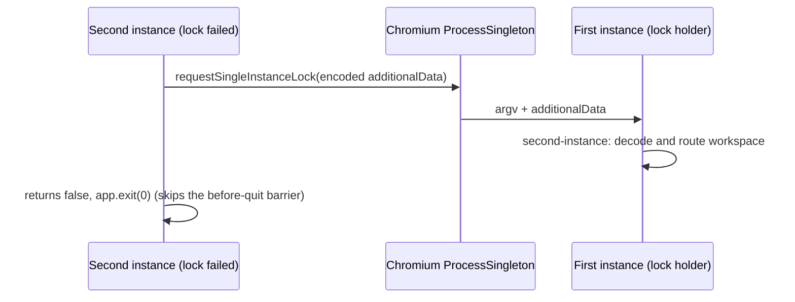

# Desktop open folder from the system context menu

## Background

The file manager's folder context menu needs an entry that hands the user's currently selected local folder to
ZCode. The semantics equal `Open folder` in the empty-state menu above the main input box: skip the directory
picker and open the given directory directly as a workspace.

## Scope

- The trigger is the macOS Finder folder context-menu service; no new UI is added inside the ZCode app.
- The Finder service display name follows the ZCode app language: `zh-CN` shows 「在ZCode中打开」, `en-US` shows
  `Open in ZCode`.
- Only a single folder is supported. On multi-select the system service script passes only the first directory.
- Only local absolute directory paths are supported; not remote workspaces, mobile `/remote`, or the current
  directory of a blank file-manager area.
- macOS accepts `zcode://workspace/open?path=<encoded-absolute-directory>`.
- Windows accepts `--open-workspace <absolute-directory>` or `--open-workspace=<absolute-directory>`.

## macOS data flow

1. On macOS startup and app-language switches, ZCode Desktop installs or updates
   `~/Library/Services/Open in ZCode.workflow`; the workflow file name stays stable so an upgrade leaves no
   duplicate Finder services, and the service menu display name is written in the current app language.
2. The Finder Quick Action / Service receives a single folder path.
3. The service script applies `encodeURIComponent` to the absolute path and calls
   `/usr/bin/open "zcode://workspace/open?path=..."`.
4. The Electron main process parses the deep link and validates scheme, host, path and directory existence.
5. Main sends the directory path to the renderer through the `OpenWorkspacePath` IPC; on cold start it caches it
   first and delivers after the renderer is ready.
6. The renderer reuses `handleSelectProject(path)`, keeping existing tab de-duplication, cross-window
   activation and recentProjects update logic.

The installed workflow must be compatible with both the user-directory workflow and the system workflow bundle
structure: `Contents/document.wflow` and `Contents/Resources/document.wflow` get the same content.
`workflowMetaData` uses the same `serviceApplicationBundleID` as built-in system workflows and marks the input
type `com.apple.Automator.fileSystemObject.folder`.

## Windows data flow

1. On Windows startup ZCode Desktop installs or updates the current user's Explorer context-menu registry keys.
2. The registry gets `HKCU\Software\Classes\Directory\shell\ZCode.OpenInZCode`, with menu text `Open in ZCode`
   and the icon pointing at the current ZCode executable.
3. The registry gets `HKCU\Software\Classes\Directory\shell\ZCode.OpenInZCode\command`, with the command
   `"<ZCode.exe>" --open-workspace "%1"`.
4. `HKCU\Software\Classes\Drive\shell\ZCode.OpenInZCode` is written too, supporting right-click on a drive root.
5. After Explorer triggers it, a second ZCode process starts; Electron single-instance parses `openWorkspacePath`
   from `additionalData` or argv. The `additionalData` value is encoded per "Single-instance payload"; argv is
   not URL-decoded.
6. Main reuses the local directory validation and the `OpenWorkspacePath` IPC; on cold start it caches first and
   delivers after the renderer is ready.
7. The renderer reuses `handleSelectProject(path)`, keeping existing tab de-duplication, cross-window
   activation and recentProjects update logic.

Windows does not use `zcode://workspace/open` as the Explorer menu command, because a registry command can pass
`%1` directly as argv, keeping spaces, `&`, `#`, `%` in the path out of the URL encode/decode chain. The registry
is written under HKCU and needs no administrator rights; a Windows 11 top-level modern-menu COM extension is not
implemented yet, and the menu item appears in the system's default legacy shell menu.

## Single-instance payload

Owner and boundary:

- Writer: the second instance that fails to take the lock calls
  `app.requestSingleInstanceLock(createDeepLinkSingleInstanceData(process.argv))`;
  `packages/desktop/src/main/desktopDeepLinkUrl.ts` is the only serialization entry.
- Reader: the first instance's `second-instance` handler calls `extract*FromSingleInstanceData` through
  `desktopSecondInstanceDeepLink.ts`.
- argv is a separate parameter of `second-instance` and does not go through `additionalData`; the two are parsed
  separately and do not substitute for each other.



Rules:

1. `deepLinkUrl` and `openWorkspacePath` use `encodeURIComponent` before writing, so the payload contains only
   ASCII and no whitespace.
2. Reading decodes tolerantly: if `decodeURIComponent` throws (for example an old unencoded value with an
   invalid `%`), the value is used as is.
3. Reason: Chromium splits the serialized `additionalData` on `\0` and trims whitespace; whitespace bytes
   directly after a `\0` corrupt the value and may crash (electron/electron#52020, fix PR
   electron/electron#52025). This encoding is a mitigation on Electron 41.x; a full fix needs an Electron
   upgrade (>= 42.4.2), outside this spec.
4. Known limitation: an old unencoded value that contains a valid percent escape (for example the directory name
   `Project%20A`) is decoded to `Project A`. Removing the ambiguity needs a version-marker key, not adopted yet.

A process that fails to lock owns no window, Host, cron or Agent. After `requestSingleInstanceLock` returns
`false`, the payload has been handed to the first instance, so it calls `app.exit(0)` directly and does not enter
the host cleanup barrier of `before-quit` (that barrier would block the restart).

Acceptance scenarios:

- The path `/tmp/проект с пробелами ü` encoded by `createDeepLinkSingleInstanceData` has a value with no
  whitespace or non-ASCII bytes; the extracted result equals the original path.
- A URL and a workspace URL containing `%25` round-trip byte-identically through encode and decode.
- The old unencoded value `/tmp/100%`, an ordinary path, and a URL with an invalid `%` come back unchanged.

## Boundaries

- Multi-select: only the first directory is handled, the rest are ignored.
- Selected files: the system menu config should be limited to folders; the app rejects non-directory paths.
- macOS paths with spaces, Chinese, `&`, `?`, `#`: the service script must encode; the app decodes through the
  URL query.
- Windows paths with spaces, Chinese, `&`, `?`, `#`: Explorer passes argv via `"%1"`; the app does no URL decode
  (the `additionalData` transport encoding is unrelated to argv, see the previous section).
- Windows drive-root path: passed through the `Drive\shell` registry key, for example `C:\`.
- Windows UNC or non-existent directory: the app rejects after validation fails; the feature only promises
  local absolute directories.
- App not running: after a cold start by deep link, the directory is opened when the renderer is ready.
- App already has windows: sent to the currently focused window or the first available window, then the UI's
  `activateOrSetWorkspace` handles cross-window de-duplication.
- `allowOpenWorkspace=false`: the renderer refuses to execute, so the system service cannot bypass the current
  mode constraint.

## Finder service script reference

The app writes this workflow automatically; the script below is the actual logic of the `Run Shell Script`
action, for troubleshooting.

```bash
first=""
for item in "$@"; do
  if [ -d "$item" ]; then
    first="$item"
    break
  fi
done

if [ -n "$first" ]; then
  encoded=$(/usr/bin/osascript -l JavaScript -e 'function run(argv) { return encodeURIComponent(argv[0]); }' "$first")
  /usr/bin/open "zcode://workspace/open?path=${encoded}"
fi
```
