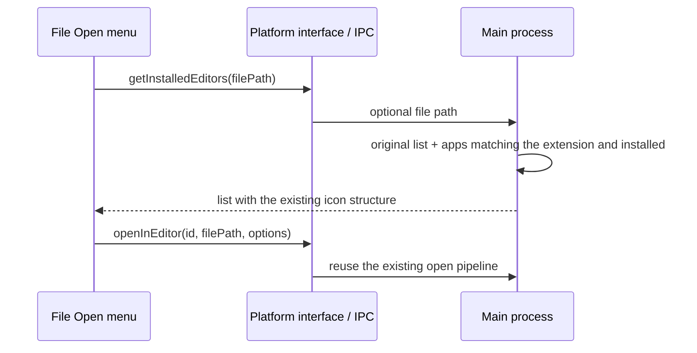

# File preview external open apps

## Scope

Append installed apps that match the current file's extension to the existing Open menu. Existing editor, terminal, and Finder/QSpace/Explorer entries and their order stay unchanged. No new entries, groups, default-app item, or "choose other app"; copy-path and the main Open button are unchanged.

| Type | macOS                                                | Windows                                                  | Linux                                 |
| ---- | ----------------------------------------------------- | -------------------------------------------------------- | ------------------------------------- |
| PDF  | Preview, Adobe Acrobat/Reader, PDF Expert, WPS Office | Adobe Acrobat/Reader, Foxit PDF Reader, WPS Office, Edge | Evince, Okular, Firefox               |
| DOCX | Word, Pages, WPS Office, LibreOffice Writer           | Word, WPS Office, LibreOffice Writer                     | WPS Office, LibreOffice Writer        |
| PPTX | PowerPoint, Keynote, WPS Office, LibreOffice Impress  | PowerPoint, WPS Office, LibreOffice Impress              | WPS Presentation, LibreOffice Impress |
| XLSX | Excel, Numbers, WPS Office, LibreOffice Calc          | Excel, WPS Office, LibreOffice Calc                      | WPS Spreadsheets, LibreOffice Calc    |
| MP3  | Music, QuickTime Player, IINA, VLC                    | Windows Media Player, VLC                                | VLC, mpv                              |
| MP4  | QuickTime Player, IINA, VLC                           | Windows Media Player, VLC, PotPlayer                     | VLC, mpv                              |

## Data and platform boundaries

`IPlatformService.getInstalledEditors(filePath?)` stays compatible with the no-argument form: without a path it returns only the original list, leaving workspace menus unchanged. With a path, the main process matches the added catalog by case-insensitive extension and detects install locations asynchronously (macOS system/global/user Applications; Windows common install locations and App Paths registry; Linux PATH). The main process is the single owner of install detection and caching; the UI keeps no second format map.



File cards and the Preview Pane query with the current file path. Unknown extensions, directories, and pathless queries append no apps. When the previewed file switches, stale query results must not overwrite the new file's list. New apps open files through an argument array, never shell string concatenation.

SSH/WSL/Docker keep restricting available apps through the existing `resolveWorkspaceEditorSelection`; remote file paths never reach the new local viewers. Mobile Web keeps returning an empty list. Desktop-continuous / mobile replayable message streams, `workspaceIdentity`, and owner routing are unchanged.

## Verification

Unit tests cover the six extensions, case and spaces in paths, missing apps, no-argument compatibility, per-platform install locations, and argument-array opening. Existing file-card E2E covers path passing and menu contents/open targets; system-app installation and real launching need platform runtime verification.

The main process validates a local absolute path and the real file type before launching a file app; it does not trust the renderer's `pathKind`. macOS uses the system `open`; Windows/Linux spawn a detached child process with stdio ignored, return success on `spawn`, and neither wait for the reader to exit nor let app logs trigger buffer-limit process termination. Launch failure returns the existing failure result.

```text
renderer open request → main validates local file → launch app → spawn / error → return result
                                                  └─ app runs independently; no state write-back on close
```

## Open failures and install changes

Both an app-open failure and a thrown request log the error and show the same localized failure toast. Remote menus keep reusing workspace capability filtering: SSH allows only the VS Code family; WSL additionally allows Explorer; unresolved and unsupported targets show no local apps.

File-app probing caches only successful results and in-flight requests; not-installed, missing-icon, and error cases release the cache. The next menu query re-probes, with no TTL and no restart required. Cache cleanup targets only the original request and never deletes a newer request.
