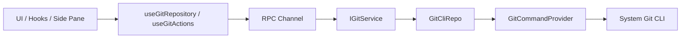

# Git Architecture Design

## Related Documentation

- [Git Branch Switching and Creation Underlying Capability Design](./branch-switching-service-design.md)

## Background

The project already has a layered architecture and a cross-terminal communication framework:

- UI consumes services through hooks and never touches underlying implementations.
- Desktop / Web / Remote reach business capabilities through `IServiceAccessor` + the RPC service chain.
- `IPlatformService` carries only actions that must cross the host boundary, not regular business logic.

Git reuses this service architecture instead of taking a new direct-connection path.

## Design Goals

- One Git abstraction across local, remote and Web execution.
- Git logic follows the `Types -> Config -> Repo -> Service -> Runtime -> UI` dependency direction.
- Git reads the real user environment Git configuration; there is no pseudo Git configuration.
- UI reuses the existing side pane, diff rendering and file tree components instead of building another shell.

## Non-Goals

- v1 is not a complete Git client.
- v1 has no rebase / cherry-pick / stash / submodule management.
- v1 does not take over the user's global Git installation, SSH, GPG or credential helper lifecycle.
- Session-level rollback and Git-based undo are out of scope here.

## Core Judgment

### 1. Git is a standard business service, not part of `IPlatformService`

Add `IGitService` on the existing RPC service chain.

- Git is regular business capability, not a host action that only Electron main can do.
- In remote mode Git must run in the remote workspace environment, so it cannot be bound to the host platform layer.
- Web mode also gets Git through the server workspace, which belongs in the service layer.
- This matches the `IPlatformService` boundary: only native dialogs, window control, external open and other actions that must cross the host boundary.

## Solution

Independent `GitService`; local and remote go through the same service protocol.

- Fits the service-oriented architecture.
- Local and remote differ only in service implementation source; UI is not tied to a platform.
- Git commands, parsing, fault tolerance and logging close inside the service layer.
- Later staged/unstaged, branch, commit and discard capabilities do not scatter into UI.

## Layered Design

### Types

Git domain DTOs live in `packages/shared/src/git.ts`, exported from `packages/shared/src/index.ts`. At least:

- `GitRepositorySummary`: `workspacePath`, `repoRoot`, `workspaceInRepoPath`, `branchName`, `headRefType`, `ahead`, `behind`, `isDirty`, `isGitAvailable`, `isRepository`
- `GitFileChange`: `path`, `repoRelativePath`, `workspaceRelativePath`, `x`, `y`, `kind`, `isStaged`, `isUntracked`, `isConflicted`
- `GitDiffRequest`, `GitDiffResult`
- `GitIdentity`: `userName`, `userEmail`, `nameSource`, `emailSource`

### Config

`packages/services/src/git/config.ts` owns: Git binary parsing strategy, default command parameters, timeout / output size / log desensitization rules, and the strategy for judging the repo root vs workspace subpath relationship.

### Providers

Horizontal concerns enter through Providers. Two providers:

- `GitCommandProvider`: executes `git` commands uniformly (cwd, env, timeout, stderr, exit code, log).
- `GitEnvironmentProvider`: discovers the Git binary, supplements safe environment variables, adapts platform differences.

Providers decide how to execute and how to adapt the environment; they carry no Git business semantics.

### Repo

`packages/services/src/git/repo/gitCliRepo.ts` is a thin Git CLI wrapper with no UI semantics:
`resolveRepository(workspacePath)`, `getStatus(workspacePath)`, `getDiff(workspacePath, path, staged)`, `stage(workspacePath, paths)`, `unstage(workspacePath, paths)`, `discard(workspacePath, paths, stagedScope)`, `commit(workspacePath, message)`, `getIdentity(workspacePath)`.

### Service

`packages/services/src/git/git.ts` and `packages/services/src/git/gitService.ts` expose stable semantics to UI and hide CLI details:
`getRepositorySummary`, `getChanges`, `getDiff`, `getBranchComparison`, `stagePaths`, `unstagePaths`, `discardPaths`, `commit`, `getIdentity`, `refresh`. Subscription-based refresh would add `onDynamicRepositoryEvent(workspacePath)`.

### Runtime / UI

UI consumes `IGitService` only through hooks: `packages/ui/src/hooks/useGitRepository.ts`, `useGitActions.ts`, `useGitAutoRefresh.ts`.

UI components: `GitPane`, `GitRepositoryHeader`, `GitChangeSourceSelect`, `GitChangesTree`, `GitDiffPanel`, `GitCommitPanel`.

### Git pane data-source switching

The Git pane is a unified change review panel. A change-source dropdown on the left switches four modes:

- `Not staged`: worktree vs index changes. Interfaces: `getChanges` / `getDiff`.
- `Staged`: index vs `HEAD` changes. Interfaces: `getChanges` / `getDiff`.
- `All branch changes`: current branch vs remote tracking branch. Interface: `getBranchComparison`.
- `Previous round changes`: file-change snapshot of the active task's most recent round. Reuses the existing task / per-turn changes data; it is not forced into `IGitService`.

The first three belong to the Git domain and go through `IGitService`. `Previous round changes` is session-level change review: the pane only shares the tree and diff display shell with it, read-only. This keeps the Git service boundary clear, avoids disguising session data as Git data, and lets the change tree, diff panel and review experience reuse one set of components.

## Local, Remote, Web Execution Positions

- Local Desktop: `createLocalServices()` registers the local `GitService`; commands run in the local workspace.
- Remote Desktop: Git comes from the remote service like `file/system/terminal`; it cannot run on the host in place of the remote workspace. The remote window keeps only local settings / credentials / broadcast, and Git belongs to the remote service collection.
- Web: no separate Git implementation; Git capability comes from the backend service over websocket.

Git execution position must match the workspace's real location; Git service affiliation aligns with `file/system/terminal`, not with `setting`.

## Command Strategy

Use the system Git CLI, not a JS Git implementation. It reuses the user's Git installation and configuration, is compatible with `includeIf`, platform default paths and Git for Windows, and keeps SSH, credential helper and line-ending behavior close to user expectations.

- Repository detection: `git rev-parse --show-toplevel`
- Status: `git status --porcelain=v2 --branch -z`
- Identity: `git config --get user.name`, `git config --get user.email`; when the source is needed, `git config --list --show-origin --null`
- diff: `git diff --no-ext-diff -- <path>`, `git diff --cached --no-ext-diff -- <path>`
- Branch comparison: `git diff @{upstream}...HEAD --`
- stage: `git add -- <path...>`
- unstage: `git restore --staged -- <path...>`
- Discard workspace changes: `git restore --worktree -- <path...>`
- Commit: `git commit -m <message>`

## Repository Root and Workspace Path

`workspacePath` is not necessarily `repoRoot` (the user may open a monorepo root or a package subdirectory). Git domain keeps `workspacePath`, `repoRoot` and `workspaceInRepoPath`.

- The service layer always runs Git from `repoRoot`.
- UI shows files inside the current workspace scope by default; a "display entire repository" switch may be added later. This avoids confusion from seeing changes in unrelated areas when the workspace is a subdirectory.

## Log and Observability

- UI uses `packages/ui/src/logger.ts`.
- `GitCommandProvider` does not log every Git command by default; Git probes and status queries are high-frequency internals. Add bounded logs at upper layers for one-time lifecycle events, failure branches or special debugging entries.
- Never record complete environment variables, sensitive tokens or credential helper output.

## Integration with the Side Pane

The right shared pane already carries `browser` and `code-viewer`; add `git` there rather than a new navigation region in the left `WorkspaceSidebar`, which already carries workspace / task navigation. Git is workspace operation context, and the right side reuses adjustable width, pane switching and close logic.

## Implementation Sequence

- Phase 1: `IGitService`; local / remote chain; repository detection, status, diff, stage / unstage / discard, commit; right-side Git pane.
- Phase 2: hunk operations; finer repo / workspace scope switching; dynamic refresh via file-change subscription.

## Risks and Pending Items

- When the workspace is a subdirectory, whether Git shows the current sub-tree or the entire repository by default.
- In remote mode, whether Git user identity shows the remote effective configuration only or both local and remote sources.
- Whether the Web end gets complete commit capability or stays read-only.
- Whether v1 allows direct commit or only view and stage.

## TODO

- Session-level rollback capability boundary and interaction: separate design later.
- Whether to offer Git-based undo: assess separately.
- If a Git checkpoint is introduced: supplement an independent design document.
- How `Previous round changes` reuses data: refine against the existing task store.

## Conclusion

- Add an independent `GitService`.
- Execution position follows the workspace's environment.
- Git UI hangs on the right shared pane.
- First the repository-level foundation in the Git pane, then finer-grained Git features.
