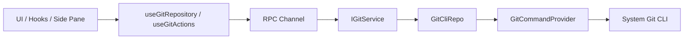

# Git Architecture Design

## Related Documentation

- [Git Branch Switching and Creation Underlying Capability Design](./branch-switching-service-design.md)

## Background

The current project has already established a relatively clear layered architecture and cross-terminal communication framework:

- UI consumes services through hooks, not directly accessing underlying implementations
- Desktop / Web / Remote all access business capabilities through `IServiceAccessor` + RPC service chain
- `IPlatformService` only carries actions that must cross the host environment, not carrying regular business logic

Git functionality should be maintainable in the long term if it reuses the existing service architecture, rather than taking a new direct connection path.

## Design Goals

- Git capabilities should maintain unified abstraction in local, remote, and Web three execution environments
- Git related logic should strictly fall within the `Types -> Config -> Repo -> Service -> Runtime -> UI` dependency direction
- Git should read real user environment Git configuration, not maintain its own set of pseudo Git configuration
- UI should reuse existing side pane, diff rendering, file tree components, avoiding to recreate another shell

## Non-Goals

- v1 does not make a complete Git client
- v1 does not do rebase / cherry-pick / stash / submodule management
- v1 does not take over user's global Git installation, SSH, GPG or credential helper lifecycle
- Session-level rollback and Git-based undo capabilities are not within the scope of this document

## Core Judgments

### 1. Git should be standard business service, not put into `IPlatformService`

It is recommended to add `IGitService`, going through existing RPC service chain.

Reasons:

- Git is not only the host action that can only be done in Electron main, but is regular business capability
- Remote mode Git must be executed in remote workspace environment, cannot bind to host platform layer
- Web mode is essentially also through server workspace providing Git capability, still suitable to put into service layer

This also conforms to the current `IPlatformService` responsibility boundary: it only puts native dialog, window control, external open and other actions that "must cross host boundary".

## Recommended Solution

### Solution A: Add independent `GitService`, both local / remote go through same service protocol

This is the recommended solution.

#### High-level structure

#### Why recommend

- Fully conforms to existing project's service-oriented architecture
- Local and remote are only different in service implementation sources, will not lock UI design to any one platform
- Git commands, parsing, fault tolerance, log can all be unified in service layer for closure
- Subsequent need to expand staged/unstaged, branch, commit, discard and other capabilities will not scatter to UI

## Layered Design

### Types

It is recommended to add Git domain DTO, put in `packages/shared/src/git.ts`, and export in `packages/shared/src/index.ts`.

It is recommended to include at least:

- `GitRepositorySummary`
  - `workspacePath`
  - `repoRoot`
  - `workspaceInRepoPath`
  - `branchName`
  - `headRefType`
  - `ahead`
  - `behind`
  - `isDirty`
  - `isGitAvailable`
  - `isRepository`
- `GitFileChange`
  - `path`
  - `repoRelativePath`
  - `workspaceRelativePath`
  - `x`
  - `y`
  - `kind`
  - `isStaged`
  - `isUntracked`
  - `isConflicted`
- `GitDiffRequest`
- `GitDiffResult`
- `GitIdentity`
  - `userName`
  - `userEmail`
  - `nameSource`
  - `emailSource`

### Config

It is recommended to add Git domain configuration layer, responsible for:

- Git binary parsing strategy
- Command default parameters
- Timeout, output size, log desensitization rules
- repo root with workspace subpath relationship judgment strategy

It is recommended files:

- `packages/services/src/git/config.ts`

### Providers

In order to conform to project's principle that "horizontal cutting concern enters through Providers", Git domain inside recommends explicit introduce Provider layer.

It is recommended to split into at least two providers:

- `GitCommandProvider`
  - Responsible for unified execution `git` commands
  - Responsible for cwd, env, timeout, stderr, exit code, log
- `GitEnvironmentProvider`
  - Responsible for discovering Git binary
  - Responsible for complementation of safe environment variables
  - Responsible for platform difference adaptation

Provider layer only does "how to execute" and "how to adapt environment", not do Git business semantics.

### Repo

Repo layer is thin wrapper of Git CLI, not bearing UI semantics.

It is recommended files:

- `packages/services/src/git/repo/gitCliRepo.ts`

It is recommended responsibilities:

- `resolveRepository(workspacePath)`
- `getStatus(workspacePath)`
- `getDiff(workspacePath, path, staged)`
- `stage(workspacePath, paths)`
- `unstage(workspacePath, paths)`
- `discard(workspacePath, paths, stagedScope)`
- `commit(workspacePath, message)`
- `getIdentity(workspacePath)`

### Service

Service layer exposes stable semantics to UI, hiding Git CLI details.

It is recommended files:

- `packages/services/src/git/git.ts`
- `packages/services/src/git/gitService.ts`

It is recommended external interfaces:

- `getRepositorySummary`
- `getChanges`
- `getDiff`
- `getBranchComparison`
- `stagePaths`
- `unstagePaths`
- `discardPaths`
- `commit`
- `getIdentity`
- `refresh`

If subsequently need subscription-based refresh, then additionally supplement dynamic events:

- `onDynamicRepositoryEvent(workspacePath)`

### Runtime / UI

UI layer only through hooks consume `IGitService`.

Current hooks:

- `packages/ui/src/hooks/useGitRepository.ts`
- `packages/ui/src/hooks/useGitActions.ts`
- `packages/ui/src/hooks/useGitAutoRefresh.ts`

UI components recommended:

- `GitPane`
- `GitRepositoryHeader`
- `GitChangeSourceSelect`
- `GitChangesTree`
- `GitDiffPanel`
- `GitCommitPanel`

### Git pane internal data source switching

Git pane left side is recommended to have a change source dropdown, different modes switching different data sources.

It is recommended to support four modes:

- `Not staged`
  - Data source: Git worktree relative to index changes
  - Main interfaces: `getChanges` / `getDiff`
- `Staged`
  - Data source: Git index relative to `HEAD` changes
  - Main interfaces: `getChanges` / `getDiff`
- `All branch changes`
  - Data source: current branch relative to remote tracking branch differences
  - Main interfaces: `getBranchComparison`
- `Previous round changes`
  - Data source: current active task recent round file changes snapshot
  - Main interfaces: Prefer to reuse existing task / per-turn changes data, not forcibly inject into `IGitService`

It is suggested to understand "Git pane" as "unified change review panel", rather than each view hard塞到 `IGitService` responsibilities.

Among them:

- First three modes belong to Git domain, going through `IGitService`
- `Previous round changes` belongs to session-level change review, only in Git pane internal share a set of tree and diff display shell, keeping read-only

The benefits of doing so are:

- Keep Git service boundary clear
- `Previous round changes` doesn't need to disguise as Git data for UI entrance location
- Change tree, diff panel, right side review experience can reuse a set of components

## Local, Remote, Web Three Execution Positions

### Local Desktop

- `createLocalServices()` register local `GitService`
- Git commands executed in local workspace

### Remote Desktop

- Git must be like `file/system/terminal`, coming from remote service
- Cannot substitute remote workspace executing Git in host
- Remote window only keeps local setting / credential / broadcast; Git should be归入 remote service collection

### Web

- Web end does not separately do Git implementation
- Still through websocket after-end service provide Git capability

Conclusion:

- Git execution position must and workspace real falling point consistent
- Git service affiliation should and `file/system/terminal` align, rather than and `setting` align

## Command Strategy

It is recommended to insist on using system Git CLI, rather than introduce JS Git implementation.

Reasons:

- Can naturally reuse user's existing Git installation and configuration
- Compatible with `includeIf`, platform default paths, Git for Windows and other real environment
- Subsequent encounter SSH, credential helper, line ending strategy and other aspects easier not deviate from user cognition

It is recommended commands:

- Repository detection
  - `git rev-parse --show-toplevel`
- Status
  - `git status --porcelain=v2 --branch -z`
- Read identity
  - `git config --get user.name`
  - `git config --get user.email`
  - Need source when again use `git config --list --show-origin --null`
- diff
  - `git diff --no-ext-diff -- <path>`
  - `git diff --cached --no-ext-diff -- <path>`
- Branch comparison
  - `git diff @{upstream}...HEAD --`
- stage
  - `git add -- <path...>`
- unstage
  - `git restore --staged -- <path...>`
- Discard workspace changes
  - `git restore --worktree -- <path...>`
- Commit
  - `git commit -m <message>`

## Repository Root and Workspace Path

`workspacePath` is not necessarily equal to `repoRoot`.

For example:

- User opened is monorepo root directory
- User opened is monorepo under some package subdirectory

Therefore Git domain must simultaneously retain three categories of paths:

- `workspacePath`
- `repoRoot`
- `workspaceInRepoPath`

Recommended behavior:

- Service layer always based on `repoRoot` execute Git
- UI default display "current workspace scope inside" file
- Subsequent if need, again add "display entire repository" switch

This can avoid when workspace opened is subdirectory, directly seeing entire repository other area changes that cause confusion.

## Log and Observability

According to project constraints, involving interaction and complex status switching ability need to supplement log.

It is recommended:

- UI layer uniformly use `packages/ui/src/logger.ts`
- `GitCommandProvider` not default print each Git command; Git probe and status query belongs to high-frequency internal details, need to investigate when priority supplement at upper layer one-time lifecycle, failure branch or special debugging entrance supplement having boundary log.

Do not record:

- Complete environment variables
- Sensitive token
- Credential helper sensitive output

## Integration with Existing Side Pane

Current right side shared pane already unified carry `browser` and `code-viewer`.

It is recommended expand for:

- `browser`
- `code-viewer`
- `git`

Rather than in left `WorkspaceSidebar` again new a with task parallel large navigation region.

Reasons:

- Current left side already explicitly undertake workspace / task navigation
- Git more like "current workspace operation context", suitable on the right side expand
- Can directly reuse existing can adjust width, pane switch, close logic

## Implementation Sequence Suggestions

### Phase 1

- Add `IGitService`
- Local / remote chain linking
- Repository detection, status, diff, stage / unstage / discard, commit
- UI right side Git pane

### Phase 2

- Support hunk operation
- Support more fine-grained repo / workspace scope switching
- Support dynamic refresh with file changes subscription

## Risk and Pending Items

- Workspace opening subdirectory when, Git default display range is "current sub-tree" still entire repository
- Remote mode when, Git user identity is display remote effective configuration still simultaneously display local and remote source
- Web end whether need complete commit capability, still just read-only
- v1 whether allow direct commit, still just do view and stage

## TODO

- Session-level rollback capability boundary and interaction, follow-up separate design
- Whether need "based on Git undo" capability, follow-up separately assess
- If subsequently introduce Git checkpoint, then supplement independent design document
- Git pane `previous round changes` data reuse method, follow-up combine existing task store again refine

## Current Recommended Conclusion

- Architecture on add independent `GitService`
- Execution position follow workspace fall environment
- Git UI priority hang on right side shared pane
- First do Git pane repository level foundation capability, then gradually expand more fine-grained Git functionality
