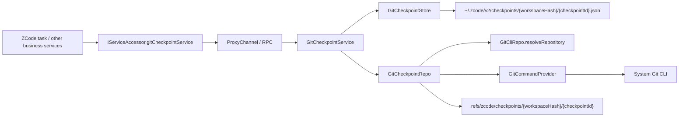

# Git Checkpoint Underlying Capability

## Scope

Underlying Git checkpoint capability and service wiring only. It is not connected to ZCode task turn orchestration or UI interaction.

It solves: creating immutable workspace file snapshots; comparing file differences between two checkpoints; safely restoring the live workspace from one checkpoint to another without a worktree.

Capabilities: `createCheckpoint`, `diffCheckpoints`, `restoreBetweenCheckpoints`, `deleteCheckpoint`.

Wiring:

- `ServiceChannels.GitCheckpoint`, `IGitCheckpointService`
- Registered in `createLocalServices()`
- Exposed through `IServiceAccessor` / `RemoteServiceAccess`
- The remote workspace renderer switches to the remote `gitCheckpointService`

The result is a general file checkpoint foundation in the Git domain with a create / diff / restore / delete loop on real Git repositories. It is not yet used by task-turn checkpoint orchestration or UI.

## Key Files

- Shared: `packages/shared/src/channels.ts` (`ServiceChannels.GitCheckpoint`); `packages/shared/src/git.ts` (`GitCheckpointMeta`, `GitCheckpointDiff`, `GitCheckpointFileDiff`, `GitCheckpointConflict`, `GitCheckpointRestoreResult`).
- Services (`packages/services/src/git/`): `gitCheckpoint.ts` (`IGitCheckpointService`), `gitCheckpointService.ts` (orchestration), `repo/gitCheckpointRepo.ts` (core implementation), `repo/gitCheckpointHelpers.ts` (diff/path/tree pure utilities), `repo/gitCheckpointStore.ts` (manifest persistence).
- Wiring: `packages/services/src/node.ts`, `accessor.ts`, `index.ts`; `packages/client/src/remoteServiceAccess.ts`; `packages/desktop/src/renderer/src/main.tsx`.
- Tests: `packages/services/test/gitCheckpointService.test.ts`.

## Relationships



- Execution position follows the workspace environment; no local / remote / web business difference.
- Real file content lives in the Git object database; the business layer persists only a lightweight manifest.

## Layered Responsibilities

- `GitCheckpointService`: generates `checkpointId`; reads / validates the manifest; validates that two checkpoints share `repoRoot` and `scope`; calls the repo for create / diff / restore / delete; calls the store to write or delete the manifest.
- `GitCheckpointRepo`: resolves the Git repository for `workspacePath`; creates the hidden checkpoint commit with Git plumbing; structured diff between two checkpoints; conflict detection on the current worktree; restores disk from `fromCheckpoint` to `toCheckpoint`; deletes the hidden ref.
- `GitCheckpointStore`: writes, reads and deletes the checkpoint manifest by `workspaceHash`.

## Interface

```ts
export interface IGitCheckpointService {
  createCheckpoint(params: GitRepositoryRequest): Promise<GitCheckpointMeta>;
  diffCheckpoints(params: GitCheckpointDiffQuery): Promise<GitCheckpointDiff>;
  restoreBetweenCheckpoints(params: GitCheckpointRestoreQuery): Promise<GitCheckpointRestoreResult>;
  deleteCheckpoint(params: GitCheckpointRequest): Promise<void>;
}
```

Not provided: checkpoint list, checkpoint GC, rename / annotate, task/turn semantic fields.

## Storage and Reference

Manifest: `~/.zcode/v2/checkpoints/{workspaceHash}/{checkpointId}.json`, holding only `checkpointId`, `workspacePath`, `repoRoot`, `workspaceInRepoPath`, `createdAt`, `refName`, `commitOid`, `scope`.

Hidden ref: `refs/zcode/checkpoints/{workspaceHash}/{checkpointId}`. It anchors the Git objects so GC does not clean them early, and lets diff / restore / delete locate the checkpoint.

## Flows

### `createCheckpoint`

1. `GitCheckpointService.createCheckpoint()` generates a new `checkpointId`.
2. `GitCheckpointRepo.createCheckpoint()` calls `resolveRepository()`.
3. Create a temporary directory and temporary `GIT_INDEX_FILE`.
4. `git add -A -- <workspace pathspec>` writes the live workspace-scope state into the temporary index.
5. `git write-tree`.
6. `git commit-tree`.
7. `git update-ref refs/zcode/checkpoints/...`.
8. Return `GitCheckpointMeta`.
9. `GitCheckpointStore.save()` writes the manifest.

Constraints: use only the temporary index and never touch the real `.git/index`; create no user-visible branch; do not switch HEAD.

### `diffCheckpoints`

1. The service loads the `from` / `to` manifests.
2. It validates that `workspacePath`, `repoRoot`, `scope` and `workspaceInRepoPath` are consistent.
3. The repo runs `git diff --name-status --find-renames -z <from> <to> -- <workspace pathspec>` and `git diff --numstat --find-renames -z <from> <to> -- <workspace pathspec>`.
4. The helper merges them into a structured `GitCheckpointDiff`.

`name-status` gives the file and change type; `numstat` gives added/removed statistics. The diff covers only the current workspace scope, not the entire repo.

### `restoreBetweenCheckpoints`

The core method. Semantics are not "restore to a checkpoint": the caller declares that the current disk is still at `fromCheckpoint` and wants to reach `toCheckpoint`.

1. The service loads and validates the `from/to` manifests.
2. The repo computes the structured diff `from -> to`.
3. The affected path set is derived from the diff.
4. `collectWorkspaceConflicts()` runs conflict detection.
5. If conflicts exist and `force !== true`, return `{ success: false, conflicts }`.
6. With no conflict or `force === true`: for non-delete paths run `git restore --source=<toCommit> --worktree -- <paths>`; for delete paths and rename original paths, delete locally.
7. `collectWorkspaceConflicts()` runs again as post-restore validation against `toCheckpoint`.
8. On success, return `{ success: true, restoredPaths }`.

### Conflict detection

`collectWorkspaceConflicts()` checks only the paths restore will reach, not whether the whole repo is dirty.

1. `git ls-tree -r -z <fromCommit> -- <affected paths>` extracts the tree entries of those paths in `fromCheckpoint`.
2. Each affected path is judged individually:
   - Absent in `fromCheckpoint` but present on disk: `unexpected-file-in-worktree`
   - Present in `fromCheckpoint` but absent on disk: `missing-in-worktree`
   - Type mismatch: `type-mismatch`
   - Same type but different hash from `hash-object`: `content-mismatch`

It compares blob hashes directly, not weak signals such as mtime or size.

### `deleteCheckpoint`

1. The service loads the manifest.
2. The repo runs `git update-ref -d <refName>`.
3. The store deletes the manifest file.

Git objects are not cleaned explicitly by the business layer; Git GC handles them.

## Multi-End Wiring

- Local Desktop: `createLocalServices()` registers `IGitCheckpointService`.
- Remote Desktop: `RemoteServiceAccess` creates the `gitCheckpointService` proxy; remote workspace session registration puts the remote `gitCheckpointService` into the renderer-side service object.
- Web: passes through the existing `IServiceAccessor` / RPC / websocket chain.

One protocol; execution follows the workspace; upper layers do not distinguish local / remote / web.

## Test Coverage

`packages/services/test/gitCheckpointService.test.ts` covers:

- Creating a workspace-scoped checkpoint.
- Diff recognition of modification, addition, deletion and rename; diff applies only to the current workspace scope and does not affect other monorepo directories.
- `restoreBetweenCheckpoints()` restores a file from changed to base.
- Restore does not change the real staged state.
- Path drift returns a conflict by default; `force=true` allows overwrite restore.
- After `deleteCheckpoint()`, accessing the deleted checkpoint errors.

## Boundaries and Limitations

- Git repository workspaces only; only `scope = "workspace"`; only files inside the repo.
- No repo-external side effects.
- Ignored files are not guaranteed by default.
- No ZCode session / task / turn semantics; no worktree isolation.
- Not implemented: checkpoint list / GC; ignored file strategy; submodule / nested repo / sparse checkout support; ZCode turn-level `baseFileCheckpoint/resultFileCheckpoint` orchestration; UI use of checkpoints.

## Conclusion

The checkpoint capability is a reusable service/repo/store loop. `restoreBetweenCheckpoints(from, to)` can serve as the general file rollback foundation. If ZCode tasks later support real file undo, re-edit or post-fork file restoration, they reuse this capability instead of extending the `beforeContent/afterContent` approach.
