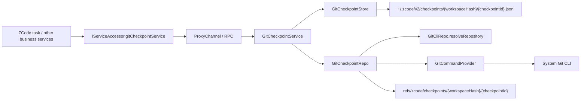

# Git Checkpoint Underlying Capability Implementation Summary

Update date: 2026-04-13

## Scope of This Task

This time only implements the underlying capabilities and service wiring of Git checkpoint, without connecting to upper-layer ZCode task turn orchestration, nor connecting to UI interaction.

Completion scope:

- Add independent `IGitCheckpointService` in Git domain
- Add checkpoint-related shared DTO and RPC channel
- Implement service -> repo -> store structure under `packages/services/src/git/`
- Connect local / remote / Web three unified service access chains
- Supplement service tests based on real Git repository

This implementation focuses on solving:

- How to create immutable workspace file snapshots
- How to compare file differences between two checkpoints
- How to safely restore the current live workspace from one checkpoint to another without introducing worktree

## Current Landing Status

Completed capability scope:

- `createCheckpoint`
- `diffCheckpoints`
- `restoreBetweenCheckpoints`
- `deleteCheckpoint`

Completed engineering wiring:

- `ServiceChannels.GitCheckpoint`
- `IGitCheckpointService`
- Registration in `createLocalServices()`
- Exposure through `IServiceAccessor` / `RemoteServiceAccess`
- Remote workspace renderer switches to remote `gitCheckpointService`

The current implementation can be defined as:

- General file checkpoint foundation in Git domain is available
- Can complete create / diff / restore / delete full loop in real Git repository
- Has not yet entered ZCode task turn level checkpoint orchestration, nor exposed to UI for direct operation

## Key Files

### Shared

- [packages/shared/src/channels.ts](../../packages/shared/src/channels.ts)
  - Added `ServiceChannels.GitCheckpoint`
- [packages/shared/src/git.ts](../../packages/shared/src/git.ts)
  - Added checkpoint DTO:
    - `GitCheckpointMeta`
    - `GitCheckpointDiff`
    - `GitCheckpointFileDiff`
    - `GitCheckpointConflict`
    - `GitCheckpointRestoreResult`

### Services

- [packages/services/src/git/gitCheckpoint.ts](../../packages/services/src/git/gitCheckpoint.ts)
  - Define `IGitCheckpointService`
- [packages/services/src/git/gitCheckpointService.ts](../../packages/services/src/git/gitCheckpointService.ts)
  - Service layer orchestration
- [packages/services/src/git/repo/gitCheckpointRepo.ts](../../packages/services/src/git/repo/gitCheckpointRepo.ts)
  - Repo layer core implementation
- [packages/services/src/git/repo/gitCheckpointHelpers.ts](../../packages/services/src/git/repo/gitCheckpointHelpers.ts)
  - Diff/path/tree related pure utility logic
- [packages/services/src/git/repo/gitCheckpointStore.ts](../../packages/services/src/git/repo/gitCheckpointStore.ts)
  - Manifest persistence

### Wiring

- [packages/services/src/node.ts](../../packages/services/src/node.ts)
- [packages/services/src/accessor.ts](../../packages/services/src/accessor.ts)
- [packages/services/src/index.ts](../../packages/services/src/index.ts)
- [packages/client/src/remoteServiceAccess.ts](../../packages/client/src/remoteServiceAccess.ts)
- [packages/desktop/src/renderer/src/main.tsx](../../packages/desktop/src/renderer/src/main.tsx)

### Tests

- [packages/services/test/gitCheckpointService.test.ts](../../packages/services/test/gitCheckpointService.test.ts)

## Implementation Relationship Diagram



This diagram corresponds to two key principles of current implementation:

- Execution position always follows workspace environment, does not distinguish business semantics between local / remote / web
- Real file content handed to Git object database, business layer only persists lightweight manifest

## Layered Responsibilities

### Service

`GitCheckpointService` is responsible for:

- Generate `checkpointId`
- Read / validate manifest
- Validate whether two checkpoints belong to same `repoRoot` and same `scope`
- Call repo to execute real create / diff / restore / delete
- Call store to write or delete manifest

### Repo

`GitCheckpointRepo` is responsible for:

- Parse Git repository corresponding to `workspacePath`
- Create hidden checkpoint commit using Git plumbing
- Perform structured diff between two checkpoints
- Perform conflict detection on current worktree
- Restore current disk from `fromCheckpoint` to `toCheckpoint`
- Delete hidden ref

### Store

`GitCheckpointStore` is responsible for:

- Write checkpoint manifest by `workspaceHash`
- Read manifest
- Delete manifest

## Current Interface

The current external interface is exactly:

```ts
export interface IGitCheckpointService {
  createCheckpoint(params: GitRepositoryRequest): Promise<GitCheckpointMeta>;
  diffCheckpoints(params: GitCheckpointDiffQuery): Promise<GitCheckpointDiff>;
  restoreBetweenCheckpoints(params: GitCheckpointRestoreQuery): Promise<GitCheckpointRestoreResult>;
  deleteCheckpoint(params: GitCheckpointRequest): Promise<void>;
}
```

Current not added:

- Checkpoint list interface
- Checkpoint GC interface
- Checkpoint rename / annotate capability
- Upper-layer task/turn semantic fields

## Storage and Reference

### Manifest

Default manifest directory:

```text
~/.zcode/v2/checkpoints/{workspaceHash}/{checkpointId}.json
```

Manifest currently only saves:

- `checkpointId`
- `workspacePath`
- `repoRoot`
- `workspaceInRepoPath`
- `createdAt`
- `refName`
- `commitOid`
- `scope`

### Hidden Ref

Each checkpoint creates a hidden ref:

```text
refs/zcode/checkpoints/{workspaceHash}/{checkpointId}
```

In current implementation, hidden ref role is:

- Let Git object have stable anchor, won't be prematurely cleaned by GC
- Let subsequent diff / restore / delete stably locate this checkpoint

## Key Implementation Flow

### 1. `createCheckpoint`

Entry position:

- [gitCheckpointService.ts](../../packages/services/src/git/gitCheckpointService.ts)
- [gitCheckpointRepo.ts](../../packages/services/src/git/repo/gitCheckpointRepo.ts)

Current flow:

1. `GitCheckpointService.createCheckpoint()` generates new `checkpointId`
2. `GitCheckpointRepo.createCheckpoint()` calls `resolveRepository()` to parse Git repository
3. Create temporary directory and temporary `GIT_INDEX_FILE`
4. Execute `git add -A -- <workspace pathspec>`, write current workspace scope live state into temporary index
5. Execute `git write-tree`
6. Execute `git commit-tree`
7. Execute `git update-ref refs/zcode/checkpoints/...`
8. Return `GitCheckpointMeta`
9. `GitCheckpointStore.save()` writes manifest

The most important constraint in current implementation:

- Only use temporary index, do not touch real `.git/index`
- Do not create user-visible branch
- Do not switch HEAD

### 2. `diffCheckpoints`

Entry position:

- [gitCheckpointService.ts](../../packages/services/src/git/gitCheckpointService.ts)
- [gitCheckpointRepo.ts](../../packages/services/src/git/repo/gitCheckpointRepo.ts)

Current flow:

1. Service layer loads `from`/`to` two manifests first
2. Validate both:
   - `workspacePath` consistent
   - `repoRoot` consistent
   - `scope` consistent
   - `workspaceInRepoPath` consistent
3. Repo layer executes:
   - `git diff --name-status --find-renames -z <from> <to> -- <workspace pathspec>`
   - `git diff --numstat --find-renames -z <from> <to> -- <workspace pathspec>`
4. Helper merges into structured `GitCheckpointDiff`

In current implementation:

- `name-status` determines file and change type
- `numstat` provides added/removed statistics
- Final diff only faces current workspace scope, not entire repo output

### 3. `restoreBetweenCheckpoints`

Entry position:

- [gitCheckpointService.ts](../../packages/services/src/git/gitCheckpointService.ts)
- [gitCheckpointRepo.ts](../../packages/services/src/git/repo/gitCheckpointRepo.ts)

This is the most core method in current foundation.

Current semantics are not "directly restore to a checkpoint", but:

- Caller declares: current disk should still be at `fromCheckpoint`
- Actual target: hope to restore to `toCheckpoint`

Current flow:

1. Service layer loads and validates `from/to` manifests
2. Repo layer first computes structured diff `from -> to`
3. Fold out affected path set from diff
4. Call `collectWorkspaceConflicts()` for conflict detection
5. If conflict exists and `force !== true`, directly return `{ success: false, conflicts }`
6. No conflict or `force === true`:
   - For non-delete paths execute:
     - `git restore --source=<toCommit> --worktree -- <paths>`
   - For delete paths and rename original paths execute local delete
7. Then use `collectWorkspaceConflicts()` again for post-restore validation against `toCheckpoint`
8. After validation passes, return `{ success: true, restoredPaths }`

### 4. Current Conflict Detection Strategy

The core of `collectWorkspaceConflicts()` is not looking at whether the whole repo is dirty, but only checking paths that restore will reach.

Current practice:

1. First use `git ls-tree -r -z <fromCommit> -- <affected paths>` to extract tree entries for these paths in `fromCheckpoint`
2. For each affected path judge individually:
   - If path does not exist in `fromCheckpoint` but exists on disk: `unexpected-file-in-worktree`
   - If path exists in `fromCheckpoint` but does not exist on disk: `missing-in-worktree`
   - If type mismatch: `type-mismatch`
   - If type matches but hash after `hash-object` differs: `content-mismatch`

In current implementation, does not compare mtime, size etc. weak signals, but directly compares blob hash.

### 5. `deleteCheckpoint`

Current deletion splits into two layers:

- Repo layer deletes hidden ref
- Store layer deletes manifest

Execution order:

1. `GitCheckpointService.deleteCheckpoint()` first loads manifest
2. `GitCheckpointRepo.deleteCheckpoint()` executes:
   - `git update-ref -d <refName>`
3. `GitCheckpointStore.delete()` deletes corresponding manifest file

Git object itself is not subject to business-layer explicit cleanup, handed to Git GC.

## Multi-End Wiring

Current checkpoint service goes through unified RPC like other business services:

### Local Desktop

- `createLocalServices()` registers `IGitCheckpointService`

### Remote Desktop

- `RemoteServiceAccess` creates `gitCheckpointService` proxy
- Remote workspace session registration brings remote `gitCheckpointService` into renderer side service object

### Web

- Through existing `IServiceAccessor` / RPC / websocket chain naturally passes through

Therefore current conclusion:

- Unified protocol
- Execution position follows workspace
- Upper layer does not need to distinguish local / remote / web

## Current Test Coverage

Test file:

- [gitCheckpointService.test.ts](../../packages/services/test/gitCheckpointService.test.ts)

Key scenarios covered:

- Create workspace-scoped checkpoint
- Checkpoint diff correctly recognizes:
  - Modification
  - Addition
  - Deletion
  - Rename
  - Diff only applies to current workspace scope, does not accidentally affect other monorepo directories
- `restoreBetweenCheckpoints()` can restore file from changed to base
- Restore does not change real staged state
- When path drift occurs, default returns conflict
- `force=true` allows cover restore
- After `deleteCheckpoint()`, accessing deleted checkpoint reports error

## Current Verification Results

Verified:

- `pnpm vitest run packages/services/test/gitCheckpointService.test.ts packages/services/test/gitService.test.ts packages/services/test/gitCliRepo.test.ts`
  - Result: passed
- `pnpm typecheck`
  - Result: passed

Not fully passed:

- `pnpm lint`
  - Result: not passed
  - Explanation: Current failure items are pre-existing global `max-lines` / `no-unused-vars` etc. issues in the repository, not problems newly introduced by checkpoint capabilities

## Current Boundary and Limitations

Current implementation clearly commits only to the following boundaries:

- Only supports Git repository workspace
- Only supports `scope = "workspace"`
- Only handles files inside repo
- Does not handle repo-external side effects
- Default does not guarantee ignored files
- Does not handle ZCode session / task / turn semantics
- Does not provide worktree isolation

Currently not implemented:

- Checkpoint list / GC
- Ignored file strategy
- Submodule / nested repo / sparse checkout special support
- ZCode turn level `baseFileCheckpoint/resultFileCheckpoint` orchestration
- UI layer directly using checkpoint capability

## Current Recommended Conclusion

- Git checkpoint underlying capability has formed reusable service/repo/store closed loop
- `restoreBetweenCheckpoints(from, to)` can already be used as general file rollback foundation
- If ZCode task subsequently wants to support real file undo, re-edit, fork-after file restoration, should directly reuse this capability rather than continuing to expand `beforeContent/afterContent` solution
