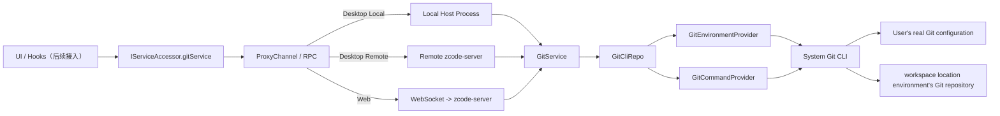

# Git Underlying Service Implementation Summary

Update date: 2026-04-09

## Scope of This Task

This time only implements Git's underlying service and communication architecture, without connecting upper-layer Git pane's real interaction.

Completion scope:

- Supplement Git RPC required DTO in `packages/shared/src/git.ts`
- Register `git` service channel in `packages/shared/src/channels.ts`
- Implement `config -> providers -> repo -> service` structure under `packages/services/src/git/`
- Connect local / remote / Web three service access chains `IGitService`
- Supplement service layer test, verify real Git CLI execution

## Implementation Relationship Diagram



This diagram corresponds to two core principles:

- Upper layer always through unified `IGitService` protocol access Git capability, does not perceive execution position
- Actually executes Git command is workspace location environment service's instance, not fixed bound to host platform

## Directory Structure

```text
packages/services/src/git/
  config.ts
  git.ts
  gitService.ts
  providers/
    gitEnvironmentProvider.ts
    gitCommandProvider.ts
  repo/
    gitCliTypes.ts
    gitCliHelpers.ts
    gitCliRepo.ts
```

## Layered Responsibilities

### Config

Responsible for Git domain's static rules and utility methods:

- Git binary candidate paths
- Default timeout / output size limit
- Command execution environment variables
- Cross-platform path normalization
- Repo root and workspace scope judgment strategy

### Providers

`Providers` layer only responsible for "how to execute", not Git business semantics.

#### GitEnvironmentProvider

Responsible for:

- Parse available Git binary in current environment
- Cache detection results, avoid repeatedly executing `git --version`
- Generate unified Git execution environment variables

#### GitCommandProvider

Responsible for:

- Unified execution Git CLI
- Control `cwd`、`env`、timeout、output size
- Record command、耗时、exit code、stdoutBytes、stderrSummary

### Repo

`GitCliRepo` is thin wrapper of system Git CLI, responsibility is "将 Git 原始 output 变成结构化数据".

Current has covered:

- Repository parsing
- status
- diff

- branch comparison
- stage / unstage / discard / commit
- identity

其中纯解析逻辑被拆到 `gitCliHelpers.ts`，包括：

- `git status --porcelain=v2 -z` 解析
- `git diff --numstat -z` 解析
- diff 结果可用性判断
- 路径归一化与 repo 边界检查

### Service

`GitService` 对上层暴露稳定 RPC 语义，不让 UI 直接感知 Git CLI 细节。

关键职责：

- 按当前 `workspacePath` 做作用域过滤
- 将 repo 层原始状态映射成 `GitFileChange[]`
- 把 branch comparison、identity、refresh 等高层语义统一收口

## Key Implementation Flow

### 1. Repository Parsing

`GitCliRepo.resolveRepository()` flow:

1. 通过 `GitEnvironmentProvider` 找当前环境可用的 Git binary
2. 在 `workspacePath` 下执行 `git rev-parse --show-toplevel --show-prefix`
3. 得到：
   - `repoRoot`
   - `workspaceInRepoPath`
4. 如果 Git 不存在或当前目录不在仓库内，返回 structure 化空 result，而不是把异常直接 expose 给上层

这样做的目的是让上层可以稳定拿到：

- 是否安装了 Git
- 当前 workspace 是否处于 Git 仓库中
- workspace 是 repo 根目录还是子 directory

### 2. Status Obtaining

`GitCliRepo.getStatus()` flow:

1. 执行 `git status --porcelain=v2 --branch -z`
2. 执行 staged / unstaged 两个 `git diff --numstat -z`
3. 解析 branch、ahead/behind、文件状态、行数统计
4. 对 untracked 文件额外读取文件内容，补出 added 行数
5. 返回 `GitStatusSnapshot`

这里的关键点是：

- `status --porcelain=v2` 保证 format 稳定，不受 system 语言影响
- staged / unstaged 的行数统计统一在 repo 层完成
- 上层不需要再猜测某个文件到底属于 staged、unstaged、untracked 还是 conflicted

### 3. Workspace Subdirectory Filter

`GitService.getChanges()` 不会直接把整个 repo 的变化原样抛给 UI，而是根据：

- `repoRoot`
- `workspacePath`
- `workspaceInRepoPath`

只保留当前 workspace 作用域内的变更。

这样当用户打开的是 monorepo 子 directory 时，默认看到的是“当前 workspace 相关的改动”，不会被整个 repository 其他 directory 干扰。

### 4. Single File Diff

`GitCliRepo.getDiff()` strategy:

- `staged`：走 `git diff --cached`
- `unstaged`：走 `git diff`
- `branch`：走 `git diff <upstream>...HEAD`

对未跟踪文件做了额外兜底：

- 普通 `git diff` 不会返回 untracked 文件
- 所以对这类场景再执行一次 `git diff --no-index`

这样上层在拿 diff 时不需要额外特判“这是 untracked 文件”。

### 5. Write Operations

Current repo layer has implemented following real Git write operations:

- `stage` -> `git add -- <paths>`
- `unstage` -> `git restore --staged -- <paths>`
- `discard` -> `git restore ...`
- `commit` -> `git commit -m <message>`

这些能力已经通过 `IGitService` expose，但上层 UI 还没有正式接入。

## Communication Wiring

Git 服务现在和 `file/system/terminal` 一样走统一 RPC 链路。

### Local Desktop

- `createLocalServices()` 直接注册本地 `GitService`

### Remote Desktop

- renderer 侧看到的仍然是 `IServiceAccessor.gitService`
- 当前窗口对应的 Remote Host service collection 暴露远端 `gitService`，renderer 再按 remote session /
  workspace scope 选择该 service；窗口 Local Host 不负责替远端 workspace 建立 Git 代理
- 这保证 Git 执行位置始终跟随远端 workspace，而不是错误地落到本机

### Web

- 浏览器通过 websocket 接远端服务
- server 侧 remote bridge 透传 `gitService`

结论：

- 协议统一
- 执行位置跟随 workspace
- UI 不需要区分 local / remote / web

## Problem Solutions

### 1. How GitService obtains user's local Git command and Git configuration

#### Git command

`GitEnvironmentProvider` 会按顺序探测：

1. `ZCODE_GIT_BINARY`
2. `git`
3. Windows 下的常见 Git 安装路径

探测方式是执行一次 `git --version`，成功后缓存 result，后续复用。

#### Git configuration

不直接自己解析 `~/.gitconfig`，而是统一通过 Git CLI 读取。

例如 identity information reading method:

- `git config --show-scope --show-origin --get user.name`
- `git config --show-scope --show-origin --get user.email`

这样拿到的是 Git 自己最终判定的有效 configuration，天然兼容：

- global / local / worktree scope
- includeIf
- 平台默认 configuration loading logic

### 2. GitService how to do multi-end compatibility

Multi-end compatibility 的核心不是 "每端单独写一套 Git 实现"，而是：

- 统一 protocol：`IGitService`
- 统一分层：`Service -> Repo -> Providers -> System Git CLI`
- 统一原则：Git 执行位置跟随 workspace 所在 environment

#### Local / Remote / Web compatibility

- 本地：本机 host process 注册本地 implementation
- 远端：远端 server 提供 Git 服务，本地只做 RPC 代理
- Web：浏览器通过 websocket 消费同一套远端服务

#### 多操作系统 compatibility

当前已经处理：

- Windows Git binary 候选路径
- `/dev/null` 与 `NUL` 差异
- `\` 与 `/` 路径分隔符差异
- `realpath` 归一化，避免 macOS `/var` 与 `/private/var` 导致路径误判

### 3. GitService now provides which service interfaces, are respectively what doing

#### `getRepositorySummary`

返回 repository 摘要信息：

- `repoRoot`
- `workspaceInRepoPath`
- Branch name
- ahead / behind
- 是否 dirty
- 是否安装 Git
- 是否在仓库中

#### `getChanges`

返回当前 workspace 作用域内的改动列表。

当前支持：

- `unstaged`
- `staged`

返回值已经归一化成 `GitFileChange[]`。

#### `getDiff`

返回单文件 diff。

Support:

- unstaged diff
- staged diff
- branch comparison diff
- untracked files兜底 diff

#### `getBranchComparison`

返回当前分支相对 upstream 的 comparison result，包括：

- `baseRef`
- `headRef`
- `comparisonLabel`
- 变更文件列表

#### `stagePaths`

将文件加入暂存区。

#### `unstagePaths`

将文件从暂存区移除。

#### `discardPaths`

丢弃文件改动，支持 workspace 丢弃和 staged 丢弃。

#### `commit`

执行提交，返回：

- `commitHash`
- 提交后的 latest repository 摘要

#### `getIdentity`

读取当前有效的 Git identity information：

- `userName`
- `userEmail`
- `nameSource`
- `emailSource`
- `scopeLabel`

#### `refresh`

一次性返回：

- 最新 `summary`
- 最新 `identity`

适合上层做刷新入口时直接调用。

## Verification Results

本轮已验证：

- `pnpm typecheck` 通过
- `pnpm test:unit -- packages/services/test/gitService.test.ts` 通过

`pnpm lint` 当前仍未完全通过，但剩余 failure items 是仓库内既有历史问题，不是本轮新增 Git 底层服务引入的错误。

## Current Boundary

当前已经完成的是：

- Git 底层服务能力
- 跨端通信与执行位置设计
- 真实 Git CLI 集成

当前还没有做的是：

- 上层 Git pane 改为消费真实 `gitService`
- Git pane 写操作 UI 正式接线
- Git 仓库 dynamic 订阅刷新
- 更细粒度 hunk 级操作
