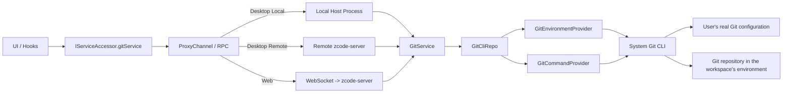

# Git Underlying Service

## Scope

Git's underlying service and communication architecture only; the upper-layer Git pane's real interaction is wired separately.

- Git RPC DTOs in `packages/shared/src/git.ts`.
- The `git` service channel registered in `packages/shared/src/channels.ts`.
- `config -> providers -> repo -> service` structure under `packages/services/src/git/`.
- `IGitService` wired into the local / remote / Web service access chains.
- Service-layer tests that run the real Git CLI.

## Relationships



- The upper layer always reaches Git through the unified `IGitService` protocol and does not know the execution position.
- Git commands run in the service instance of the environment that hosts the workspace, not on a fixed host platform.

## Directory Structure

```text
packages/services/src/git/
  config.ts
  git.ts
  gitService.ts
  providers/
    gitEnvironmentProvider.ts
    gitCommandProvider.ts
  repo/
    gitCliTypes.ts
    gitCliHelpers.ts
    gitCliRepo.ts
```

## Layered Responsibilities

### Config

Static Git-domain rules and utilities: Git binary candidate paths; default timeout / output size limit; command execution environment variables; cross-platform path normalization; repo root and workspace scope judgment strategy.

### Providers

Providers only decide how to execute, with no Git business semantics.

- `GitEnvironmentProvider`: resolves the available Git binary in the current environment; caches detection results to avoid repeated `git --version`; generates unified Git execution environment variables.
- `GitCommandProvider`: executes the Git CLI uniformly; controls `cwd`, `env`, timeout and output size; records command, duration, exit code, stdoutBytes and stderrSummary.

### Repo

`GitCliRepo` is a thin wrapper of the system Git CLI that turns raw Git output into structured data. It covers repository resolution, status, diff, branch comparison, stage / unstage / discard / commit, and identity.

Pure parsing lives in `gitCliHelpers.ts`: `git status --porcelain=v2 -z` parsing; `git diff --numstat -z` parsing; diff availability judgment; path normalization and repo boundary checks.

### Service

`GitService` exposes stable RPC semantics so UI never sees Git CLI details. It filters by the current `workspacePath` scope, maps raw repo status to `GitFileChange[]`, and closes branch comparison, identity and refresh semantics.

## Key Flows

### 1. Repository Resolution

`GitCliRepo.resolveRepository()`:

1. Find an available Git binary through `GitEnvironmentProvider`.
2. Run `git rev-parse --show-toplevel --show-prefix` in `workspacePath`.
3. Obtain `repoRoot` and `workspaceInRepoPath`.
4. If Git is missing or the directory is not in a repository, return a structured empty result instead of exposing an exception.

The upper layer can therefore reliably learn whether Git is installed, whether the workspace is in a Git repository, and whether the workspace is the repo root or a subdirectory.

### 2. Status

`GitCliRepo.getStatus()`:

1. `git status --porcelain=v2 --branch -z`.
2. Two `git diff --numstat -z` runs for staged and unstaged.
3. Parse branch, ahead/behind, file states and line statistics.
4. For untracked files, read the content to compute added lines.
5. Return `GitStatusSnapshot`.

`status --porcelain=v2` keeps the format stable regardless of system language. Staged / unstaged line statistics are done in the repo layer. The upper layer never guesses whether a file is staged, unstaged, untracked or conflicted.

### 3. Workspace Subdirectory Filter

`GitService.getChanges()` does not return the whole repo's changes. It keeps only changes inside the current workspace scope, based on `repoRoot`, `workspacePath` and `workspaceInRepoPath`. When the user opens a monorepo subdirectory they see only changes relevant to it.

### 4. Single File Diff

`GitCliRepo.getDiff()`:

- `staged`: `git diff --cached`
- `unstaged`: `git diff`
- `branch`: `git diff <upstream>...HEAD`

Plain `git diff` does not return untracked files, so for them `git diff --no-index` runs additionally; the upper layer needs no special case.

### 5. Write Operations

The repo layer implements real Git writes, exposed through `IGitService`:

- `stage` -> `git add -- <paths>`
- `unstage` -> `git restore --staged -- <paths>`
- `discard` -> `git restore ...`
- `commit` -> `git commit -m <message>`

## Communication Wiring

Git goes through the unified RPC chain like `file/system/terminal`.

- Local Desktop: `createLocalServices()` registers the local `GitService`.
- Remote Desktop: the renderer still sees `IServiceAccessor.gitService`. The Remote Host service collection of the current window exposes the remote `gitService`, and the renderer selects it by remote session / workspace scope; the window Local Host does not build a Git proxy for a remote workspace. Git execution therefore follows the remote workspace, never the local machine.
- Web: the browser connects to the remote service over websocket; the server-side remote bridge passes `gitService` through.

One protocol; execution follows the workspace; UI does not distinguish local / remote / web.

## How Key Problems Are Solved

### 1. Getting the user's local Git command and configuration

Git command: `GitEnvironmentProvider` probes in order `ZCODE_GIT_BINARY`, `git`, then common Git installation paths on Windows. It probes by running `git --version` once and caches the result.

Git configuration: `~/.gitconfig` is not parsed directly; configuration is read through the Git CLI, for example identity:

- `git config --show-scope --show-origin --get user.name`
- `git config --show-scope --show-origin --get user.email`

This returns Git's own effective configuration and is naturally compatible with global / local / worktree scope, `includeIf` and the platform's default configuration loading.

### 2. Multi-end compatibility

No separate Git implementation per end:

- One protocol: `IGitService`.
- One layering: `Service -> Repo -> Providers -> System Git CLI`.
- One principle: Git execution follows the workspace's environment.

Local: the local host process registers the local implementation. Remote: the remote server provides Git and the local side only proxies RPC. Web: the browser consumes the same remote service over websocket.

Multi-OS handling: Windows Git binary candidate paths; `/dev/null` vs `NUL`; `\` vs `/` separators; `realpath` normalization to avoid macOS `/var` vs `/private/var` path misjudgment.

### 3. Service interfaces

- `getRepositorySummary`: `repoRoot`, `workspaceInRepoPath`, branch name, ahead / behind, dirty, Git installed, in repository.
- `getChanges`: change list within the current workspace scope for `unstaged` and `staged`, normalized to `GitFileChange[]`.
- `getDiff`: single-file diff (unstaged, staged, branch comparison, untracked fallback).
- `getBranchComparison`: comparison of the current branch against upstream: `baseRef`, `headRef`, `comparisonLabel`, changed file list.
- `stagePaths`: add files to the index.
- `unstagePaths`: remove files from the index.
- `discardPaths`: discard file changes, workspace and staged.
- `commit`: commit; returns `commitHash` and the latest repository summary.
- `getIdentity`: effective Git identity: `userName`, `userEmail`, `nameSource`, `emailSource`, `scopeLabel`.
- `refresh`: returns the latest `summary` and `identity` at once, as a refresh entry point.

## Boundary

Done: Git underlying service capability; cross-end communication and execution-position design; real Git CLI integration.

Not done here: the upper Git pane consuming the real `gitService`; formal UI wiring of Git pane writes; dynamic subscription refresh of the Git repository; hunk-level operations.
