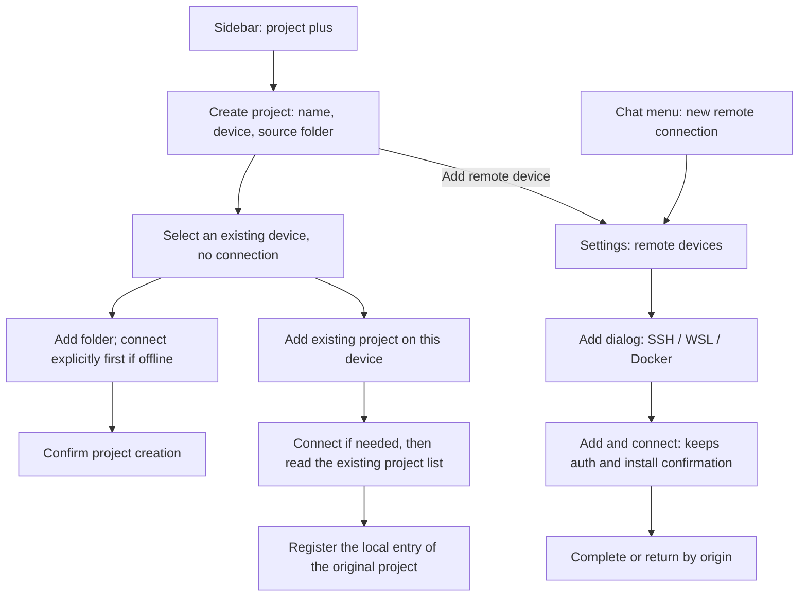

# 15 — Separating Project Creation from Remote Connection Management

Status: ready-for-agent

2026-10-12: product decisions Q1-Q12 and the test entry points are confirmed; the implementation and verification of each sub-ticket follow its own completion record. 2026-10-14: the chat entry contract was updated by a new confirmation, see [#21: Must choose a remote folder after connecting and enter the project](21-chat-settings-round-trip.md). #21 was re-marked ready-for-agent; old chat round-trip evidence does not mean the new behavior is implemented.

## Problem Statement

The 2026-10-12 background is kept below; the problem of unclear execution targets after a chat connection on 2026-10-14 and the revised scope are in #21.

Users who want to create or add a project on a device currently must first choose local or remote, enter an existing-connection list, then enter another connection wizard with saved devices and discovery candidates. Device selection and project creation are spread over several pages, so it is hard to tell whether the user is adding a device, establishing a connection, or creating a project.

The connection entries of the sidebar, the chat-box project menu and Settings also have different completion paths: the sidebar connects and then selects an existing remote project or creates one; the new entries of the chat box and Settings continue to directory selection after connecting. Users who only want to add a device also enter the project flow. The existing-connection list and the discovery candidates have different sources; when the former list is empty and the latter has many targets, the UI does not make the difference clear.

Entering device management from project creation or from a chat also needs to keep the original draft and return position. Otherwise users must refill the project after connecting, or lose their chat input; if a background completion jumps pages automatically, it interrupts later work.

## Solution

Separate project operations from device management; SSH, WSL and Docker share one entry and one completion rule.

- "项目 +" (project +) opens a creation form with project name, device and source folder directly, with no local/remote choice and "next".
- The device defaults to the device of the current task when the form opens; with no current task, "此电脑" (this computer). An offline device stays the default selection and must not silently switch back to local.
- The device dropdown lists only "此电脑", all added devices with their status, and "添加远程设备…" (add remote device…). Connection configurations not yet successfully identified and discovery candidates do not enter this list.
- Discovery results of SSH config Hosts, WSL distributions and Docker containers live in the Settings add dialog. The dialog is organized by SSH/WSL/Docker, defaults to SSH, and each type keeps its discovery and manual entry capability and existing platform limits.
- All add-connection entries go to "Settings → 远程设备" and open the add dialog; the primary action is "添加并连接" (add and connect). A Settings origin finishes with device management only; a chat new-task draft origin continues to choose a remote folder after every successful connection and enters the project per #21; sending without a project is not allowed.
- Selecting an existing device does not start a connection. For an online device "添加文件夹" (add folder) opens directory selection directly; an offline device connects explicitly through "连接并选择文件夹" (connect and choose folder), with progress, credential supply and required install confirmation staying in the current project flow.
- The remote project form keeps the secondary entry "添加此设备上的已有项目…" (add existing project on this device…), so that creating a same-directory project is not mistaken for restoring the original project and tasks.

Foreground completion and cancel rules:

| Origin                | Add and connect succeeds                                                                                                                                                                                                                                           | Cancel an unfinished add                                                                                                                                  |
| --------------------- | ------------------------------------------------------------------------------------------------------------------------------------------------------------------------------------------------------------------------------------------------------------------ | --------------------------------------------------------------------------------------------------------------------------------------------------------- |
| Create project        | Return to the original project draft and select the new device; if folders exist, confirm the switch per Q7 first; on rejection keep the original device and folders, the new device is still added                                                                | Return to the original project draft, keeping name, device and folders                                                                                    |
| Chat-box project menu | Every time, a folder picker for the target device; after the directory is confirmed: a single match is reused, several matches are chosen explicitly, zero matches create a project with the default folder name; after preparation, enter the project's new draft | Cancel this remote switch, restore and show the original chat target explicitly, keep the original draft; an already-connected device is not disconnected |
| Settings page         | Stay on the remote devices page and locate the device                                                                                                                                                                                                              | Stay on the remote devices page and do not continue the project flow                                                                                      |

"在后台继续" (continue in background) collapses the current connection interaction, and the Settings device card or the unfinished-connection item takes over progress. Background success only notifies completion and offers a continue entry and does not force a page jump. Failure keeps the configuration and reason for editing and retrying; close, cancel or Esc on the connection interaction layer cancels this unfinished flow. Closing the UI after the device is connected does not disconnect it.

## User Stories

1. As a desktop user, I want the project add button to open the project form directly, so that I can start with the project I intend to create.
2. As a desktop user, I want the project name, device, and source folder in one form, so that I can review the complete target before creating a project.
3. As a user working on a remote task, I want its device selected by default, so that I do not repeatedly choose the same environment.
4. As a user working locally, I want this computer selected by default, so that local project creation remains direct.
5. As a user without a current task, I want a local default, so that the form has a predictable starting point.
6. As a user whose task device is offline, I want that device to remain selected with a visible status, so that I do not accidentally create a local project.
7. As a user with saved devices, I want both online and offline devices in the selector, so that disconnection does not hide my targets.
8. As a user choosing a device, I want its name and connection status to be readable, so that I can distinguish devices without relying on color.
9. As a user choosing a project device, I want discovery candidates kept out of the saved-device list, so that I know which devices I have already added.
10. As a user adding a device, I want every add-connection entry to open the same settings section and dialog, so that the process is consistent.
11. As an SSH user, I want SSH selected initially in the add dialog, so that I can enter its settings immediately.
12. As an SSH user, I want to select a host from my existing configuration or enter it manually, so that I can use either setup method.
13. As an SSH user, I want existing authentication and advanced settings retained, so that the simplified entry still supports my connection.
14. As a Windows user, I want supported WSL distributions and a manual entry in the WSL section, so that I can add my development environment.
15. As a Docker user, I want discovered containers and manual configuration in the Docker section, so that I can select a suitable target.
16. As a user on an unsupported platform, I want controls to respect available capabilities, so that I do not enter a workflow the platform cannot complete.
17. As a user encountering discovery failure, I want a clear explanation and the available manual entry, so that discovery does not block other supported ways to connect.
18. As a user browsing discovery candidates, I want selection to prepare the configuration before I submit it, so that connection starts only after an explicit action.
19. As a user adding a device, I want an Add and connect action, so that I can tell whether the device is usable before selecting a project on it.
20. As a user managing devices, I want connection completion to finish the device operation, so that I am not forced to choose a folder or create a project.
21. As a user choosing an existing device, I want selection alone to avoid connecting, so that browsing the selector has no connection side effect.
22. As a user choosing an online device, I want Add folder to open its directory browser, so that I can proceed directly to the project location.
23. As a user choosing an offline device, I want Connect and choose folder to start the connection, so that the required network operation is explicit.
24. As a user connecting an existing device for a project, I want progress and required confirmations in that project flow, so that I retain the project context.
25. As a user whose connection needs credentials or installation, I want the existing prompts and details, so that the new navigation does not bypass required decisions.
26. As a user switching devices before selecting folders, I want the switch to be immediate, so that an empty form stays easy to change.
27. As a user switching devices after selecting folders, I want confirmation before clearing them, so that I do not lose my selection by mistake.
28. As a user confirming a device switch, I want my project name retained, so that only the device-specific folder selection changes.
29. As a user cancelling a device switch, I want the original device and folders retained, so that cancellation has no partial effect.
30. As a local project user, I want existing empty-project and multiple-folder support retained, so that the remote UI change does not reduce local capabilities.
31. As a remote project user, I want one required fixed root directory, so that project creation follows the existing remote project contract.
32. As a user with an existing remote project, I want to add that project to this computer, so that I can continue accessing its original tasks.
33. As a user with multiple remote projects using the same directory, I want to select the actual project, so that directory similarity does not merge their identities.
34. As a user returning from the existing-project list, I want my new-project draft retained, so that inspecting existing projects does not discard my work.
35. As a user with an older remote environment that only supports reading projects, I want to retain the existing-project entry, so that I can use its supported capability.
36. As a user adding a device from a project draft, I want to return to that draft after success, so that I can continue creating the project.
37. As a user whose project draft already has folders, I want returning with a new device to use the same switch confirmation, so that a settings round trip cannot bypass it.
38. As a user cancelling device addition from a project, I want the original draft restored unchanged, so that the cancelled prerequisite does not discard the project.
39. As a user adding a connection from a chat draft, I want to choose a remote folder after every successful connection, so that my next task runs on the device I chose.
40. As a user confirming a remote folder, I want to enter its selected or newly created project before sending, so that the message cannot run in a local projectless chat.
41. As a user adding a device directly in settings, I want its card located after success, so that I can inspect and manage the result.
42. As a user encountering a connection error, I want the configuration and reason retained with a retry action, so that I can correct the problem without starting over.
43. As a user cancelling an unfinished connection, I want the original project or chat draft preserved, so that cancellation affects only that connection attempt.
44. As a user with saved connection records, I want cancellation to keep those records, so that cancelling an attempt is not mistaken for deleting a device.
45. As a user with other projects on the same device, I want cancellation to leave their connections intact, so that one abandoned flow does not disrupt ongoing work.
46. As a user waiting for a connection, I want to continue in the background and inspect progress in settings, so that I can keep working elsewhere.
47. As a user whose background connection finishes, I want a completion notice and a continuation action, so that success does not unexpectedly change my page.
48. As a user closing an interface after connection success, I want the device to remain connected, so that dismissing a dialog does not undo completed work.
49. As a keyboard user, I want accessible device selection, confirmations, and focus restoration, so that I can complete the same workflow without a pointer.
50. As a user of either theme or supported language, I want readable and complete controls in narrow windows, so that state and actions remain understandable.
51. As a Web or mobile user, I want shared project UI to respect existing Host capabilities, so that the desktop redesign does not imply access to my browser device's filesystem or create a separate remote session.
52. As a user who has moved to another workflow, I want late results from a cancelled or superseded flow ignored, so that old requests do not reopen dialogs or overwrite new drafts.

## Implementation Decisions

### Confirmed product decisions

| Decision | Implementation contract                                                                                                                                                                                           |
| -------- | ----------------------------------------------------------------------------------------------------------------------------------------------------------------------------------------------------------------- |
| Q1       | The project entry owns device, directory and project selection; all add-connection entries go to Settings; device addition has an independent completion point                                                    |
| Q2       | SSH, WSL and Docker are implemented together, each keeping its capabilities and platform limits                                                                                                                   |
| Q3       | New projects default to the current task's device; local when there is no current task; offline never auto-replaces the default device                                                                            |
| Q4       | Device selection lists only added devices, including offline ones; discovery candidates stay in the add dialog                                                                                                    |
| Q5       | The add dialog is organized by type, defaults to SSH, and each type keeps discovery and manual entry                                                                                                              |
| Q6       | Selecting an existing device does not connect; an offline device connects through "连接并选择文件夹", with waiting and errors handled in the project flow                                                         |
| Q7       | Switching devices with directories requires confirmation; after confirmation clear directories and keep the name; cancel keeps all original values                                                                |
| Q8       | The primary action is "添加并连接"; no "save only" mode; unidentified configurations stay in the Settings unfinished connections                                                                                  |
| Q9       | The remote project form offers an add-existing-project entry that shows the list in the same dialog; returning keeps the new-project draft                                                                        |
| Q10      | Adding a device from a project: foreground success returns to the draft and selects the new device; existing directories still need confirmation; cancel restores the original draft                              |
| Q11      | A chat new-task draft must choose a remote folder after each connection, determines the project per #21 and enters; top-level cancel restores the original target; Settings origin stays in Settings              |
| Q12      | Failure is kept and retryable; close/cancel/Esc cancels an unfinished flow; continue-in-background does not cancel, background completion does not steal navigation; closing after connecting is not a disconnect |

### Modules and wiring

1. Modify the project creation and editing modules, merging the old type selection, Host list and project form into a direct creation form; reuse the existing directory picker and remote existing-project picker.
2. Modify the sidebar project entry, the chat project menu, Settings navigation and the remote device management module. The chat entry copy is "新建远程连接…"; Settings new enters the same categorized add UI.
3. Reuse the existing connection form, connection flow, device presentation model, authentication and install confirmation. Unify the wiring of the sidebar and the app-level connection interaction, avoiding two competing connection wizards.
4. Express the origin and completion intent at the existing UI navigation and connection-completion seam: device management only, continue to directory selection, continue to existing-project selection, restore an explicit original project. On connection success dispatch by this intent; it must no longer fall uniformly into directory selection.
5. The existing flow already lets the caller take over after a connection succeeds. Prefer reusing that seam; do not build a new authentication, install or connection main chain to skip the directory screen, and add no management API that only saves a Profile.
6. A connection operation in Settings completes within device management scope; an explicit project action on a device card keeps the project intent. Reconnecting an existing project continues the original project and must not be taken over by this round's new form.

### Data and state ownership

7. A Source is an identified remote environment and account; a Connection Profile is the way to reach that Source. One Source can have several Profiles, and the device list must not invent a device identity from the connection address or display name.
8. Added-device candidates come from existing device-management facts and are unrelated to whether this machine has opened a project on the device. Discovery candidates, not-yet-identified Profiles and identified devices are kept separate; a connection that reuses the same Source must not produce a duplicate device.
9. Project name, selected device and source folder are held by the single owner of the project draft; the default device is initialized on open and later state refreshes do not overwrite the user's choice. A Settings round trip keeps the same draft; the draft is not copied in the sidebar, Settings and chat and synced back.
10. The connection flow holds request ownership, origin and completion intent. The background card and the dialog project the same operation; real connection state, logs and credentials stay in the existing Host service, and UI builds no connection fact cache.
11. Connection configuration and credentials keep the existing commit boundary. Failure, cancel or reuse of an online connection must not unconditionally save this attempt's password or overwrite existing credentials; a failed add keeps a correctable form, which does not claim that this authentication information was persisted.
12. Project draft recovery covers only the page round trip within this interaction; no cross-restart draft recovery is added. The return intent saves no password or key passphrase and does not change the credential service storage rules.
13. No database migration is added and the Source, Profile, project and workspace identity formats are not rewritten. The UI-layer return intent does not enter the task protocol and does not become a new task, connection or message owner.

### Async, cancellation and directory boundaries

14. The device-switch confirmation must precede directory clearing and target switching; rejecting the confirmation produces no partial change. When an async directory selection or read returns, check that its draft, device and request are still valid; a result of the old device cannot be written into the new device's draft.
15. Device selection, connection completion and directory browsing add no project or chat. A chat origin resolves the existing project after the user confirms the directory per #21, uses the default name on zero matches and follows the shared creation confirmation; other entries must still create or add explicitly. An invalid directory, no permission, read or save failure adds no ghost entry, and a failure is not treated as zero matches.
16. Local projects still allow zero or more roots; a remote project must have exactly one fixed root. The fixed directory, project identity and history task ownership of an existing remote project do not change with the new form.
17. Adding an existing remote project uses the original project identity; the generic create-same-directory project can still produce another project. The confirm-directory action of the chat origin does same-device exact-directory resolution per #21: a single match is reused, several matches are chosen again, projects are not merged, and the global save is not changed to dedupe by directory. The read-only project capability of old remotes stays available.
18. Cancel only revokes the interaction request not yet completed and the temporary resources it holds; it does not delete saved connection records, disconnect devices shared by other projects, or undo an add that already completed. Closing the connection window and explicitly abandoning the original project form are different operations and must not clear the initiator's draft along with it.
19. A late connection, credential, install confirmation or directory result after close or cancel must not reopen the UI, create a project or overwrite a new draft. Reuse the existing request identity and invalidation mechanism; do not compensate state sync with delayed jumps, timers or polling.
20. Foreground success returns by consuming only a still-valid original flow intent; when the original task, draft or target is invalid, an old page is not resurrected. Background completion only notifies and offers an explicit continue entry, and even if the user has left Settings it must not steal focus; background failure and needs-action likewise keep accessible details.
21. When a dropdown or confirmation layer is open, Esc follows the top-layer close rule of the shared component first; only at the connection interaction layer does it mean cancel this connection, so one keypress does not close several layers.

### Platform and visuals

22. Reuse the design system's type scale, colors, layers, radii, sizes, components and state model; connection type and connection state each express their own meaning, and offline, failed or needs-action are not expressed by color alone.
23. Verify the current light and dark themes, Chinese and English, narrow windows, keyboard operation and focus return. Long device names, paths, errors and translations must not block the primary action.
24. Remote device management stays bound by existing Desktop platform capabilities; WSL is offered only on supported platforms, and Docker's unavailable and no-candidate states stay distinguishable. Discovery failure does not block other sources or existing usable manual entries.
25. The shared form on Web/mobile follows existing capabilities and must not offer an add entry leading to a non-existent Settings page. "此电脑" keeps the existing control-host semantics and does not mean the file system of the browser's device. The phone keeps attaching to the desktop's existing Host and creates no independent SSH, WSL or Docker session.
26. Desktop continuous and mobile replayable, original project reconnect and startup recovery, task owner, Provider delivery and workspace isolation keep their existing contracts; this round only reorganizes the user entries and the interaction completion destination.

## Testing Decisions

2026-10-12 test entry points confirmed by the user: mainly the existing desktop app E2E, verifying complete flows from the three real entries (sidebar, chat box and Settings); UI integration tests only for late results, cancellation and draft recovery timing that are hard to control stably; authentication and install use the existing real remote test chain, and no test-only business interface is added.

### Test principles and existing entry points

- **The main entry point is externally observable app behavior.** Operate through real entries and assert the visible page, buttons, focus, original draft, project identity, task ownership and actual connection state. Do not verify only internal method calls or let a case manually skip the Settings navigation under test.
- **Control timing through existing seams.** UI integration tests mount the real project/connection components, and delay, inject failures or release results at existing platform and service ports; assert visible results and external side effects such as project writes, and do not lock hook names, private state fields or DOM depth.
- **Modules under test.** Project creation/editing, device candidates, existing project selection, sidebar and chat entries, Settings navigation and device management, connection flow completion dispatch, and the draft lifecycle. Host connection and project services keep their existing contract tests, with assertions added only at affected boundaries.
- **Existing precedents.** The three-screen connection tests already have SSH config, offline target, collapse, failure and close scenarios; the project input tests have sidebar same-source, project selection and cross-layout evidence; the original-project handoff tests have real SSH, the Host binding barrier and late results after entry removal; the connection flow UI tests have delayed credentials, install confirmation and cancel recovery. Reuse these structures and environments, without copying three-screen navigation assertions superseded by this spec.
- **Real-environment evidence is recorded separately.** SSH, WSL and Docker real chains are verified separately; a Windows WSL case cannot be replaced by an SSH or mock PASS. A narrow desktop window screenshot is not real-phone shared-host verification; the native directory dialog may use a system return-value stand-in, with the stand-in boundary stated.
- **Tests before implementation.** First map the acceptance scenarios below into the existing case catalog and coverage matrix, add interaction tests that prove the old behavior does not satisfy the new contract, then change the code. Helpers and assertions in existing E2E that depend on type selection, generic directory wrap-up and the sidebar collapsed card are updated in step.

### Acceptance scenarios and evidence requirements

The IDs below are this round's acceptance list and do not mean tests exist or pass. Each needs setup, operation, assertion and run evidence; when covering themes, languages and platforms use representative and high-risk combinations, not the full Cartesian product.

| ID        | Initial condition and operation                                                                                                                        | Observable assertion                                                                                                                                                                                    | Main evidence                                  |
| --------- | ------------------------------------------------------------------------------------------------------------------------------------------------------ | ------------------------------------------------------------------------------------------------------------------------------------------------------------------------------------------------------- | ---------------------------------------------- |
| RDUX15-01 | Click project plus from a local task, a remote task, and with no current task                                                                          | The full form shows directly; default device is local, the corresponding remote, local respectively; no type-first screen                                                                               | Desktop E2E                                    |
| RDUX15-02 | Current task's device is offline; open the form and wait for a state refresh                                                                           | The default device is kept with a readable status; no auto switch to local, no connection established                                                                                                   | Desktop E2E + UI timing                        |
| RDUX15-03 | Device has online, offline and no-project-open records, plus discovery candidates and unidentified Profiles                                            | The dropdown includes all identified devices, without discovery candidates and unfinished connections; devices are not dropped by the project open set                                                  | UI integration + Desktop E2E                   |
| RDUX15-04 | Click add connection from a project, the chat menu and Settings                                                                                        | All enter the same Settings section and the categorized add dialog, with no second selection among cross-type existing devices                                                                          | Three-entry Desktop E2E                        |
| RDUX15-05 | In the add dialog switch SSH/WSL/Docker, choose a discovery candidate or enter manually; simulate discovery failure                                    | SSH default; type fields and capabilities are correct; choosing a candidate does not dial, explicit submit connects; discovery failure does not block other usable entries                              | UI integration + supported-platform E2E        |
| RDUX15-06 | Project form selects an online device and adds a folder                                                                                                | Selecting a device has no connection side effect, directory browsing reuses that device; choosing a folder does not create the project yet                                                              | Desktop E2E                                    |
| RDUX15-07 | Project form selects an offline device and clicks connect and choose folder                                                                            | No connection before the click; progress and required confirmations are inside the project flow; success enters directory browsing without jumping to device settings                                   | Real-remote Desktop E2E                        |
| RDUX15-08 | The form has a name and folders; switch device; confirm and cancel respectively                                                                        | Confirm clears only directories and switches device, the name is kept; cancel keeps all original values; an empty-directory draft needs no confirmation                                                 | Desktop E2E                                    |
| RDUX15-09 | Device A's directory selection/read is unfinished; cancel or switch to device B, then release A's response                                             | A's result is not written into B's draft, does not reopen the old directory page, does not save a project                                                                                               | UI integration                                 |
| RDUX15-10 | Add and connect a device directly from Settings and succeed; also check ordinary connection operations of an existing device                           | The device management operation completes independently and locates the device, with no directory page, no new project or chat                                                                          | Real-remote Desktop E2E                        |
| RDUX15-11 | Add a device from a named project draft and succeed in the foreground                                                                                  | Returns to the same draft, keeps the name and selects the new device; the project count does not change before explicit creation                                                                        | Desktop E2E                                    |
| RDUX15-12 | The original draft has folders; return after a new device is added; accept and reject the device change                                                | Return still goes through the Q7 confirmation; rejecting keeps the original device and folders, the new device stays in the added list                                                                  | Desktop E2E                                    |
| RDUX15-13 | Add a device from a project draft and cancel in the form, while connecting, and while waiting for confirmation                                         | Back to the original project draft; no project added; saved connection records and other shared projects are not deleted or disconnected                                                                | Desktop E2E + UI timing                        |
| RDUX15-14 | Add a device from a new chat draft; success must choose a directory and enter the project, cancel restores the original target                         | The new contract is detailed in RDUX21-01 to 24; send limits, project identity, cancel and async protection must be re-verified; cross-device draft migration is deferred, old PASS does not cover this | Desktop E2E + necessary UI/service timing      |
| RDUX15-15 | A remote device has an original project and tasks; pick that project from the secondary entry; also test the create draft before returning to the list | The original project entry is added and original task identity kept; no same-directory new project is created; returning keeps the draft; repeated adds make no duplicate entry                         | Desktop E2E + project service contract         |
| RDUX15-16 | Different projects exist for the same device and directory; also add with a read-only old remote                                                       | Original projects can be selected separately; no merge by path; a read-only remote can add an existing project and cannot create illegally                                                              | Existing service/UI contracts + E2E            |
| RDUX15-17 | Create an empty project and a multi-directory project locally, a single-directory project remotely, then pick an unavailable directory                 | Local capability retained; the remote directory contract holds; a read or save failure adds no ghost project                                                                                            | Desktop E2E + project service contract         |
| RDUX15-18 | Meet credential supply, authentication failure, install/upgrade confirmation, then retry after correcting                                              | The original completion intent is not lost, configuration and understandable errors are kept; required confirmations are not skipped; unused new credentials do not overwrite existing values           | Real-remote E2E + existing credential contract |
| RDUX15-19 | While connecting click continue in background, then leave Settings manually; let the connection succeed, fail or wait for action                       | The Settings item takes over the same progress; foreground is not preempted; success has a continue entry, failure/pending has accessible details; no duplicate operation                               | Desktop E2E + UI timing                        |
| RDUX15-20 | After the connection is closed, cancelled or the initiator is invalid, release an old credential, install or connection result                         | The old result does not revive a dialog, jump pages, add a project or overwrite a new draft; only exclusive temporary resources of this attempt are cleaned                                             | UI integration + original-project handoff E2E  |
| RDUX15-21 | A project on the same device is using the connection; add a reusing connection or cancel another request                                               | Still the same device; the original project keeps working; new credentials not involved in authentication do not overwrite old values; closing the success UI does not disconnect                       | Real-remote E2E + Host contract                |
| RDUX15-22 | An existing remote project is offline; click the original project and go through credential supply/install; also run startup recovery                  | Success still enters the original project and directory, not the new-project form; recovery does not require choosing a directory again                                                                 | Original-project reconnect E2E                 |
| RDUX15-23 | Operate the device dropdown, add, switch confirmation and close by keyboard only; cover long names and errors                                          | Esc works by top-layer interaction semantics, focus is visible and returns sensibly; states have text; no action is clipped                                                                             | Desktop E2E + accessibility assertions         |
| RDUX15-24 | Light/dark, Chinese/English, normal/narrow window; macOS/Windows/Linux capabilities                                                                    | Uses the existing design system; layout, system directory selection and type capabilities are correct; WSL appears only on supported platforms                                                          | Visual evidence + per-platform E2E             |
| RDUX15-25 | Web/mobile use the project UI of the existing Host and restore existing remote workspaces                                                              | Capability gating works, no non-existent Settings entry, no misuse of the browser's local directory, no independent remote session; shared Host and replayable recovery do not regress                  | Web/mobile regression + existing Host contract |

### Implementation completion bar

- Code implementation passes typecheck, lint, the architecture gate, affected unit tests within the task scope and the corresponding Desktop E2E; shared UI and remote boundaries get applicable Web/mobile regression.
- Record the evidence scope of real SSH, WSL, Docker, operating systems and phones. Environment blockers must list the unverified scenarios and must not be replaced by component tests or old-version pass records.
- New E2E enter the manual-review candidate stage per the existing workflow; a successful run is not formal/CI admission, and formal promotion follows the original flow.
- This delivery is documentation only: check document structure, references, rule consistency, formatting and open-source constraints; do not write unexecuted functional tests as passed.

## Out of Scope

- Rewriting the SSH, WSL and Docker transport, authentication, install, upgrade or reconnect state machines; adding unconfirmed capabilities such as ssh-agent and default keys.
- Introducing a "save but do not connect" mode, or offering unidentified connection configurations as added devices for project selection.
- Remote multi-directory, remote projectless tasks, changing the fixed directory of an already-created remote project, merging projects by path, or migrating history tasks.
- Redoing all visuals of the device card, sidebar ordering and grouping, or adding a filtering system for large device lists.
- Adding cross-restart project/connection draft recovery, or putting the password into the page-return intent.
- Expanding remote device management on mobile or ordinary Web, creating an independent mobile remote connection owner, or changing the continuous/replayable boundary.
- Redoing the dev-only Server direct entry, Provider delivery, task protocol, workspace identity and storage migration.

## Further Notes

- This release delivers the spec only and changes no functional code or runs functional tests; later implementation targets this document, and ready-for-agent is not taken as implemented or verified.
- This round's Q1-Q12 and the test entry points are confirmed; the 2026-10-14 chat entry revision and the cancel and directory matching rules are also confirmed. Before implementation start from this issue's and #21's acceptance scenarios without re-discussing confirmed decisions; draft/attachment migration across devices is outside #21.
- ready-for-agent from the [local issue convention](../../agents/issue-tracker.md) is expressed by this document's Status; this file is also the complete spec, does not duplicate another body, and does not publish a remote issue.
- The [remote connection UX index](01-remote-connection-ux-optimization.md) records this ticket's relation to the completed batches. 2026-10-14 reopens only #21 to implement the new chat entry contract; the status and historical evidence of other sub-tickets are kept and the undecided ssh-agent evaluation is not advanced.
- When implementing this ticket, the statements in the [connection UX spec](../../architecture/remote-device-connection-ux-spec.md) about the generic three-screen entry, the mixed discovery list, success always entering a directory, the sidebar collapsed progress position, and closing clearing all drafts are replaced by the corresponding contract here. The five states, error classification, logs, install confirmation, credential saving and device identity keep the original contract.
- When implementing this ticket, the project plus entry and the "manual connection without a directory uniformly chooses a directory" rule in the [project navigation spec](../../remote/project-first-remote-navigation-spec.md) are distinguished by this document's project/device-management intents; the existing project reconnect, startup recovery, identity isolation and history data rules remain valid. Implemented marks and old test evidence in old documents do not mean this ticket is complete.
- Domain boundaries continue to follow the [R3 main spec](../../architecture/r3-source-server-remote-architecture.md) and [runtime boundaries](../../agents/runtime-boundaries.md); UI follows the [design guidelines](../../../DESIGN.md), and local directory selection follows the [existing contract](../../ui/project-local-directory-picker.md).
- During implementation link the acceptance scenarios to the [case catalog](../../conversation-session-case-catalog.md) and [coverage matrix](../../testing/conversation-session-e2e-coverage-matrix.md) and maintain evidence per the [E2E workflow](../../testing/conversation-session-e2e-development-workflow.md). Only acceptance targets are given here; no case files or PASS are fabricated.
