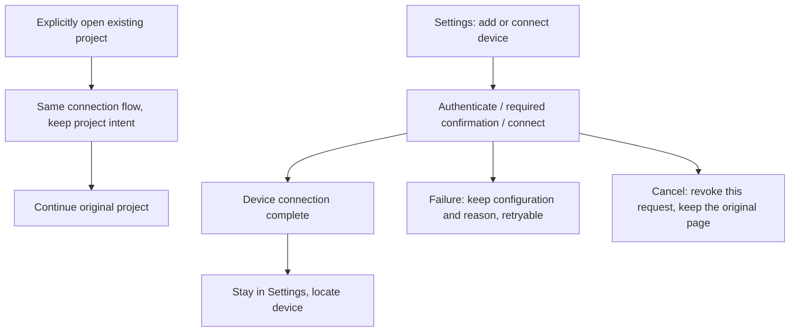

# 16: Connection Completes Independently in Settings

Status: done

**Parent:** [#15 — Separating project creation from remote connection management](15-project-device-selection-and-connection-management.md)

**What to build:** When a user adds or connects a device from Settings, after authentication, the required install confirmation and a successful connection, the user stays on the remote devices page with the device located, and is no longer asked to choose a directory or create a project. An explicit open-existing-project action still returns to the original project. Complete this runnable, acceptable path first, so that the typed add and project entries later reuse the same connection flow.

**Blocked by:** None (can start immediately).

**Spec coverage:** Q1, Q8, Q12; RDUX15-10, RDUX15-18, RDUX15-21, RDUX15-22, and the connection-flow invalidation protection of RDUX15-20. RDUX15-23/24/25 cover the Settings interaction, visuals and capability boundary involved here.

## Acceptance criteria

- [x] First tidy the existing connection-completion seam, distinguishing completion intents such as device management, continue to directory selection, continue to existing-project selection and restore the original project. Keep the existing authentication, install, upgrade and connection capabilities, and build no separate physical connection chain or task owner; old callers still complete by their original intent before migration.
- [x] From the Settings add entry and the ordinary connect entry of an existing device, on success stay on the remote devices page and locate the device; neither the directory picker nor the project editor opens automatically, and project and chat counts do not increase.
- [x] Explicit project actions on a Settings device card, sidebar original-project reconnect and startup recovery still use the original project and directory; credential supply, install, upgrade and retry do not turn them into device-management completion or a new project.
- [x] Failure keeps the current configuration and an understandable error and allows editing and retrying; close, cancel or Esc on the connection interaction layer cancels only the unfinished flow. Dropdown and confirmation layers still consume their own Esc first and do not close several layers at once.
- [x] Cancel deletes no saved connection record and does not close the device connection shared by other projects; closing the UI after a successful connection keeps the device online. The exclusive temporary attachment of this attempt is released per the existing lifecycle.
- [x] After cancel or intent invalidation, late credential, install confirmation and connection results cannot reopen the UI, switch projects or commit old navigation; decided through request ownership, not timeout compensation.
- [x] Failure, cancel or reuse of an online connection does not unconditionally save this attempt's password or overwrite existing credentials; reuse of the same Source produces no duplicate device.
- [x] Settings success, failure and needs-action states agree with device facts; keyboard focus, status text, Chinese/English and the current dark/light themes work. The Web/mobile device management capability gate is not opened.
- [x] Tests were added before code changes, the verification below was completed and actual evidence recorded; related specs and test assertions are updated with this ticket's behavior, and goals still owned by later tickets are not written as implemented.

## Verification

- From the real Settings entry perform add, existing-Profile connect and explicitly opening the original project, asserting the final page, device state and project/task counts. Use the existing real remote test chain to prove connection success, credential supply, install confirmation and original-project recovery.
- Control cancellation and late results at the existing UI/service seams, asserting observable navigation and project side effects; reuse the credential and shared-connection contracts to verify that unused credentials do not overwrite existing values.
- Cover current light/dark, Chinese/English and narrow windows, and record the SSH, WSL, Docker and operating-system scope actually run. Component stand-ins or old run results cannot replace real-chain evidence.
- Implementation passes typecheck, lint, the architecture gate, affected unit tests within the task scope and the corresponding Desktop E2E. When shared modules touch Web/mobile, complete the applicable regression; on environment blockers list the unverified items and do not mark done.

## Scope and handoff

- The needed completion-intent tidying is done first in this ticket and accepted through the complete Settings connection path; no new abstraction without actual callers is delivered separately, and no "save Profile only" API, database migration or workspace identity format is added.
- The typed add UI is delivered by [#17](17-typed-remote-device-addition.md), direct project creation by [#18](18-direct-project-creation-and-device-selection.md). Existing entries stay usable during migration; flows that later tickets still depend on are not deleted at once.
- Background progress position and the explicit continue interaction are delivered by [#22](22-background-connection-and-explicit-resume.md); this ticket's foreground cancel, credential protection and late-result isolation must be completed independently and cannot be deferred to that ticket.

## Implementation boundary and TODO

- The directory history on a Settings device card contains only Source and path, not an existing-project list with original project IDs. This ticket keeps its compatible directory path; an explicit original-project reconnect keeps using the existing `preferredProjectEntryId` / `preferredWorkspaceTabId`. Projects are not inferred from the same directory; the formal existing-project selection is delivered by #19.
- TODO: by the user's authorization this round, real WSL and mobile chains are not verified yet. Capability-gate regressions are kept; this is not reported as a real-chain pass.

## Verification record (2026-10-12)

- macOS native Desktop E2E `conversation-session-settings-connection-completion.test.ts` passes 2/2: SSH add, ordinary Profile reconnect, online reuse with a wrong new password, Docker in an independent user environment, Esc cancel, device location and original-project identity recovery, all through real connections. The Host public read interface confirmed 1 local project and 0 tasks before and after each device operation.
- Device and cancel evidence: `packages/desktop/.e2e-artifacts/desktop-e2e-20261012101254815-p39412-0d279d20ad5c072b/` with 8 screenshots of Chinese/English × dark/light × 1440/480px, representative ones checked. The final run used build output checked file by file against the source mapping; no connection, install or Host was substituted.
- Existing credential regression `conversation-session-ssh-remote-wizard-credentials.test.ts` passes 1/1: missing-credential refill after a cold reload and reuse of an already-online connection. Evidence: `packages/desktop/.e2e-artifacts/desktop-e2e-20261012101356498-p39966-214ee0d1c7e9b02c/`.
- Unit tests: 659 test files / 6358 tests selected against baseline `e98b230336` pass, with 34 Node script checks; the later account-less startup configuration was verified per file; connection flow 32 and startup credentials 24 targeted regressions pass.
- `pnpm typecheck`, Desktop E2E type check, `pnpm lint`, architecture gate, fixture check, changed-code formatting and diff check pass. Lint keeps 208 baseline warnings with no new error.
- Real execution scope this round: SSH/Docker on macOS Desktop + a Linux container. WSL and mobile are deferred by user authorization; Windows/Linux desktop real E2E was not run and is not counted as passing.
