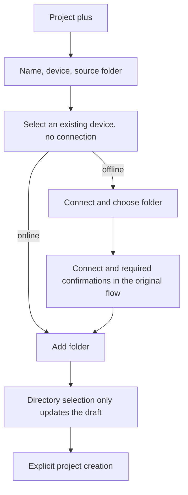

# 18: Direct Project Creation and Selecting an Existing Device

Status: done

**Parent:** [#15 — Separating project creation from remote connection management](15-project-device-selection-and-connection-management.md)

**What to build:** After clicking "项目 +", the user fills in the name, chooses a device and source folder directly, and completes project creation. When an existing remote device is online, directory browsing starts directly; when offline, the user starts a connection explicitly, completes the required confirmations inside the project flow, and then continues selecting a directory.

**Blocked by:** [#16 — Connection completes independently in Settings](16-settings-connection-completion.md). This ticket reuses its intent-based connection flow for continuing project operations and no longer maintains another competing connection-completion path.

**Spec coverage:** Q1, Q3, Q4, Q6, Q7; RDUX15-01, RDUX15-02, RDUX15-03, RDUX15-06, RDUX15-07, RDUX15-08, RDUX15-09, RDUX15-17; RDUX15-18/20/21 cover this ticket's connection waiting and cancel, RDUX15-23/24/25 cover the shared project form.

## Acceptance criteria

- [x] Remove the local/remote type front screen and "next" of new-project creation. The first screen contains project name, device, source folder and the create action; both local and existing remote projects can be saved from this entry.
- [x] On open, default to the device of the current task; with no current task use local. An offline current-task device stays selected with its status shown; later device snapshot refreshes do not overwrite the user's choice.
- [x] The device dropdown shows "此电脑", all added devices and their status; it includes offline devices and identified devices never opened as a project on this machine, does not depend on the project open set, and does not mix in discovery candidates or unidentified Profiles. Device identity is not guessed from display name or address.
- [x] Selecting a device itself does not connect and creates no project or task. For an online device "添加文件夹" reuses that device's directory capability; an offline device shows "连接并选择文件夹", and clicking it establishes the connection.
- [x] The connection progress, credential supply, required install/upgrade confirmation and errors of an existing device are handled in the project flow without jumping to the Settings add dialog; success opens directory browsing of the selected device, failure keeps the project draft and allows retry.
- [x] An empty-directory draft can switch device directly; with directories, confirm first, and after acceptance clear directories and switch device while the name is kept; after rejection device and directories all stay unchanged. Confirmation and async directory returns must not cause partial changes.
- [x] Directory reads or system directory-selection responses of an old device, after the device switch, cancel or draft invalidation, must not be written into the new draft, reopen the old UI or trigger a save.
- [x] Local keeps supporting zero or more directories; remote must and can select exactly one fixed root, and editing an existing remote project cannot change its root. An unavailable directory or save failure stays in the form and adds no ghost project.
- [x] Selecting a directory only changes the draft; only explicit creation saves the project. Closing this connection is not abandoning the original project draft, deletes no saved device, and does not affect connections shared by other projects.
- [x] The shared form keeps the platform-injected directory capability; Web/mobile do not treat the browser's device as an accessible local file system, do not open non-existent device management entries or create an independent remote session.
- [x] The form, device dropdown, switch confirmation and directory selection follow the design system, covering keyboard, focus, long device names/paths, Chinese/English, current dark/light themes and narrow windows.
- [x] This ticket's interaction tests were updated and run before implementation, keeping un-migrated entries usable; the later tickets' add-device round trip and the existing-project secondary entry are not counted as delivered by this ticket at acceptance.

## Verification

- From the real sidebar plus entry verify defaults, candidate range, online/offline device selection, switch confirmation and local/remote project saving; for a "recognized but never opened a project" device verify that a project can actually be created, not only that it is visible in the list.
- Use the real remote chain to verify explicit connection of an offline device, then continue to directory selection after credential/install; use the existing UI port to delay directory responses, verifying draft isolation and cancel.
- Link this ticket's scenarios to the existing project input, local directory selection and remote project contract tests, covering local zero/multiple directories, remote single directory and invalid paths. Assert only external behavior, not component-internal state structure.
- Implementation completes typecheck, lint, the architecture gate, affected unit tests, the corresponding Desktop E2E and the applicable Web/mobile regression of the shared UI; the actual operating system, theme and remote type evidence are recorded separately.

## Scope and handoff

- This ticket consumes only added devices and can proceed in parallel with [#17](17-typed-remote-device-addition.md).
- [#19](19-add-existing-remote-project.md) connects the existing remote project capability to the new form; before it is done, the existing-project entry currently usable is not removed.
- Adding a device into Settings and round-tripping the draft is done by [#20](20-project-draft-settings-round-trip.md); the existing add-connection capability stays usable during migration and no no-op button is left behind.
- Reuse the single project draft and the existing connection flow; no cross-restart draft store, project database or connection owner is created.

## Implementation notes

- When Web/mobile have no Source management capability, device candidates project only the Hosts in the existing `remoteProjectService` directory; the absence of management capability must not be interpreted as no devices, and device-add permission is not opened for it. Desktop still uses the full set of identified Sources.
- The remote directory page of the project flow and the old connection directory page share the first-time continuous-run hint; the existing `remoteBoundaryOnboardingVersion` is written only after it is shown, and unshown, failed-read and late results do not count as read.
- `ProjectEditor` is the single draft owner of name, device and directories; `ProjectCreation` holds only the connection handoff and local member registration. The default device is sampled when the form first opens, and Source snapshot refreshes do not change the selected value.
- Device candidates take the full set of identified Sources, and directory reads/writes use the project service of the chosen Host. Only explicit creation registers a member for a Source with no project member; existing members re-check generation. After a remote create succeeds but entry registration fails, a retry reuses the original project ID.
- Directory results are validated by draft generation. Connection credential supply, install and upgrade confirmation reuse the existing flow; releasing the temporary attachment does not affect attachments shared by existing projects.
- Before #22 wires in the unified continue-in-background owner, project connections use `SSHDialog.allowBackground=false`. This is a capability gate so the old outer layer does not treat collapsing as cancel; #22 opens it up, and this gate must not be taken as the background scenario being accepted.
- The old VP08 Direct URL fixture is not part of the Source selector and now prepares its entry through a dedicated project metadata service; later project UI / remote execution regressions are kept. It does not prove the new Source dropdown behavior.
- TODO (deferred with user confirmation): real WSL and mobile remote-control verification; macOS SSH or shared component unit tests do not substitute.

## Verification result — 2026-10-12

- `pnpm typecheck`, `pnpm --filter @zcode/desktop typecheck:e2e` and `pnpm architecture:check --changed` pass. `pnpm lint` passes (208 pre-existing warnings, 0 errors).
- `pnpm test:unit:affected --base` against `26778bf6b4` passes: 692 affected files; ordinary Vitest 688 files, 6516 cases, isolated Vitest 1 file, 1 case; the Node test group passes. The later `--files packages/ui/test/projectCreation.test.ts` with the added candidate-exclusion test passes (11 cases).
- Desktop native E2E `conversation-session-project-device-selection.test.ts` passes 2/2, runId `desktop-e2e-20261012104747134-p27975-f98ece7e94e167c8`. Covers the real sidebar, keyboard, default devices for no task / local task / online remote task / offline remote task, snapshot refresh, the component contract that unknown Profiles are excluded, local zero/multiple directories, invalid directory, a recognized SSH device with no project member, explicit reconnect, device-switch confirmation and late directory responses.
- Screenshots in both languages, dark/light, 1440px/480px were sampled after the actual CSS transition ended; the create button stays visible. Evidence is kept in the integration workspace `packages/desktop/.e2e-artifacts/<runId>/`.
- Remote run artifacts reuse the CLI/shared/services/server/rpc/provider/client/CUA release verified in #16 with the same Git tree; this ticket's UI was built from the current source first, and the later test-only re-runs checked the source map content of 5 core UIs one by one for consistency.
- The extra default-device precondition created real tasks through the public history import without sending model requests; remote preparation goes through a real ScopedServicePort, and a local service port plus workspaceIdentity must not be treated as a remote command.
- Not verified: real WSL and mobile remote control, deferred by the user's explicit instruction; other migrated historical E2E were not each run and are not counted as passing. #22 remains responsible for unified background completion/recovery and the final cross regression; this ticket did not accept later tickets' capabilities in advance.

## Review regression verification — 2026-10-12

- Directory and existing-project connections of an existing device keep reusing the Root's single flow; the `connect-device` return intent keeps the original project tab, and only `add-device` round-trips to Settings. A delayed snapshot error from continue-in-background is dropped by `entryEpoch` when stale; a valid entry still shows the error.
- The project form and the existing-project list translate device-removed and connection-unavailable errors at the display boundary; internal error codes and other service errors are kept. Component regressions cover the visible Chinese/English text, delayed failures after the entry is cancelled/replaced, and errors of a valid entry.
- `pnpm test:unit:affected --base` against `08b88d058f` passes: 658 Vitest files, 6410 cases; 4 Node files, 34 cases. `pnpm typecheck`, Desktop E2E type check, lint (208 pre-existing warnings, 0 errors), format check, architecture gate and the fixture checks of the two modified E2E pass.
- `conversation-session-project-device-selection.test.ts` passes 2/2, runId `desktop-e2e-20261012-115251-590`. During a real offline connection the active tabs of both the directory and existing-project intents stay at the original value, with Settings not shown; includes Chinese/English, dark/light, wide/narrow screenshots.
- `conversation-session-project-settings-return.test.ts`, `conversation-session-chat-device-return.test.ts` and `conversation-session-background-connection.test.ts` each pass 1/1, runId `desktop-e2e-20261012-114912-766`: adding a device still round-trips Settings with the original draft kept, and SSH/Docker continue-in-background and cancel. In that batch two selection cases failed on a leftover English language state in the test; after fixing the language assertion they all passed in the independent run above, and the earlier batch is not reported as all green.
- Evidence is copied to the integration workspace `packages/desktop/.e2e-artifacts/<runId>/`. The final E2E rebuilt Desktop after type checking; 5 key UI sourcemaps match the current source verbatim, and the Git trees of 10 remote packages equal the reused verified run artifacts.
- Two Office cases of the first affected-test run failed because the independent worktree's external WASM link was rejected by Vite; after fixing the local dependency layout, the targeted 15/15 and the full affected re-run passed, without changing product code or assertions to evade it. Real WSL and mobile remote control remain TODOs per the user's decision and are not recorded as passing.
- Review-fix re-verification: `conversation-session-r3-boundary-ack.test.ts` passes 1/1 on macOS native Desktop + an independent Linux SSH container; device completion does not consume the hint early, the first project directory browse shows the hint, and closing, a second project and app restart do not repeat it. Evidence `packages/desktop/.e2e-artifacts/r3-server-review-20261012-boundary/`, directory-hint screenshot checked.
- Mobile shared-Host regression passes 1/1 on macOS Desktop + Chrome mobile viewport, evidence `packages/desktop/.e2e-artifacts/r3-server-review-20261012-mobile-r3/`: a registered offline device is selectable under a restricted channel, the existing-project entry is kept with no add-device entry, and original project creation / task persistence / draft reload still pass. Account and external relay use the existing loopback fixture, while Main/Host/WebSocket/app RPC stay real; this does not represent the production relay or a real phone. The first two attempts located a missing-account pairing gate and a fixture client-scenes return type error; only test preconditions were fixed and no product gate changed.
