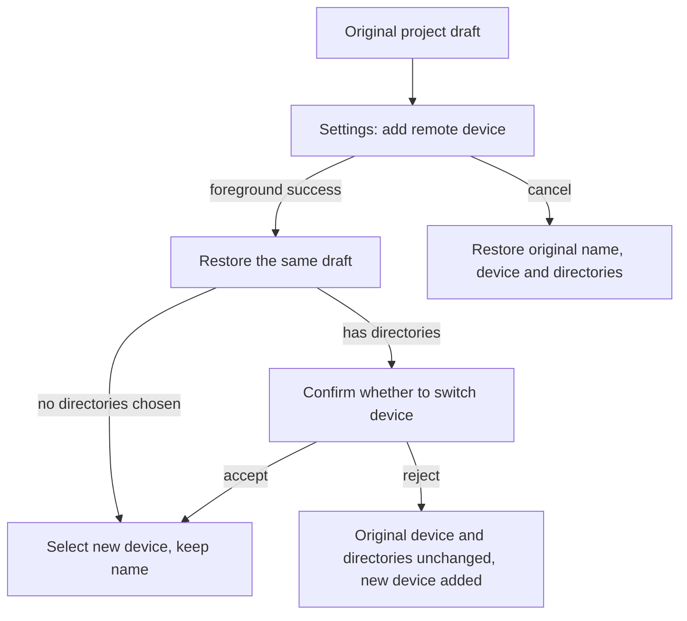

# 20: Create-Project Round Trip through Settings with Draft Recovery

Status: done

**Parent:** [#15 — Separating project creation from remote connection management](15-project-device-selection-and-connection-management.md)

**What to build:** When the user clicks "添加远程设备…" in the device dropdown of project creation, they enter the typed add dialog in Settings; on foreground success they return to the same project draft with the new device selected, and on cancel the original selection is restored. Project name and directories are not lost across pages, and existing directories still need the device-switch confirmation.

**Blocked by:**

- [#17 — Add SSH / WSL / Docker by type](17-typed-remote-device-addition.md): provides the complete add path inside Settings.
- [#18 — Direct project creation and selecting an existing device](18-direct-project-creation-and-device-selection.md): provides the form to restore, the single draft and the device-switch confirmation.

**Spec coverage:** Q1, Q7, Q10, Q12; the project entry of RDUX15-04, RDUX15-11, RDUX15-12, RDUX15-13, and the cross-page draft protection of RDUX15-20; RDUX15-23/24/25 cover focus, layout and capability gating.

## Acceptance criteria

- [x] The add entry of the project device dropdown closes the original menu and enters "Settings → 远程设备", opening #17's typed add dialog directly; whether Settings is already open or remounted, the navigation intent of this attempt is consumed only once.
- [x] Across pages the name, device and source folder are kept by the single owner of the original project draft; navigation carries only the origin and a draft reference, copies no second writable draft, and saves no password in the return intent.
- [x] When the foreground connection succeeds and the original intent is still valid, return to the same creation form and keep the name; when the original draft has no directories, select the new device; before explicit creation the project and task counts do not increase.
- [x] When the original draft has directories, returning must go through the same confirmation as an ordinary device switch. After acceptance clear directories and select the new device; after rejection keep the original device and directories, the new device is still added and can be chosen later.
- [x] Cancelling in the add form, while connecting, or while waiting for credential/install confirmation all return to the original project draft with original values restored; saved connection records are not deleted, connections shared by other projects are not disconnected, and cancel is not interpreted as abandoning the project draft.
- [x] A failed add stays in the add flow, keeping the configuration and an understandable error for correcting and retrying; final success or cancel still returns to the same valid origin intent.
- [x] After the original draft is explicitly abandoned, replaced or the original flow invalidated, late connection and Settings navigation results must not reopen the old form or overwrite a new draft; cleanup affects only exclusive resources of this attempt.
- [x] One round trip restores once; page timing is not repaired by delayed jumps, timeouts or polling, and no cross-restart draft is persisted.
- [x] Under keyboard, Esc top-layer semantics, return focus, Chinese/English, current dark/light themes and narrow windows, the foreground round trip and switch confirmation can be completed; platforms without device management capability expose no jump that cannot be completed.
- [x] Real-entry E2E and necessary timing integration tests were added before wiring navigation; the independent add-connection wiring replaced by this entry is deleted only after confirming other callers still work.

## Verification

- From a real project form add a device with an empty-directory draft and with an existing-directory draft; perform success, reject device switch, accept device switch, failure retry and cancel at each waiting stage, checking original values, device state and project count one by one.
- Do not bypass the navigation under test by opening the add dialog directly; also verify the first mount of Settings and switching sections while it is already open, to prevent repeated consumption and wrong returns.
- Delay connection/credential results at existing service seams, release after abandoning or replacing the original draft, and assert the old form is not revived and new drafts or shared projects are not affected.
- Implementation passes typecheck, lint, the architecture gate, affected unit tests, the corresponding Desktop E2E and applicable platform/theme regressions; record real remote evidence and unverified items.

## Scope and handoff

- This ticket owns the foreground project-draft round trip and does not depend on [#19](19-add-existing-remote-project.md)'s existing-project list or [#21](21-chat-settings-round-trip.md)'s chat round trip; it can proceed once its prerequisites are met.
- The branch where background success only notifies and needs an explicit user continue is done by [#22](22-background-connection-and-explicit-resume.md). This ticket does not move the connection completion intent into the task protocol and does not change the Host's connection state machine.

## Implementation notes

- `ProjectEditor` keeps the original instance and the single draft; `ProjectCreation` holds only the return reference of this attempt and the collapsed state. Settings navigation copies no name, directory or credential.
- Root keeps the original owner reference and the exact tab/workspace identity through `returnTarget`; success and explicit cancel consume the reference first, then return. An invalid owner, tab or workspace is not restored. Collapsing a connection is not treated as cancel; background continuation is connected by #22.
- The returned new device still calls the original `changeDevice`, reusing the directory confirmation. After the old draft unmounts, late device results and project-entry registration results cannot affect a new draft.
- New candidates use the account-less E2E startup contract; a fake OAuth triggers the real control plane's login-expired popup, covering the project entry. The project-return test only waits for the connection window to finish and does not misjudge the normally appearing device-switch confirmation as a connection failure.
- TODO (deferred with user confirmation): real WSL and mobile remote-control verification, not replaced by local SSH or shared component tests.

## Verification results

- `pnpm typecheck`, `pnpm lint` (0 errors, 208 pre-existing warnings), the architecture gate (0 violations), E2E type and fixture checks pass.
- Affected tests run from the implementation baseline: 405 files, 4589 tests pass; the test-selector helper suite passes. The new account-less startup regression 26 tests and the targeted project-draft and connection timing tests pass.
- macOS native real SSH E2E passes: `desktop-e2e-20261012110624292-p87138-e361604dfca379e7`. Covers the real project entry, form cancel, cancel during handshake, wrong-password correction, reject/accept of the device-switch confirmation after successful return, an empty-directory draft and no implicit project creation.
- 8 sets of Chinese/English × dark/light × 1440/480px for the foreground round trip, focus and button reachability pass, with screenshots taken and checked after transitions ended. The test is still pending, not promoted or added to CI.
