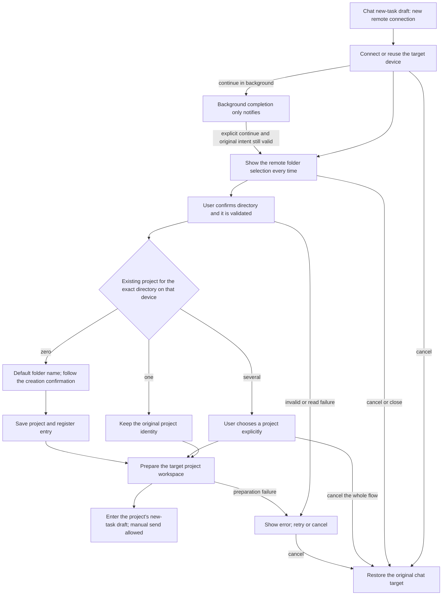

# 21: Choose a Remote Folder after a Chat Connection and Enter the Project

Status: done

**Parent:** [#15 — Separating project creation from remote connection management](15-project-device-selection-and-connection-management.md)

2026-10-14: implemented and integration-verified by #23-#26. The earlier contract "return to the original chat after a successful connection, offering only a create-project button" is superseded; the latest verification and actual platform scope are below, and old PASS records do not cover the new contract.

## Problem Statement

A user who clicks "新建远程连接…" (new remote connection…) in the chat-box project menu saw "选择项目" (select project) and "在此设备创建项目" (create project on this device) after a successful connection. After typing text, sending was still possible and ended up creating a local projectless chat. The user considers the just-connected device the execution target of what follows, and the UI did not make clear that the chat still belonged to local.

This path matched the old contract: a successful device add only returned the device identity, and the original chat target did not change. So the problem is that the product flow after connection completion does not match user intent; it cannot be described merely as falling back to local after a remote send failure. Remote projectless chat is retired; local projectless chat is still supported.

Folders and projects are not one-to-one: the same device and directory can belong to several projects. Selecting a folder cannot guess the project identity by path alone; registering only a project entry without entering the target project does not complete the user's remote-work intent either.

## Solution

After completing a remote connection from "新建远程连接…" in the chat box, every time open the "选择文件夹" (select folder) dialog of the target device. Use the existing directory browsing capability, including path input, jump, directory list and hidden-directory display. No project may be opened automatically by recent project, unique project or old draft project before the user confirms a folder.

Applies to a homepage draft without project, a new-task draft with a selected local project, and a new-task draft with a selected remote project. Existing session identities are not migrated; device addition in Settings and original-project reconnect keep their own completion rules.

After the user confirms a folder, the project is determined by the owning device and exact directory:

| Condition                                                             | Completion behavior                                                                                                                                                                   |
| --------------------------------------------------------------------- | ------------------------------------------------------------------------------------------------------------------------------------------------------------------------------------- |
| Exactly one existing, non-deleted project                             | Open the original project's new-task draft, keeping the project ID and history task ownership                                                                                         |
| Several existing, non-deleted projects                                | Show these projects, let the user choose one explicitly, then enter its new-task draft                                                                                                |
| No corresponding project                                              | Use the folder name as the default project name, create a remote single-directory project at that directory, follow the existing creation confirmation, then enter its new-task draft |
| Invalid directory, no permission, device disconnected or read failure | Show the actual reason and allow retry or cancel; create no substitute project and do not fall back to local                                                                          |

Sending is allowed only after folder selection, project determination, necessary creation and registration, and target workspace preparation are all complete. The send button and keyboard submit follow the same constraint; completing preparation does not send any message automatically.

Cancelling or closing the top-level selection flow means abandoning this switch to remote: restore the chat target before the connection and explicitly show the restored device/project state. The original draft is kept by its existing owner. A successfully established device connection is kept and other tasks are unaffected. No state "remote without a selected project but sendable" may remain, and no exit is offered to continue remote chat by skipping the project.



### Loading feedback of directory confirmation

After clicking "选择文件夹", reuse `ChatRemoteFolderSelection.busy` and show a spinner and "正在打开…" (English `Opening…`) inside the original confirm button. Directory contents and the chosen path stay; the button reserves space for both copies so switching state does not change the button width or dialog height, and no "加载中…" is appended below the directory picker any more. The running button keeps the primary button foreground color, and the spinner stops under reduced motion. A failure uses the original error area and the button becomes operable again. The parent layer keeps owning single-flight, directory validation, project preparation and stale-result isolation; the directory browser only receives display state. The multi-project selection stage keeps its existing loading feedback, and other directory selection entries do not enable this display parameter.

```text
select directory → confirm / busy=true → validate directory, match and prepare project → navigate on success or show error
                      └─ DirectoryBrowser confirm button: spinner + 正在打开…
```

Acceptance: during blocking project reads the directory and path remain visible, only the button shows the loading hint, and the confirm button cannot be submitted repeatedly; after failure the button copy recovers, and the error is visible and retryable. Layout is stable on desktop and narrow screens, in dark/light themes and Chinese/English.

2026-10-14 verification: the original test first reproduced "loading state is not inside the button", and after the fix the related UI regressions pass; final affected scope 503 files / 5,471 tests, with type, E2E type, lint (0 errors), architecture and changed-code format checks passing. The core scenario from macOS desktop to an independent Linux arm64 SSH container passes (`desktop-e2e-20261014-094915-820`); the adjacent create-project, multi-project selection and background connection scenarios pass (`desktop-e2e-20261014-095322-224`). Eight browser checks of the real directory component at 1200px/390px, Chinese/English, dark/light pass, including size stability and reduced motion; mobile shared-host, real phones and Windows/Linux desktop were not run this round. Candidates are not promoted automatically.

## User Stories

1. As a user starting a projectless draft, I want a remote folder picker after connecting, so that my next task runs in the environment I chose.
2. As a user with a local project draft, I want the same remote folder selection flow, so that the entry has a consistent meaning.
3. As a user with a remote project draft, I want to choose a folder on the newly connected device, so that the old project is not mistaken for my new target.
4. As a user reusing an online device through this chat entry, I want the folder picker, so that connection reuse does not bypass my choice.
5. As a user whose device has one project, I want to confirm a folder first, so that uniqueness does not replace my decision.
6. As a user whose device has several projects, I want no automatic recent-project selection, so that a previous task does not determine the new task's location.
7. As a user browsing remote folders, I want the device and current path to be clear, so that I can distinguish remote directories from local ones.
8. As a user who knows a path, I want the existing path input and jump action, so that I can reach it directly.
9. As a user working in hidden folders, I want the existing hidden-directory control, so that those folders remain selectable.
10. As a user selecting an existing project's folder, I want that project's identity reused, so that its history remains accessible.
11. As a user with multiple projects sharing a folder, I want to choose the actual project, so that their identities and tasks remain separate.
12. As a user selecting an unregistered folder, I want a project named after the folder, so that I can continue without a separate naming step.
13. As a user creating a project, I want the existing folder and recovery confirmations retained, so that this entry follows the same creation contract.
14. As a user repeating the same folder selection, I want the existing project reused, so that routine reconnection does not create duplicates.
15. As a user with identical paths on different devices, I want matching limited to the chosen device, so that the wrong project's history is never selected.
16. As a user whose project is still preparing, I want both button and keyboard submission blocked, so that my message cannot run in the old environment.
17. As a user whose project becomes ready, I want to send explicitly, so that readiness does not submit a message on my behalf.
18. As a user choosing an invalid or inaccessible folder, I want the actual error and a retry option, so that I can correct the choice.
19. As a user whose project list cannot be read, I want a loading error, so that a failed read does not create a duplicate project.
20. As a user whose device disconnects during selection or preparation, I want to remain in the unresolved remote flow, so that sending cannot silently switch to local execution.
21. As a user cancelling remote folder selection, I want the original chat target restored visibly, so that I know where a later message will run.
22. As a keyboard user, I want closing and Escape to respect the active dialog layer, so that one action does not accept a folder or submit chat unexpectedly.
23. As a user with another task on the same device, I want cancellation to preserve its connection, so that abandoning this flow does not interrupt that task.
24. As a user retrying after project registration fails, I want the already-created project reused, so that the retry does not create another project.
25. As a user who changes drafts or starts another connection, I want late results ignored, so that an old operation cannot replace my current target.
26. As a user continuing a connection in the background, I want completion to remain a notice, so that it does not interrupt my current page.
27. As a user explicitly resuming a completed background connection, I want the folder picker for that device, so that resumption follows the same selection requirement.
28. As a user managing devices in settings, I want that operation to remain independent of project selection, so that managing a connection does not start a task.
29. As a user working locally without a project, I want local projectless chat to remain available, so that this remote rule does not remove the local capability.
30. As a user of a supported platform, language, or theme, I want readable folder selection and error controls, so that I can complete the flow with the available device capabilities.

## Implementation Decisions

1. **Entry and completion intent.** The chat project menu still reuses the unified device add, authentication and install chain, but its completion intent becomes "after connecting, must choose a remote directory and enter the project". This replaces the wiring "device management success only, then show a create-project button" of this entry, and builds no separate connection wizard. Settings add, project-form add-device and original-project reconnect each keep their existing semantics.
2. **Vocabulary and identity.** A Source is an identified remote environment and account; a Connection Profile is the way to reach a Source; a project is determined by its owning Host and project ID; a directory is a project root, not the project identity. A successful connection only proves the device is usable, not that a project is selected.
3. **Directory source.** Browsing, path validation and directory equality use the target Host's service and existing path rules, never the local file system or the local OS path normalization to judge a remote. Matching is an exact match on the same device and the same fixed root; no guessing by name, path prefix, parent directory or a same-named path on another device.
4. **Project resolution after confirmation.** Only after the user confirms the directory is the authoritative project result read/checked and the one / several / zero dispatch run. A unique match reuses the real project ID; several matches continue with user selection; a failed list read is not zero. A deleted project is not opened automatically as an existing match; creating at a deleted project follows the existing restore-or-create rule, never silently restoring.
5. **Creation scope.** On zero matches this flow fills in the default folder name and a single fixed root, reusing the shared creation, directory confirmation, save and local entry registration, and does not ask the user to re-enter the same directory. The by-directory resolution of this entry does not turn the generic project save into a global get-or-create and adds no "one project per directory" constraint. Other entries that explicitly create another project at the same directory keep the original contract.
6. **Existing creation boundary.** Creating/restoring still goes through the existing directory trust confirmation; folder selection does not replace it. When an old remote supports only reading, existing projects are selectable and this entry cannot bypass the create capability limit. A save failure keeps the error; when the remote save succeeded but the local registration failed, keep the returned project ID and retry registration rather than creating again. The layered cancel and permission semantics of the existing creation confirmation stay valid.
7. **Complete delivery.** After selecting or creating, the actual Host, project ID and directory must be handed to the existing project selection and workspace preparation chain to enter the project's new-task draft; only refreshing the list or registering the entry is not enough. History tasks of an existing project are kept; no old session is restored automatically and no identity migrated.
8. **Send constraint.** While the current foreground switch intent is unfinished or not cancelled, the initiating draft cannot send to the old target through the button, Enter or any other existing submit entry. Only after the target project, attachment and runtime preparation succeed do the normal send conditions apply. Background does not impose a global send ban on unrelated chats; message and queue rules of existing tasks are unchanged. The send restriction must not be lifted by delay.
9. **Cancel and submit boundary.** Cancel, close and the corresponding layer's Escape of the top-level folder/project selection cancel this switch, restore the still-valid original chat target and focus, and show its device/project ownership. "稍后选择" (choose later) must not become a sendable remote projectless exit. Nested dropdown, restore or directory trust confirmation layers handle things by their own layer semantics first, and the unfinished whole flow still cannot send. An already-saved project is not deleted automatically by closing; cancelling before saving creates no project.
10. **Resource ownership.** Release only the temporary attachment exclusive to this attempt; cancel deletes no device record, disconnects no connected Source, and releases no session shared by other projects. Repeated confirm, repeated continue and registration retry must not add duplicate projects or entries, following the existing in-flight result and idempotency boundaries, with no new global distributed directory uniqueness promised.
11. **Async and single owner.** The connection flow holds the initiator, target device, request identity and completion intent; the existing draft owner holds the body and attachments. Every async result re-validates the current request, Source/Host membership, chosen directory and project before navigating or writing. Switching drafts, replacing the request, member removal, cancel or unmount invalidates old results; no copy of the draft, no separate connection state cache and no timeouts to sync state.
12. **Background continuation.** Follow the existing background notice and explicit-continue contract. Background success does not pop a directory window and does not change the current project; only an explicit continue with a still-valid original intent enters folder selection. Expired and repeated continues must not steal navigation or submit twice. An old connection result cannot revive a flow the user abandoned.
13. **Scope and compatibility.** SSH/WSL/Docker use the same completion rule and respect existing platform capabilities. The dev-only Server direct connection is not extended. Shared UI follows the design system, internationalization, dark/light themes and keyboard rules; Web/mobile keep the shell capability gating and the existing Host and desktop-continuous / web-remote-replayable boundaries.
14. **Storage and protocol.** Reuse the project service, directory browsing, remote entry and workspace identity contracts; this requirement needs no new database migration, identity format, task protocol, draft persistence model or second message owner. Cross-device migration of drafts and attachments keeps existing behavior; migration and conflict merging are not implemented this round.

## Testing Decisions

Directory matching is compatible with historical path spellings kept by old remotes: the old-remote adapter derives a read-only `directoryMatchPath` by the remote platform, using the same normalize rules as `readDirectory`. It takes part only in single-directory matching, writes no database or entry cache, and does not change the original roots, synthetic project ID, task ownership or the cwd of prepareSession. Several historical identities normalizing to the same directory still require an explicit project choice; no realpath or symlink equivalence rule is added.

An explicit continue after background completion must restore foreground visibility synchronously before querying the Source or membership, and the original chat owner immediately restores the submit gate. Cancel before completion, re-collapse or original-intent invalidation use the existing cleanup rules, with no second send state.

```text
background send-block released → explicit continue → foreground visibility notice / original draft send-blocked → Source/member check → choose directory
historical root → owning Host's normalized match value → directory match; original ID/root/task cwd kept
```

The main seam is the existing real Desktop chat-entry E2E: start the connection from the visible project menu, complete directory selection, project entry and first send, and check the actual task ownership and execution directory. Reuse the testing capabilities of the chat device round-trip candidate, the add-existing-remote-project candidate, the background connection candidate and the project creation directory confirmation. Existing UI/service ports supplement only late results, invalid identities and registration failures that are hard to control stably; no product API is added for tests.

Good tests assert the user-visible target, the actual Host/project/task identity, directory, send result and persisted counts, and do not treat local state, callback counts or "passed through that page" as correct behavior. Draft warm-up may already have a runtime, so "no local runtime started" cannot replace "this message was not submitted locally". Before the fix, first prove that the original projectless path sends wrongly to local, then make the corresponding E2E pass.

The confirmed acceptance contract follows. Implementation and test mapping are in #23-#26, the case catalog and the coverage matrix; a pass conclusion applies only to the recorded test seam and actual environment and does not mean all platforms were actually run:

| ID        | Setup → Action                                                                              | Must assert                                                                                                                                  |
| --------- | ------------------------------------------------------------------------------------------- | -------------------------------------------------------------------------------------------------------------------------------------------- |
| RDUX21-01 | Local projectless draft; really connect a remote from the chat menu                         | The target device's folder selection shows automatically; before confirming, neither the button nor Enter can submit to local                |
| RDUX21-02 | The remote has only one project, or recent projects; connect separately                     | The folder selection still shows every time, and no project opens automatically                                                              |
| RDUX21-03 | Reuse an online device, including repeated connects from the same chat entry                | An explicit directory choice is still required; device identity and list are correct                                                         |
| RDUX21-04 | Enter this flow from a local project draft and a remote project draft                       | Same as projectless draft; the original project is not the new device's default target, old task identity not migrated                       |
| RDUX21-05 | The directory uniquely matches one existing project; confirm and enter                      | Uses the original project ID, Host, root; history tasks kept; the first message really goes to the target remote                             |
| RDUX21-06 | Same device and directory correspond to two existing projects                               | Explicit project choice again; no send before choosing; after choosing history is not merged and no duplicate project added                  |
| RDUX21-07 | The directory has no existing project; complete the existing creation confirmation          | Default folder name, a unique fixed root; after save/registration enter the new project draft; first send ownership correct                  |
| RDUX21-08 | Connect again and confirm the same directory used before                                    | Reuses the existing project; repeated confirm clicks add no duplicate project or entry                                                       |
| RDUX21-09 | Two devices have the same path; also a same-name-prefix or parent-directory project         | Match only by target device and exact directory; no project of another device or a parent directory is chosen                                |
| RDUX21-10 | Invalid path, non-directory, no permission; directory becomes invalid during confirmation   | Shows the actual reason, retry/cancel; no substitute directory, project or local message                                                     |
| RDUX21-11 | Project list read fails; then a successful retry                                            | A failure is not treated as zero-project creation; retry continues the original device/directory                                             |
| RDUX21-12 | Disconnect/failure during directory selection, project selection or workspace preparation   | Cannot send, no switch back to local; no auto-send after recovery                                                                            |
| RDUX21-13 | Cancel, close and Escape on the folder selection                                            | Restores original target, original draft and sensible focus, with a clear target marker; no remote projectless chat left                     |
| RDUX21-14 | Cancel multi-project selection; press Escape in nested selection/trust confirmation         | The top layer cancels the whole switch; a nested layer closes only the current layer, no wrong submit, no several layers at once             |
| RDUX21-15 | Cancel before or during connecting; the device has another running task                     | No uncommitted project added; original chat recoverable; existing connection record and shared task unaffected                               |
| RDUX21-16 | Release old results after cancel, draft change, device change or membership invalidation    | Old connection/directory/save/preparation results do not navigate or overwrite the new target; shared resources not wrongly released         |
| RDUX21-17 | Remote save succeeds, local entry registration fails, then retry                            | Keeps the real project ID; only registration is retried, no duplicate creation; cannot send before completion                                |
| RDUX21-18 | After background completion the user is still in another chat; then continue explicitly     | Completion does not pop a window or steal focus; a valid continue enters directory selection; expired/repeated continues have no side effect |
| RDUX21-19 | Original target is local projectless, local project, remote project; cancel the switch      | Shows and restores the original target, keeps the existing draft; local projectless can still send normally after an explicit cancel         |
| RDUX21-20 | Settings device add, original project reconnect, continuing an existing session             | Keep the original completion rules; original-project reconnect does not require choosing a directory again because of this entry             |
| RDUX21-21 | No existing project but a deleted project exists; old remote with read-only capability only | Follow the restore/create confirmation; no silent restore; a read-only remote cannot bypass the create restriction                           |
| RDUX21-22 | Chinese/English, dark/light, long paths, narrow window and keyboard operation               | Device/directory/error readable, confirm and cancel reachable, sensible focus; Enter does not leak to chat send                              |
| RDUX21-23 | SSH/WSL/Docker and the corresponding operating-system capabilities                          | Supported platforms follow the same directory completion rule; evidence recorded per actual environment                                      |
| RDUX21-24 | Ordinary Web/mobile shared UI and existing remote projects                                  | Capability gating works; no browser local directory, extra Host/session or replayable regression introduced                                  |

- This round's test scope directly takes over the confirmed directory selection, project matching, cancel return, send restriction and async protection, without re-interviewing or extending to draft migration. A successful cross-device switch isolates this scope with an empty draft; the original draft content is used only for cancel/failure retention regressions.
- At implementation add E2E and necessary existing-port tests first, then change the code; sync the case catalog, coverage matrix and related old assertions. Themes/languages use representative combinations, not a full Cartesian product with all failure types.
- Complete typecheck, lint, the architecture gate, affected unit tests, the corresponding Desktop E2E and applicable shared UI/mobile regression. Record the real connection types and OS scope; a narrow desktop window cannot replace phone evidence.
- Candidates keep going through the existing pending, manual review and promotion flow; this spec, implementation completion and a successful run do not authorize formal/CI admission.

## Out of Scope

- Auto-opening the unique project, recent project, default project or original draft project before the user confirms a folder.
- Remote projectless chat, remote multi-directory projects, migrating existing sessions, merging multiple project identities by directory.
- Cross-device migration of draft text and attachments, re-staging attachments, target-draft conflict handling or content merging; existing behavior stays.
- Rewriting the generic rules of Settings device management, the project creation entry and original-project recovery; only this chat entry adopts the match/create rule after directory confirmation.
- New connection transport, authentication, install, reconnect state machine, independent mobile connection, identity/database/task protocol migration, global directory uniqueness or a new persistent trust mechanism.
- Auto-send, background auto page jump, expanding Web/mobile device management, or recording unrun platforms as passing.

## Further Notes

- The decision order of this round has converged: first cancel "auto-open project after connecting"; explicitly select a folder every time; after directory confirmation apply the unique / several / zero rule; top-level cancel revokes this remote open and returns to the original target; draft migration is deferred. The abandoned discussion option "keep a remote pending-selection state after cancel" is no longer used.
- This file is a local Issue and the complete spec; the chat branch of the parent spec follows this file. #23-#26 are done, and the old success button and old E2E assertions are updated; the completion scope follows this round's evidence.
- Domain and identity continue to follow the [R3 main spec](../../architecture/r3-source-server-remote-architecture.md), [runtime boundaries](../../agents/runtime-boundaries.md) and the [virtual project spec](../../superpowers/specs/2026-09-09-virtual-project-design.md). Multiple projects at the same directory is a supported state, not duplicate data to clean up.
- Reuse [#17 typed device addition](17-typed-remote-device-addition.md), [#19 add existing remote project](19-add-existing-remote-project.md) and [#22 background connection and explicit continue](22-background-connection-and-explicit-resume.md); creating/restoring follows the [project directory confirmation](../../specs/project-creation-folder-confirmation.md), and choosing a directory is not treated as automatic trust.
- Visuals follow the [design guidelines](../../../DESIGN.md). The acceptance IDs are registered in the [case catalog](../../conversation-session-case-catalog.md) and [coverage matrix](../../testing/conversation-session-e2e-coverage-matrix.md); case implementation follows the [E2E workflow](../../testing/conversation-session-e2e-development-workflow.md).

### Implementation and verification: 2026-10-14

Review-fix re-verification:

- A background explicit continue restores the foreground notice and the send block before the Source/membership query. The Desktop RED of the original implementation was `desktop-e2e-20261014080117758-p36079-9dfb8d5ab50a47fa`: the send button was still usable after the Source query was held. The final background candidate `desktop-e2e-20261014081704935-p58111-926b13e33297f1e3` passes 1/1, covering targeted composer Enter/form send blocking, remote first send, cancel restore and SSH/Docker; waiting-stage screenshots were reviewed.
- The old-remote adapter derives the directory match value by the remote platform and keeps the original ID, root, task cwd and read-only restriction. Real adapter/UI regressions cover POSIX, Windows, unique and several equivalent historical identities; both regressions on the old UI copy were RED. The chat directory candidate passes in `desktop-e2e-20261014081447158-p54737-f7abcbb92e9dd5c6`, adding old-remote projection RPC replay and checking two original project IDs; the project selection screenshots were reviewed. This is not a run of an old Server binary.
- `pnpm test:unit:affected --base c81f9736d7ccb83dc77203a43d7b2582b9bbecdd` selected 312/2623 files. The first round passed 311 files; the old Host test lacked the system-info port needed for the new path projection, and after adding it that file passes 18/18. In total 4095 tests pass with 1 pre-existing skip; the full UT was not run. The final flow file passes 104/104.
- Root type check, E2E type check, lint (209 pre-existing warnings, 0 errors), the architecture gate (0 violations), the fixture checks of the two candidates, code format and diff checks pass. The member-read fault marker in the fixture is still a pre-existing non-provider warning.
- The mobile Web project directory passes 4 groups at 390px × Chinese/English × dark/light themes, with evidence in `.tmp/chat-review-fix-mobile`; dark/light screenshots reviewed. The real-environment scope is macOS Desktop and an exclusive Linux arm64 SSH/Docker fixture; Windows/Linux Desktop, WSL, old remote binaries and real phones were not run. The candidate stays pending.
- E2E also corrected two observation conditions: after continue the connection dialog focuses "收起" (collapse), a global Enter legitimately releases the gate, so the keyboard assertion targets the original composer; on return it waits for the original Dialog's exit animation, and the project-menu action moves the identity popover out first; neither adds a product timeout or sync logic.

- [#23](23-chat-remote-folder-existing-project.md), [#24](24-chat-remote-folder-project-choice.md), [#25](25-chat-remote-folder-create-project.md), [#26](26-chat-remote-folder-background-resume.md) are all `done`, integrated in `feat/chat-remote-folder-integration`. Every time a directory is chosen explicitly, and the unique / several / zero matches share project entry, send restriction and cancel rules; the original draft is still kept by the existing owner.
- Dual-axis review findings were fixed and re-checked: the module contract drops the old completion semantics; a membership read failure follows the original connection error / retry / cancel flow with the foreground send block kept; cancel while waiting accepts no late result, and a late failure after re-collapse does not reopen the dialog. Neither the Standards nor the Spec axis has a remaining finding.
- Root/E2E type check, lint, architecture, affected unit tests and fixture checks pass. The final integration tree, from the task start with `pnpm test:unit:affected --base 833e6dcb4b`: 615 files, 6966 tests pass with 1 pre-existing skip. Lint keeps 209 pre-existing warnings, architecture 0 violations; the full unit suite was not run.
- Real SSH on desktop passes for unique project, multiple projects and create-first-send respectively; the background candidate also includes a real Docker connection. The fault-directory and background candidates after the review fixes pass 2/2: `desktop-e2e-20261014062429307-p3874-62dc81c125bcbc6d`. The run evidence checks actual Host/project/task/cwd/identity, and during failure the button, Enter and form do not submit to the old local target.
- The integrated Web project directory and mobile shared-host candidate pass 2/2: `desktop-e2e-20261014060018735-p87993-7a832ba2b1b8d036`. Using this repo's Web page, an independent Chrome mobile viewport/touch context and a local relay fixture, it verifies the remote project, device management capability gating, directory/trust confirmation, return to local and the existing Host/tab boundary; dark/light screenshots checked. This is browser mobile emulation and must not be recorded as real-phone verification.
- Real-run scope: macOS Desktop, a Linux arm64 SSH target and the background Docker branch. Windows/Linux Desktop, WSL, real phones and old remote binaries were not run; old-remote read-only and Windows remote path rules are covered by service/UI contract tests, and the Docker create and multi-match branches were not run separately. All candidates are still `manual-review/pending`, not promoted or granted CI admission.

### Historical implementation and verification: 2026-10-12, old contract

The earlier completion record (device add returning to the original chat with an explicit continue-to-create) proved only the old implementation and cannot replace the independent run evidence of the 2026-10-14 mandatory-folder contract; it is omitted here (see `git show 45f808f7:docs/issues/remote-connection-ux/21-chat-settings-round-trip.md`).
