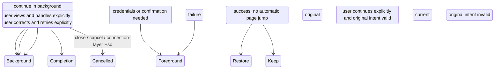

# 22: Background Connection and Explicit Resume

Status: done

2026-10-14: this ticket keeps the completed background lifecycle contract. For a chat origin, the target after an explicit continue follows the [pending revision of #21](21-chat-settings-round-trip.md): show the remote folder selection and enter after the project is determined; this ticket's old evidence does not cover that new target flow. The rules that background completion does not steal navigation, request invalidation and shared connection protection stay valid.

**Parent:** [#15 — Separating project creation from remote connection management](15-project-device-selection-and-connection-management.md)

**What to build:** When connecting a device the user can choose "在后台继续" (continue in background) and see progress, errors and pending items of the same operation on the Settings device card or the unfinished-connection item. Success only notifies completion and offers a continue entry, without taking over the current page; when the user continues explicitly, the project, existing-project list or chat follow-up is restored per the still-valid original intent.

**Blocked by:**

- [#19 — Add an existing remote project](19-add-existing-remote-project.md): background recovery must keep the intent of continuing the existing-project list and must not return to new-project creation by mistake.
- [#20 — Create-project round trip through Settings with draft recovery](20-project-draft-settings-round-trip.md): provides the project draft return and device-switch confirmation.
- [#21 — Choose a remote folder after a chat connection and enter the project](21-chat-settings-round-trip.md): provides the chat origin's completion target; this ticket's original completion record corresponds to its old version, and the new target must be verified separately.

**Spec coverage:** Q12, and the background continuation of Q9/Q10/Q11; RDUX15-19, RDUX15-20, and re-verification of the background branches of RDUX15-13/14/15/18/21. RDUX15-23/24/25 cover progress takeover, explicit recovery and the multi-end boundary.

## Acceptance criteria

- [x] "在后台继续" only collapses the interaction; it does not cancel the request or clear configuration and origin intent; an identified device is taken over by its Settings device card, and a not-yet-identified connection by the unfinished-connection item, without faking a device identity.
- [x] The dialog, device card and unfinished-connection item show the real progress, errors and needs-action state of the same operation. After the device is identified or reused it is filed under the right device, with no repeated connection or duplicated log/state owner.
- [x] After the user leaves Settings manually, background success does not open the directory page, project form or original chat and does not change the current task's device; it only notifies completion and offers an explicit continue entry suitable for that origin.
- [x] When the original intent is still valid, an explicit continue restores directory selection, the existing-project list, the original project draft, or the chat origin's follow-up; when the project already has directories the original switch confirmation is still needed, #20's protection is not bypassed, and no project or task is created automatically.
- [x] When an existing background flow occupies the connection entry, reopening from Settings "新建连接" or another device's ordinary connect button restores the same flow. While the connection is in flight the background mark is lifted and later results complete in the foreground; when the connection has completed, the original completion action is consumed once, without stopping on an empty connection progress page and without redialing. Close, cancel and expired recovery still follow the original request ownership.
- [x] A background connection started directly from Settings can return to the corresponding device management state without being taken into project creation; closing the notice or UI after background completion does not disconnect the device.
- [x] Background failure and credential/confirmation-needed states stay accessible, and the user can view details, correct, retry or cancel; no failure window is forced open and a real failure is not rewritten as a user cancel.
- [x] Closing or cancelling the unfinished connection keeps the original request-invalidation semantics; continue-in-background is clearly different from cancel. Cancel deletes no saved record, does not affect connections shared by other projects, and temporary resources are cleaned only by this attempt's ownership.
- [x] When the original project/chat draft is abandoned, the original entry invalidated, or the request cancelled or replaced, late results do not revive the old UI and old continue actions do not overwrite a new draft or steal navigation. Viewing or clicking continue repeatedly does not repeat connecting, saving a project or committing the completion result.
- [x] The timing from foreground to background, device identification, pending recovery and success notice is driven by existing requests and completion events, with no timers, separate polling or cross-restart draft store to patch state sync.
- [x] The progress item, errors, pending state and continue action are reachable under keyboard, Chinese/English, current dark/light themes and narrow windows; the notice does not rely on color, focus after recovery is sensible, and long device names and errors do not cover the primary action.
- [x] Desktop and mobile keep the original Host and continuous/replayable boundary; a background connection creates no independent session for mobile and shared UI display does not expand Web/mobile management capability.
- [x] Tests for the complete background path and invalidation timing were added before implementation, with explicit recovery acceptance per origin; after replacing the old sidebar collapsed-progress entry, no double card, duplicate recovery entry or unconsumed old wiring remains.

## Verification

- Start connections from Settings, project creation, chat and the existing-project selection path and move them to the background; after the user leaves Settings, let the operation succeed, fail or need action, asserting the current page and input stay unchanged and the state has an accessible takeover place.
- Continue explicitly for a valid origin, checking the restore target, original draft and device-switch confirmation; for an invalidated origin and repeated continue operations assert no old navigation, project addition or repeated connection side effects.
- Control cancel-then-success, late credentials, late install confirmation and origin invalidation at existing UI/service ports, and reuse the real SSH/WSL/Docker chain to verify actual progress and install waiting; record the real execution scope per type and operating system.
- Implementation passes typecheck, lint, the architecture gate, affected unit tests, the corresponding Desktop E2E, applicable Web/mobile regression and visual/keyboard checks. New E2E keep evidence by the original candidate review flow; this ticket's completion is not equal to formal/CI admission.

## Scope and handoff

- This ticket is the complete delivery of background behavior, not a unified test-supplement ticket for the earlier ones. The foreground cancel, credential isolation, late-result protection, themes and applicable platform regressions of #16-#21 must be completed at their own acceptance.
- Only the background continue and recovery of the origins accepted this round are integrated; the physical connection state machine, remote task running, message recovery protocol and all visuals of the device card are not redone.
- The completion record lists only evidence this ticket actually implemented and ran; the parent ticket #15 is not closed or modified automatically, and old PASS of earlier tickets is not used as verification of the new background path.

## Completion record (2026-10-12)

### Implemented

- Project directory, existing-project list, project add-device, chat add-device and Settings share the Root's connection flow. `ProjectConnection` and the old sidebar slot with no production calls are deleted; static `dep:refs` is 0, and the old temporary-attachment tests moved into the unified flow.
- Background keeps only the original request and a one-shot completion action. Device-management success releases the exclusive attachment of this attempt at once; other origins keep the sessions they need. An explicit continue is validated by entryEpoch and the live Source state; cancel, replace, origin invalidation or repeated continue deliver no old result, and a session reused by another project is not released.
- The Settings card and the unfinished-connection item read the same credential-free UI projection. The publish and subscribe Contexts are separated so the projection write-back does not trigger its own render; no connection owner, log cache or timed polling is added. The success notice offers continue and close, and closing the notice does not disconnect the device.
- Background cancel does not activate the original tab; the project portal stays hidden until the user returns to the original tab, and a chat cancel does not steal focus. After the async continue completes, the Root entry gate is released so later adds are not blocked by the old request.

### Actual verification and evidence

Results (evidence directories under `packages/desktop/.e2e-artifacts/`):

- macOS native background candidate 1/1 PASS (`desktop-e2e-20261012113752972-p61904-ed5d187f22de48de`): five entries/follow-up branches (Settings, project add, offline directory, existing-project list, chat); real SSH success/authentication failure and Docker install pending/success; no navigation stealing, explicit continue, project/task identity and draft kept, no revival after cancel; Chinese/English/both themes/480px, wide-window notice and device card.
- Foreground #20/#21/#19 regression, 1/1 PASS each (`desktop-e2e-20261012113931623-p66484-a0568e0c04891939`): directory-switch confirmation of the original project draft, chat text attachment/project and focus, existing-project identity / old list cancel. The fourth item of that batch (original-project handoff) was blocked by a fake-OAuth precondition and is not recorded as PASS.
- Original-project handoff targeted re-run 1/1 PASS (`desktop-e2e-20261012114148131-p72672-335281107679ef8c`): after the Personal-only startup precondition fix, default route, backup failure and removing the entry during bind commit no old navigation.
- UI/flow timing and component tests: background failure / missing credentials / install / update waiting, late confirmation and results, Source disconnect, repeated continue, shared-session release, publish loop-back and async gate, origin invalidation; affected scope 669 files / 6488 tests PASS; startup-precondition targeted tests 30 PASS.

- Final `pnpm typecheck`, `pnpm lint` (0 errors; 208 pre-existing warnings), default `pnpm architecture:check --changed`, the fixture checker, format and diff checks pass. Affected-test baseline `9c94409bca387d129516500cb9b60ee18c2b948f`. Failures of earlier trial runs and old-ticket PASS are not counted as this ticket's new-path results.
- Success and regression evidence were copied to the above directories in the integration worktree. 10 source trees were checked before remote asset reuse; the UI was rebuilt from this source. Candidates stay `manual-review/pending`, not promoted or added to CI.
- TODO (explicitly deferred by the user): real WSL, real phone/relay. Windows/Linux native UI was not run on this machine; the multi-end Host/continuous/replayable boundary is regressed by existing protocol and affected unit tests and must not be taken as real-device PASS on those platforms.
- The parent #15 status was not modified; local commit only, no push, no MR.

Review-fix re-verification (2026-10-12): the background candidate passes 1/1 on macOS native Desktop + an independent Linux SSH/Docker container, additionally verifying that the ordinary Settings entry restores the same operation while connecting and after completion, with the completion result consumed once; evidence `packages/desktop/.e2e-artifacts/r3-server-review-20261012-background/`. The old three-screen candidate was migrated to the in-Settings progress card plus explicit cancel then new, 1/1 PASS, evidence `r3-server-review-20261012-threescreen-r4/`; the real run also found that the generic disconnect helper returned to the sidebar while the old assertion still waited for the Settings card, and it now operates on the Source card and verifies the offline state, without changing a product timeout.

The remote full-regression list now includes the five candidates of this round, still pending and not formal/CI admission. The list regression went red then green, 12/12 PASS. The final Desktop was built from the current source; the sourcemaps of five key UIs match the source verbatim; ten remote source trees and the descriptor SHA/size of the Linux archive were checked. The build credential is in `packages/desktop/.e2e-artifacts/r3-server/review-final-build-source-verification.json`. Early runner argument validation failures, an Electron session start timeout under heavy load and a migration omission failure are kept separately and not counted as PASS.

In this round's first affected-test run only the list case exceeded the original 30-second limit under the load of parallel builds / type checks, while the other 408 files / 4688 tests passed; after the load ended the original command re-ran serially and targeted 12/12 pass, with no code or timeout changed. Root type check, lint, the architecture gate and the final Desktop E2E type check pass; the four E2E fixtures and all changed-code formatting pass, and the new authentication fixture passes 2/2. Final code lint has 0 errors and keeps the pre-existing max-lines warning of the connection flow.
