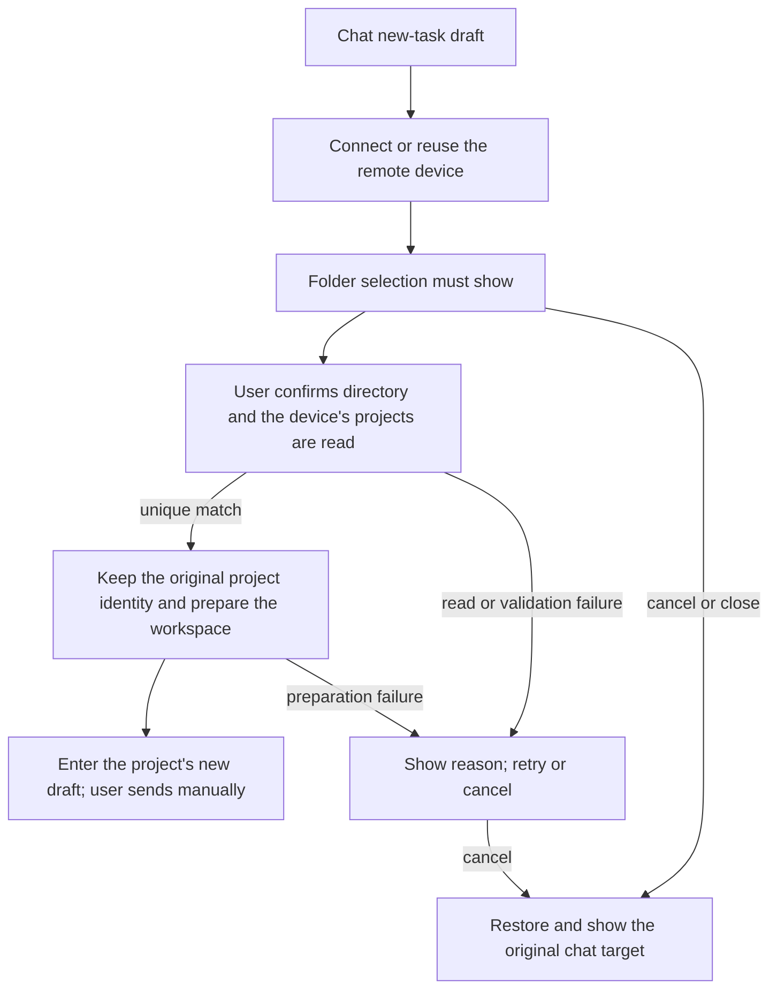

# 23: Choose a Folder and Enter the Uniquely Matching Existing Project

Status: done

**Parent:** [#21 — Choose a remote folder after a chat connection and enter the project](21-chat-settings-round-trip.md)

**What to build:** After a user connects a remote device from a chat new-task draft, every time they choose a folder on the target device. When the confirmed directory belongs to exactly one existing project, enter that project's new-task draft and send the first message remotely. Before selection and preparation are done, nothing can be sent to the original target; cancelling the whole switch restores and explicitly shows the original chat target.

**Blocked by:** None (can start immediately).

**Spec coverage:** RDUX21-01-05, RDUX21-08-13, RDUX21-15-16, RDUX21-19-20; the folder and nested layers of RDUX21-14, and the existing-project read-only compatibility of RDUX21-21. RDUX21-22-24 are verified along this ticket's path.



## Acceptance criteria

- [x] A homepage projectless draft, an existing local project draft and an existing remote project draft all enter the same flow from the real chat project menu; the old "return to the original chat, only show create project on this device" is no longer the success endpoint.
- [x] After every successful connection or reuse of an online device, folder selection shows; it does not open automatically even when the device has only one project, has recent projects, or the original draft already has a project. Path input, jump, directory browsing and hidden-directory controls reuse existing capabilities, and the target device and path are clearly visible.
- [x] After the directory is confirmed, existing, non-deleted projects are matched by the actual Source/Host and the exact fixed root; the local file system, display name, parent directory, path prefix or a same-named path on another device does not replace the remote judgment.
- [x] On a unique match keep the real project ID, root and history task ownership, complete the necessary entry registration and target workspace preparation, and enter that project's new-task draft; refreshing the list alone is not enough and no history session is opened automatically.
- [x] While this foreground switch is unfinished or not cancelled, the initiating draft's send button, Enter and other existing submit entries cannot submit a message to the old target. Completing preparation only restores normal send ability and does not submit automatically; the first manual send's actual Host, project and execution directory are all the selected remote.
- [x] Invalid path, non-directory, no permission, project read failure, directory invalid after confirmation and disconnect during preparation all show the actual reason and allow retry or cancel; failure is not a zero match, creates no substitute project, and does not send locally.
- [x] Cancel, close and Escape of the top-level folder selection revoke this remote switch, restore the still-valid original target, original draft and sensible focus, and show the target clearly. A nested dropdown closes only the current layer first; "稍后选择" must not leave a sendable remote projectless state.
- [x] Cancel before / during connecting returns correctly whether the original target is local projectless / local project / remote project. After an explicit cancel, local projectless chat stays usable.
- [x] Only the temporary attachment exclusive to this attempt is released; established device connections, device records and sessions shared by other projects are kept. Repeated confirm or repeated registration adds no duplicate entry.
- [x] After switching drafts, replacing the connection request, cancel, member removal or unmount, late connection, directory, project read and workspace preparation results cannot reopen the old UI, overwrite the new target or release shared resources; request identity and owner are followed, with no timeout synchronization.
- [x] Settings device add, original-project reconnect and continuing an existing task keep their original completion rules; a read-only old remote can keep using existing projects. Ordinary Web/mobile show no entries beyond the shell capability, and the existing Host and continuous/replayable boundary is unchanged.
- [x] E2E from the real menu were added first, proving that the original projectless path wrongly submits to local, before implementing the fix; tests check the actual first-message ownership, project count and history identity, not only button style or local callbacks.
- [x] This ticket completed the Chinese/English, dark/light theme, long path, narrow window and keyboard verification; SSH/WSL/Docker and operating systems are recorded by actual support and execution scope, and a narrow desktop window does not replace phone evidence.

## Verification

- The main seam reuses the existing chat device round-trip Desktop E2E with real remote connections and project data; a successful switch uses an empty draft, and cancel / failure use an original draft with content to verify retention.
- Reuse existing remote project scenarios to verify repeated opening, same path on different devices, same-name prefix and parent directory not matched wrongly. Existing UI/service ports control late results and preparation failures; no test-only product API is added.
- Draft warm-up may already have created a runtime, so the assertion should be "this message was not submitted to the original local target", not "no local runtime was started".
- Complete typecheck, lint, the architecture gate, affected unit tests, this ticket's Desktop E2E and the applicable shared UI regression, updating scenarios and coverage evidence. Candidates keep the existing review flow; missing environments are recorded truthfully and the parent ticket's old PASS is not reused.

## Scope and handoff

- If the completion-result handoff needs tidying, first make the existing intent deliver the actual device, directory and project result inside this ticket, then connect the complete user path; no second draft, connection owner, database migration or broad framework is added.
- [#24](24-chat-remote-folder-project-choice.md), [#25](25-chat-remote-folder-create-project.md) and [#26](26-chat-remote-folder-background-resume.md) take over the multi-match, zero-match and background-continue cases respectively. What is handed to them is the same directory confirmation result, valid request ownership, send constraint, cancel and project entry capability; no second connection/send chain is duplicated.
- Multi-match and zero-match are not features completed by this ticket; during the handoff they must stay unsendable and re-selectable or cancellable, with no automatic picking or temporary project creation to fill in for later tickets. The parent spec completes only when all four tickets are done.
- Cross-device migration of drafts/attachments and conflict handling keep existing behavior and are not implemented here. The parent Issue is neither modified nor closed; this ticket only records its own implementation and verification status.

## Implementation convention

The chat menu holds this switch intent and the directory selection; Root keeps holding connection and workspace preparation. The Composer receives only the menu's submit-block projection and copies no draft. `CreateTaskOptions` gains a renderer-internal validity and failure-return seam: Root re-validates the initiating intent before preparing and navigating, and errors returned to the directory flow remain retryable. Device membership is validated through membership; project matching reads the target Host's authoritative list with the exact path of the fixed root and does not call local path rules.

```text
chat intent → connect → directory confirmation → authoritative project match → register entry → Root prepares → new project draft
   │                  │              │               │
   └─cancel/change draft┴─old results invalid┴─cannot navigate┘
```

### #23 implementation and verification (2026-10-14)

- Candidate `manual-review/pending/conversation-session-chat-remote-folder.test.ts`: real chat menu, SSH connection and online reuse, projectless / remote project draft cancel, mandatory directory, button / Enter / form submit blocking, invalid long-path error, unique-project first send, choosing a directory again keeps project and history task identity, no duplicate entry registration.
- Updated `manual-review/pending/conversation-session-chat-device-return.test.ts`: connection failure retry from a local project draft, cancel before and after connecting, body / attachment / original task ownership, and the directory dialog and focus at Chinese/English × dark/light × 1440/480px.
- Real RED `desktop-e2e-20261014044755117-p28723-fd57f544f073042f`: `old-local-submission.json` proves the old flow submitted the message to the local projectless task after connecting. GREEN `desktop-e2e-20261014050039448-p42395-acef074fec4b900a`: both candidates pass 2/2; the Host / project / task / cwd / identity of the remote first send are in `remote-first-submission.json`; representative screenshots reviewed.
- UI/service port regressions cover different Hosts, parent directory, prefix and deleted projects not matched wrongly; list errors and preparation failures do not lift the gate; late results after cancel, and old request invalidation between the Store commit and React render; before attachment binding, membership and project are re-validated, and failure releases only exclusive resources. Read-only directory browsing of an old remote keeps going through the remote file service, and Windows path rules are decided by the remote platform.
- Real-device scope: macOS client → real SSH to Linux arm64. Docker in this round served as an exclusive SSH fixture and does not count as Docker transport acceptance; WSL / Windows / Linux clients and physical phones were not run. The shared Web/mobile shell capability gating keeps UI regression, and the integrated shared mobile regression is recorded by the parent task.
- Multi-project selection, zero-project creation / restore and background explicit continue are taken over by #24 / #25 / #26. Candidates stay pending; no manual review, formal or CI admission is claimed.

- Required code checks: `pnpm typecheck`, `pnpm lint` (209 pre-existing warnings, 0 errors), `pnpm architecture:check --changed` (0 violations), candidate fixture check, diff and format self-check pass. Affected scope 607/2615 files: 606 files passed first; the new assertion on the gap between commit and render failed in an in-flight test where the old component was already loaded, and after the fix only that file was re-run, 16/16 pass. Combined result 6841 tests pass with 1 pre-existing skip; the full suite was not widened.
