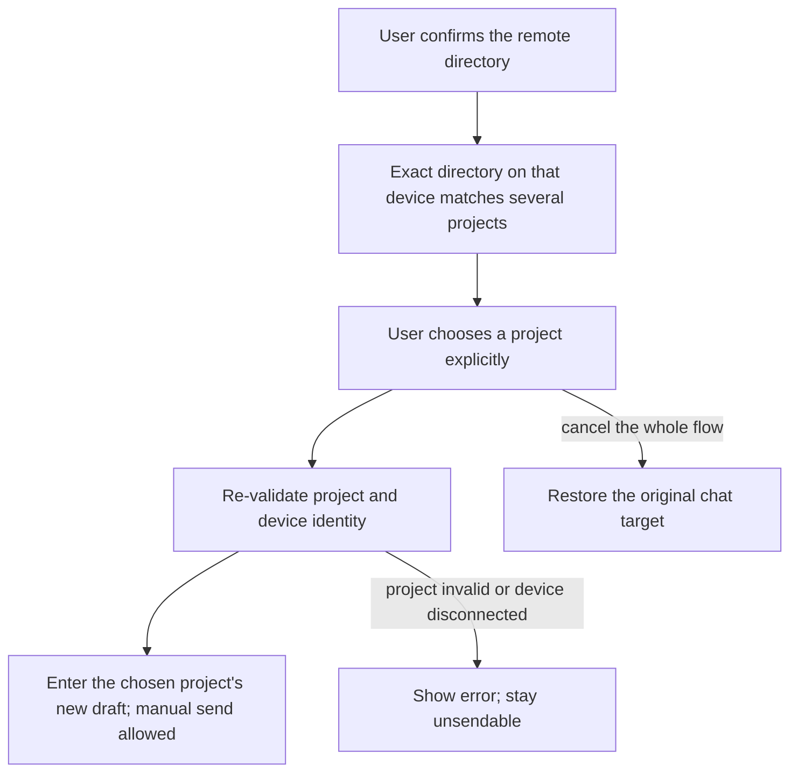

# 24: Choose Explicitly When One Directory Has Several Projects

Status: done

**Parent:** [#21 — Choose a remote folder after a chat connection and enter the project](21-chat-settings-round-trip.md)

**What to build:** After a user connects a remote from chat and confirms a folder, if that directory corresponds to several existing projects, the user sees these projects and chooses one explicitly. On completion enter the chosen project's new-task draft, with the first message using its original identity and directory; cancelling the whole flow restores the original chat target.

**Blocked by:**

- [#23 — Choose a folder and enter the uniquely matching existing project](23-chat-remote-folder-existing-project.md): provides the real chat entry, remote directory confirmation, project entry and send/cancel constraints.

**Spec coverage:** RDUX21-06; the multi-project branches of RDUX21-09, RDUX21-11-12, RDUX21-14, RDUX21-16. RDUX21-22-24 are verified along this ticket's path.

## Acceptance criteria

- [x] Use the same chat connection and directory selection flow as #23; only after the user confirms the directory are existing, non-deleted projects matched by the real target device and exact root shown.
- [x] Several projects at the same device and directory keep different identities, candidates show distinguishable information and are selected by real project ID; no automatic selection, merging or new project by name, recent use, list order or equal path.
- [x] After the user selects, re-validate that the request, Host membership, project and directory are still valid, then reuse the shared registration and preparation path to enter that project's new-task draft. Project ID, history tasks and their ownership stay unchanged, and the first message is actually sent to the chosen remote project.
- [x] While no project is chosen or the workspace is not yet prepared, the button and keyboard cannot send to the original target; completion does not submit automatically. Double-click selection and repeated responses cannot register, open or send repeatedly.
- [x] Cancel, close or the corresponding layer's Escape of the top-level project selection revokes the whole remote switch and restores the still-valid original chat target and draft, showing the target ownership; nested layers handle by the original close rule first and do not submit wrongly.
- [x] Project read failure, candidate deleted/changed, directory invalid, member removed or device disconnected show an error and allow re-reading/re-selecting or cancel; no other candidate is chosen automatically and the failure is not treated as zero-project creation.
- [x] After the user cancels, switches drafts, changes devices or starts a new request, old list and old selection completion results cannot navigate, overwrite the new target or clean up other tasks' connections.
- [x] Same-path, same-name projects and parent/child directory projects of two devices do not mix into the match candidates; existing projects of a read-only old remote remain selectable per existing capability and cannot trigger illegal creation.
- [x] A "two projects at the same directory" E2E from the real chat menu was added, selecting different projects and checking original project and history task identity; covers cancel and invalidated candidates. Tests first, then this branch.
- [x] This ticket completed the verification of long list names, keyboard, focus, Chinese/English, dark/light themes and narrow windows; shared UI respects the existing Web/mobile gating, and evidence is recorded by actual remote type and platform.

## Verification

- Reuse the two-project data and task history of the existing remote project selection candidate, connected to the new chat entry; verify results by actual project, task and execution directory, not only list rows or call counts.
- Hard-to-control timing such as a late list or member regeneration after selection uses existing UI/service ports; compare entry counts and shared connection availability before and after cancel.
- Complete typecheck, lint, the architecture gate, affected unit tests, this ticket's Desktop E2E and applicable shared UI regression; keep the case / coverage matrix consistent. Unrun environments are not recorded as passing and candidates are not promoted automatically.

## Scope and handoff

- Extends only #23's multi-match branch; zero-match creation, global project uniqueness and the storage rules of several projects at one directory are not changed.
- Does not depend on #25 or #26; if background recovery has been wired into the shared directory flow it naturally uses the same project selection result, and no second background selector is kept.
- Cross-device migration of drafts/attachments and conflict handling are out of scope. The parent Issue is neither modified nor closed; only this ticket's completion evidence is recorded.

## Implementation and evidence — 2026-10-14

- After a directory is confirmed, the multi-project candidates show only non-deleted projects with that Host's exact single root; name and real project ID are both visible, and keyboard focus enters the candidate list. The shared `enterProject` membership, directory and project re-validation and workspace preparation are kept, with no separate registration or navigation path.
- Project selection uses a synchronous in-flight lock. A read or preparation failure keeps sending blocked; if only one item is left after re-reading, explicit selection is still required and the remaining project cannot replace the user's original choice. Re-choosing a directory and top-level cancel keep the existing owner and resource ownership.
- TDD: the first test of `chatRemoteFolderChoice.test.ts` failed on the original implementation for lack of multi-project candidates; after implementation 9 UI/service port tests pass. They cover same-name ID distinction, double click, candidate deleted / root changed / offline, cancel / stale request / member regeneration, exact Host and root, read-only capability, no automatic reselection after re-read, and focus.
- Desktop E2E GREEN: `desktop-e2e-20261014053401905-p70011-e4130be481e13bf0`, candidate `conversation-session-chat-remote-project-choice.test.ts` 1/1 pass. SSH connected from the real chat menu, the two projects at the same directory are chosen with a first send each; each task, project, Host, cwd and workspace identity are checked, existing task ownership kept and no duplicate registration. Actual project names follow the service's existing disambiguation; fully same-named candidates are verified by the UI port tests.
- The same E2E verifies parent/child directories and soft-deleted projects do not mix in, original draft send block and Escape restore, an error when the project is deleted before selection, Chinese/English × dark/light × 480px and 1440px desktop. `choice-identities.json` keeps the identity results; representative screenshots reviewed. The first environment attempt failed because a concurrent type check overwrote build output and the exclusive fixture's old Source data was inconsistent; it was re-run after a sequential rebuild and resetting the test data. The test expands the sidebar explicitly per the existing narrow-window sidebar rule.
- Required checks: root `pnpm typecheck`, `typecheck:e2e`, lint (209 pre-existing warnings, 0 errors), architecture gate (0 violations), fixture check, format and diff self-check pass. `pnpm test:unit:affected --base 833e6dcb4b` selected officially 608/2616 files, 6850 passed, 1 pre-existing skip; the full unit suite was not run.
- Real-environment scope: macOS Desktop → Linux arm64 SSH; Docker served only as an SSH fixture and does not represent Docker transport. Windows/Linux Desktop, WSL, Docker transport and physical phones were not run; shared UI shell capability gating is covered by affected regression, and the integrated mobile-chain evidence is recorded by the parent task. The candidate stays pending, not promoted automatically or added to container CI.
