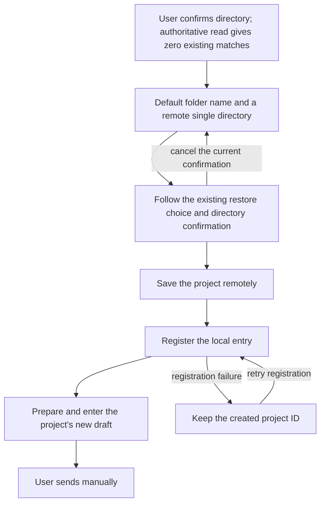

# 25: Create and Enter When No Project Matches

Status: done

**Parent:** [#21 — Choose a remote folder after a chat connection and enter the project](21-chat-settings-round-trip.md)

**What to build:** After a user connects a remote from chat and confirms a folder with no existing matching project, use the folder name as the default project name and follow the existing create/restore and directory confirmation flow. After saving the project, registering the entry and preparing the workspace, enter that project's new-task draft; on failure it can be retried or cancelled, without duplicate creation and without sending locally.

**Blocked by:**

- [#23 — Choose a folder and enter the uniquely matching existing project](23-chat-remote-folder-existing-project.md): provides directory confirmation, the authoritative match result, valid operation ownership and the complete path of entering the target project.

**Spec coverage:** RDUX21-07, RDUX21-17, RDUX21-21; the create/restore branches of RDUX21-08, RDUX21-10-12, RDUX21-14, RDUX21-16. RDUX21-22-24 are verified along this ticket's path.

## Acceptance criteria

- [x] The create branch is entered only when the user has confirmed a directory, the authoritative project read of the target device succeeded, and the number of existing non-deleted matching projects is zero; a read failure, invalid directory or identity change must not be treated as zero matches.
- [x] The default name is the selected folder name, and the target device and the single fixed root come from this confirmation; the user is not asked to re-enter the same directory, and no local directory or newly generated substitute directory is used.
- [x] Reuse the existing shared project creation and directory confirmation; selecting a folder is not trusting the directory. Hitting a deleted project follows the restore-or-continue-creating choice, restoring uses the original project ID, and it never silently restores or overwrites another project.
- [x] The device, directory, name and restore target shown in the confirmation stage and those saved agree. Cancel / close / Escape of the nested directory confirmation returns to the current flow and keeps the selection, without submitting or leaking into chat send; top-level cancel still revokes the whole remote switch and restores the original target.
- [x] After saving and registering succeed, deliver the actual project ID, Host and root, prepare the target workspace and enter the project's new-task draft; only adding a sidebar entry is not completion. The first manual send actually uses that remote project, and the old target receives no message.
- [x] During the whole create, register and prepare period the button and keyboard send constraints hold; completion does not send automatically. Repeated confirm or double-click must not create a project, register an entry or start a chat repeatedly.
- [x] When connecting from chat again and selecting the same directory, the existing project is reused by #23's matching path and no same-directory project is created because of repeated connecting; the generic save interface is not changed to global per-directory dedupe.
- [x] On directory no permission, deleted during confirmation, device disconnect or save failure, show the original error and keep a retryable selection, generating no substitute directory or ghost entry; on cancel keep the original chat draft and the shared device connection.
- [x] When the remote returned save success but local registration failed, keep the returned project ID; a retry only registers the created result, without creating again or asking again for the directory confirmation already completed. A successfully saved project is not deleted automatically by closing.
- [x] After the original request is cancelled, replaced, hidden or unmounted, or Host membership is invalidated, late query, confirmation, save and registration results neither navigate nor overwrite the new target nor start expired writes; only resources owned by this attempt are handled.
- [x] When an old remote has only project read capability, show the existing creation restriction; this entry cannot bypass the capability check. Other entries that explicitly create a same-directory project, and the project identity and history task contract, are unchanged.
- [x] An E2E for zero-match creation and remote first send from the real chat entry was added first, then implemented; it also covers shared restore / directory confirmation, save failure and registration retry. It verifies real project count, ID, the single root and first-message ownership.
- [x] This ticket completed the language, theme, long path, narrow window, focus and keyboard verification of the create confirmation; results are recorded by actual platform and SSH/WSL/Docker environment, and the Web/mobile capability gating is kept.

## Verification

- The main path reuses the chat-entry E2E and the shared project directory confirmation capability; soft-delete restore and read-only compatibility reuse the project service contract tests.
- Save success with registration failure is built with existing service ports, proving that the retry still yields the same project; the problem is not bypassed by a test-only API or unlimited network retries.
- A successful switch uses an empty draft; original text/attachments are verified only for retention on cancel and failure, and cross-device migration is not added here.
- Complete typecheck, lint, the architecture gate, affected unit tests, this ticket's Desktop E2E and applicable shared UI regression, syncing the case and run evidence. Missing platforms are recorded explicitly, old PASS is not inherited, and candidates do not automatically get CI admission.

## Scope and handoff

- Does not depend on #24 or #26; reuses #23's shared completion, send and cancel constraints. It shares the real project result with the multi-match branch and does not rewrite global project identity by directory.
- No permanent directory trust, Hook authorization, database migration, distributed directory uniqueness, draft migration or global network retry mechanism is added.
- The parent Issue is neither modified nor closed; this ticket records only the implementation and verification of the zero-match create/restore path.

## Implementation decisions

- `ChatRemoteFolderSelection` holds the confirmed Host/directory and valid request; zero matches are handed to the shared `ProjectEditor`. The form pins this directory and shows the default folder name; the trust confirmation shows this attempt's name, and on restore shows the confirmed restored project name, with no new creation owner.
- `ProjectEditor` keeps the restore choice, trust confirmation, in-flight exclusion and the created-result cache. Before saving it re-validates the request, Host membership, directory and remote capability; after saving it goes through the existing `enterProject` to register, prepare and enter the draft. A registration failure retry uses the same ID.
- Port tests use the existing project service and remote entry service; the real Desktop candidate verifies creation and first send from the chat connection entry and stays pending.

## Verification evidence

- Zero-match UI/service-port reds were added first, then the shared creation was implemented; the late-query invalidation and restore-name display each keep a red-green regression. The 11 tests of `chatRemoteFolderCreation.test.ts` cover pinned Host/root, explicit trust, restore or continue creating, save failure, permission failure, repeated confirm, read-only capability, registration retry and stale results.
- Root `typecheck`, Desktop `typecheck:e2e`, lint (0 errors, 209 pre-existing warnings) and the architecture gate (0 violations) pass. Affected from this task's start: 608 files, 6852 pass, 1 pre-existing skip. After merging #24, directory dispatch and shared confirmation, 4 files / 47 tests pass.
- The new candidate manifest and provider fixture checks pass; the candidate stays `manual-review/pending`, not promoted or added to CI.
- The first real SSH run `desktop-e2e-20261014051020488-p50885-83b993467e37b894` was judged a failure by an existing wait helper in the install-update stage and never reached the create branch; that run counts neither as a create red nor as pass evidence.

- macOS Desktop → Linux arm64 SSH create candidate 1/1 pass: `desktop-e2e-20261014055401059-p80988-2f9ef70df764ec75`. Checks the zero-match default folder name, the single fixed root, trust Escape not saving, the Host/project/task/cwd of the real remote first send, the message absent from the original local, reconnecting reusing the same project with only one entry, and cancel keeping the remote draft.
- After merging #24 and #26, directory dispatch, background ownership and shared confirmation 4 files / 52 tests pass, and the root type check passes again. English light 1440px and Chinese dark 480px trust-confirmation screenshots were reviewed: name, device, long path and buttons are readable and not clipped; a narrow desktop window does not count as phone evidence.
- This ticket did not run Windows/WSL, the Docker-transport create branch or real phones; ordinary Web/mobile remote connection capability gating follows the shell and has affected UI regression. It does not change the shared-host or continuous/replayable contract, and unrun platforms are not recorded as PASS.
