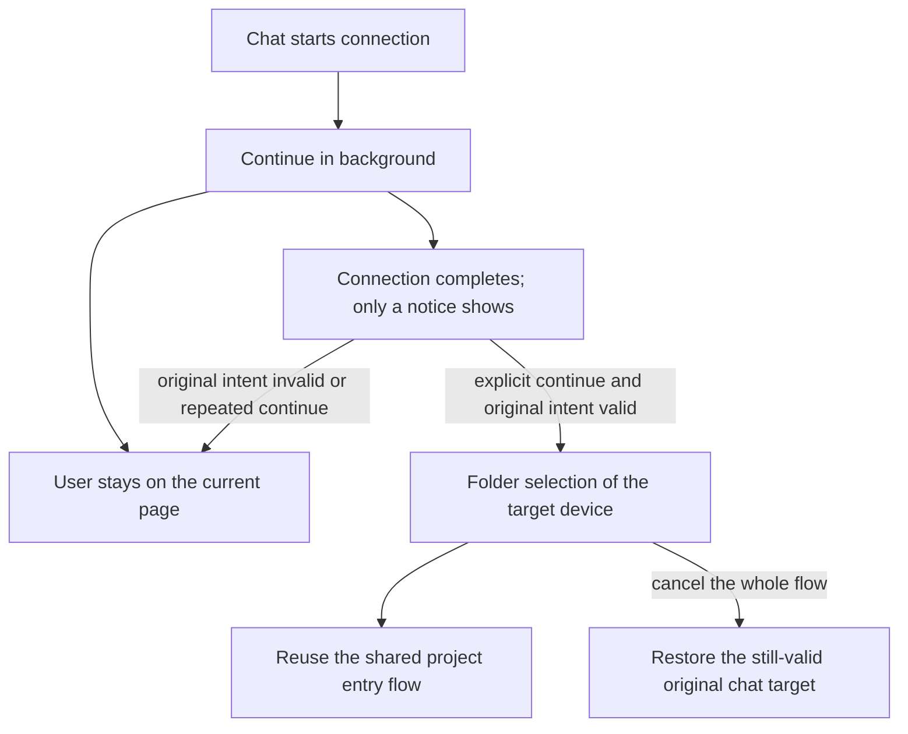

# 26: Explicitly Continue to Folder Selection after a Background Connection Completes

Status: done

**Parent:** [#21 — Choose a remote folder after a chat connection and enter the project](21-chat-settings-round-trip.md)

**What to build:** After a user starts a remote connection from chat and chooses to continue in the background, they can keep working on other pages. Connection completion only notifies; when the user continues explicitly and the original intent is still valid, the folder selection of the same target device shows, after which they enter the project and send manually. An expired or repeated continue must not steal navigation, repeat operations or affect other tasks.

**Blocked by:**

- [#23 — Choose a folder and enter the uniquely matching existing project](23-chat-remote-folder-existing-project.md): provides the reusable chat directory flow, original-intent validation, send constraints and project entry capability.

**Spec coverage:** RDUX21-18; the background continuation branches of RDUX21-03, RDUX21-12-13, RDUX21-15-16, RDUX21-19-20. RDUX21-22-24 are verified along this ticket's path.



## Acceptance criteria

- [x] Keep the completed background connection lifecycle and the single operation owner. Continue-in-background only collapses the interaction; the Settings device card / unfinished item still shows the same request's progress and state, with no separate connection or independent recovery flow.
- [x] After the user leaves Settings or switches to another chat, background success does not pop a directory selection, switch device or project, change the current draft, or impose a global send restriction on unrelated chats.
- [x] Before an explicit continue, re-validate the original chat intent, request identity, actual Source and current connection state; when valid, enter #23's directory selection flow, where the user still has to confirm a directory every time, and it is not skipped by recent / unique project or online reuse.
- [x] After directory confirmation reuse the shared project result handoff, workspace preparation and send rules; "background connection → explicit continue → choose directory → enter project → remote first send" is fully proven with a unique existing project, and merely opening the dialog is not completion.
- [x] When the original draft is abandoned, the request cancelled or replaced, or the member invalidated, a late success and an old continue action do not revive the old page or overwrite the new target. A repeated continue consumes the same valid completion action only once, without repeated connecting, registration or message submission.
- [x] On background failure, credentials / install confirmation needed, or the Source disconnecting before continue, keep the original error and explicit handling entry; success is not faked, local is not switched to automatically, and the user is not interrupted by a forced popup.
- [x] After continuing, cancelling directory / project selection revokes this remote switch per the shared rule and restores the still-valid original target with its ownership shown. Cancelling the background operation while the user is still on another page does not pull them back to the original chat.
- [x] Cancel cleans only exclusive temporary resources of this attempt; connected devices and sessions shared by other projects stay usable. An invalidated or repeated continue must not wrongly clean shared resources either.
- [x] Device add with a Settings origin still stays in device management; the project-form round trip and explicit original-project reconnect keep their own completion intent and are not taken over by the chat's mandatory-directory rule.
- [x] The complete background E2E from the real chat entry was added first, then implemented; existing UI/service ports supplement late failures, stale results, repeated continue and the shared-resource boundary, with no timed polling or compensating jumps.
- [x] The focus, keyboard, Chinese/English, dark/light themes and narrow window of the notice, the continue action and directory selection work; connection types and platforms are recorded by actual execution. Web/mobile keep using the existing Host and replayable boundary and add no mobile connection owner.

## Verification

- Reuse the background connection candidate and the real entry of the chat device round trip, verifying results by the current page, original draft, real project/task identity and the first message's target.
- Cover separately: still on the original draft after background completion, already switched to another chat, original intent invalidated, and repeated continue; a normal background completion only notifies, and only an explicit resume enters the visible directory flow.
- Re-check the existing behavior where the ordinary Settings entry restores the same background operation, so that not only the new notification button is verified while the original continue entry is missed.
- Complete typecheck, lint, the architecture gate, affected unit tests, this ticket's Desktop E2E and applicable shared UI regression; sync the case and coverage evidence. Insufficient environments are listed explicitly and the candidate review status does not change automatically.

## Scope and handoff

- Does not depend on #24 or #25: this ticket delivers the background continuation into the common directory entry and verifies it end to end with #23's existing-project path. Once other tickets are done they use the same shared dispatch, without duplicating the multi-project selector or the creation form.
- [#22 — Background connection and explicit resume](22-background-connection-and-explicit-resume.md) is the completed behavior basis, not a new blocker; this ticket only updates the target and corresponding evidence after a chat-origin continue.
- The background connection state machine, authentication, install, task message queue and cross-device draft migration are not changed; the parent Issue is neither modified nor closed.

## Implementation notes

- The connection lifecycle is still held solely by `remote-connection-flow`. Root notifies the original return owner of connection visibility; when the chat collapses, the original draft's submit restriction is lifted, and an explicit continue delivers the actual Source and then enters the shared directory flow with the submit restriction re-applied. The completion callback marks the return intent as being validated synchronously and marks it consumed only after successful delivery; an originally existing member is re-validated for membership through readDirectory; after the await the original draft and tab identity are re-read, and replacing the entry invalidates the old return. The validated membership is passed to the directory flow, so a removal in the gap between mounts cannot be treated as a first registration.
- Test seams: the existing Composer UI return port, the real connection flow hook, and the background candidate's real chat → SSH → directory → project → first-send chain.

```mermaid
sequenceDiagram
    participant Chat as Original chat owner
    participant Root as Return-intent owner
    participant Flow as Connection owner
    participant Host as Original Host member
    Flow->>Root: collapse the connection layer
    Root->>Chat: onVisibilityChange(false)
    Note over Chat: Lift the original draft's submit gate
    Flow->>Flow: background completes; only notifies
    Flow->>Flow: user continues; validate Source online and request generation
    Flow->>Root: actual Source completion result
    Root->>Root: synchronous checking, preventing repeated continue; delivered after delivery
    Root->>Chat: canFinish(result)
    Chat->>Host: readDirectory, check the original membership
    Host-->>Chat: current authoritative member
    Chat-->>Root: current intent and member valid
    Root->>Root: re-read tab and original chat identity
    Root->>Chat: return to the original owner, open the shared directory selection
    Note over Chat: Inherit the original membership; no sending before directory/project preparation completes
```

## Evidence (2026-10-14)

- UI red-green: the assertion that sending stays blocked after background collapse failed first; the eligibility assertions for member removal / regeneration / late draft failed first. After completion the Composer's 21 tests pass; after merging #24 the Composer, project selection and connection flow total 128 tests pass. Existing flow port regressions cover repeated continue, late failure after cancel / replace, Source offline before continue, and a shared attachment not being cancelled.
- Real Desktop E2E: `desktop-e2e-20261014054619416-p77568-1b2f973228b64db0`, background candidate 1/1 PASS (61 seconds). Covers SSH background collapse lifting the original draft gate, completion only notifying, explicit continue from the Settings card and the notice, mandatory directory, cancel keeping the original body / attachments and the online Source, continue invalidated when the original draft was abandoned, and unique-project first send; also keeps the Settings / project form / existing-project directory entries, background authentication failure and Docker transport regression.
- `background-remote-first-submission.json` checks the actual Host, project ID, task, cwd, workspaceIdentity; after the first send the local task list did not grow, the remote project count did not grow, and the local entry is just one. 7 screenshots checked, including the completion notice, directory, Chinese/English dark/light 480px Settings states and Docker completion.
- The first three rounds were located as a development archive hash mismatch in this task's fixture, an old candidate not handling the newly added remote introduction, and the test repeatedly adding retained attachments. All were fixed in test preconditions / assertions without changing connection product semantics or deleting Sources or business databases; failure evidence of each round is kept. The third round already passed the remote first send, and the final whole round follows the PASS above.
- `pnpm typecheck`, Desktop `typecheck:e2e`, lint (209 pre-existing warnings, no errors), the architecture gate and fixture validation pass. `test:unit:affected --base 833e6dcb4b` officially selected 607/2615 files: the first round passed 597 files and 10 failed because the Electron path was missing in the independent worktree; after completing the local dependency path, re-running only those 10 files, all 160 tests pass. The full UT was not run.
- Real-environment scope: macOS Desktop and this task's exclusive Linux arm64 SSH and Docker transport; Windows/Linux Desktop, WSL and physical phones were not run. Web/mobile add no owner and keep the existing capability gating and the shared-host / replayable seam; the integrated shared mobile regression is recorded by the parent task. The candidate stays pending, not promoted or added to CI.

## Review fix: completion-eligibility read failure

A membership-eligibility read failure is separated from explicit invalidation: Root keeps the same return intent and restores its retry eligibility, and the connection flow waits for the completion callback. An IO failure follows the connection error UI's actual reason, explicit retry and cancel; the foreground request still blocks sending, and nothing can be submitted to the original target while no directory is chosen and not cancelled. Cancel revokes the in-flight eligibility result, and the background still lifts the original chat gate through the existing visibility notification.

```text
connection flow completes → Root checking → canFinish
                     │ success and foreground → delivered → folder selection
                     │ IO failure → keep owner → original flow error / retry / cancel
                     │ collapse while waiting → flow keeps the background completion → explicit continue
                     └ explicit cancel → revoke the return reference → late results have no right to navigate
```

- Review TDD: a completion-eligibility IO rejection used to close early with no error; a rejection after re-collapse following a background explicit continue used to request reopening the dialog. Both keep their RED; the final connection flow passes 103/103 tests, also covering late success / failure after cancel while waiting, explicit continue after collapse while waiting, and repeated continue.
- Real fault regression and background regression 2/2 PASS: `desktop-e2e-20261014062429307-p3874-62dc81c125bcbc6d`. The existing RPC port makes the eligibility read of an existing Host fail; checks that the original reason is expandable, button / Enter / form do not submit to the original local, a late result after explicit cancel while waiting does not pop a directory, retry enters the directory, and cancel restores the original draft; the real remote first send is then checked. The original background candidate keeps covering SSH/Docker and completion intents such as Settings / project. `membership-read-failure.png` reviewed.
- The first-round fault and remote first send already passed, but a later menu click was covered by the existing project identity hover overlay; the test closes the overlay first by the existing Escape interaction, and the final whole round follows the PASS above, with no product hover behavior changed.
- Final root type check, lint (209 pre-existing warnings, 0 errors), architecture (0 violations), fixture, format and diff checks pass. The affected-test selection from the whole task's start `--base 833e6dcb4b` was 615 files, 6965 passed / 1 pre-existing skip; afterward only the re-collapse rejection regression was added and that condition fixed, the affected flow file finally passes 103/103, and the other 614 passed files were not repeated.
