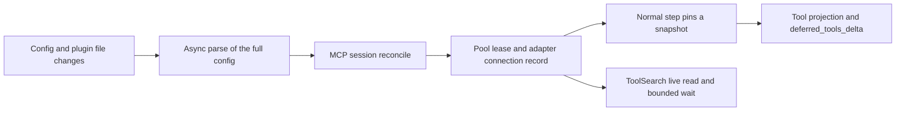
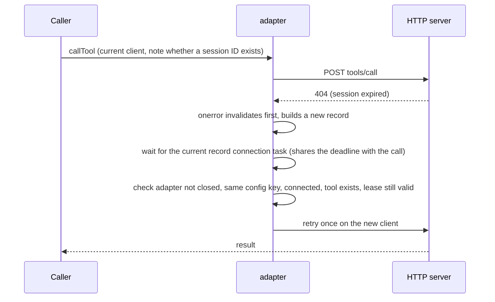

# MCP dynamic catalog and async connection

## Contract

An interactive session starts MCP in the background, and the first request only reads the published in-memory snapshot. Headless, automation and idle tasks keep the first-send wait. A server becoming ready does not start a model request by itself. When ToolSearch is on, servers that are still connecting are listed in the announcement. When ToolSearch is off there is no announcement, and the `WaitForMcpServers` tool plus the executor wait tell the model (see "Request and search").



## Configuration

There is one rule for config identity: `mcpConfigKey` (`@zcode/contracts`) sorts the keys, drops undefined fields and serializes the result. The pool connection key, the adapter reuse check, the MCP App connection summary and the session config-change check all use it. `{ timeoutMs: undefined }` and `{}` are the same config and do not rebuild the shared connection.

The CLI in the execution environment watches the user and project configs, the plugin install record `installed_plugins.json`, the bundled shards of official plugins, and the manifest and MCP declaration files of inline plugins (user config `plugins.dirs`). A desktop session reads the config from disk. The settings page and plugin operations run in other CLI processes, so file watching is the only way a change reaches this process.

Only commit points are watched, not the directory contents of cached plugins and official plugins:

- A cached plugin directory is written only by the install and update flow (`activateDirectoryAtomically`, with `installed_plugins.json` as the authoritative state), and the flow ends by writing the install record. Uninstall deletes the install record. Enable and disable write the user config. The official plugin directory is released at app start and the release ends by writing the bundled shard. So every effective change to these directories comes with a change to a watched file, and the loader then re-reads everything and sees the new directory.
- A plugin directory read while a transaction is uncommitted is unstable, and the loader keeps the last stable execution config. The install record written at commit triggers the next re-read, and the result converges to the new generation.
- An inline plugin has no commit point. Developers edit its files directly, so its manifest, its MCP declaration files and its transaction record stay watched.
- Constraint: any new flow that writes a cached plugin directory or the official plugin directory must end by writing `installed_plugins.json` or a bundled shard. Otherwise open sessions do not see the change. Hand-editing a file inside the cache directory does not take effect live.
- The number of watchers does not depend on the number of installed plugins. Before the fix each plugin used about 3 directory anchors (parent of the version directory, plugin root, manifest directory), which meant about 84 watchers for 26 plugins. A new session waited serially for those watchers to become ready when it acquired the config source, and sessions in different workspaces each built their own copy.

Watch rules:

- The anchor is the existing directory that holds the file. If the directory does not exist, walk up only inside the known root that contains the file (working directory, user config directory, plugin store root) to find an existing directory. Nothing outside those roots is watched, so large directories such as the home directory are never watched. The parent of an inline plugin root is watched because of the transaction record file (`.<name>.transaction.json`), which is how an atomic rename is noticed. No other anchor watches its parent directory.
- A file event only invalidates the config. After 300 ms with no new event (trailing debounce, no maximum wait) a serial drain re-reads the full config. A series of atomic replacements ends by publishing the last write. When a native event has no filename, the anchor is invalidated. The debounce only decides when to read, not the state: every read is a full re-read compared by content, so removing the timer leaves the final state unchanged.
- When a watcher errors after it was ready, one drain is scheduled immediately (no debounce) and the drain rebinds. An error during binding does not schedule anything and waits for the next disk read to rebind. A failed binding does not count as covered. The config is never polled.
- When a watcher for the same anchor and the same identity fails twice (failures before and after ready both count), watching stops and a warn is logged, with no further rebinding. A stable file event resets the count. A changed identity or a rebuilt entry tries again. After watching stops, new sessions still read the latest config. The rule is in [Skill live catalog, watch scope](./skills-live-catalog.md#监听范围). Before the fix, rebinding after a ready-time error had no limit, so with a persistent failure the drain never finished and new session creation was held up.
- Establishing the watch has a total timeout of 1 second. Within one binding, the stat of each anchor and the wait for the watcher to become ready or fail share one deadline. An anchor that times out is cut off, its watching stops and one warn is logged (`MCP configuration watcher bind timed out`). No rebind is scheduled. The cut-off follows the entry, and after watching stops new sessions still read the full latest config. The timeout only decides whether to keep watching, not the config content. The rule is in [Skill live catalog, watch scope](./skills-live-catalog.md#监听范围). Before the fix, a slow network drive could leave stat hanging or leave the watcher neither ready nor failed, binding had no limit, and new sessions waited forever.
- Anchors, binding, debounce, drain and the process-level registry are generic watch primitives. The [Skill live catalog](./skills-live-catalog.md) reuses the same primitives, with its own entries and loader. The primitives also support directory entries (watching only the add and remove of direct subdirectories). MCP does not use them, and the MCP watch set, boundaries and behavior are unchanged.

Within one CLI process, sessions whose loader inputs are equal share one config source (the process-level registry is created and injected by the entry point, it is not a module-global singleton):

- The shared key contains all loader inputs by value: config file paths, user config path, fallback paths, plugin store root, official plugin roots (order kept), the explicit server map (via `mcpConfigKey`), working directory, environment variables, and the default-enabled plugins (as an ordered array). The key includes environment variables, and only their hash is recorded.
- Each session holds one view. Built-in servers, computerUse, explicit enabled and broker injection are computed inside the view. All views share the same raw load result, so the identity check of the official CUA server does not change. A view notifies its session only when its own computed result changes by content. An error while computing one view only skips that view and does not affect other views. If the computation fails at acquire time, the reference registered for it is released.
- Acquiring a view first registers the reference, then skips the debounce timer and reads from disk right away until no read is pending, and then reads the snapshot and subscribes in the same synchronous step. So a new session always sees the latest disk state.
- Closing a view is an idempotent release. When the last view is released, the watcher and the timers are closed. A failed first load only deletes that entry, all waiters receive the same error, and the next acquire loads again. The registry is force-closed on process exit cleanup. Entry points without an injected registry (TUI, headless) build one private config source per app, with the same rules.
- Each step of a model request only reads the snapshot in session memory and does no file IO.

The first load and a hot update call the same async loader, and the first snapshot of the config source is the first-load result. Loader rules:

- A warning on a single MCP server skips only that item. Only a file read, JSON or overall schema error keeps the last valid result of that source. The last valid result and the stable plugin config are committed only when the load result is adopted (becomes the current snapshot, even if the content is unchanged). A read that is superseded by a new event in the middle of a drain does not change the fallback base for the next one.
- For a plugin manifest, the first existing file in a fixed order is used. If that file is invalid, the plugin is skipped, the same as the plugin discovery rule at startup.
- The plugin install directory and `installed_plugins.json` share one atomic-transaction check. During a transaction a committed source can be recognized from the backup, but the backup execution path is not published. An existing source only keeps its last stable execution config while the transaction is incomplete.
- The data directory is created only when the MCP feature is on, the plugin is enabled and it declares an MCP server. When an optional filesystem workspace directory cannot be read, only that directory is skipped and a warn is logged.
- A failure in variable expansion or data directory preparation for one plugin removes only that plugin's result. The startup plugin loader also isolates errors per plugin, so one bad plugin cannot make session creation fail.
- These rules are extracted into a shared config and plugin manifest reader: reading config files (with fallback to the last valid result), parsing and merging config by the startup rules, plugin candidate and enable checks, and watching only inline plugin files. The Skill live catalog uses the same rules to decide plugin enable state and skill roots.
- Load warns (config read failure, invalid manifest, plugin MCP diagnostics and preparation failure, unreadable filesystem directory) are logged when the result is adopted, and only entries that were not in the last adopted result are logged. Saving the config again with unchanged warns does not log them again.
- Project files (config paths other than the user config) are parsed with the same project allowlist as the startup config ([project config trust boundary](./security/deep-link-project-trust-boundary.md)). Only extension declarations and enable state are accepted. Runtime parameters such as `features`, `plugins.enabled` and `plugins.suppressedBuiltins` have no effect, and an invalid value in a runtime parameter does not invalidate the MCP declarations in the same file. After that the result goes through the same shaping rule as the startup config: Hook declarations and `plugins.dirs` are removed, and a relative `cwd` of a stdio server is resolved against the project root. Project config cannot introduce a plugin root directory.
- Each config file is merged as a whole by scope priority (project over user), the same as `createConfig`: a top-level field that a file does not declare does not override a lower-priority file. For example, if the user config turns off `features.mcp` and the project config only writes `plugins.enabledPlugins`, MCP stays off. The merge rules for nested objects are also the same as `createConfig` (see [config merge legacy issue](./issues/config-merge-legacy/01-nested-fields-replaced-by-higher-layer.md)).
- When a config file has no server, the fallback file registered for it is read: `<workdir>/.zcode/config.json` falls back to `<workdir>/.agents/mcp.json`, and the user config falls back to `~/.agents/mcp.json`.
- Each server is marked with a source by the file it comes from: project files and their fallbacks are marked `workspace`, and the user config and its fallback are marked `user`. Plugin and built-in servers keep their own source, and an explicitly passed map keeps the caller's marks. The workspace guard decides only from this mark and its own project declarations: a server marked `workspace` without a matching project declaration is always rejected and shown as untrusted. For example, when another project file already declares servers, an empty `.zcode/config.json` whose fallback `.agents/mcp.json` supplies entries is such a case.

When no server map is passed explicitly, the disk config of the execution environment is read. An explicitly passed map keeps the original override semantics. Apart from the source mark, the first-load result of the loader equals the result of `createConfig` + plugins + built-in servers (locked by a consistency test).

## Ownership

```text
session (owner) -- config subscription / reconcile --> pool lease --> adapter connection record
fork (owner)    -- own connection
subagent / workflow child -- borrows the parent port (the port carries a borrow mark, scope frozen at creation)
```

Ownership is decided by the port itself. A borrowed port carries an unforgeable mark, and the runtime uses it to skip config subscription, cache publication and lifecycle calls, so no ownership parameter is passed. A borrowed port reads a frozen scope only. It does not subscribe to config and cannot converge or close the parent connection.

When a new child is created, it waits only for the servers it needs that are still pending, for at most 30 seconds, and it ends early when a server fails. It does not wait for slow servers it has no use for. The "needed servers" are the union of the servers referenced in `mcpServers` and in `tools` (`mcp__x__y`, `mcp__x`, `mcp__x__*`). A model-visible name is mapped back to the config name by the whole name. There is no substring matching (`mcp__git__x` does not wait for github) and no case sensitivity (the same as the MCP capability check of subagents). `mcp__*` and `*` do not trigger a wait. The borrowed scope is still decided by `mcpServers` alone and is frozen at creation: a server that connects after the wait ends is not in the scope. A workflow child without a scope does not wait for MCP, and a server that is still pending at creation is not in its borrowed scope. The read path of a borrowed port keeps the source consistency filter: when the parent connection has confirmed a source change, tools from the old scope are removed from the borrowed catalog.

## Connection record

```text
records[name]: a new record per connection; generation only serves MCP App invalidation notices and dropping late tasks
  connecting --(only committer: end of startConnection)--> connected / failed / disabled / untrusted
     ^  recovery (remote unexpected disconnect, built-in stdio process unexpected exit): the new record keeps the old tools, at most 5 times, 1/2/4/8 s apart, no interactive authorization
     |                                    onerror classification:
     +---- invalidate <------------------- + HTTP session expired -> invalidate
           other stdio: failed (unexpected_disconnect) + HTTP GET open-stream failure -> log only
                                          + SSE stream error -> invalidate
                                          + 3 network errors in a row -> invalidate
```

- The connection phase, the effective catalog and the current connection task are held by the same server record. Ready is published in one step after discovery succeeds, the lifecycle handlers are installed and the record is still the current one. A failure is committed only once at the end of the connection task, so subscribers see only one terminal notification.
- A new connection registers a connecting record synchronously and then closes the old record object. The close task and late results only handle the old object. Each new record adds one to generation, and several attempts within one recovery share that generation. A record invalidation (stdio unexpected disconnect entering failed, explicit disconnect, adapter close) also adds one to generation. Every increment notifies MCP App connection invalidation.
- After an unexpected HTTP/SSE disconnect, up to 5 attempts run in the background. While pending, the last valid catalog is kept, and only when the attempts run out is failed published and the catalog cleared. If an error that needs interactive authorization appears during recovery, recovery ends at once with result failed and `failureKind` set to `oauth_authorization_failed`, which the model sees as needs-auth.
- When a stdio server with runtime source `builtin` exits unexpectedly or fails a ping, the same background recovery runs. Source `builtin` includes the host-injected `node_repl` and the MCP servers declared by plugins of the official marketplace (`zcode-plugins-official`). An http server of an official plugin uses the HTTP recovery above and is not subject to the restart limit below. Recovery method: keep the catalog, restart at once, at most 5 times. The same server is automatically restarted at most 5 times within 10 minutes. After that there is no automatic restart, the server enters failed (`unexpected_disconnect`) but keeps its catalog: the tools stay in the session view, and the next execution admission (or MCP App open) restarts it once as a normal connection, with the catalog unchanged during the reconnect. If this restart fails, the catalog is cleared as for a normal failure. A non-recovery connection (config change, explicit reconnect, execution-admission reconnect) starts counting again. `node_repl` is not listed on the settings page, so the user cannot trigger a reconnect by hand. For stdio servers of other sources (user, workspace, third-party plugin), an unexpected exit still goes straight to failed and clears the catalog.
- Other stdio disconnects or ping failures go straight to failed (`unexpected_disconnect`) with no background self-healing, and the catalog is cleared. The tools leave the session view on the next normal step. Until then, the registry of the current step still holds its tools, and when the model calls one, execution admission reconnects once as a normal connection (a `disconnected` record from an explicit disconnect is handled the same way). If it connects, the call runs normally. Otherwise the model gets a "disconnected" text. After the tools have left the session view, recovery comes from a config change (a toggle on the settings page), an explicit reconnect (TUI `/mcp connect`, opening an MCP App) or a newly created connection. A shared `isolation: "workspace"` connection reuses this failed record in a new session and does not reconnect because of it.
- Only two kinds of failure keep the last valid catalog: an authorization failure (`oauth_authorization_failed`), and an unexpected disconnect of a stdio server with source `builtin` that went over the automatic restart limit (see the `builtin` item above). On an authorization failure the tools stay in the list, a call returns the needs-auth text, and no revoke or restore announcement is produced. At the next tool execution admission it reconnects as a normal connection (an MCP App read does not trigger it): first with the latest credentials (another process, such as the settings page, may have completed authorization), and if authorization is still needed it starts one round of interactive authorization. Other failures clear the catalog as usual. A server that never connected since the session started has no catalog to keep and can only be reconnected explicitly.
- For Streamable HTTP, onerror is classified by structured error. A POST 404 when the call began with a session ID, or a 400 whose body says the session does not exist, counts as session expiry. A failure to open the GET event stream (any status code, including 404/405) only writes a debug log, and a GET stream drop is reopened by the SDK itself without rebuilding the client. For SSE, onerror receiving `SseError` (event stream disconnected) invalidates, because the SDK does not dispatch onclose for an SSE stream drop. Three network errors in a row at the fetch layer (structured error codes) or in the event stream body count as the server being unreachable, and any HTTP response resets the count. The count lives in the fetch wrapper and is shared by HTTP and SSE.
- Interactive authorization is allowed only on first connect, explicit reconnect (settings page validation) and tool execution (a call that hits 401/insufficient_scope, or the execution-admission reconnect after an authorization failure).
- `tools/list_changed` only marks dirty during discovery, and after ready is committed the same refresh entry continues. Refresh is single-flight with bounded retries (at most 3, 1 and 2 seconds apart), and on failure the old list and dirty are kept. Reading the snapshot triggers no I/O, and `listTools()` only reads the current snapshot.

Explicit validation (settings page refresh) is decided by the adapter:

- When connected, ping. A ping failure and a disconnect share the invalidation entry: HTTP/SSE and `builtin` stdio that has not gone over the restart limit enter background recovery with no interactive authorization, and this refresh only reports the current state of the recovery record. It does not replace the recovery and does not wait for it to end. Other stdio servers enter failed, and this refresh reconnects as a normal connection, with interactive authorization allowed.
- When the record is not connected (failed, disconnected), reconnect, with interactive authorization allowed. So when background recovery ended because it needed authorization (failed, `oauth_authorization_failed`), the user has to refresh once more before interactive authorization starts.
- Connecting, disabled and untrusted only return the current state.

The pool only manages leases and forwards explicit validation.

## Tool calls

A model tool call has no connection fence, and it binds the current client late at execution time. Before the call it only checks that the lease still points to this connection, `mcpConfigKey` has not changed, the state is connected and the tool name exists. After a permission or hook wait, the handler checks again with the same conditions that the target is still valid.

The workspace trust guard runs config changes serially, and each change has two phases: first the admission check (reading the trust record), then waiting for the connection to complete. Tool calls, resource requests and pings wait only for the admission check in progress to end, and then run against the current admission result:

- They do not wait for the connections of other servers. A call to a connected A does not wait because B is still in handshake.
- They do not fail because of a queued config change. If a change has not started, the call uses the current connection. If a change alters the config of the target server, the old connection is closed when it takes effect, and in-flight calls follow the connection-close rule below. A queued change does not start a new-config process that has not been admitted.
- A call that arrives during the admission check (the record of the same server is first set to pending review and then released) waits for that check to end and never reads the intermediate state.
- A full reconcile first releases workspace servers, waits for the other servers' handshakes, and then checks admission again and reconnects. During this time a call to a workspace server waits for the reconnect and then runs. It does not land on the released connection. User and plugin servers are not affected.



Automatic retry happens at most once per call and only for Streamable HTTP, under either of two conditions:

1. Session expiry: a POST 404 when the call began with a session ID, or a 400 whose body matches `Server not initialized`, `No valid session ID` or `Mcp-Session-Id header is required` (case-insensitive). The server expresses session loss only in text, so these two text checks are an exception to the rule "do not use error text for control flow".
2. Connection closed: a local ConnectionClosed, or JSON-RPC `-32000` with a message containing `Connection closed`.

Repeated execution is a known consequence. One session expiry closes the old client, all in-flight calls on that client receive ConnectionClosed, and each retries once, so a long call may run twice. The third network failure in a row also closes the old client synchronously: the call that triggered it and the other in-flight calls all receive ConnectionClosed and each retries once.

No retry for: a server JSON-RPC error (including `-32000 Not connected`), a lost response, HTTP 500, a 404 without an assigned session ID, a timeout, and a connection close on SSE or stdio. The reconnect wait time is `min(reconnect wait cap, remaining call budget)`. If during the wait the config is replaced, this lease no longer holds the server or the adapter closes, the original error is returned directly. When the whole lease closes (session close), the call is cancelled together with its caller. If the reconnect wait cap is reached without a connection, the original error is also returned, and a tool timeout is reported only when the call's own budget runs out first.

When a tool call hits 401/insufficient_scope, an HTTP/SSE server that uses authorization-code OAuth (including a server configured with only a URL whose OAuth is declared by the server) runs interactive authorization through the same reconnect path (step-up merges the scope) and retries once on success. Servers with official authentication, `client_credentials`, or a static Authorization header do not start interactive authorization and return the original error. The conditions are the same as for interactive authorization at connect time. Concurrent 401s share one connection task. When authorization enters the waiting-for-user state (the authorization link is published), the call that triggered it ends at once with a needs-auth text and does not wait until timeout. Authorization continues in the background for up to 5 minutes, and the user can open the same link on the settings page to finish it. A caller cancel or timeout only ends this wait. It does not cancel the shared task and produces no unhandled rejection.

An MCP App call keeps the connection fence: it pins the connection identity and generation from when the App was opened, rejects after a generation change, does not retry automatically and does no authorization recovery during the call.

## Resource subscriptions

The only source of subscription intent is the live MCP App instances on the host. The adapter only records "subscriptions confirmed on the current client". On a connection generation change the host closes the instances and unsubscribes by instance prefix, and the adapter does not replay old subscriptions on the new connection.

```text
connection G1 drops -> adapter builds connection G2, generation +1
   +-> onAppConnectionInvalidated(G1)
   |      +- host: close the App instance on G1 -> unsubscribe by instance prefix -> desktop shows an error card
user clicks "Retry" -> host opens a new instance
   +- connection available: subscribe on G2, confirmed state belongs to G2
   +- connection unavailable: first wait for the existing connection task (so a session restored before the handshake finished is not judged failed);
      if still unavailable (for example failed after a stdio crash), reconnect once more and wait within the budget; only then report -32001
```

The connection summary is read once before and once after issuing. If the session was closed or replaced, or the connection identity or generation changed, issuing is rejected. The open request has no cancel channel (the protocol parameters have no operationId), so the wait is bounded only by the reconnect budget.

- The registry separates, by subscriberKey, registrations that succeeded from requests that are not complete yet. A cancel or failure only withdraws this request. A repeated or concurrent request with the same key cannot delete other requests or earlier successful registrations. An explicit unsubscribe or a scope cleanup invalidates old requests, and a late completion must not revive them.
- The current connection record stores the remote confirmation (subscribed, unsubscribed, unknown) and a serial task per URI. An error the server has explicitly answered keeps the original confirmation state. After any other RPC failure the confirmation becomes unknown, and the next request confirms again. Unsubscribe completion is recorded only after the unsubscribe request was really sent.
- A lease records the (uri, subscriberKey) pairs it registered itself. When a lease is released or switches to another connection, it unsubscribes only those keys and does not clean by session prefix: when the same session reopens, the old and new leases may briefly coexist, and the new lease's subscriptions must not be taken away by the old lease.

## State classification and model reminder

`classifyServer(config, name, row)` is the only availability check. Catalog reads, status facts, execution admission, error text and revoke reasons all read only from it:

| Result           | Condition                                                                                   | Model-visible                                       |
| ---------------- | ------------------------------------------------------------------------------------------- | --------------------------------------------------- |
| `not_configured` | The server is not in the config                                                             | Revoke reason                                       |
| `disabled`       | The MCP master switch or the server switch is off, or the state is disabled                 | Revoke reason                                       |
| `absent`         | The server is in the config but has no connection record (lease released or not started)    | Not reported; call errors use the disconnected text |
| `pending`        | State is connecting and there is no authorization wait                                      | pending section                                     |
| `needs_auth`     | There is an authorization wait (authorization), or failed with `oauth_authorization_failed` | needs-auth section                                  |
| `failed`         | failed, disconnected, untrusted, `official_origin_untrusted`                                | failed line (delivered definitions are not revoked) |
| `connected`      | connected                                                                                   | Tool catalog                                        |

The status facts are `{ pending, needsAuth, failed }`. pending is sorted by code unit, and needsAuth is sorted by code unit. failed lists ASCII names first (compared with localeCompare among themselves), and non-ASCII names are sorted among themselves by code unit. The source index and permission denials compute revokes only in memory and are not persisted. Diagnostics are redacted once at the facts boundary.

The needs-auth section goes before the failed section:

```text
The following MCP servers require authentication before their tools can be used:
<names>

The authorization cannot be completed from this conversation. If the user's request depends on one of these servers (even if they didn't name it explicitly), or they ask about it, tell them that it needs to be authorized - via the MCP server settings in ZCode - and that the capability is unavailable until they do. Otherwise carry on with the request and do not mention these servers. Do not ask the user for authorization codes, tokens, or callback URLs.
```

With more than 30 names, the names are joined with `, ` and `…and N more` is appended. When a ToolSearch has no match, only the pending and failed facts are attached.

Announcement rules:

- An announcement is generated only when the ToolSearch mode of the request is not off and the control tool is available. An already generated announcement is hidden from the projection only when the request mode is off. State changes while ToolSearch is temporarily unavailable do not generate an announcement, and the bytes already sent do not change after it recovers.
- A state change with unchanged names also produces an announcement, and the same state is deduplicated. The announcement body carries the current pending, needs-auth and failed facts.
- A compact rebuild compares tool names only: it does not write MCP state keys, does not compute revoke and restore, and does not render the state sections. After a compact, the next normal collection compares against the last state in the retained history.
- The old strict schema of `toolSearchAnnouncement` still contains only three name arrays. The MCP state is stored under the `toolSearchMcpDelta` key in the loose metadata, and unknown fields are dropped on read.
- `toolSearchAnnouncement` is written only when a tool name changed. An announcement with only state, revoke or restore changes does not write this key and writes only `toolSearchMcpDelta`. A reader recognizes an announcement by "either of the two keys": hiding in off mode, re-rendering by mode, filtering an empty body, cold restore and state accumulation all share the same check. Reason for the fix: an old version re-renders the body from the three name arrays, and when all three arrays are empty it gets an empty body and then fails with `System reminder body cannot be empty` (observed on v3.16.3), so after a downgrade the session cannot continue. When this key is not written, an old version restores the record as plain synthetic text with no error. The cost is that the old version sends the body as user text without the system-reminder wrapper, and it is not hidden in off mode either (observed on v3.16.3).

Unavailability at execution time has two paths:

- The tool is not in the registry of this step and the name is `mcp__<server>__...`:
  - The latest view already has the tool (the server connected after this step): it runs at once on the normal path, with permissions and Hooks as usual. The selection rules (allow/deny, official CUA, model visibility) are the same as at the registration of the next step, and the registry of this step does not change.
  - The server it belongs to is on its first connection (connecting, no tool list yet, not in authorization), and this session has not already waited a full time for this connection: wait for it to leave the connecting state. Calls in the same assistant reply share a 10 second budget, and if the tool appears it runs. If the full 10 second wait ends and the tool still has not appeared (judged by the wait result, not by wall clock), this connection is recorded and the session does not wait for it again. A server that is recovering keeps its tool list and does not take this wait.
  - In other cases, or if the tool is still missing after the wait: `<tool_use_error>Error: No such tool available: <name><suffix></tool_use_error>`. When the tools of this main-agent request include `WaitForMcpServers` and the server is still connecting, the suffix is `. The MCP server '<server>' is still connecting. Call WaitForMcpServers to wait for it, then try again.`. Otherwise only MCP tools that this session announced or delivered get a reason suffix, and the suffix is a fixed text chosen by the `classifyServer` result.
- The tool is no longer in the registry and the name is not an MCP tool: the same error, with no suffix.
- The tool is still in the registry but the connection is unavailable at execution time: one fixed text is returned, chosen by the `classifyServer` result.

## History definitions and request projection

A native request separates delivered definitions from history references that still need replay:

- Deferred tools: only definitions that were referenced and sent with defer_loading are recorded.
- Resident MCP tools: recorded and frozen when they first appear, and the recorded definition is sent afterwards. An MCP record with no reference is a resident record, and the record order is the order of first appearance.
- A resident tool that leaves the catalog (including revoked ones) is re-declared as non-deferred, with the same bytes as the definition sent before, except for tools that are still in the registry and only filtered out in this round. Position: in record order, after the previous resident tool that is still in the request. If there is none before it, before the first MCP tool. If the request has no MCP tools, at the end. When a tool leaves, the tool order changes once (the cache is invalidated that once) and stays unchanged after that. When the model calls these tools, it gets a "does not exist" error with the reason of the server they belong to.
- Revoke eligibility: retained names that were referenced, plus names in resident records. When only the announcement names exist and no definition was delivered, no "ignore the earlier definition" revoke instruction is generated.
- Input validation still follows the live definition. The model sees the frozen definition, and at execution the live definition may be stricter. When they disagree, the server or local validation returns the error.
- Compact carries the deferred records that correspond to retained-segment references, plus the resident records that have left and were not revoked (`not_configured` is carried as well). Resident records that are still in the catalog are not carried, and the first request after compact records them again from the live definition.

Request preparation is a pure projection and also returns the definition delivery delta for this request. When a valid assistant message or a retained partial is committed, it is written to the existing internal history metadata. Estimates, unsent requests and failed requests with no valid response are not committed. For delivery records, the MCP source is written only as `serverName` and `toolName`.

Persistent reads are not strict: on read, delivery records, state and revoke deltas drop unknown fields. A revoke reason accepts any string, an unknown reason is treated as "revoked", and compact does not carry it. This way, when a new version adds a field or reason, a downgraded read does not lose the whole record. The writer writes only the fields above. Cold restore, rewind and fork rebuild from the current history branch, and no new database table is added. Local keeps the existing schema expansion and the wrapped-call protocol.

## Request and search

A single normalInputPreparationPending controls the preparation after new input, a guide and a complete tool batch: consume the snapshot, generate the tool set, collect attachments. Retry, model downgrade, continuation and reactive compact keep the original snapshot.

ToolSearch is available even when only pending servers exist. At execution it reads the latest scoped catalog. A keyword match returns at once, including tools retained for pending servers. When there is no match or a select item is missing, it refreshes first. If the relevant server is still pending, it waits up to 5 seconds and then searches again. An explicit target does not wait for unrelated servers. The wait reuses the connection task, starts no connection or authorization, and a cancel only ends this wait. ToolSearch treats only a full server name or an explicit `mcp__` prefix as naming a server.

A cached description is explicitly marked as display only, and it is scheduled as non-read-only, non-concurrent and possibly destructive. Argument and permission checks run after the live definition is first obtained. A real tightening in a known live definition still rejects the calls of this batch.

### When ToolSearch is off: WaitForMcpServers

When the ToolSearch mode resolved for the request is off there is no announcement, and `WaitForMcpServers` is the only hint that servers are still connecting:

```text
The status facts of this step have pending, or this session's main-agent request already sent it --> added to the tool list (latched, kept afterwards)
The model calls WaitForMcpServers({servers?}) --> wait for the targets to leave the connecting state (<= 5 s) --> report the state line by line
The model calls a tool of a server on its first connection --> the executor waits <= 10 s (see "Unavailability at execution time")
```

- Visibility: decided by the status facts of this step, and a retry or a continuation sees the same list. It does not appear when ToolSearch is available (native, local). The latch is set only in a normal request of the main agent, is kept in memory and is not kept across cold restore: after a restore with no pending server, the tool disappears once. A subagent decides only by its own pending servers. A tool list without a model (persisted records, subagent inheritance) includes it only when there is a pending server or it is already latched. A session without MCP never shows it, and the bytes of the tools section do not change. When the tool allowlist excludes it, it does not appear either, and the suffix of an execution error does not point to it.
- Position: it goes into the tool list sorted by name.
- Definition (fixed bytes). description:

  ```text
  Wait for MCP servers that are still connecting and whose tools are not
  yet in your tool list. Pass `servers` to wait for specific ones, or omit
  it to wait for all pending servers (once none is pending, a call without
  `servers` reports any server that failed to connect or is not configured).

  If the user's request needs tools from a still-connecting server, call this
  tool to wait for it. Once it connects, its tools will be added to your tool
  list and you can use them directly. Returns ready=true when servers are
  ready, ready=false if they failed to connect, need authentication, or are
  disabled.

  You do not need to ask the user for confirmation to use this tool.
  ```

  input schema: `{"$schema":"https://json-schema.org/draft/2020-12/schema","type":"object","properties":{"servers":{"description":"Server names to wait for (default: all pending)","type":"array","items":{"type":"string"}}},"additionalProperties":false}`. Read-only, non-concurrent (not run during the streaming phase), no approval needed, no side effects.

- Targets: when `servers` is passed, targets are matched by config name or model-visible name. When it is not passed, all pending servers are the targets if there is any pending server, and all failed servers if there is none. The official Computer Use tools are provided as `mcp__computer-use__*`, and the connection record name carries the plugin namespace. In name matching and when the executor finds a server by tool name, `computer-use` also maps to this official server.
- Wait: if any target is still pending, wait up to 5 seconds. The wait ends when the server leaves the connecting state or publishes an authorization link. It starts no connection or authorization, and a cancel only ends this wait.
- Result: grouped by the current classification of the targets, one line per group, and empty groups are omitted:

  ```text
  ready: <true|false>
  Connected (their tools are now available - call them directly): <names>
  Failed to connect: <names>
  Still connecting (try again or proceed without): <names>
  Needs authentication (ask the user to authorize them in the ZCode MCP settings): <names>
  Disabled (ask the user to enable them in the ZCode MCP settings): <names>
  Unknown (no MCP server with this name is configured): <names>
  ```

  A configured server with no connection record goes into Failed. `ready: true` only when all targets are connected. Otherwise the same text is returned as an error result (`is_error`).

## Cache

The protocol entry (the CLI that the app starts through the ZCode Protocol) creates the shared connection pool when the MCP feature is on and turns on the in-process stdio cache by default, and after a hit it still connects actively in the background. TUI and headless do not use this cache. The cache only fills in catalogs that the current effective pending connection does not know yet. With no connection record, a released lease, a final failure or a valid empty list, it cannot fall back to the cache. Capacity is 32 entries, TTL 30 minutes, 2 MiB per entry and 16 MiB in total. Remote does not use the local catalog cache. The cache holds no client and is not a fact source for execution and permissions.

## Acceptance and deferral

Write the failing test first, then implement. Core regressions:

- Connection: a stateful HTTP server that returns 404/405 for GET still connects. The same config with different serialization initializes only once. A 401 during recovery does not open an authorization page. Each failure notifies only once. A stdio ping failure enters failed. After an unexpected exit of a stdio process with source `builtin`, the catalog is kept and it restarts. After 5 failures it enters failed. A 6th exit within 10 minutes does not restart automatically but keeps the catalog, and the next execution restarts it. 3 network errors in a row trigger recovery, and a response in between resets the count.
- Calls: after a session 404 the call succeeds transparently. A 400 session body, ConnectionClosed and `-32000 Connection closed` retry once. While a long call is in flight, another request triggers a 404 and the long call runs twice. A JSON-RPC error, a lost response, a 500 and a 404 without a session ID do not retry. Replacing the config, releasing the lease or closing the adapter during the wait does not retry. When the reconnect wait reaches its cap, the original error is returned. Concurrent 401s share one authorization. After the authorization link is published, the call that triggered it returns needs-auth at once. After an authorization failure the catalog is kept, and the next execution reconnects with the latest credentials.
- App: after a generation change the App call is rejected and not retried. After a stdio crash, opening an instance can reconnect.
- Subscriptions: a server-answered error keeps the confirmation state. A lease release unsubscribes only the keys registered by that lease. Completion is recorded only after a real unsubscribe.
- Model-visible text: the two error paths for unregistered and registered tools, the needs-auth section, sorting, deduplication, and no state replay after compact.
- Delivery: resident definition bytes are frozen across a schema change. A resident tool that leaves is re-declared in place. Compact carries resident records.
- Config: no watcher is built above the root directory. The cached plugin directory is not watched, the new directory is read after the install record changes, and the inline plugin directory is still watched. A watcher rebinds after an error. The two atomic-transaction entries give the same result. First-load consistency. One write loads only once. Sessions with the same key share a watcher. Acquire reads the latest disk state. Repeated close releases only once. `features` and global plugin switches in project config have no effect, and when a runtime parameter is invalid the servers in the same file still load. A field that project config does not declare does not override the user config.
- Subagent: a subagent that writes only `tools` waits for the pending servers it references. `mcp__*` does not wait for unrelated servers. Names map exactly.
- Connecting (ToolSearch off): `WaitForMcpServers` appears only when there is a pending server and is latched after it is sent. Definition bytes and ordering are fixed. Result group text and `is_error`. An unregistered tool waits for the first connection, calls in the same reply share 10 seconds, after a full wait there is no further wait for the same connection, and there is no wait while recovering. The timeout suffix points to `WaitForMcpServers`. When a server connects after a step, the call runs directly.
- Trust guard: a call does not wait for the connections of other servers. A queued config change does not make a call fail. A call that arrives during the admission check waits for the check to end. During reconcile, a call to a workspace server waits for it to reconnect.
- Downgrade: a state-only announcement does not write `toolSearchAnnouncement`. Off hiding, re-rendering, empty-body filtering, cold restore and state deduplication are unchanged for such announcements. v3.16.3 reading such a record does not fail.

MCPW01-10 use real controlled stdio/HTTP/SSE servers to verify the final provider content in Native and Local, desktop and mobile events, and the plugin UI. They stay manual-review/pending and are not promoted automatically.

Deferred:

- A 30 second wall-clock timeout (a total budget that resets on progress).
- A subagent inheriting the main agent's `WaitForMcpServers` latch.
- The resident tool latch and the `tool_addition` surfacing; DeferredToolPlaceholder.
- Config priority and same-name deduplication; adjusting cache defaults; refreshing the remaining plugin components on reload (Hooks, plugin Agent definitions). Plugin skills already take effect through the live catalog, see [Skill live catalog](./skills-live-catalog.md).
- Background self-healing for third-party stdio (stdio servers with source `builtin` are already restarted automatically); history bytes in Local mode.
- A server that never connected since the session started and stopped at needs-auth because of an authorization failure: it has no catalog to keep, so the model cannot call it and it can only be reconnected explicitly.
- A workflow child without a scope does not wait for MCP.
- Server instructions; a generic capability framework or database tables.
