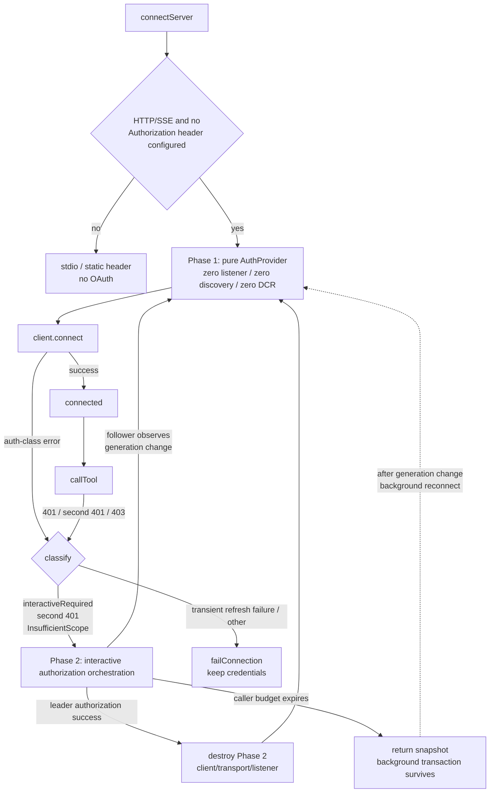
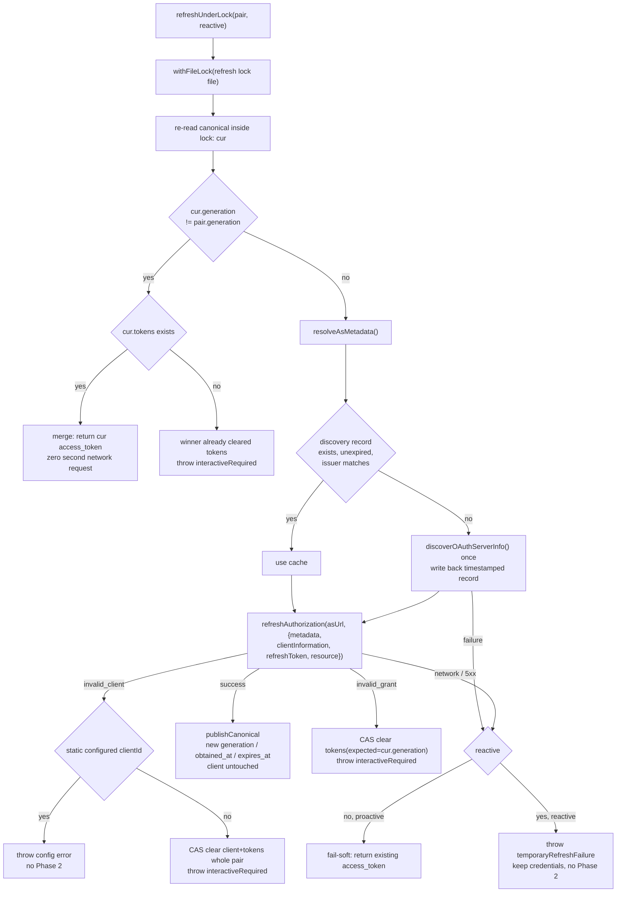
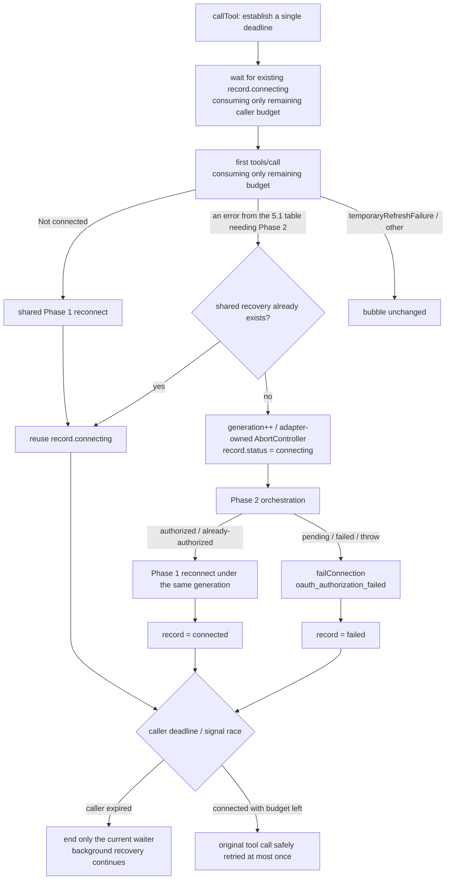

# MCP OAuth two-phase connection spec (v4)

> Status: design finalized, implemented in PR1-PR3. Date: 2026-08-14; revised 2026-08-24 to add runtime tool-caller budgets, shared recovery ownership, and failure convergence.
> Baseline: `exa-oauth-analysis` / `bfc91c54a9`. Root-cause analysis: `docs/analysis/exa-oauth-reauth-analysis.md`.
> Production SDK: `@modelcontextprotocol/client@2.0.0` (`apps/zcode-cli/packages/adapters/package.json:105`). The repo also contains `@modelcontextprotocol/sdk@1.29.0`; this spec and implementation use only `client@2.0.0`.
> Prerequisite spec: `docs/mcp-oauth-client-auth.md` (config, credential integrity, settings-page boundaries).

## 1. Problem and goals

### 1.1 Two confirmed root causes

| Root cause                | Mechanism                                                                                                                                                                                                                             | Field evidence                                                 |
| -------------------------- | -------------------------------------------------------------------------------------------------------------------------------------------------------------------------------------------------------------------------------------- | --------------------------------------------------------------- |
| **R1 refresh race**        | Multiple CLI processes share `~/.zcode/v2/credentials.json`. `withFileLock` covers only credential reads/writes, not network token exchange. On expiry every process refreshes concurrently with the same refresh token, trips the authorization server's rotation reuse-detection, and the whole token family is revoked; the SDK then invalidates tokens and degrades to re-authorization | 8-12 connected at `08:54:49Z`, interactive authorization by `09:00:13Z` |
| **R2 re-authorization dead loop** | A DCR-registered client pins `redirect_uris` to the random callback port at registration; the callback server re-randomizes the port on each `listen(0)`. On redirect_uri mismatch the authorization server must not redirect back (RFC 6749 §4.1.2.1) and renders an error page in place; the callback never arrives and retries never self-heal | client registered port `54735`; later authorizations used `58670`/`58676`/`61820` |

R2's amplifier: settings-page lease and session lease each created an independent OAuth transaction — multiple clients, states, and authorization URLs; the session startup budget of 15 seconds was wrongly implemented as "the authorization transaction may only live 15 seconds".

### 1.2 Design principles

1. Passive connections: zero listeners, zero discovery, zero DCR.
2. Only interactive authorization creates a listener; cross-process single-flight; DCR client lives in transaction memory.
3. All refreshes (active and reactive) funnel through one cross-process file lock.
4. Deterministic OAuth errors invalidate via generation CAS; only non-deterministic errors fail soft.
5. Caller wait budget and authorization-transaction lifetime are separate: 15 seconds is the caller's budget; the transaction's global lifetime is 300 seconds.
6. Runtime (`callTool`) and connection setup share the same Phase 2 → Phase 1 orchestration — no startup-only self-healing.
7. Shared recovery is held by the adapter/session lifecycle; any tool caller's timeout or cancel ends only its own waiter and never cancels the shared authorization. The recovery promise must be a total operation that finally settles the record to connected or failed.

### 1.3 Current defect: passive connections also open listeners

`resolveAuthorizationCodeOAuthConfig()` returns `{ type: "authorization_code" }` for any HTTP/SSE MCP without an `Authorization` header (`mcp/index.ts:1012-1025`). `createTransport()` then unconditionally creates an OAuth session, and `createMcpAuthorizationCodeOAuthSession()` calls `listen(0)` before returning (`mcp/oauth.ts:67-80`, `auth/localhost-callback.ts:69-83`).

Result: **every HTTP MCP connection occupies a random-port HTTP listener even when credentials are fully valid and no authorization is needed.** That is both the port source of R2 and the resource problem Phase 1 must solve first.

## 2. Overall architecture



Hard boundaries between the phases:

- Phase 1's provider has **only** `token()` and `onUnauthorized()`. It is not an `OAuthClientProvider`, so the transport's `_oauthProvider` stays empty (the `isOAuthClientProvider` branch at `client/dist/index.mjs:4977-4980`) and the SDK's `auth()` / discovery / DCR never participate.
- Phase 2 **creates no MCP transport**. It calls the SDK-exported `auth(provider, options)` directly to drive discovery → DCR → authorize → code exchange. The hazard "Phase 2's authenticated transport would carry `_oauthProvider` into runtime and on 401 go through the SDK's `handleOAuthUnauthorized()` → `auth()`, bypassing the refresh lock" (`index.mjs:245-276`) structurally cannot exist: there is no transport to leak. After authorization succeeds, the caller reconnects with Phase 1's pure AuthProvider.
- The Phase 1 probing transport is always closed before Phase 2: on negotiation failure the SDK already called `transport.close()` (`index.mjs:3283-3287`); a spent transport is not reusable.

## 3. Phase 1: runtime pure AuthProvider

### 3.1 Provider shape

```ts
{
  async token() {
    const pair = await loadCanonical();
    if (!pair?.tokens) return undefined;                 // → 401 → onUnauthorized
    if (!isNearExpiry(pair)) return pair.tokens.access_token;
    return await refreshUnderLock(pair, { reactive: false });
  },
  async onUnauthorized() {                               // transport then retries once automatically
    const pair = await loadCanonical();
    if (!pair?.tokens?.refresh_token) throw interactiveRequired();
    await refreshUnderLock(pair, { reactive: true });
  },
}
```

SDK contract (`index.d.mts:186-201`): `onUnauthorized()` returns `Promise<void>` and its return value is ignored; its job is "make the next `token()` return a usable token". So `refreshUnderLock` must publish its result to canonical and make the provider's next read bypass the cache.

401 seat semantics (`index.mjs:4848-4866`, `5103-5120`, `5340-5358`):

- `onUnauthorized` is invoked at most once per request (`!isAuthRetry`).
- Errors it throws bubble unchanged through `markAuthSeamEscape()`, preserving identity.
- If the retry still gets 401, it throws `SdkHttpError(SdkErrorCode.ClientHttpAuthentication, "Server returned 401 after re-authentication")`.

### 3.2 Canonical credential structure

```ts
interface McpOAuthCanonicalCredentials {
  client_information: OAuthClientInformationMixed;
  expires_at?: number; // new: epoch ms, derived from obtained_at + expires_in
  generation?: string; // new: unique 128-bit random id per publication
  issuer?: string; // new: stored field only; not part of keyPrefix keying this round
  obtained_at?: number; // new: epoch ms
  published_by: string; // kept: transaction id, diagnostics only
  tokens: OAuthTokens;
  version: 1 | 2; // not bumped
}
```

**All new fields are optional and the version is not bumped.** Optional additive fields are backward compatible for old readers (unknown fields ignored); bumping would make un-upgraded CLI/desktop treat the record as an unknown version, ignore it wholesale, and fall back to the legacy mirror — losing the canonical-pair guarantee, while "unknown versions must keep the original value" is exactly the existing constraint.

`generation` must be a fresh random id per publication and **must not reuse `published_by`**: `published_by` is a state-derived transaction id that does not change across refreshes within one transaction (`oauth.ts:223-228`), so it cannot carry CAS and follower-observation duty. A random id also removes ABA. During migration, old records (no `generation`) use a stable hash of the canonical raw JSON as the baseline generation.

`OAuthTokens` carries only `expires_in`, no acquisition time, so `obtained_at` must be recorded by us — otherwise real expiry cannot be computed across processes. Near-expiry keeps the 30-second skew.

### 3.3 refreshUnderLock



Key constraints:

- **The lock file is separate from the credentials file.** Inside the lock we call `publishCanonical()`, which itself uses `withFileLock(credentials.json)`. Locks on two different paths cannot self-deadlock.
- **The lock file basename contains only hash and hyphens.** `keyPrefix` looks like `mcp:oauth:<hash>`; colons are illegal in Windows filenames, so rewrite to `mcp-oauth-<hash>.refresh`, same directory as credentials.
- **The lock acquisition budget must cover the network budget.** `withFileLock` defaults `lockMaxWaitMs` to 8 seconds (`privateFilePersistence.ts:9`), while discovery + refresh can exceed that, so pass 45 seconds explicitly. On waiter timeout, **re-read canonical first**: if the generation changed and tokens exist, use them; otherwise report `temporaryRefreshFailure` (a lock wait failure is not a grant failure).
- **Fail-soft splits proactive vs reactive.** A proactive (`token()` near-expiry path) network failure may return the current value: the resource server has not rejected it yet. A reactive (`onUnauthorized()`) network failure must **not** return the current value — that token was just rejected; returning it guarantees a second 401 and a thrown `ClientHttpAuthentication`, and would misread a transient AS outage as needing interactive authorization. Reactive network failures throw the distinct `temporaryRefreshFailure`; the orchestrator keeps credentials and skips Phase 2.
- **Generation changed but the winner has no token** is not success. Never return `undefined` as "no credentials" — join / enter Phase 2.
- **Without a refresh token, never invent a refresh.** `token()` returns the existing access token until 401; `onUnauthorized()` then uniformly decides interactive authorization is required.

### 3.4 resolveAsMetadata

Returns a triple; Phase 1 and Phase 2 share the same discovery record:

```ts
interface ResolvedAsMetadata {
  authorizationServerUrl: string;
  metadata?: AuthorizationServerMetadata;
  resource?: URL; // validated via selectResourceURL
}
```

- The discovery record carries `fetched_at` with a 24-hour TTL; re-discover when expired or when `issuer` differs from the canonical `issuer`. **The timestamp lives in a separate key (`discovery_state_fetched_at`), not wrapped inside `discovery_state`**: the latter's value shape must stay a bare `OAuthDiscoveryState`; wrapping it as `{fetched_at, state}` would make un-upgraded readers see an object without `authorizationServerUrl`, silently losing the discovery cache. A missing timestamp counts as expired and self-heals after one re-discovery.
- `resource` must be resolved and passed to `refreshAuthorization()` (RFC 8707). The SDK's own refresh passes a validated resource (`index.mjs:690-697`); bypassing `auth()` means we must supply it ourselves, or audience binding is lost.
- Phase 2's interactive provider's `discoveryState()` reads the same record, avoiding Phase 1 refreshing metadata while Phase 2 still uses an un-TTL'd stale cache (today `oauth.ts:288-294` returns the cache with no TTL).
- Phase 2 also keeps an in-memory copy within the transaction: SEP-2352 requires the code-exchange leg to read back the issuer recorded by the authorize leg, or the SDK throws `AuthorizationServerMismatchError` (`index.mjs:682-687`). The shared record may be rewritten by another process or expire mid-flight; the in-memory copy keeps issuer binding stable within one transaction.

### 3.5 Credential invalidation must be a generation-conditional transaction

The current `deleteIfValues()` compares and deletes key by key (`shared-credentials.ts:104-121`): when canonical fails to match, legacy mirrors may still be deleted, and vice versa — it cannot express "invalidate the whole set only if canonical matches".

So the shared credential store gains a conditional transaction:

```ts
deleteManyIfValue(
  guardKey: string,
  expectedGuardValue: string,
  keysToDelete: readonly string[],
): Promise<boolean>;
```

Semantics: inside one credential-file RMW critical section, delete all `keysToDelete` only if `guardKey`'s current value equals `expectedGuardValue`; otherwise delete nothing and return `false`. The OAuth call uses the canonical key as `guardKey` and **the initiator's read canonical raw JSON** as the expected value (the raw value carries the generation, stricter than comparing the generation field alone). Deletion sets:

- `invalid_grant` → canonical + legacy tokens (keep the legacy client as a re-authorization seed);
- `invalid_client` → canonical + legacy tokens + legacy client (drop the whole pair).

A stale transaction therefore cannot delete the winner's canonical or either of its mirrors.

### 3.6 One implementation of the compatibility rules only

The canonical/legacy-mirror interleaving compatibility branches (which changes can be proven to belong to the same authorization) are extracted into the pure function `deriveCredentialPair({canonicalRaw, legacyClientRaw, legacyTokensRaw})`; `loadCredentialPair()` is its "read once + derive" wrapper.

The kept old `authorization_code` provider also delegates to the same pure function, deriving from its own already-read snapshot: writing these branches twice would certainly diverge, and re-reading the credentials file would double the I/O per provider read. That provider is no longer used at runtime; it stays only as a test surface for the compatibility rules and goes away with the legacy mirror window.

## 4. Phase 2: interactive authorization orchestration

### 4.1 Sequence

```mermaid
sequenceDiagram
    participant S as Session lease
    participant T as Settings lease
    participant L as authz lease
    participant C as canonical credentials
    participant B as Browser / AS

    S->>C: read baseline generation G0
    S->>L: tryAcquire(attemptId=A)
    L-->>S: won → leader
    T->>C: read baseline generation G0
    T->>L: tryAcquire(attemptId=B)
    L-->>T: lost → follower

    S->>C: re-read under lock; continue only if generation still G0
    S->>S: listen(0) create listener
    S->>B: fresh DCR (redirect_uri = current live listener)
    B-->>S: new client_id (written to transaction memory only)
    S->>C: publish pending{attemptId=A, url, state, G0, expiresAt}
    T->>C: read pending(A) → project the same authorization URL into its own status
    S->>B: open authorization URL (user-triggered)
    B-->>S: callback code (state validated)
    S->>B: finishAuth → token exchange
    B-->>S: tokens
    S->>C: fenced publish canonical generation=G1
    S->>C: CAS delete pending(A)
    S->>L: release lease
    S->>S: destroy Phase 2 client/transport/listener → Phase 1 reconnect
    T->>C: polling finds generation G1 != G0 with tokens
    T->>T: Phase 1 reconnect
```

### 4.2 Leader / follower contract

```text
G0 = current canonical generation (baseline)
tryAcquire(authz lease, attemptId)
 ├─ not acquired → follower
 │    read pending: attemptId valid and unexpired → show the same authorization URL
 │    poll canonical: generation != G0 and tokens exist → back to Phase 1 reconnect
 │    caller budget expired (session 15s / settings 300s) → report "authorization in progress elsewhere" and return snapshot
 │                                                  the shared background task keeps observing; the leader is not terminated
 └─ acquired → leader
      re-read under lock: generation != G0 (someone finished while waiting) → release and finish, back to Phase 1
      listen(0) random port (no port reuse: the listener lives for the whole connection; reuse would collide)
      interactive OAuthClientProvider (fresh state, scope = orchestration-computed unionScope)
        clientInformation()      static configured clientId → return it; otherwise undefined
                                 → the SDK must DCR again against the currently live listener URL
                                 → redirect_uri mismatch eliminated at the root
        saveClientInformation()  writes transaction memory only, never disk
        tokens()                 undefined (no refresh triggered)
        saveTokens()             atomically publish canonical + legacy mirror via locked saveMany
        discoveryState()         read the shared discovery record (with TTL)
      publish pending{attemptId, authorizationUrl, state, baselineGeneration, expiresAt}
      wait for callback up to the global 300s TTL
      on giving up, AbortController truly cancels listener / fetch / finishAuth
      finally: wait for all in-flight promises to settle → CAS delete pending → release lock
               → close listener → destroy transport → back to Phase 1 reconnect
```

### 4.3 Why a dedicated authorization lock, not a marker

`withFileLock`'s `maxWaitMs` bounds acquisition, not holding (`privateFilePersistence.ts:51-75`); a live-PID lock is never stale-reclaimed (`atomicFileLock.ts:69-87`); `67666ea256` fixed a mistaken cleanup after waiter timeout, unrelated to long holds. **The lock itself is the fencing**: once a late leader releases, its attempt has already lost the right to publish.

### 4.4 tryAcquire must be a dedicated implementation

`withFileLock(..., { lockMaxWaitMs: 0 })` is not enough, for two independent reasons:

1. **Deadlocks cannot be reclaimed.** Under contention `acquireFileLock` checks `elapsed >= maxWaitMs` before attempting to reclaim an abandoned lock (`atomicFileLock.ts:238-253`). A zero wait times out immediately and never runs the owner-dead check; after the lock-holding process crashes, authorization is permanently unavailable. So tryAcquire uses a **short but non-zero** budget (250ms, 25ms retry interval), guaranteeing at least one owner-dead reclamation check before failing while keeping the follower's added latency imperceptible in a human flow.
2. **`withFileLock`'s in-process FIFO would block followers.** It queues by filePath (`privateFilePersistence.ts:58-64`) before acquiring; a second in-process caller would wait for the first to release (up to 300 seconds) instead of immediately becoming a follower. So tryAcquire calls `acquireFileLock` directly, bypassing that queue.

**No extra in-process registry is needed.** Mutual exclusion comes from `mkdir` — a filesystem-level semantic independent of processes: a second in-process caller also gets `EEXIST`, then reads an owner PID that is this same live process, so it never mis-reclaims and correctly degrades to follower. The lock path basename again contains only hash and hyphens (`mcp-oauth-<hash>.authz`).

### 4.5 The pending key must bind to the attempt

Pending contains at least `attemptId`, `baselineGeneration`, `authorizationUrl`, `state`, and `expiresAt`. Deletion must be a CAS by `attemptId`, or an old leader's `finally` would delete a new leader's just-published pending and followers would lose the authorization URL. The TTL is for display-expiry only and must **never** be a lock-ownership basis.

### 4.6 Cancellation must wait for in-flight settle

Entering `finally` and releasing the lock right after `AbortController.abort()` is not enough: a token response may already be in flight, and the old transaction's code exchange / `saveTokens()` may still be running. The current callback promise takes no signal and closing the listener does not reject it (`localhost-callback.ts:24-30`, `83-90`); the current `withTimeout` only ignores late results and never cancels the underlying operation (`mcp/timeout.ts:1-53`), so it cannot carry cancellation duty.

**The fix is structural, not an in-flight tracker: only the "wait for the user to authorize" leg has a timeout; the code exchange is always awaited to settle, never racing a timeout.**

```text
auth(provider, {...})                     ← no timeout (build URL + DCR, local/bounded network)
withTimeout(waitForCallback(), 300s)      ← the only timeout point: waiting for a human
auth(provider, {authorizationCode})       ← no timeout, await to settle
finally: close listener → CAS delete pending → release lock
```

A timeout can only happen "before we have the code", at which point token exchange has not started — no in-flight request can publish after the release, and fencing closes naturally. The cost: a callback at 299.9s plus a 5s exchange slightly exceeds 300s of lock holding — more correct than discarding a valid code.

### 4.7 PR2 landing alone needs a transition seam

When PR2 lands, Phase 1 is still the old full provider, which calls `listen(0)` before transport creation and lets the SDK do its own DCR / redirect (`oauth.ts:67-103`); the adapter checks `hasPendingAuthorization()` only after failure (`index.ts:570-599`). Without a seam, PR2 alone would still open an authorization URL with "old client + new redirect_uri" — R2 unfixed.

Seam contract (two parts, both required):

1. `redirectToAuthorization()` **no longer** projects the authorization URL as a pending state or opens a browser; it throws `interactiveRequired()`, and the orchestrator transitions into a fresh Phase 2 transaction.
2. `clientInformation()`, with neither a static configured clientId nor a stored client, likewise throws `interactiveRequired(reason: "no_credentials")`, **not** `undefined`. Returning `undefined` makes the SDK immediately run its own dynamic registration — but DCR ownership has moved wholly to Phase 2; that registration would never be used and only litters the authorization server with junk clients. No client means no refresh token, so interactive authorization was the only path anyway — throwing is correct.

During the PR2 window the old provider keeps only `token()` / refresh semantics; the only exit for interactive authorization is Phase 2.

## 5. Error classification and runtime recovery

### 5.1 Auth error classification table

| Error                                                        | Source                                          | Orchestrator action                                                       |
| ------------------------------------------------------------ | ----------------------------------------------- | -------------------------------------------------------------------------- |
| `interactiveRequired` (our stable code + `Symbol.for` brand) | Phase 1 provider                                | enter Phase 2                                                              |
| `SdkHttpError{code: ClientHttpAuthentication}`               | still 401 after retry (`index.mjs:4862`, `5117`, `5354`) | enter Phase 2                                                    |
| `UnauthorizedError`                                          | defensive path without `onUnauthorized`         | enter Phase 2                                                              |
| `InsufficientScopeError{requiredScope}`                      | Streamable HTTP 403 (`index.mjs:5010`)          | compute unionScope, then Phase 2                                           |
| `temporaryRefreshFailure`                                    | network / 5xx on reactive refresh               | keep credentials, failConnection, **no** Phase 2                           |
| `invalid_client` with static clientId                        | Phase 1 refresh                                 | report config error, **no** Phase 2 (Phase 2 would reuse the same static client and loop forever) |

`interactiveRequired` is recognized by stable code + `Symbol.for` brand, not `instanceof`, to survive bundle double-loads. The SDK's `markAuthSeamEscape()` preserves identity (`index.mjs:2270-2277`) and never replaces the error object. The orchestrator must classify **before** `failConnection()` (near `index.ts:570`).

### 5.2 The 403 unionScope formula

The SDK's own algorithm is a three-way union (`index.mjs:5021-5024`; `computeScopeUnion` is exported):

```text
unionScope = historical requested scopes ∪ token.scope ∪ challenge.scope
```

Not the two-way `token.scope ∪ requiredScope`: the token response's `scope` may be absent, so relying on the token alone would drop scopes declared in config but not echoed by the server.

On catching a challenge, the orchestrator: re-reads the latest canonical → computes `config/effective_requested_scope ∪ token.scope ∪ requiredScope` → passes the final scope **and** the `resourceMetadataUrl` into Phase 2 → Phase 2 never recomputes from a stale snapshot. Both the DCR `clientMetadata.scope` and the authorize request use this final scope, or 403 loops forever.

### 5.3 SSE 403 has no step-up (known limitation)

Typed step-up exists only on Streamable HTTP. The old SSE transport throws a plain HTTP `Error` on POST 403 (`index.mjs:4867-4869`), producing no `InsufficientScopeError` and no `requiredScope`.

This round adds no SSE step-up. SSE 403 is treated as unclassifiable: `failConnection` keeping credentials, **no** Phase 2 — because an authorization retry without a computable unionScope would 403 again with the same scope, looping.

### 5.4 Runtime recovery

`callTool()` currently retries once only on a bare `"Not connected"` (`index.ts:307-328`); auth-class errors bubble raw. After connecting, an expired, revoked, or insufficient-scope token leaves the user with a raw error and no self-healing.

Runtime recovery keeps "the original tool call retries at most once", but the caller that hit the error must not inline-own Phase 2. The first auth error must atomically create or reuse a shared recovery task on the server record:



The shared task fully owns "Phase 2 → Phase 1 reconnect" and is stored on `record.connecting`. Concurrent callers of the same adapter reuse this one promise; across adapters/processes the authz lease still single-flights. The task uses an adapter-owned `AbortController`, cancellable only by explicit `disconnectServer`, adapter/session `close`, or a generation change. `McpCallToolOptions.signal` must never be passed to Phase 2, or the core tool executor's deadline abort would close the callback listener and kill an authorization still in progress in the browser.

`callTool()` establishes one deadline at entry. Waiting for an existing connecting, the first request, waiting for shared recovery, reconnecting, and the final retry all consume only the remaining budget; no stage may regain a full `timeoutMs`. On caller expiry, return the `McpTimeoutError`/cancel error, but the shared recovery keeps observing the canonical generation and proactively reconnects the record to connected after authorization completes. Runtime tools are already registered in core, so later calls directly reuse the recovered connection.

The shared recovery must not recursively reconnect through the existing `connectServer()`: `connectServer()` calls `closeRecord()` first, which aborts the current record's recovery controller — self-cancellation. It should either enter Phase 1 directly under the same generation/controller or extract an internal state-transition function that does not run `closeRecord()`.

### 5.5 Phase 2 exceptions must converge

`runInteractiveOAuthAuthorization()`'s public result already includes `{status: "failed", error}`, so production orchestration must normalize these exceptions into a failed outcome instead of letting the promise reject:

- canonical/legacy credential reads failing as corrupt, EACCES, or EPERM;
- authz lease acquisition exceptions;
- credential read exceptions while computing step-up scope;
- a host callback rejecting while a follower projects `onAuthorizationRequired`;
- resource-metadata URL conversion and other interactive-orchestration exceptions like discovery/DCR.

Both connection setup and runtime shared recovery, on receiving a failed outcome, must call `failConnection({failureKind: "oauth_authorization_failed"})`. On success a connected record replaces the connecting record; on failure a failed record replaces it. Keeping a rejected `record.connecting` is forbidden, as is using `Promise.allSettled` to mask an unconverged single-server state.

The underlying lease release stays best-effort; file-deletion exceptions are already swallowed inside the lock implementation and are not this defect's trigger. Even if the lock implementation later changes, cleanup failures must never overwrite an already-determined authorization outcome.

### 5.6 Pending projection for the settings/session double lease

The settings adapter and session adapter are independent leases (`zcode-protocol-entrypoint.ts:115-133`); `connectionKey` uses `leaseId` for non-workspace-isolated servers (`pool.ts:317-328`). So when the session becomes leader, the settings follower must read the shared pending key and project the authorization URL into its own status; the current status update fires only in the owning adapter's own `onAuthorizationRequired` callback (`index.ts:770-785`) and is invisible across leases.

## 6. PR sequence (order fixed)

| PR      | Content                                                                                                                                                                                                                     | Fixes                |
| ------- | ---------------------------------------------------------------------------------------------------------------------------------------------------------------------------------------------------------------------------------------- | --------------------- |
| **PR1** | `localhost-callback`: a mismatched state answers 400 but does **not** reject its own callback promise; a matching state with `error=access_denied` settles as failure immediately. `oauth.ts`'s `invalidateCredentials` branches and authorization/refresh events gain warn-level logs (no token plaintext) | observability + callback robustness |
| **PR2** | dedicated authorization lock (dedicated tryAcquire) + fresh DCR held in transaction memory + locked atomic publish + attempt-bound `pending_authorization` shared key + caller-budget/transaction-lifetime split + true abort + **old provider → Phase 2 transition seam**                           | **R2**                |
| **PR3** | Phase 1 pure AuthProvider + `refreshUnderLock` + `generation` and `deleteManyIfValue` CAS + `obtained_at`/`expires_at` migration + discovery TTL/issuer/resource + 403 unionScope pass-through + Phase2→1 handoff + runtime `callTool` recovery                | **R1**                |

PR3 must follow PR2: once Phase 1 becomes a pure AuthProvider, the SDK no longer self-triggers interactive authorization, and without PR2 users could not authorize at all.

## 7. Migration

| Existing state                                   | Behavior                                                                                                                                                                                                              |
| ------------------------------------------------ | --------------------------------------------------------------------------------------------------------------------------------------------------------------------------------------------------------------------- |
| v3 canonical (has `generation`/`obtained_at`)    | normal path                                                                                                                                                                                                           |
| v1/v2 canonical with refresh token               | treated as near-expiry; enter the lock and attempt **exactly one** refresh (the in-lock re-read prevents multi-process repeats). Success → publish v3; `invalid_grant` → CAS-clear tokens and enter Phase 2 (the old family is already dead — exactly the exa incident); transient failure → keep the old pair and treat as a reactive transient error |
| v1/v2 canonical without refresh token            | no invented refresh; keep using the access token until 401, then Phase 2                                                                                                                                              |
| unknown higher version                           | keep the original value and fall back; never delete as corrupt (existing constraint)                                                                                                                                  |

Sending every upgrading user straight into Phase 2 would cause needless authorization prompts — not adopted.

## 8. Verification matrix

All 19 existing OAuth e2e assertions are kept. The existing e2e imports directly from `@modelcontextprotocol/sdk@1.29` and must switch to the production package `@modelcontextprotocol/client@2.0.0`. Additions:

### PR1

1. A request with a wrong state arrives first, the correct state later → authorization still succeeds (the wrong request must not poison the callback promise).
2. A matching state with `error=access_denied` → fails immediately, without waiting for the timeout.

### PR2

3. Two real child processes contend for leader → exactly one listener, one DCR, one authorization URL.
4. A times out, B takes over: assert A's `finishAuth`/`saveTokens` fully settle before the lock releases, A's late `saveTokens` must fail (fencing), and A never overwrites B.
5. Authorization-lock dead-owner reclamation: reclaimable under zero-wait contention with a dead owner; an old attempt's `finally` must not delete the new attempt's pending; the lock path is legal on Windows (no colon in basename).
6. **Transition seam**: while the old full provider is still in use, first/invalid authorizations are steered by the seam into a fresh Phase 2; the old redirect URL must not be opened.
7. On `ServerError`/403 paths with an old canonical still present, the leader must not treat the old token as a new generation.
8. Settings/session double lease: the session becomes leader first; the settings follower sees the same pending URL; the session's 15-second budget expiry does not terminate the 300-second shared authorization; after the leader finishes, both adapters return to Phase 1.

### PR3

9. First connection without credentials: assert zero discovery, zero DCR, zero listeners.
10. Strict-rotation server + two barrier processes: exactly one refresh request (following the `mcp-oauth-proactive-refresh.test.ts` idea from `22ba5d86c4`; the file layout has diverged, no cherry-pick). On top of it, add an expired-discovery single-flight branch and a reactive network-failure branch.
11. `invalid_client`: the client + tokens pair is invalidated wholesale; a static-clientId `invalid_client` reports a config error instead of entering Phase 2.
12. Old canonical without time fields → exactly one refresh attempt, not repeated.
13. Generation/CAS: under concurrent refresh, authorization, and invalidation, every publication changes generation; a stale `invalid_client` must not delete the winner's canonical or legacy mirrors.
14. Runtime recovery: after connecting, `callTool()` triggers 401, a second 401, and 403 respectively → completes Phase 2, destroys the interactive transport, reconnects Phase 1; the original tool call safely retries at most once.
15. Scope/resource: the token response lacks `scope` and the challenge adds a new scope → assert new requests keep config/historical scopes and the challenge's `resourceMetadataUrl` is passed. SSE 403 asserts "step-up explicitly unsupported".
16. While `callTool()` waits for startup connecting, a caller timeout/abort immediately ends the current waiter; the background connection and callback listener stay alive.
17. A tool caller triggers Phase 2 at runtime, then times out; the user later completes browser authorization → without the original caller alive, the record eventually reaches connected by itself.
18. Two concurrent tool callers create only one adapter-owned recovery; either caller's cancellation does not affect the other caller or the callback listener.
19. Phase 2 orchestration exceptions (credential load, lease EACCES/EPERM, follower callback reject, …) → the record enters `failed/oauth_authorization_failed`; later connections with the same config can retry and never reuse a rejected promise.
20. Single deadline: first call, recovery wait, and final retry together stay within the caller budget; after successful authorization the original tool call retries at most once.

## 9. Known limitations (not fixed this round)

- `issuer` is only a stored canonical field, not part of `keyPrefix` keying. Switching authorization servers under the same credential key (`serverName + serverUrl + scope + redirectPath`) still reuses credentials per the existing five-dimension key.
- Localhost callbacks are unreachable across hosts in remote SSH / container scenarios. Pre-existing; the two-phase design does not change it.
- SSE transport 403 has no step-up (see 5.3).
- The authorization URL is still opened explicitly by the user in settings; no automatic system-browser launch by default.
- **A late authorization does not inject tools into a running session.** After the caller budget expires, the authorization transaction survives and writes credentials, but `registerMcpTools` runs only once in `startMcpStartup` (`core/src/runtime/methods/mcp.ts:105`). After the leader succeeds, the running session does not automatically gain that MCP's tools; the settings page's pending/follow-up polling window will show connected, while the session side needs the next connection or refresh. Making tool registration replayable mid-session is a core runtime change, out of scope.
- During the PR2 window, Phase 1 is still the old provider, so each connection still creates one callback listener per HTTP/SSE MCP (see 1.3). That overhead disappears in PR3 with the pure AuthProvider.

## 10. Spec references

- MCP Authorization: https://modelcontextprotocol.io/specification/2025-11-25/basic/authorization
- RFC 6749 §4.1.2.1 (no redirect back on redirect_uri mismatch)
- RFC 8252 (loopback native client port exception; this design does not depend on the server implementing it)
- RFC 8707 (Resource Indicators)
- RFC 9728 (OAuth Protected Resource Metadata)
