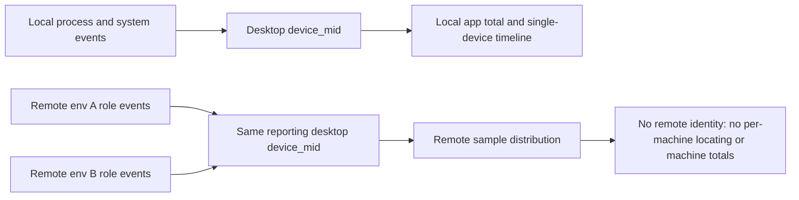

# Process-resource dashboard SQL review

Date: 2026-09-15. Scope: the 32 data panels, 1 version-list query and 8 filters of dashboard `6829792905`.
This is a SQL and field-contract review; the recommendations are not implemented and the delivered online
configuration and query files are unchanged. No production samples were used to assess resource health,
distribution stability, query performance or visual density.

## Conclusion

The seven sections are well organized and stay. The queries show resource scale, version distribution, role
differences, plugin ranking and reporting coverage, but have gaps for version-regression judgement, single-device
diagnosis and collection-fault detection. Fix valid-sample counts, trend truncation, filter scope and
collection-quality queries first, then add single-device and slow-Bash correlation views; adding more panels does
not solve these.

## Method and evidence boundary

- The [SQL query list](./process-resource-queries.json) and [dashboard JSON](./process-resource-dashboard.json)
  were checked line by line: 33 queries consistent, `query` equals `tokenQuery`, all 13 line charts use
  `classify(time, series, value)`.
- Checked against the [telemetry spec](../process-resource-telemetry.md), the shared attribute allow-list, main's
  role/system event projection and the MCP aggregation.
- The aggregation half of the original queries was run in in-memory SQLite on constructed `base` data with
  deterministic quantiles replacing `approx_percentile`. This validates grouping, counting, ordering, LIMIT and
  NULL logic, not Alibaba Cloud engine compatibility nor online data.

## Queries and expressions to fix first

### 1. Sample eligibility is not applied per metric and per time bucket

Where: group trends `cpu-trend`, `rss-trend`, `role-rss`, `role-background-cpu`, `mcp-rss`, `mcp-cpu`; the
interpretation columns of `mcp` / `remote-mcp`.

- Trends return only `time, series, value` with no valid-device count per point. The version table counts the
  whole range and cannot stand in for per-bucket sample size; the role table cannot stand in for the valid
  background-window sample size.
- The MCP interpretation uses `count(*) < 100`, but background CPU quantiles use `count(bgcpu)`, so the overall
  interpretation can contradict the listed valid background-CPU devices.
- Likewise, total devices of a role may be large while few have a valid heap; total devices must not be the heap
  eligibility.

Constructed check: a version has 100 devices all day, first bucket CPU 1%, second bucket 1 device at 50%: the
version table says comparable, the trend jumps 1% → 50% with no sample-size hint. An MCP with 101 devices of which
1 has valid background CPU still prints "comparable distribution; non-causal".

Fix: output each metric's own valid-device count; compute valid devices per `time × version × role/MCP` and show it
with the point or in a companion chart. Below 100 keep the value with a "sample too small" hint (the previously
confirmed display rule). The threshold is only a display gate and does not mean the populations are comparable.

### 2. Trends over 10,000 rows drop the newest data

Where: all fixed-bucket trend queries, especially `role-rss`, `mcp-rss`, `mcp-cpu`.

The queries use `ORDER BY time, series LIMIT 10000`; past the limit the earliest points are kept, the newest are
dropped, and a boundary bucket may keep only some series. Check: 7 days, 30-minute buckets, 4 versions, 9 roles =
12,096 rows; the original query returns 10,000 and its last bucket is 29 hours before the real last bucket. With
more MCPs, 24 hours can hit the limit too.

Fix: adapt the bucket to the time range; pick Top N before aggregation for high-cardinality MCPs and show the
selection range; estimate or detect result size and warn on truncation. Only raising LIMIT or reversing order
still silently drops part of the range.

### 3. Overview counts and resource cards are not the same population

Where: `coverage`, `events` vs `app-cpu`, `app-rss`. The first two cards consume all three event kinds and apply
only app environment, native version and platform variables; the last two consume system events only and also
apply architecture, cores, memory and foreground/background variables. After choosing a hardware class the
resource metrics change while the neighboring device and event counts do not. The counts also include remote or
Bash-only reporting desktop identifiers and cannot be the denominator of local system-resource metrics.

Fix: make the overview device count the valid devices of the current system-resource population; move the
three-event totals to the collection-quality section or label them "all new-event coverage, not linked to
hardware/foreground filters". Resource cards average over devices when several versions are selected and should
say "selected versions combined".

### 4. Collection-quality queries hide the problems they should reveal

Where: the base conditions of `sample-quality`, `event-quality`, `latest-observation`.

- `sample-quality` groups only by `role, surface`, so versions mix and a small post-upgrade group is masked by old
  versions.
- P50/P95 of sample_count mostly reflect normal, fuller windows; low tail and low sampling ratio are missing.
- The common base first excludes empty `device_mid`, so new events whose device identifier is entirely missing
  still print "no new telemetry yet".
- A failed `try_cast` becomes NULL and the quality table has no separate count of missing/illegal/out-of-range
  CPU/RSS.
- Role coverage has only counts, no required-role coverage for the same reporting device in a similar window; with
  no exact window ID, a missing role cannot be called a fault directly.

Constructed check: old version 198 main windows with sample_count 30, new version 2 windows with 1: the current
table shows merged P50=30, P95=30 and the new-version anomaly is invisible.

Fix: group by version/surface/role; add P05, low-sample ratio and metric-field validity; use a dedicated quality
base that keeps identifier-less records and shows raw events, usable devices and identifier-less events
separately; list complete-vs-exit-remnant windows as leads, not faults.

### 5. Missing resource values count as "not over the line" in the memory-pressure table

Where: `pressure`. It only requires `total_memory_gb > 0` and then uses
`CASE WHEN metric / total > threshold THEN 1 ELSE 0 END`, so a missing/failed-cast metric takes ELSE 0 into the
"not over" denominator. Check: 100 devices with total memory, 1 with resource data over the line, 99 with NULL
metrics: both ratios show 1% on a valid sample of 1. A normal client contract provides these values, but a broken
field chain makes the dashboard under-report.

Fix: keep valid denominators separately for CPU, RSS and free memory; keep NULL and count it in the quality
section; show each item's valid device count.

### 6. Two names or orderings do not match the SQL meaning

- `bash-duration` sorts by label string: `15–30s → 1–2min → 2–5min → 30–60s → ≥5min`. Add a numeric bucket order.
- The "single-instance peak" of `mcp` / `remote-mcp` comes from `rss_kb_max_process_peak`, the largest single OS
  process RSS among the instances, not the whole process tree of an MCP instance. Rename it "largest single-process
  peak"; the current field cannot recover the largest instance-tree total.

## Most valuable additions

### Single-device diagnosis: app totals, MCP and an entry for anomalies

The four timelines only show non-MCP role CPU/RSS, whole-machine CPU and free memory. `device-rss` and
`device-cpu` filter `role <> 'mcp'` and the MCP section ignores the device variable, so one device's MCP use cannot
be located. App total CPU/RSS, role peaks and heap timelines from system events are missing; role quantiles or
window means must not be summed to approximate the app total (different sample times and liveness coverage).

Priorities: (1) show app CPU/RSS from system events in the single-device section, aligned with machine metrics;
(2) add per-`mcp_id` CPU/RSS for the device (Windows MCP CPU stays unavailable); (3) let the device list sort by
high CPU/RSS with device, version, latest time and peak (today it takes the last 100 reports, which makes finding
an anomalous device hard); (4) then role peaks, heap, process count and uptime. RSS total minus largest-process heap
cannot infer native memory.

### Slow Bash: resource combination within one event

The table computes duration P95, process-tree RSS P95, CPU-equivalent P50, CLI RSS P95 and free-memory P50
independently; they may come from different commands and cannot say whether the slowest command also uses much
memory. Keep the summary and add a bounded event detail or joint-bucket table: event time, device, version,
platform, exit_kind, duration, process-tree RSS, CPU equivalent, CLI RSS, free memory and sample_count, sorted by
duration or by duration bucket, with no command text or new privacy fields. The duration histogram should show
per-version ratios and command counts (selecting several versions currently merges them and raw counts mostly
reflect user volume). The exit-kind table can add the in-version slow-command share; `completed` still does not
mean exit code 0.

### Version and role: CPU high tail and valid grouping

CPU mostly uses `custom.value`, the window mean, so device P95 means "high tail of device average load", not short
CPU spikes. `cpu_percent_p95`, `cpu_percent_peak` and `app_cpu_percent_p95` are parsed but unused. Keep the mean
definition and add a clearly labelled window CPU high or high-window ratio to find short background spinning.
The uptime table is a growth lead, not proof of a leak; heap valid-device count must be shown separately.

### Remote: keep the existing information boundary

The three remote panels show the remote sample distribution under the reporting desktop version; they average per
reporting desktop and do not sum remote resources, which matches the visible fields. But `device_mid` is not a
remote machine ID, app.version is the desktop version, `background_ratio` comes from desktop foreground/background
counts and does not mean the remote is idle, and an old CLI missing hardware fields can fall back field by field
to desktop hardware. SQL cannot reliably derive remote machine identity or remote Agent version, nor tell fallback
hardware; the explanations must state these limits.

## Per-panel verdict (32 panels)

"Fix" = a definite definition/display defect; "Improve" = valuable but cannot fully answer its goal; "Keep" =
still subject to the common statistical boundaries.

| Section | Panel ID            | Verdict | Information and main change                                                                            |
| ------- | ------------------- | ------- | ------------------------------------------------------------------------------------------------------ |
| Overview | coverage            | Fix     | New-event coverage is valuable; not a hardware-filtered system resource sample count.                  |
| Overview | events              | Fix     | Report volume is valuable; state it is not linked to hardware/foreground and includes remote/Bash.     |
| Overview | app-cpu             | Keep    | Long-term CPU of the selected population; state multi-version aggregation and valid devices.           |
| Overview | app-rss             | Keep    | Memory scale of the selected population; state multi-version aggregation and valid devices.            |
| Overview | version-summary     | Keep    | The most direct version comparison; per-field valid devices, hardware and population differences apply. |
| Overview | cpu-trend           | Fix     | Version CPU over time; add per-bucket valid count and result-size control.                             |
| Overview | rss-trend           | Fix     | Version memory over time; add per-bucket valid count and result-size control.                          |
| Overview | system-cpu          | Keep    | High-end whole-machine load background; device P95 of window-P95 means, not attributable to the app.   |
| Overview | free-memory         | Keep    | P05 shows the low free-memory tail; filter hardware when comparing absolute MiB across memory sizes.   |
| Overview | pressure            | Fix     | Over-the-line device ratio; fix the missing-value denominator, label it "ever over the line in range". |
| Roles   | roles               | Keep    | Compares role, process count and single-process peak; add heap valid count.                            |
| Roles   | role-rss            | Fix     | Locates roles that change with version; control series count, bucket samples and LIMIT.                |
| Roles   | role-background-cpu | Fix     | Finds sustained background CPU; add background valid devices; the fixed background condition is exclusive with a global foreground choice. |
| Roles   | uptime              | Keep    | Lead on resource vs uptime; different device groups and oldest-process uptime are not a same-process growth curve. |
| MCP     | mcp                 | Fix     | Finds memory-heavy plugins; rename to largest single-process, split RSS/background-CPU eligibility.    |
| MCP     | mcp-rss             | Fix     | Plugin memory over time; Top N first, add per-bucket valid count.                                      |
| MCP     | mcp-cpu             | Fix     | Plugins still using CPU in desktop background; add background valid count, Top N and time-scale control. |
| Bash    | bash                | Improve | Slow-command distribution; add the per-command resource combination.                                  |
| Bash    | bash-exits          | Keep    | completed/timeout/killed/error composition; in-version ratios compare better.                          |
| Bash    | bash-duration       | Fix     | Slow-command durations; fix bucket order, support per-version ratios.                                  |
| Remote  | remote-roles        | Keep    | Remote role sample distribution; not a remote machine distribution or remote CLI version regression.   |
| Remote  | remote-mcp          | Fix     | Remote plugin ranking; inherits the MCP eligibility/name issues and the remote identity limit.         |
| Remote  | remote-bash         | Improve | Remote slow-command summary; also needs in-event correlation and respects the hardware-field limit.    |
| Device  | device-rss          | Improve | Non-MCP role RSS mean; add MCP, app total and peaks.                                                   |
| Device  | device-cpu          | Improve | Non-MCP role CPU mean; add MCP, app total and window high.                                             |
| Device  | device-system       | Keep    | Whole-machine CPU context; more valuable next to app totals.                                           |
| Device  | device-free         | Keep    | Lower bound of free memory; compare with app RSS.                                                      |
| Device  | device-list         | Improve | Copyable latest 100 identifiers; make it sortable by high resource values as a diagnosis entry.        |
| Quality | event-quality       | Fix     | New events and version freshness; keep identifier-less events and state its filter scope.              |
| Quality | sample-quality      | Fix     | Sample count/heap coverage; add version dimension, low tail and invalid-field statistics.              |
| Quality | self-cost           | Keep    | Wall-clock cost of sampling aggregation in main windows; not the full probe cost, remnant ≠ full windows. |
| Quality | latest-observation  | Fix     | No-data/acceptance-only/has-samples status; do not report "no usable device ID" as "no events".        |

## Filters and common limits

- Env single-select default prod, version native multi-select and platform filter are right; the version list
  returns only versions with new events (confirmed scope).
- Core and memory filters are static candidates and lack configurations such as 14 cores or 18/36 GB; read them
  dynamically from window events.
- Background-only charts fix `background_ratio >= 0.9`, so a global scene of foreground/mixed gives no results;
  hint the exclusivity or make those charts explicitly ignore that variable.
- The device input affects only the four single-device timelines and the independent device list; new
  single-device MCP/Bash views must also wire the same device variable.
- Every `avg(window_mean)` weights windows equally (complete and exit-remnant windows alike), matching the
  delivered "average of window means" but not an online-time-weighted average. To answer "average use while
  online", CPU/RSS may use the applicable sample_count weight; heap has no independent sample count and must not be
  weighted blindly.
- `spanNulls=false` only controls explicit NULLs; SQL generates no missing buckets, so whether a gap breaks the
  line needs rendering verification.
- No alerting and no automatic red/green rating remain in scope. A group of 100 samples does not remove hardware,
  usage-behavior and version-population differences.

## Recommended order

1. Fix valid-sample counts/eligibility, trend truncation, count filter scope, quality queries, NULL denominators
   and the definite title/bucket-order issues.
2. Add single-device app totals and MCP, a high-resource device entry and in-event slow-Bash correlation; keep the
   seven sections and reuse/adjust existing panels first.
3. After data arrives, calibrate Top N, time buckets, low-sample threshold and visual density; then verify
   multi-version, Windows, MCP and real remote samples.
