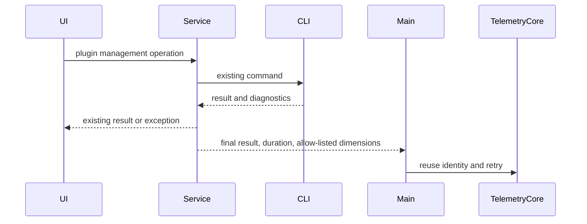

# Plugin lifecycle business telemetry

## Event overview

| Event                  | Trigger                                                                                         | Main dimensions                                                              |
| ---------------------- | ----------------------------------------------------------------------------------------------- | ---------------------------------------------------------------------------- |
| `plugin_lifecycle`     | Final result of install, uninstall, update, restore, configure, enable/disable, source change and per-plugin remote sync | action, result, plugin_id/marketplace, entry, trigger, scope, duration_ms |
| `plugin_discovery`     | Store or detail becomes visible, search submitted                                               | action, entry, plugin_id (detail), client_kind; no search term               |
| `plugin_usage`         | Plugin UI open requested, initialization done, instance released, UI-initiated tool call        | action, plugin_id, plugin_component; tool calls carry result/duration_ms     |
| `plugin_runtime_error` | Plugin UI initialization enters an error state                                                  | plugin_id, plugin_component, error_category; no raw error                    |
| `agent_step` (existing) | Terminal state of a real model Skill/MCP call                                                  | Adds plugin_id, plugin_component; keeps old Skill fields and existing de-duplication |

## Implementation definition

Plugin management operations report `plugin_lifecycle` after the final CLI result is obtained; no start event and
no new business `operation_id`. Network retries reuse the `event_id` generated by TelemetryCore. The operationId
already in the operation protocol is still used for cancel/progress and is not a business-telemetry correlation
field. `plugin_intent` is removed.

Each call is timed independently. Entry context is passed by wrapping with a proxy, keeping RPC dynamic methods and
not copying the service object field by field. A telemetry failure must not delay, reject or retry the business
operation. The CLI is the sole source of install, configure and enable/disable facts; list refresh and UI prompts
do not decide success. dryRun does not report. Accepting a cancel request is not operation cancellation; only an
explicit cancel error of the original call records cancelled.

## Scope

- `plugin_lifecycle`: install, uninstall, update, restore, configure, reset_config, enable, disable, source_add,
  source_remove, source_refresh. Remote sync uses the target import's completion result; an export cannot stand in
  for success.
- `plugin_discovery`: store and detail actually visible; search is reported at submit time and the search text is
  never uploaded. The card-exposure threshold is not finalized and is not implemented.
- `plugin_usage`: open, ready, close and tool calls of the plugin's own UI, separate from store detail and model
  tool execution.
- Existing `agent_step`: Skill keeps old fields and adds generic plugin_id/plugin_component; MCP passes the real
  ownership from the execution-time ToolEntry and must not guess it from the tool name.
- Authorization, Hook/LSP aggregation, Agent/Command usage ownership and stock snapshots remain later planning; no
  event is invented before a completion point is defined.

Results are success/failure/cancelled/noop/partial. In diagnostics an error takes precedence over an RPC resolve; a
missing uninstall target is noop; a batch returning successful targets together with errors is partial. When a
per-plugin result is missing, no failed plugin is fabricated. Versions use only actually returned records and are
omitted when missing, never substituted by latestVersion.

## Allow-list and data boundary

Common fields, device and user identity are injected by the existing TelemetryCore. event_extra_detail allows only
schema_version, action, result, plugin_id, marketplace, source_type, publisher_type, entry, trigger, scope,
client_kind, workspace_kind, remote_kind, version_before, version_after, duration_ms, error_category, batch_id,
target_count, plugin_component, remove_cache, filled as each event needs. source_type, batch_id and target_count
stay on the allow-list for now and are not filled without authoritative data; publisher_type is filled only when
the returned record carries it. Fixed enums are validated and text identifiers are length-limited; configuration,
credentials, URLs, paths, prompts, raw errors and tool content are never uploaded.

The desktop local Host reports management operation results, and mobile management requests reuse that Host, so
mobile does not report results again. Mobile discovery events are forwarded through a strict allow-list. The
existing Agent-execution reporting owner of desktop continuous and mobile replayable is unchanged; replay adds no
agent_step.

## Impact and verification

must-inspect: PluginStorePage → pluginManagementStore → IPluginManagementService → CLI; Host → Main →
TelemetryCore; CLI tool terminal → V4 fact → conversationTelemetrySupervisor → agent_step; plugin UI
provider/bridge.

must-preserve: real business results, scope/remote identity passthrough, cancel/progress operationId, list refresh,
no duplicate Agent execution counting, raw-content isolation. There is no codegraph index, so calls were traced
from source; the graph hits capability.plugin-market-ui and capability.data-observability, and the new observation
edge stays a graph-drift-candidate.

Test coverage: RPC success but diagnostics failure, partial success, dryRun, noop, explicit cancel, concurrent
timing isolation, synchronous/asynchronous report failure, allow-list, real Skill/MCP ownership, desktop and mobile
request forwarding. E2E is a targeted verification from the real plugin-management entry to the business report and
is not auto-promoted to formal CI.

The old Feishu draft of the sequence diagram and SQL is deliberately not modified at the user's request; this
document records the implementation contract and the old SQL is not acceptance evidence.
