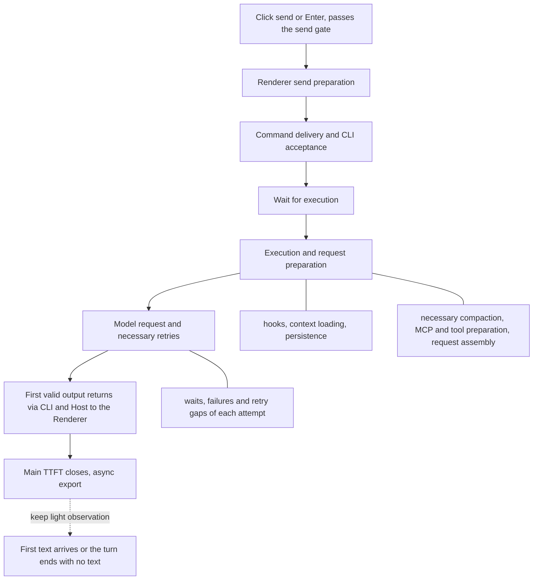

# Desktop local message TTFT stage telemetry

Status: ready-for-agent

Issue-Tracker: local-markdown

## Problem statement

Users need to analyze, from clicking send to the client receiving the first valid output, which pipeline stages
the message passes through and how long each takes, and to locate bottlenecks through per-stage P50/P95 and a
per-slow-message waterfall.

Overall TTFT is currently scattered across business events and ARMS RUM; the send funnel records ACK and user
message display time; CLI OpenTelemetry records first-event, first-content and first-text time of a model request
attempt. Their start/end points, sampling and scope differ, so no complete, verifiable click-to-first-output chain
exists. In particular, waiting before CLI acceptance, the execution queue, hooks, context preparation,
compaction and the first content returning to the client cannot be counted as consecutive stages of one message.
The existing model first_content may also accept a content-block-start event and so is not equal to non-empty
displayable output. Subtracting P95s of different metrics cannot recover a stage's P95.

## Solution

Add dedicated TTFT telemetry for desktop local workspaces, reusing the existing OpenTelemetry/OTLP export and ARMS
ingestion, with two correlated views:

- Stage Metrics: sample count, duration distribution, P50 and P95 per stage, filtered and compared by controlled
  dimensions.
- Message Trace: with a stable correlation ID, view the stage tree, retries, waits, outcome and waterfall of one
  send and explain a specific slow sample.

Main TTFT starts when a click or Enter submit passes the send gate and ends when the originating Renderer
receives, along the actual content path, the first non-empty displayable text, reasoning or tool call. Empty
events, heartbeats and status notices are not first output, and neither a telemetry side-channel notice nor the
React paint moment is the endpoint. Click-to-first-text is observed separately.



The diagram shows the main boundaries to observe; preparation and retries may interleave and sub-operations may
run in parallel. The implementation must record the real timeline and not force actual concurrency or repetition
into the single serial run shown.

## User stories

1. Performance analyst: see the total click-to-first-valid-output time to judge how long users actually wait.
2. Performance analyst: see P50 and P95 per main stage to find common and long-tail bottlenecks.
3. Performance analyst: see the sample count with each quantile so small-sample noise is not read as regression.
4. Performance analyst: filter by stage, model and provider to separate local processing from model-request issues.
5. Performance analyst: compare by app version and OS to find release regressions and platform differences.
6. Performance analyst: view idle and queued sends separately so normal queueing does not hide processing speed.
7. Performance analyst: see both click-based total TTFT (with queueing) and time from execution start, to judge
   user wait and execution efficiency separately.
8. Performance analyst: mark user wait in the queue confirmation dialog separately so dwell is not read as system
   processing.
9. Performance analyst: keep immediate-guide input apart from ordinary sends that can be attributed on their own, so
   output already running is not attributed to the wrong message.
10. Troubleshooter: open the waterfall by the correlation ID of one send to explain a specific slow message.
11. Troubleshooter: see Renderer send-preparation time to find local delay before sending.
12. Troubleshooter: see command delivery, CLI acceptance and the wait before acceptance to locate communication and
    admission contention.
13. Troubleshooter: see how long a message waits to start executing to tell queueing from execution preparation.
14. Troubleshooter: expand hooks, context loading and persistence to locate the pre-request preparation bottleneck.
15. Troubleshooter: identify context compaction before first output so compaction time is not counted as the main
    model's first response.
16. Troubleshooter: see MCP, tool preparation and request assembly to analyze extension-initialization impact.
17. Troubleshooter: see each model attempt and its retry wait to distinguish one slow request from accumulated
    failures.
18. Troubleshooter: see the time for the first valid output to return from the CLI to the Renderer to find
    return-path bottlenecks.
19. Troubleshooter: see parallel, missing and unattributed intervals so the waterfall does not fill the total with
    invented stages.
20. Performance analyst: tell whether first output is text, reasoning or a tool call so different output modes
    compare correctly.
21. Performance analyst: see click-to-first-text separately to distinguish "started giving feedback" from "started
    the text answer".
22. Performance analyst: have the main record complete as soon as first output arrives, without waiting for the
    whole turn.
23. Performance analyst: see counts, ratios and waited time of failures and cancellations before first output so the
    worst experience does not vanish from statistics.
24. Troubleshooter: find checkpoints of send start and completed stages so clues survive an abnormal process exit.
25. Performance analyst: distinguish unclosed, explicitly interrupted and explicitly failed so a missing end record
    is not misread as a timeout.
26. Performance analyst: keep collecting in foreground and background with state changes kept, so slow messages do
    not vanish when switching sessions.
27. Performance analyst: default to continuously-foreground samples and recognize sleep or pause so background
    scheduling does not pollute normal foreground statistics.
28. Performance analyst: do not actively sample TTFT detail for the gray population, so slow samples are not lost to
    independent Trace sampling.
29. Operator: reuse the existing ARMS ingestion and get dedicated queries and dashboard config, without building a
    separate diagnostics product.
30. Operator: control the gray release, event volume, label cardinality and retention so observability cost can be
    verified before expanding coverage.
31. User: telemetry network failure or a full queue must not affect sending and receiving.
32. User: telemetry contains only durations, status and necessary correlation info; message text, file content and
    credentials never enter the chain.
33. Tester: inject known stage delays and check the finally exported data to prove stage attribution matches real
    execution.
34. Tester: verify reordering, duplicates, output before ACK and multi-session concurrency so records are neither
    mis-bound nor double-counted.
35. Maintainer: new telemetry must not change existing business events and RUM definitions so historical dashboards
    and other clients stay compatible.

## Implementation decisions

### Coverage and compatibility boundary

- The first version builds TTFT records only for user sends in desktop local workspaces. Desktop remote workspaces,
  mobile and Web remote control are not collected in v1 and their current behavior must stay compatible.
- Desktop keeps the desktop-continuous actual content path and introduces no mobile replayable snapshot, gap or
  recovery semantics. History hydration, replay and background automatic tasks must not fabricate local user
  click records.
- Extension points are reserved for client type, execution environment and stage source, but cross-machine timing,
  remote connections and mobile reconnect attribution are not implemented ahead of time.
- Existing business completion, RUM TTFT and send-funnel events stay; the new model does not change old
  definitions, sampling and counts and does not require double-sending all new stages to the business endpoint or
  RUM.

### Module responsibilities and interfaces

- The Composer creates the observation context of one send once the real submit gate passes; queue second
  confirmation reuses the same send and does not reset the start.
- The Renderer's dedicated observation lifecycle owns the click master clock, client foreground/background state,
  actual first-content receipt, main-record closure and the extra first-text observation.
- The CLI records authoritative stage facts at the existing admission, queueing, execution-preparation and
  model-call boundaries. The Host keeps scheduling and transport duties, adds no second accepted-input queue and is
  not a second source of the business lifecycle.
- Passing CLI stage facts and the observation context across processes uses strict shared-protocol types, a
  runtime schema and a controlled bridge, staying compatible with old callers. Main only schedules controlled
  telemetry export and holds no task, queue or model business state.
- Reuse existing service interfaces, platform injection and OTLP export. The Renderer never touches a Repo or CLI
  implementation directly and the export network call is not in the blocking path of sending or output.
- workspaceIdentity still expresses identity isolation and workspacePath the file-execution path; local keeps the
  path fallback and invents no new local identity format. Telemetry isolation must cover workspace, session and
  process instance and never exports the raw workspace path.

### Correlation, first output and lifecycle

- One send has a stable observation correlation ID, established as early as the send-preparation stage, linked to
  commandId, inputId, queryId, turnId, logical model-call ID and the requestId of each physical attempt.
- The existing V4 relationship of inputId and queryId to the original send commandId is used for correlation.
  Queue edit or send-now operation commands cannot replace the original input attribution. requestId changes on
  retry and is never the primary key of a whole send.
- The observation context and the enablement decision propagate consistently across processes; Renderer and CLI
  must not sample independently and fragment records. New TTFT records can be correlated with existing Agent
  Traces but do not depend on the old 10% Trace sampling for completeness and do not change the old business
  Trace's parent-child ownership.
- First output accepts only non-empty displayable text, reasoning or a tool call reaching the originating Renderer
  along the actual session content path. text_start, reasoning_start, tool_input_start alone, empty blocks,
  status, heartbeat or side-channel notices are not enough; `first_output_kind` is recorded.
- Earlier turns, other sessions, other inputs or subtask side-channel progress are never attributed to this
  message; output ownership is verified with real input and execution causality. An input that cannot be uniquely
  attributed keeps an explicit mark and no independent TTFT is forged.
- ACK does not mean execution or request started; first output may even precede ACK. Correlation, de-duplication
  and closure must accept legal reordering and must not use fixed waits to synchronize business state.
- After the main TTFT closes, first text is lightly observed and a supplementary metric is produced if it arrives
  late; a turn ending with no text is marked no-text. Later errors never reverse an already successful first
  output.
- Send start and completed stages produce async checkpoints and do not depend on the final root Span ending to be
  exported. Unfinished preparation steps or retry stages are not fabricated after first output.

### Stage and time contract

| Main stage                          | Boundary to explain                                                                   | Expandable observation                                                                                                              |
| ----------------------------------- | ------------------------------------------------------------------------------------- | ----------------------------------------------------------------------------------------------------------------------------------- |
| Renderer send preparation           | Submit start to command dispatch to the Host                                          | Local preparation that really happens; user second-confirmation wait marked separately                                              |
| Command delivery and CLI acceptance | Dispatch to authoritative CLI acceptance                                              | Host forwarding, CLI receipt, admission-gate wait, necessary acceptance persistence; ACK return observed separately as a round trip |
| Wait for execution                  | After acceptance until this input starts executing                                    | Idle or queued type, queue wait; not double-counted with the ACK round trip                                                         |
| Execution and request preparation   | Execution start to the main-response model request, keeping actual repeated intervals | hooks, context loading, persistence, necessary compaction, MCP/tool preparation, request assembly                                   |
| Model request and retries           | After request preparation until the CLI forms this input's first valid output         | Failure or output of each attempt, retry gaps; internal compaction model requests attributed apart from the main response request   |
| First-output return                 | CLI produces first valid output until the Renderer actually receives it               | Send, Host forwarding and client receipt boundaries the real protocol content passes                                                |

- Main stages are divided along the real path into consecutive, non-overlapping intervals as far as possible;
  boundaries must be checked at real hook points before implementation. Stages may be absent, repeated and
  sub-stages parallel; un-run stages are not zero-filled.
- CLI receipt of a command and acceptance after obtaining the admission gate are different boundaries; admittedAt
  alone cannot replace the whole acceptance stage.
- Execution after CLI acceptance can run in parallel with the ACK return. Cumulative observations such as send to
  ACK and user-message presentation are not serial main stages that can be added.
- End-to-end TTFT uses the originating Renderer's clock. Each process records durations with its own monotonic
  clock; cross-process alignment needs a measured error bound, and monotonic clocks of different processes or
  unverified wall clocks must not be mixed.
- The v1 precision goal is to reliably distinguish tens of ms, hundreds of ms and seconds, not sub-millisecond.
  Short stages use dedicated millisecond buckets, not the old minimum-250 ms TTFT buckets.
- Out-of-bound alignment error, negative intervals, sleep or clock anomalies are recorded as an explicit quality
  state. No clamping to zero; unreliable cross-process samples do not enter precise stage distributions; reliable
  same-process observations may stay independently.
- Detail keeps stage interval, duration, causal links and missing information. The union of explainable intervals
  is reconciled against total time, overlap is not double-counted, and the difference shows as unattributed or
  missing and is not forced onto model or network.
- Model-service internal queueing and inference and DNS/TLS/network TTFB are not split without supporting facts; an
  SDK first event cannot pose as network first byte.

### Statistics, outcomes and queries

- One independent send is the unit of main TTFT. Model attempts and preparation sub-stages have their own units and
  queries must state them, so later tool-loop requests are not mixed into first-response statistics.
- Idle and queued sends are grouped; click-based total TTFT, execution-start-to-first-output and queue wait are all
  given. Immediate-guide input enters only a send outcome or its own category, never ordinary TTFT quantiles.
- Explicit outcomes such as failure, rejection or cancel before first output record the waited time and existing
  stages and are counted separately in number and ratio; no-first-output samples never enter the success TTFT
  distribution as 0 or -1.
- A record with only a start or stage checkpoints shows as unclosed, possibly still running or interrupted. A
  missing terminal or exceeding a query window does not suffice to call it failed; explicit exit or interrupt
  evidence gives the matching outcome.
- Foreground and background both keep collecting. The state at send, at receipt and necessary changes in between
  are saved to judge continuous foreground; comparing only start and end state cannot exclude a mid-way switch to
  background. The default experience dashboard filters continuously-foreground, reliably-timed samples; the
  diagnostic dashboard can see all.
- Filtering and grouping by stage, model/provider, app version, OS, idle/queued and foreground/background use
  controlled labels and predefined common combinations, not a Cartesian product of all dimensions; high-cardinality
  message, Trace, workspace and user correlation never enter Metric labels.
- The same stage facts produce Metric and Trace with explicit schema version, app and CLI version. Statistics use
  raw valid-stage samples or their Histogram with sample count and bucket precision shown; P95s are never added and
  other stages are never derived as total P95 minus model P95.
- ARMS deliverables: total TTFT, P50/P95 of main stages and preparation sub-stages, sample counts, outcome ratios,
  unclosed and data-quality views, and a per-message stage waterfall or correlated query opened by the correlation
  ID. The actual platform's query, jump and waterfall capability must be verified; locally generated Spans alone
  are not delivery.

### Export, gray release and storage

- New TTFT uses dedicated OTel Metric and Trace data models, reusing the existing OTLP exporter, configuration
  injection and batch reporting. ARMS RUM custom events and business event/report are not the primary store of
  this new stage data.
- The first phase fully collects bounded TTFT detail and statistics only for the gray population, inheriting
  neither the old Renderer's independent random sampling nor the old CLI's 10% head sampling. The main chain covers
  only up to first output with first text a light supplement; it does not widen to full collection of all
  business Spans of the turn.
- Start and stage checkpoints can be submitted asynchronously and independently before the main record closes.
  When a terminal arrives first, stages later, or transmission repeats, records merge by stable record and stage
  identity without double-counting; no event per token or per loop iteration is required.
- First-output arrival completes the main record at once and hands it to the async exporter, with no synchronous
  per-record network request. Under healthy operation detail is queryable within seconds to tens of seconds as a
  goal; aggregate metrics may update about every 5 minutes.
- Queue, stage-record count and memory are all bounded; export failure, backlog or a full queue never applies back
  pressure on sending and output. Drops or truncation keep an observable data-quality signal; exactly-once
  network delivery or zero loss on force-kill is not claimed.
- Retention target: detail 7 days, aggregate metrics at least 30 days. Before launch, check actual ARMS ingestion,
  permissions, capacity, retention configuration and cost. If existing configuration meets the target it is kept;
  unverified items must be marked as pending launch verification.
- Telemetry records only duration, controlled stage names, outcome, version and necessary correlation info; no
  prompt, reply text, file content, raw path, credential or request header/body. Existing project privacy and
  authentication constraints are reused and no unified privacy master switch over all exporters is assumed.

## Testing decisions

### Primary test boundary

The highest test boundary is "a real desktop Composer sends input, through to Trace and Metric decoded at the final
OTLP receiver". It really passes through the Renderer, window Host, CLI and session content return, using
controllable model replay and a local test OTLP receiver, and checks the externally observable timeline and the
final export contract rather than asserting how often a private function was called.

Prefer the existing conversation-session E2E and telemetry-final-output capture organization, and the existing OTel
HTTP receiver's gzip/protobuf decoding and Trace/Metric assertions. The existing RUM/event-report capturers cannot
stand in for acceptance of the new OTLP channel; if new test capability is needed, provide one reusable receiver at
the final OTLP export boundary instead of adding test-only business interfaces at every layer.

Lower layers only add tests for clock, reordering, de-duplication, statistics and protocol boundaries that are hard
to produce stably in real E2E, following the injection patterns of the existing telemetry runtime, model-api
recorder, supervisor and composer send-funnel tests.

### Acceptance scenarios

| Scenario                                             | Expected external result                                                                                                                    |
| ---------------------------------------------------- | ------------------------------------------------------------------------------------------------------------------------------------------- |
| Ordinary text first                                  | One send correlation, one main TTFT, correct stages and first text; no wait for the turn terminal                                           |
| Reasoning or tool first                              | Correct first_output_kind; main TTFT closes first, first text added later; an empty start event does not trigger                            |
| Known delay injected into a stage                    | That stage's duration and total TTFT change in real order, other stages absorb nothing; deviation within the verified error                 |
| CLI admission contention                             | The wait from command receipt to authoritative acceptance is visible, not hidden in business queue or model time                            |
| Queue, promotion and second confirmation             | Original send correlation kept; queue-inclusive and post-execution times distinguishable; confirmation wait marked separately               |
| Immediate guide                                      | Does not take the previous input's output and is not mixed into ordinary TTFT quantiles                                                     |
| hooks, compaction and MCP preparation                | Preparation sub-stages that really happen are visible; the internal compaction model call does not pose as the main response request        |
| First output after retry                             | Several attempts and waits link to one send; main TTFT is not counted per attempt                                                           |
| First output before ACK, stage reorder or duplicates | Main correlation and closure correct, late legal stages merge, no duplicate Metric or message Trace                                         |
| Multi-session, multi-window or workspace             | Messages, runtime instances and observation contexts do not cross; old turns and subtask side-channel output do not take the first response |
| Failure or cancel before first output                | Outcome counts and waited time correct; no fabricated success TTFT or zero pollution                                                        |
| Failure after first output, end with no text         | Main TTFT keeps the successful first-output fact; first-text status independently correct                                                   |
| Process exit, force-kill or missing terminal         | Exported checkpoints queryable; without end evidence stays unclosed; no fabricated timeout or remaining stages                              |
| Background and back, machine pause or clock anomaly  | Continuous-foreground judgment accurate; anomalous-quality samples filterable; no negative duration or forced clamping                      |
| Parallel, repeated preparation and missing stages    | Waterfall shows real intervals; union reconciles, no double-adding, gaps not forcibly attributed                                            |
| Gray off, on and correlated sampling                 | Off: no new collection; on: consistent across the chain; old 10% Trace sampling creates no TTFT gaps                                        |
| exporter timeout, rejection, full queue              | Sending and output continue; memory/queue bounded, drops observable, normal closure does not depend on export success                       |
| Final data contract                                  | Strict schema, units, version, low-cardinality labels and redaction rules correct; Trace/Metric reconcile by definition                     |
| Old channels and excluded scenarios                  | Old business/RUM counts unchanged; remote, mobile, replay and automatic tasks produce no local user TTFT                                    |

Implementation must write appropriate tests before code; interaction chains must have E2E. Complete typecheck,
lint, the architecture gate and related tests, keeping E2E cases consistent with the implementation. Core
verification covers macOS, Windows and Linux; platforms that cannot be completed are listed honestly and mock
success is not passed off as real-machine completion.

Before release, do one real desktop run forensics aligning user submit, actual content receipt, stage records and
final export, and measure the message latency, main-thread load, memory and event volume the collection adds. The
ARMS environment must verify quantile queries, record correlation, waterfall display and data-visibility latency.
Platform acceptance and local-test completion are recorded separately.

## Out of scope

- TTFT collection and cross-machine clock sync for desktop remote workspaces and mobile/Web remote control.
- A separate Host or Agent for mobile, or changing the delivery semantics of continuous/replayable.
- Server-side stage tracing of model-service internal queueing and inference, and DNS/TLS/network-first-byte splits
  without supporting facts.
- React commit, browser paint and a first-output on-screen metric.
- Independent ordinary-TTFT attribution of immediate-guide input; new measurement of non-user-click entries such as
  automation, off-peak tasks and background subtasks.
- Full tracing of all tokens, model calls and tool executions of the turn; after first output only first-text
  observation is added.
- A new diagnostics page inside ZCode, or migrating/replacing existing business/RUM telemetry.
- Sub-millisecond timing precision, zero loss on force-kill, and all-user full rollout without capacity
  verification.

## Further notes

- Requirements and scope above were confirmed in discussion; this is a to-be-implemented spec and does not mean
  the telemetry, E2E, ARMS queries or storage configuration have landed.
- Delivery order: spec and protocol/stage contract, tests, implementation, real-run verification, ARMS acceptance,
  gray capacity assessment. Check existing telemetry specs before implementing; the new dedicated contract must not
  quietly rewrite boundaries in the old ui_action or Agent Trace specs.
- Implementation review must explicitly record stage hook points, the clock-alignment scheme and error bound,
  stage capacity and truncation policy, Metric buckets and label combinations. These are engineering refinements
  bound by this spec and not a reason to re-interview confirmed product scope.
- Retention, ARMS permissions and capacity remain deployment conditions to verify; an ingestion example in a
  document is not evidence that it is configured online.

## Ticket 01 implementation contract

The Renderer is the sole owner of the observation of one send; the CLI records only bounded, body-free stage
facts, carried by the actual continuous content frame. Main only validates and batch-exports completed facts and
holds no business state. The optional `ttft` context of a command freezes the enablement decision and correlation
IDs; old callers default to off. Agent Trace context and sampling are not changed.

```text
Composer gate → Renderer prepare → command dispatch → CLI received → admitted
                                                            → execution → request → content
Renderer actual continuous content receipt ← Host passthrough ← content frame + timing facts
  └→ bounded async OTLP export; continue observing first text
```

The test seam follows the Testing decisions: real Composer to final OTLP; protocol, clock and duplicate boundaries
get unit tests only. Review baseline: starting HEAD `5cc3713d3a35a404157b0ac513fba30cce18b08c`.

CLI and Renderer express monotonic epoch time as `performance.timeOrigin + performance.now()`; a command query
returns the process instance and sampled clock, and the Renderer round-trip interval yields offset and maximum
error, at most 10 ms, valid for 60 s. Calibration never waits for user sending; it re-probes when the transport
handshake, a CLI checkpoint or an actual content frame arrives with expired calibration. Without trusted
calibration, total TTFT and same-process intervals are kept, cross-process stages stay out of the success
distribution, and quality is recorded `missing`, not `clock_invalid`. Every interval is checked for order and
quality, without clamping to zero.

Gray configuration is the independent `localTtftEnabled` (default false); local verification can set
`ZCODE_LOCAL_TTFT_ENABLED=1` explicitly. Desktop injects the config into the Renderer, the same send carries it to
the CLI, and nothing is sampled independently. The Renderer holds at most 128 in-flight observations; the CLI
keeps at most 128 active facts and 128 terminal facts, each with at most 6 main stages; 5-minute expiry is
explicitly recorded `expired`, not failed; each batch has at most 32 records, the exporter at most 32 batches,
network timeout 3 s. Millisecond Histogram boundaries: 1, 5, 10, 20, 50, 100, 200, 500, 1000, 2000, 5000, 10000,
30000, 60000, 300000.

Ticket 01 supports only local, continuously foreground, idle sends with no retry. Queue/guide, retry, cancel,
failure, background, recovery and missing correlation are each marked and never posed as complete samples. ARMS
platform query acceptance is recorded separately; local OTLP passing cannot tick platform acceptance.

Protocol compatibility: only a `commands/query` request that explicitly carries `clock:true` gets a calibration
response; old query responses, old conversation telemetry fact shapes and counts are unchanged. The CLI source
event's executionStartedAt is captured before hooks/persistence and consumed only by the new TTFT observer. The
separate endpoint/header of the Metrics signal is privately captured like Trace and removed from the tool env.

Implementation and verification entry points: [query contract](local-ttft-queries.md),
[output evidence](local-ttft-evidence.json). The new-sample ARMS platform acceptance and the failing full-CLI items
are in Ticket 01; local success cannot mark the whole requirement complete.

The calibration `clock:true` request accepts only a null-session probe key, does not look at the command ledger or
admission gate, and does not take the Host's command-query workspace binding; ordinary command queries keep the
existing workspace isolation checks.

### Ticket 02 supplement

Detailed contract, statistical units, windows, clock quality and gray resource bounds are in the
[query and diagnostics contract](local-ttft-queries.md#ticket-02-queueing-preparation-retry-and-unclosed). The
original accepted input's correlation and CommandInbox ownership are kept; Core observes real preparation
intervals through the optional `observeLocalTurnPreparation` contract, and without an observation subscription no
preparation timing starts. The new V4 `localTtftFacts` checkpoints go through the existing stdio/service and take
no part in business projection or first-output judgment. An `initial` snapshot is simply ignored; `recovery` is
explicitly excluded and mobile recovery semantics must not be brought to desktop. An online snapshot produced on
desktop continuous by subscription-buffer overflow or projection rebuild also cannot attribute first output
uniquely and is excluded as the separate outcome `resync`, not recorded as `recovery`.

The root first-output result closes only once and late stages recompute stage quality; already exported Metrics are
neither rewritten nor repeated. Events within an observation use stable identity, and bounded exporter
de-duplication keeps whole observations as a group. An actual content frame can carry facts of several original
inputs, covering the case where old-turn output and queue promotion coexist in one batch. An explicit CLI exit
closes per workspace as interrupted; records with no exit/terminal received stay unclosed. Implementation and
platform acceptance are each recorded in
[Ticket 02](../issues/ttft-stage-telemetry/02-queued-retry-and-failure-diagnostics.md).
