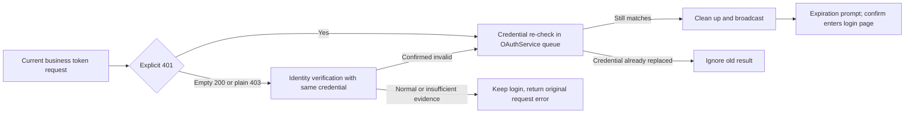

# ZCode Login Credentials HTTP/Business 401 Auto-Logout

## Objectives

The server signals confirmed-invalid login credentials with HTTP `401`, or HTTP `200` with a
complete JSON body containing numeric `code: 401`. Desktop services compare the request
Authorization against the current credentials at the service layer and notify the Host, which
reuses the existing OAuth logout cleanup, the login-expired dialog and the confirm-restart flow.

Scope:

- The existing ZCode JWT judgment is retained.
- The business `access_token` of the current unique active provider (BigModel or ZAI) is judged on
  `/api/biz/customer/getCustomerInfo` of the current environment, the platform-configured userinfo
  URLs, `/api/biz/subscription/enterprise/v2/pricing` and
  `/api/biz/team/subscribe/product/querySubscribeDetail`. These share the HTTP 401 and business 401
  judgment. Bare Authorization and `Bearer <access_token>` are both accepted. URLs must match both
  origin and pathname; query parameters do not take part in identity.
- Payment/orders, API key list/create/copy, model API key requests and WebView-internal requests
  are excluded. customerInfo keeps its user/team identity query semantics even when called during
  model configuration refresh; its 401 semantics do not depend on the caller.

## Request exits

```text
Services -> NodeApiClient.request -> HTTP 401 or HTTP 200 + JSON code=401
                                    |
                     +--------------+----------------+
                     |                               |
              Current ZCode JWT          Current platform identity/pricing/subscription whitelist
                     |                     + current access_token
                     +--------------+----------------+
                                    |
                       Existing logout -> Broadcast -> Expiration dialog
                                    |
                          Confirm restart (Web refresh)
```

Observation points only emit callbacks with the request URL/Authorization and never read or write
credentials directly. The Host deduplicates against the current credentials in the session queue and
calls the existing logout/derived-provider cleanup. Credentials are read after a 401 returns; old
tokens and non-active-platform requests must not trigger processing. The access token is read again
to confirm the active provider, so async reads cannot cross a platform switch.

## Compatibility boundaries

- A normal 401 from an old server can be classified by request credentials; startup recovery still
  predicts local JWT `exp` expiry and does not replace server-side revocation.
- API Keys that bypass the ZCode request exits to reach official services are not covered.
- No new refresh, expiry parsing, active probing or historical key cleanup. Business errors other
  than numeric `code: 401` inside HTTP 200, empty bodies, HTML, malformed JSON, 403 and network
  failures do not trigger this mechanism (except the revocation verification below).
- Business 401 observation runs only on the explicit OAuth business interface whitelist. The copy
  read is limited to 64 KiB and at most 1 second per request; a timeout, over-limit or parse failure
  cancels the observation copy and immediately returns the original response without consuming the
  caller's body. SSE responses are never read or waited on. The independent CLI account
  architecture is not part of Todo103.
- UI, broadcast protocol and restart action are unchanged (original dialogs, i18n, themes). Mobile
  shared-host attachment keeps consuming existing Host broadcasts; no new Host/Agent; the
  desktop-continuous and web-remote-replayable message semantics are unchanged. Independent Web
  OAuth and Agent official MCP transport get no new interceptors.

## Acceptance

- HTTP 401 on a BigModel/ZAI current-business-token target interface triggers the same expiration
  callback; bare tokens and Bearer are both covered.
- HTTP 200 + JSON `code: 401` on those whitelist interfaces triggers the same callback, and the
  response body stays parsable by callers.
- Wrong domains, wrong environments, payment/orders/API key paths, anonymous/regular API keys, old
  tokens and non-active platforms do not trigger new callbacks.
- Environment isolation tests inject both `production.example` and `test.example` business and
  userinfo addresses for BigModel/ZAI, verifying that the current address triggers and the other
  environment does not, in both product environments. Tests do not depend on test and production
  domains being different, so the assertions survive open-source address rewriting.
- Updating tokens or switching platforms before a delayed 401 returns does not notify old sessions
  of expiration.
- HTTP 200 with other business errors, empty/malformed bodies, SSE, 403 and 500 do not trigger;
  existing ZCode JWT 401 tests keep passing.
- Isolated Electron E2E gets a local HTTP 401 and an HTTP 200 + business 401 through real Host
  requests, confirms credentials are cleaned before the prompt, and the existing restart command is
  called after confirmation; no real user credentials or real platforms.

Why business 401: the server wraps login expiration in HTTP 200. Observers that judged only HTTP
status left project availability degraded to unknown, pricing throwing ordinary messages,
subscription summaries losing causes and old login state persisting. The fix reuses the same
expiration entry, credential verification and broadcast, and never treats a temporary empty response
as expired. A new login may complete while the observation copy is being parsed; final cleanup is
still verified in the session queue, and concurrent interfaces produce exactly one cleanup and one
prompt. Bounded reads of the observation copy keep abnormal chunked bodies from changing the main
request lifecycle.

## Project-key location cache partial recovery

`project-key-location:v1:*` caches organization, project and Key IDs that can be re-queried; it is
not a login fact. When reading it hits an explicit decryption error, the project token owner
attempts one local rebuild in the current resolution: validate the request generation, restore the
port through the Host's private cache, and re-read the target record under the credential file's
shared lock. A repaired record is reused; a deleted one is a cache miss; the entry is deleted only
when it still cannot be decrypted. Ordinary IO, file corruption or permission errors do not trigger
deletion and are not cache misses.

```text
Location decryption failure -> validate current generation -> re-check under shared file lock / conditional delete
                             -> repaired: reuse; missing or still corrupted: query location -> issue token
Location query or issuance failure -> existing error classification
                    ├─ network / timeout / service error / project permission -> keep valid login, return failure
                    └─ confirmed current login invalid -> existing auth verification / login recovery entry
```

- Restoring the port modifies only the target cache; it does not read or clean OAuth, Bot, manual
  Keys, other accounts or project records. A successful recovery does not broadcast login
  expiration, log out or restart the App. There is no recursive retry in the same resolution.
- A single client keeps the existing pending merge. Across windows the shared file lock protects the
  "re-read and delete" step and forbids deleting a record that another write already repaired. Both
  success and failure paths check the generation before recovery side effects and before storage
  commits; location saves and 404 deletions pass the same check into local storage and verify it
  under the shared lock, so nothing commits after invalidation while waiting for the lock.
- The port belongs to the Host's local storage capability and does not extend the
  `ICredentialService` Renderer/RPC contract; consumers without a recovery port keep their original
  failure semantics. Short-lived tokens are not persisted; the location namespace, encryption
  algorithm and login credentials are unchanged. Desktop and mobile shared-host use the same token
  owner and add no UI state source.
- Observability: after confirming the current generation and having a recovery port, the code first
  records `project_token_location_unreadable`, then calls the port. If the port returns and the
  generation is still valid, `project_token_location_recovery` is kept; it only means the locked
  re-check returned, not that the location query or token exchange succeeded. IO failures inside
  recovery keep the earlier event; later query failures keep both events and the existing failure
  codes. Ordinary read errors, a missing recovery port and already-invalid requests record no
  recovery-start event. Events contain only family, stage and fixed code, never accounts, cache keys,
  ciphertext or raw exceptions.
- Acceptance: concurrent recovery on real encrypted files; repair committing first; generation
  invalidation while waiting for the lock; automatic rebuild when a valid OAuth login coexists with
  a bad location; login retained when rebuild fails; old requests must not restore after clear.
  Existing login-invalidation unit tests remain. This closes a confirmed cache-recovery gap and does
  not claim to have found the initial trigger of the originally reported exception.

## SG-01: Late 401 session submission protection

After the classifier reads an old access token, the same platform may complete a new login; checking
only the active provider would still release old responses. The classification result is only a
candidate and never authorization to clear the current login.

The Host passes the request URL/Authorization to the local OAuthService method
`logoutIfCurrentCredentialRequest`. It re-classifies inside the existing `sessionMutationQueue` and
cleans credentials in the same queue task. Only an actual successful cleanup notifies derived
providers and broadcasts the expiration prompt; a derived-config cleanup failure logs a warning but
the logged-out session prompt is kept. Each candidate is enqueued, so 401s of new credentials are
not discarded while an old candidate waits. Manual logout, JWT judgment and the interface whitelist
stay compatible; no UI/RPC methods are added. The factory returns the concrete OAuthService for
same-module Host assembly; the local method is not part of the cross-platform `IOAuthService`
contract.

```text
HTTP 401 -> Initial classification -> Request credentials enter OAuthService session mutation queue
                           |
              New login/refresh submitted first -> Credentials do not match -> Ignore, no broadcast
              Old 401 submitted first    -> Verify and clean -> Broadcast
                           |
              Subsequent new logins still written to the original queue, not overwritten by old cleanup
```

refreshToken network exchanges stay outside the queue; writes enter the same queue and verify the
session generation, provider and access token before exchange, so an expired refresh cannot revive
credentials after logout or overwrite a new login. No new refresh capability is added; current
BigModel/ZAI adapters provide no refreshToken exchange.

The state owner is still the current Host's OAuthService. The queue serializes this instance's
logins, logouts and refresh writes; it adds no cross-process transaction and does not change the
`credentials.json` format. Cross-Host/CLI concurrent file operations keep the original credential
storage boundaries. Desktop continuous / mobile replayable attachment, broadcast, prompts and
restart boundaries are unchanged.

### Todo103 integration constraint: preserve logout account identity

Conditional logout and manual logout both read the original account's `accountIdentity` inside the
session queue before clearing credentials, then pass provider + `accountIdentity` to the existing
derived cleanup callbacks. Do not revert to a cleanup entry that passes only the platform, and do
not guess identity after credentials are cleared. Derived cleanup outside the queue keeps the
existing account-identity-based cleanup service boundaries; do not redo account status sync or
cross-Host transactions from here. Cover BigModel/ZAI cross-identity passing, manual logout error
semantics, concurrent duplicate 401, and old requests returning after a new login/refresh without
false cleanup.

Regression: classifier reads an old token then a same-platform new token; same-platform re-login
before candidate enqueue; new session writes waiting during expiration verification; refresh
results returning after logout; a normal current-token 401 still triggers only the original cleanup
and prompt. Queue boundaries are proven by service-layer controlled-timing tests; Electron AUTH-06
verifies the normal 401 chain; old-token races without broadcast are covered by service-layer
controlled tests.

## CR-01: Isolated URL config exceptions

When candidate addresses are built together, a business base URL exception blocks another valid
userinfo address, and constructing full platform configs just to fetch userinfo drags in unrelated
authorization/login address exceptions.

Request addresses are parsed safely only in the access token classification phase, and the
customerInfo and userinfo candidates are built and parsed separately. An illegal address (including
relative addresses and non-HTTP(S) protocols) only skips itself and never blocks valid candidates.
When all candidates are invalid or the request address is illegal, return false; HTTP responses
return to callers normally. Blank overrides keep reusing the original config's default address
rules. Userinfo address parsing is shared by platform configs and classifiers, without changing
platform startup-time config validation and without outputting raw configs or credentials.

Acceptance: BigModel/ZAI invalid userinfo does not affect a valid customerInfo; invalid business
base does not affect a valid userinfo; unrelated config exceptions do not take part in
classification; blank overrides, illegal requests and all-invalid candidates have regressions; the
JWT branch does not depend on the new URL parsing.

## Business credential revocation recovery

When the current active provider's (BigModel or ZAI) business `access_token` is explicitly
rejected, the flow reuses OAuthService conditional logout, derived-credential cleanup and the Host
broadcast. The Renderer clears the user display, shows the existing "login expired" prompt, and
after confirmation goes straight to the Welcome login entry without restarting the App or
refreshing the Web.

Startup cache recovery also checks the JWT `exp` of both the shared JWT and the current business
`access_token`. If either is explicitly expired, it re-verifies inside the original session queue
and returns `reauthentication-required`. A business token without `exp` or unparsable does not cause
logout on that basis; remote revocation is confirmed by later requests. No new startup network
request or scheduled expiry check is added.

Invalidation evidence is HTTP 401, or a complete JSON body with numeric `code=401` under HTTP
200/403. For business requests, an empty-body HTTP 200 or a plain HTTP 403 first performs a
read-only verification of the current platform's customerInfo with the same request credential.
Only an explicit 401 from that verification, or BigModel customerInfo's verified deregistration
semantics (HTTP 200 with a zero-byte body), enters conditional logout. ZAI empty bodies, HTML,
malformed JSON, network errors, timeouts and 5xx do not prove the credential invalid. If
customerInfo itself returns a plain 403, no duplicate probe is made.

Business scope is the current environment and platform's `/api/biz/` and `/api/pay/` paths plus the
configured userinfo URL. Authorization must exactly match the current business token (bare and
`Bearer`). Regular model Keys/PATs, other platforms or environments and old tokens are not business
authentication invalidity.

Identity verification uses the existing network transport, its own request ID and a bounded
timeout, and does not go through the recursive observation chain. Concurrent verifications for the
same identity keep one in-flight promise, removed on completion; validity is not cached. No token,
Cookie, raw account response or derived Key is logged. The original business response still goes to
the caller, and the copy read never competes for the body. After confirmation, OAuthService
re-checks the original request credential inside the session mutation queue and cleans up, so an
old response or verification cannot clear a newly exchanged token or a switched platform.



The state owner remains the Local Host OAuthService; verification holds no second session state.
Mobile shared-host keeps consuming the existing broadcast and current login entry, with no new Host,
RPC, polling or automatic token exchange. Website and OAuth issuer session lifecycles are
unchanged. The Renderer reads the owner's active provider when showing the prompt and when it ends;
if a new login was already committed, the stale expiration event is ignored and the new avatar is
not cleared nor the login page reopened.

Background: an earlier fix covered HTTP 200 numeric business 401 for three identity/plan endpoints
but not the PAT issuance entry nor the empty customerInfo response after BigModel deregistration,
so the avatar stayed while plan requests kept failing. The rules above are the current behavior.
