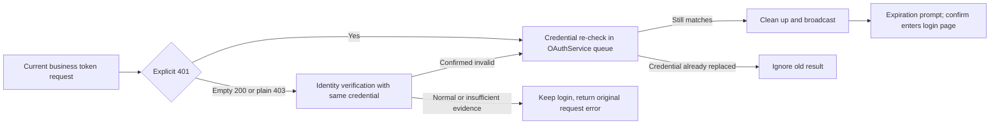

# ZCode Login Credentials HTTP/Business 401 Auto-Logout

## Objectives

The server returns HTTP `401` for confirmed-invalid login credentials, or HTTP `200` with a complete JSON body containing numeric `code: 401`. Desktop services compare request Authorization against current credentials at the service layer, notifying the Host to reuse existing OAuth logout cleanup, login expiration dialogs, and confirm restart.

2026-09-08 minimal compatibility scope: retain existing ZCode JWT judgment, add current unique active provider (BigModel or ZAI) business `access_token` judgment. The new judgment only covers `/api/biz/customer/getCustomerInfo` for the current environment, as well as platform-configured userinfo URLs, compatible with bare Authorization and `Bearer <access_token>`. URLs must match both origin and pathname; query parameters do not participate in identity judgment.

2026-10-08 supplement: Numeric `code: 401` in complete JSON responses with HTTP `200` also indicates login expiration. The whitelist for current platform business tokens adds `/api/biz/subscription/enterprise/v2/pricing` and `/api/biz/team/subscribe/product/querySubscribeDetail`, sharing HTTP 401 and business 401 judgment with customerInfo/userinfo.

Payment/orders, API key list/create/copy, model API key requests, and WebView-internal requests are not included in the new judgment. The same customerInfo interface, even when called during model configuration refresh, still belongs to user/team identity queries; its 401 semantics do not change based on the caller above.

## Request Exits

```text
Services -> NodeApiClient.request -> HTTP 401 or HTTP 200 + JSON code=401
                                    |
                     +--------------+----------------+
                     |                               |
              Current ZCode JWT          Current platform identity/pricing/subscription whitelist
                     |                     + current access_token
                     +--------------+----------------+
                                    |
                       Existing logout -> Broadcast -> Expiration dialog
                                    |
                          Confirm restart (Web refresh)
```

Observation points only emit callbacks with request URL/Authorization, not directly reading/writing credentials. The Host side deduplicates via current credentials in the session queue and calls existing logout/derived provider cleanup flows. Reading current credentials after a 401 return, old tokens or non-active platform requests must not trigger the new processing. Reading the access token again confirms the active provider, avoiding async reads crossing platform switches.

## Compatibility Boundaries

Old server normal 401s can be classified by request credentials; startup recovery is still responsible for local JWT `exp` prediction, which does not replace server revocation judgment. API Keys directly bypassing ZCode request exits to access official services are not covered by this mechanism.

No new refresh, expiration parsing, active probing, or historical key cleanup. Business errors other than numeric `code: 401` within HTTP 200, empty bodies, HTML, malformed JSON, 403, and network failures do not trigger this mechanism. Business 401 observation only runs on explicit OAuth business interface whitelists, copy reads limited to 64 KiB and at most 1 second wait per request; timeouts, over-limit, or parse failures cancel the observation copy and immediately return the original response without consuming the caller's body. SSE responses are not read or waited for. Independent CLI account architecture is not included in Todo103.

Reuse original dialogs, internationalization, and themes; do not modify UI, broadcast protocols, or restart actions. Mobile shared-host attachment continues consuming existing Host broadcasts, not adding new Host/Agent, and not changing desktop-continuous or web-remote-replayable message semantics. Independent Web OAuth and Agent official MCP transport do not gain new interceptors from this.

## Acceptance

- BigModel/ZAI current business token target interfaces HTTP 401 trigger the same expiration callback; bare tokens and Bearer both covered.
- BigModel/ZAI whitelist interfaces HTTP 200 + JSON `code: 401` trigger the same expiration callback; response bodies remain parsable by callers.
- Wrong domains, wrong environments, payment/orders/API key paths, anonymous/regular API keys, old tokens, non-active platforms do not trigger new callbacks.
- Environment isolation tests inject both `production.example` and `test.example` business and userinfo addresses for BigModel/ZAI,
  verifying current-address triggers and other-environment non-triggers in both product environments; tests do not rely on test and production domains being different,
  retaining the same assertions after open-source address rewriting.
- Updating tokens or switching platforms before delayed 401 returns does not notify old sessions of expiration.
- HTTP 200 other business errors, empty/malformed bodies, SSE, 403, 500 do not trigger; existing ZCode JWT 401 tests continue to pass.
- Isolated Electron E2E obtains local HTTP 401 and HTTP 200 + business 401 through real Host requests respectively, confirming credentials are cleaned before prompts, and calling existing restart commands after confirmation; not using real user credentials or requesting real platforms.

The reason for business 401 is that the server wraps login expiration in HTTP 200; old observers only judged HTTP status, causing project availability to degrade to unknown, pricing throwing normal messages, subscription summaries losing causes, and old login states persisting. The fix reuses the same expiration entry, credential verification, and broadcast, without interpreting temporary empty responses as expired. New logins may also complete during observation copy parsing; final cleanup must still be verified in the session queue; concurrent interfaces produce only one actual cleanup and prompt. Bounded reads of observation copies ensure abnormal chunked bodies do not change the main request lifecycle.

## Project-Key Location Cache Partial Recovery

`project-key-location:v1:*` is a cache of organization, project, and Key IDs that can be re-queried; it is not a login fact. When reading this cache explicitly hits a decryption error, the project token owner attempts a local rebuild once in the current resolution: it first validates the request generation, restores the port through the Host's private cache, and re-reads the target record under the credential file's shared lock. If the record has been repaired, the new value is reused; if it has been deleted, it is treated as a cache miss; the entry is deleted only when it still cannot be decrypted. Ordinary IO, file corruption, or permission errors do not trigger deletion and must not be treated as cache misses.

```text
Location decryption failure -> validate current generation -> re-check under shared file lock / conditional delete
                             -> repaired: reuse; missing or still corrupted: query location -> issue token
Location query or issuance failure -> existing error classification
                    ├─ network / timeout / service error / project permission -> keep valid login, return failure
                    └─ confirmed current login invalid -> existing auth verification / login recovery entry
```

Restoring the port modifies only the target cache; it does not read or clean up OAuth, Bot, manual Keys, other accounts, or project records. A successful recovery does not broadcast login expiration, log out, or restart the App. After a failure, there is no recursive retry within the same resolution. A single client keeps the existing pending merge; across windows, the shared file lock protects the "re-read and delete" step and forbids deleting a record that another write has already repaired. Both success and failure paths must check the generation before recovery side effects and before storage commits. Location saves and 404 deletions also pass the same check into local storage and verify it under the shared lock, preventing a commit after invalidation while waiting for the lock.

The port belongs to the Host's local storage capability and does not extend the ICredentialService Renderer/RPC contract; consumers without a recovery port keep their original failure semantics. Short-lived tokens are not persisted; the location namespace, encryption algorithm, and login credentials are unchanged. Desktop and mobile shared-host use the same token owner and add no UI state source.

Observability: after confirming the current generation and having a recovery port, the code first records `project_token_location_unreadable`, then calls the recovery port. If the port returns and the generation is still valid, `project_token_location_recovery` is kept. The latter only means the locked re-check has returned; it does not mean the location query or token exchange succeeded. IO failures inside recovery keep the earlier event; later query failures keep both events and the existing failure codes. Ordinary read errors, the absence of a recovery port, and already-invalid requests do not record recovery-start events. Events contain only family, stage, and fixed code, not accounts, cache keys, ciphertext, or raw exceptions.

Acceptance: concurrent recovery on real encrypted files; repair committing first; generation invalidation while waiting for the lock; automatic rebuild when a valid OAuth login coexists with a bad location; login retained when rebuild fails; old requests must not restore after clear. Existing login-invalidation unit tests remain. This change fixes a confirmed cache-recovery gap and does not claim to have identified the original user-facing exception's initial trigger.

## SG-01: Late 401 Session Submission Protection (2026-09-09)

Reason: After the classifier reads an old access token, the same platform may complete a new login; only verifying the active provider will still release old responses. The classification result is only a candidate and cannot directly serve as authorization to clear the current login.

The Host passes the request's URL/Authorization to the OAuthService's local `logoutIfCurrentCredentialRequest`. This method re-classifies within the existing `sessionMutationQueue` and cleans credentials within the same queue task; only actual successful cleanup notifies derived providers and broadcasts expiration prompts; derived config cleanup failures log warnings but still keep the logged-out session prompt. Each candidate is enqueued to avoid discarding 401s from new credentials during old candidate waits. Original manual logout, JWT judgment, and interface whitelists remain compatible, without adding UI/RPC methods. The factory returns specific OAuthServices for same-module Host assembly calls; the local method is not included in the cross-platform IOAuthService contract.

```text
HTTP 401 -> Initial classification -> Request credentials enter OAuthService session mutation queue
                           |
              New login/refresh submitted first -> Credentials do not match -> Ignore, no broadcast
              Old 401 submitted first    -> Verify and clean -> Broadcast
                           |
              Subsequent new logins still written to the original queue, not overwritten by old cleanup
```

refreshToken network exchanges are kept outside the queue; writes enter the same queue and verify the session generation, provider, and access token before exchange; expired refreshes must not revive credentials after logout or overwrite new logins. No new refresh capability added; current BigModel/ZAI adapters do not provide refreshToken exchange.

The state owner is still the current Host's OAuthService; this queue serializes this instance's logins, logouts, and refresh writes, without introducing cross-process transactions or changing credentials.json format. Cross-Host/CLI concurrent file operations continue to follow the original credential storage boundaries. Desktop continuous / mobile replayable attachment, broadcast, prompts, and restart boundaries are unchanged.

### Todo103 Integration Constraint: Preserve Logout Account Identity

Conditional logout and manual logout both read the original account's accountIdentity within the session queue, before clearing credentials,
then pass provider + accountIdentity to existing derived cleanup callbacks. Cannot revert to the old cleanup entry passing only the platform,
nor guess identity after credentials are cleared. Queue-outside derived cleanup still follows the existing account-identity-based cleanup service boundaries;
do not redo account status synchronization or cross-Host transactions from this. Must cover BigModel/ZAI cross-identity passing, manual logout
error semantics, concurrent duplicate 401, and old requests returning after new logins/refresh without false cleanup.

Regression: Classifier reads old token then same-platform new token; same-platform re-login before candidate enqueue; new session writes waiting during expiration verification; refresh results returning after logout; normal current token 401 still triggers only original cleanup and prompts. Queue boundaries proven by service-layer controlled timing tests; Electron AUTH-06 verifies normal 401 chains; old token races without broadcasts covered by service-layer controlled tests.

## CR-01: Isolated URL Config Exceptions (2026-09-09)

Reason: When candidate addresses are centrally constructed, business base URL exceptions block another valid userinfo address; constructing full platform configs to fetch userinfo also introduces unrelated authorization/login address exceptions.

Parse request addresses safely only during the access token classification phase, and construct/parse customerInfo and userinfo candidates separately; illegal addresses (including relative addresses, non-HTTP(S) protocols) only skip themselves, not blocking valid candidates. When all candidates are invalid or the request address is illegal, return false; HTTP responses are normally returned to callers. Blank overrides still reuse the original config's default address rules. Userinfo address parsing is shared by platform configs and classifiers, without changing platform startup-time original config validation, and without outputting original configs or credentials.

Acceptance: BigModel/ZAI invalid userinfo does not affect valid customerInfo; invalid business base does not affect valid userinfo; unrelated config exceptions do not participate in classification; blank overrides, illegal requests, and all-invalid candidates all have regressions; the original JWT branch does not depend on the new URL parsing.

## 2026-10-12: Business Credential Revocation Recovery

When the current active provider's (BigModel or ZAI) business `access_token` is explicitly rejected, the flow reuses OAuthService's conditional logout, derived-credential cleanup, and Host broadcast. The Renderer clears the user display, shows the existing "login expired" prompt, and after confirmation goes directly to the Welcome login entry without restarting the App or refreshing the Web.

Startup cache recovery also checks the JWT `exp` of both the shared JWT and the current business `access_token`. If either is explicitly expired, it re-verifies inside the original session queue and returns `reauthentication-required`. A business token without `exp`, or one that cannot be parsed, does not cause logout on that basis; remote revocation is confirmed by later requests. No new startup network request or scheduled expiry check is added.

Invalidation evidence is HTTP 401, or a complete JSON body with numeric `code=401` under HTTP 200/403. For business requests, an empty-body HTTP 200 or a plain HTTP 403 first performs a read-only verification of the current platform's customerInfo using the same request credential. Only an explicit 401 from that verification, or BigModel customerInfo's verified deregistration semantics (HTTP 200 with a zero-byte body), enters conditional logout. ZAI empty bodies, HTML, malformed JSON, network errors, timeouts, and 5xx do not prove that the credential is invalid. If customerInfo itself returns a plain 403, no duplicate probe is made.

Business scope covers the current environment and platform's `/api/biz/` and `/api/pay/` paths plus the configured userinfo URL. Authorization must exactly match the current business token (bare token and `Bearer` are both accepted). Regular model Keys/PATs, other platforms or environments, and old tokens are not business authentication invalidity.

Identity verification uses the existing network transport, its own request ID, and a bounded timeout, and does not go through the recursive observation chain. Concurrent verifications for the same identity keep only one in-flight promise, which is removed on completion; validity is not cached. No token, Cookie, raw account response, or derived Key is logged. The original business response still goes to the caller, and the copy read never competes for the body. After confirmation, OAuthService re-checks the original request credential inside the session mutation queue and cleans up, so an old response or verification cannot clear a newly exchanged token or a switched platform.



The state owner remains the Local Host OAuthService; verification holds no second session state. Mobile shared-host continues to consume the existing broadcast and current login entry, with no new Host, RPC, polling, or automatic token exchange. Website and OAuth issuer session lifecycles are not changed. The Renderer reads the owner's active provider when showing the prompt and when it ends; if a new login has already been committed, the stale expiration event is ignored and the new avatar is not cleared or the login page reopened.

Background: an earlier fix added HTTP 200 numeric business 401 handling for three identity/plan endpoints but did not cover the PAT issuance entry or the empty customerInfo response after BigModel deregistration. The avatar therefore stayed while plan requests kept failing. The revocation recovery rules above are the current behavior.
