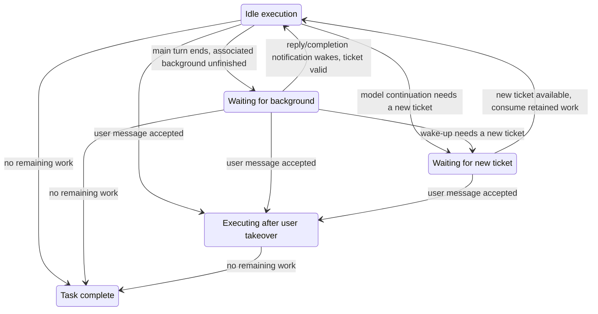

# Off-Peak Background Execution and Selection Split

Status: the main implementation, and the review-found late-cancel and lost-renewal-ack races, are
fixed. This file keeps the target design and the verification boundary. The current implementation
baseline is the [idle-time task spec](./spec.md); target behavior described here is backfilled into
the spec first and the final spec wins.

Full history: `git show b8876e8b:docs/off-peak-task/background-lifecycle-plan.md`

## 1. Goals and boundaries

An idle-time task can start background subagents, call SendMessage and start background Bash. After
the main agent ends naturally, a background reply or completion notification keeps driving the main
agent. Ticket lifecycle is managed separately from the whole-task lifecycle, and the main execution
loop reuses the ordinary agent mechanism.

| Confirmed item     | Target behavior                                                                                                                                            |
| ------------------ | ---------------------------------------------------------------------------------------------------------------------------------------------------------- |
| Background ability | Supports the existing explicit background start and the ordinary agent move-to-background path, not only lifting the tool-visibility restriction           |
| Messages           | SendMessage supports delivery to running agents and resumption of terminal agents; RespondToCoordinator keeps the existing reply queue                     |
| Main turn ends     | The whole task is not complete while associated background work, pending replies/notifications, or a continuation waiting for a new ticket exists          |
| User takeover      | A real user message accepted by the authoritative entry takes over the whole task; send failure, model-only change and approval responses do not take over |
| Running subagent   | On takeover the current subagent turn finishes with its original model; later wake-ups and resumptions use the user's choice                               |
| Ticket expiry      | Local Bash may finish and save its result; model continuation waits for a new ticket and does not rerun completed tools                                    |
| Chat stop          | Keeps ordinary agent stop scope and notification rules, no idle-specific difference                                                                        |
| Task-card cancel   | Keeps the existing cancel terminal semantics; late associated background events must not re-dispatch idle execution                                        |
| Restart            | Does not restore background processes, pending wake-up notifications or temporary idle execution state; no new recovery queue                              |
| Migration          | No config or database migration; reuses existing fields, records and formats                                                                               |

Existing capability boundaries are not widened: Workflow, recursive OffPeakCreate/CronCreate, nested
subagents, background Bash inside a child runtime. Idle automatic project-memory extraction stays
skipped and does not change the session Memory config. Existing persisted idle-task scheduling and
the background work not restored here are handled separately.

## 2. Selection responsibilities and storage

| Concept                      | Single responsibility                                                                 | Owner / storage                                                                                                                     |
| ---------------------------- | ------------------------------------------------------------------------------------- | ----------------------------------------------------------------------------------------------------------------------------------- |
| Configured Default           | Initial user model preference for new CLI sessions                                    | Personal Provider config `config.defaultModelSelection`; default `~/.zcode/v2/provider_config.json`, existing path override allowed |
| `cliDefaultSelection`        | Default for user input without an explicit selection in the current CLI/TUI session   | bootstrap session layer memory; restored from the per-session ordinary user selection record                                        |
| App Composer Selection       | Selection for the next App user message                                               | existing renderer draft and localStorage; no CLI state copy                                                                         |
| `sessionModelSelection`      | Selection used by later execution, background wake-ups and Goal auto-continuation     | CLI Runtime; an idle selection is valid only within this run lifecycle                                                              |
| Submission Selection         | Model selection fixed for one accepted input                                          | existing canonical intent; the mutable default is not re-read while queued                                                          |
| Active Model                 | Model instance actually used by the current turn                                      | the current execution turn; ordinary selection updates do not change other running turns                                            |
| `highspeedFallbackSelection` | Ordinary model selection used in the fallback scenarios defined by the highspeed card | execution snapshot fixed at highspeed turn start; specific to the highspeed card, not an idle re-ticket or generic downgrade config |

The existing SQLite `session_entry` record `runtime/model_selection` keeps storing the ordinary user
selection, with its id, type and data format unchanged. Explicit read/write interfaces separate it
from the Runtime temporary continuation selection; the idle selection is never written into that
record. App Recent and Configured Default are never overwritten by idle execution either.

### 2.1 CLI input rules

1. A new session initializes `cliDefaultSelection` by the existing global default resolution; an old
   session reads its own user selection and is not overwritten by a global default changed by another
   session.
2. `/model` and `/effort` update the CLI input default and its session record, keeping the existing
   synchronous save of the global default preference; before an ordinary message is sent they do not
   change the background continuation selection.
3. A CLI user message without a Selection is completed at the admission entry and fixed into the
   Submission. The App keeps submitting the Composer Selection explicitly.
4. A missing, unavailable or incomplete selection errors per existing validation; it never falls back
   to the Session's idle selection or an arbitrary Registry first item.
5. Compatibility reads of legacy-protocol default inputs must explicitly come from the user input
   preference; Bot and other independent submission contracts are reviewed separately and their
   `/model` semantics must not be changed mechanically.

### 2.2 Update order and concurrency

After a real user message is accepted by CLI serial admission, the session continuation selection is
updated and takeover is triggered; an unaccepted candidate produces none of these side effects. An
accepted input that later starts running uses only its own Submission snapshot and must not write an
earlier selection back as the latest Session Selection. Guide keeps acting on the current turn at the
existing model-step boundary.

```mermaid
sequenceDiagram
    participant Input as User input default/draft
    participant Queue as CLI admission and existing queue
    participant Session as Runtime Session Selection
    participant Life as Idle lifecycle
    participant Loop as Execution turn
    Life->>Session: idle starts, set I (user preference not saved)
    Input->>Input: change to B, not sent yet
    Note over Session: still I, background wake-ups continue idle execution
    Input->>Queue: submit message with B
    Queue->>Queue: validate and accept, fix Submission
    Queue->>Session: update to B in admission order
    Queue->>Life: user takeover, stop further idle dispatch
    Queue->>Loop: run this snapshot by existing queue/Guide rules
    Note over Loop: current turn of a running subagent does not hot-switch
```

After the task lifecycle ends, no ticket-less idle selection that ordinary execution could misuse may
remain. Restore/cleanup is based on the accepted ordinary user selection or the unbound state, never
on unsent drafts; a late idle-end callback must not overwrite the Session Selection after takeover.

## 3. Idle lifecycle and owners

| Fact                                                 | Owner                                                                    | Forbidden duplicate state                                              |
| ---------------------------------------------------- | ------------------------------------------------------------------------ | ---------------------------------------------------------------------- |
| Main turn, background tasks, commands, notifications | CLI RuntimeTaskRegistry, existing command queue                          | Host keeping another accepted queue or background count table          |
| Idle work ownership, takeover, local lifecycle       | independent CLI-side lifecycle coordinator using generic execution facts | idle-specific branches scattered through every main-loop step          |
| Apply, re-ticket, settle                             | existing OffPeakTaskService                                              | tool handlers requesting/renewing tickets themselves                   |
| Persistent task-card state                           | existing service and Repo, consuming explicit events                     | inferring whole-task completion from first-turn terminal or UI loading |
| Main-turn Active Model                               | the current turn                                                         | deriving the running model from the mutable Session Selection          |



Natural completion requires: no running main turn for this task, no unfinished associated background
work, no pending reply/notification to consume, and no continuation waiting for a ticket. Only work
belonging to this task counts; unrelated or historical session tasks are not mixed in. Registry
terminal state, notification enqueue, queue claim and closing events must have a defined order so
that no false idle appears between background terminal and notification enqueue. No polling delay or
second pending queue patches the race.

Waiting for background may be an internal state while the card still shows in-progress; waiting for a
new ticket reuses the existing idle queue display. Failure, cancel and natural completion each close
by their own result; "no remaining work" is not equated with success.

## 4. Background execution and tickets

- Reuse the existing task-notification and subagent-message commands and active-loop drain. While a
  main turn is running they merge by the original rules; a newly started main turn uses the Session
  Selection.
- Explicit background subagent start, foreground-to-background, and SendMessage terminal resumption
  all carry the right execution ownership and request dependencies; fixing only the first path is not
  enough.
- Tickets and authentication come from the independent lifecycle and the existing request
  dependency/admission boundary; notifications and ordinary persisted inputs must not freeze
  credentials or old tickets.
- On ticket expiry, local Bash, result artifacts and existing pending commands are kept; model
  execution waits for a valid ticket and continues. Multiple concurrent expiry events share one
  re-ticket process.
- After takeover, further idle dispatch stops; a subagent still using the old idle execution context
  finishes its current turn by the confirmed rule. Late expired/failed events must verify an ownership
  version and must not re-queue a taken-over task.
- An old ticket is settled by the existing service contract once nothing uses it. Releasing a ticket
  does not mean the task is complete, and the main turn ending does not mean it can be released
  immediately.
- Stop keeps the ordinary behavior; cancel, branch invalidation and runtime teardown keep the
  existing notification suppression and idempotency boundaries. Restart does not redeliver
  background results; existing ledgers are only closed per the original rules.

Selection describes provider/model/options only. Ticket, executability and task status never enter
Selection; Core accepts only a generic execution context, request admission and work-fact
notifications and introduces no second main execution loop.

## 5. Impact and code placement

### Title requests and stream cleanup

- A title request freezes the model selection and execution ownership at enqueue time, before async
  reads such as the session store. A title that inherits idle execution holds its own model-turn
  lease and uses the same ticket authority; the main turn ending cannot release a ticket the title is
  still using, and 3102 follows the existing re-ticket path. Success, failure and early exit when no
  generation is needed all release the lease.
- An explicitly configured title model stays an independent call; ordinary/external title calls do
  not inherit the idle model merely because the Session holds a temporary idle selection. After user
  takeover, new titles run with the user's selection; an already started title keeps its original
  request ownership.
- Each stream request attempt has its own cancel signal. When leaving an attempt, the underlying
  request is canceled first and the iterator is then closed best-effort; a close exception must not
  override the original request error, and an unfinished close must not block re-ticket, cancel or
  whole-task closing. No cleanup timeout and no automatic replay of already delivered content.

```text
title enqueued and lease kept → read session → generate title (re-ticket on expiry) → save/early exit/fail → release lease
stream attempt fails → cancel that attempt + close iterator asynchronously → keep original error or wait for new ticket and retry
```

Regression coverage: default title auth, main turn ending first, title re-ticket, early-exit/error
release, explicit title model isolation; iterator.return rejecting/never finishing, original error
and cancel preserved, delivered stream not replayed. Desktop OP10 keeps the default title path and
checks its idle ticket; the continuous/replayable delivery boundary is unchanged.

| Priority  | Module / entry                                                            | Expected change                                                                                                        |
| --------- | ------------------------------------------------------------------------- | ---------------------------------------------------------------------------------------------------------------------- |
| Must      | CLI command-center, bootstrap session/input facade                        | CLI input default selection, model/effort switching, explicit Submission, legacy default rules                         |
| Must      | Core turn-model, admission, recovery and persistence interfaces           | separate accepted-selection update, single-turn model creation and user-preference saving; handle FIFO/Guide races     |
| Must      | highspeed card selection fallback                                         | fix the card's fallback selection at start; never read the mutable Session on failure                                  |
| Must      | tool visibility, Bash/SendMessage handlers, subagent runner               | lift the matching restrictions together; keep Workflow, recursive creation and other limits                            |
| Must      | subagent port, background start / move-to-background / message resumption | consistent model selection, execution ownership and request dependencies                                               |
| Must      | CLI background notifications, command queue, runtime residency            | reuse the notification path; add work-lifecycle events; never lose work while waiting for a ticket                     |
| Must      | Host dispatch/track/finalize, OffPeakTaskService, task adapter            | whole-task lifecycle replaces first-turn terminal closing; re-ticket, takeover, settle and stale callback invalidation |
| Check     | App/protocol settings and model projection                                | input model display shows the user selection; the actual execution model comes from execution facts                    |
| Check     | title, memory, sampling, Compact                                          | distinguish independent config from owned execution; do not inherit only the idle model id and lose request auth       |
| Check     | Cron, Fork, session cold resume, Workflow model pin                       | keep a temporary idle selection out of future ordinary execution; keep each feature's explicit model contract          |
| Invariant | ordinary background, Goal, permission responses, child Bash cleanup       | no widening of stop, nesting, permission or result-visibility semantics                                                |

New or changed App/Agent contracts need strict types and runtime schemas, exported through the
existing protocol entry; Host consumes CLI facts and Service never imports Runtime implementation.
All workspace identity isolation keeps using `workspaceIdentity`; real paths stay `workspacePath`.

Desktop and mobile attach to the same existing owner: desktop stays continuous, mobile stays
replayable, and command FIFO is decided by CLI admission. No new runtime for mobile, and mobile
recovery logic does not spread into the desktop main chain. App drafts keep their per-end isolation;
a global default never replaces another session's selection.

## 6. Spec and capability-graph backfill

| File                                                                                                                                             | Update                                                                                                              |
| ------------------------------------------------------------------------------------------------------------------------------------------------ | ------------------------------------------------------------------------------------------------------------------- |
| [idle spec](./spec.md), [tech design](./tech-design.md)                                                                                          | open background ability, whole-task closing, re-ticket, takeover, current vs target boundary                        |
| [Selection state design](../working-memory/provider-refactor/design/interaction/selection-state.md)                                              | cliDefaultSelection, update at admission, storage semantics; drop the outdated separate default file description    |
| [execution selection design](../working-memory/provider-refactor/design/execution/execution.md)                                                  | Session continuation selection, subagent current turn, highspeed-specific fallback, independent auxiliary calls     |
| [background coverage matrix](../testing/conversation-session-background-e2e-coverage-matrix.md)                                                  | add idle representative scenarios and link the mobile-specific verification; keep the original desktop matrix scope |
| [session case catalog](../conversation-session-case-catalog.md), [total coverage matrix](../testing/conversation-session-e2e-coverage-matrix.md) | register the new scenarios; update OP10's background-denial assertion; planned cases are not marked covered         |
| [capability graph](../../.agents/skills/feature-boundary-planner/references/zcode-feature-graph.yaml)                                            | replace the old invariant "idle does not write the Runtime Session, denies background"                              |

The impact analysis is based on source call chains and existing specs; no codegraph was available
and text scans are not presented as graph queries. Interface signatures, event names and test file
splits not yet fixed are implementation detail and do not change the confirmed product boundary.

## 7. Acceptance scenarios

| ID   | Scenario and action                                                              | Key assertions                                                                                     | Evidence layer                      |
| ---- | -------------------------------------------------------------------------------- | -------------------------------------------------------------------------------------------------- | ----------------------------------- |
| IL01 | idle explicit background Agent, main turn ends first                             | background continues; notification wake-up still goes idle; card does not complete early           | Core + desktop E2E/request log      |
| IL02 | idle background Bash, explicit and movable-on-timeout                            | command runs once, artifact kept; completion can wake                                              | adapter/Core + E2E                  |
| IL03 | SendMessage to running and finished agents                                       | delivery/resumption valid, execution selection and auth right, reply can wake                      | Core + representative E2E           |
| IL04 | background notification catches the main turn, or arrives after it ends          | merge / new turn by existing rules; no loss, no duplicates                                         | Core timing tests                   |
| IL05 | Bash finishes after ticket expiry, new ticket arrives later                      | Bash not rerun, result not lost, model waits for the ticket and continues                          | service + Core integration          |
| IL06 | several backgrounds hit ticket expiry together                                   | single re-ticket, no duplicated work, old-ticket events do not overwrite the new ticket            | service concurrency tests           |
| IL07 | user sends B while waiting for background / new ticket                           | after acceptance Session is B; the current subagent turn keeps I, later wake-ups/resumptions use B | CLI + desktop/mobile E2E            |
| IL08 | old ticket expires or ready callback arrives after takeover                      | no re-queue, no selection grab-back, no original task resend                                       | service/protocol tests              |
| IL09 | CLI /model or App menu changes to B without sending                              | only the user input selection changes; background still continues with I                           | CLI + UI tests                      |
| IL10 | B then C accepted in a row, earlier B starts running later                       | B turn uses B; the latest continuation selection stays C                                           | admission/queue/Guide tests         |
| IL11 | session B changes the global default, session A sends again                      | A keeps its own input default; only new sessions use the new default                               | CLI multi-session tests             |
| IL12 | user selection changes after highspeed start, then the defined fallback triggers | uses the fallback selection fixed at start                                                         | Core regression                     |
| IL13 | chat stop, single background stop, task-card cancel                              | each entry keeps its original scope contract; no idle resurrection after cancel                    | Core + service + representative E2E |
| IL14 | restart / branch invalidation / teardown                                         | temporary idle selection and re-wake not restored; user selection restores normally                | storage/protocol tests              |
| IL15 | background terminal, notification enqueue and closing interleave                 | the whole task closes exactly once; no completion from a false mid-state idle                      | deterministic concurrency tests     |
| IL16 | permission response and auxiliary model call                                     | approval does not trigger user takeover; auxiliary call selection matches request ownership        | Core/protocol regression            |

The full Cartesian product of model providers and background counts is not enumerated; ordinary /
idle / highspeed, single / multiple, before / after takeover, valid / expired ticket represent the
key differences. Nested Bash only keeps the existing child-cleanup boundary; cross-restart background
recovery is explicitly excluded.

E2E uses controlled streams and ticket fixtures to create timing, never arbitrary sleeps. New
candidates follow the existing manual-review flow; without admission evidence, no claim of formal
replay or container-suite coverage. Promotion to formal cases follows the existing manual review and
promotion flow.

## 8. Implementation order and checkpoints

All checkpoints are done.

- [x] P0: independent dev container from the current staging; check source baseline, toolchain,
      dependencies; reproduce and classify existing test failures.
- [x] P1: update the specs, case catalog and matrices; write CLI default/Session separation,
      admission-order and highspeed-fallback tests first, then implement the Selection split.
- [x] P2: write work ownership, background closing, re-ticket, takeover and stale-callback race
      tests first, then implement the independent lifecycle and generic contract.
- [x] P3: write background Agent/Bash/SendMessage and resumption tests first, then wire the context
      and lift the matching restrictions.
- [x] P4: wire Host/service whole-task closing; OP10 desktop three variants and the existing
      continuous/replayable protocol-boundary regression done. Mobile browser whole-device interaction is
      not verified and stays a verification limit.
- [x] P5: relevant verification and diff self-check done, spec updated, committed locally; full
      baseline failures and unverified platforms are recorded below.

Container checks: a container passing only the toolchain check does not prove Electron E2E support;
graphics dependencies, replay resources and the container test entry must be confirmed separately,
and missing capability must be stated rather than replaced with unit tests.

Required verification for ordinary code: root `pnpm typecheck`, `pnpm lint`,
`pnpm architecture:check --changed` and affected unit tests; the CLI additionally runs its own
typecheck/lint/tests per its AGENTS; App interaction runs the matching E2E. Failures are classified
as baseline vs introduced; code is never committed by skipping hooks.

### Implementation facts

- Selection split: CLI assembly maintains `cliDefaultSelection`, input admission updates the
  continuation selection, old queued input never writes back, and highspeed fallback is a snapshot at
  start. The model instance is still created at actual execution; admission stores only the selection
  intent and `ModelSelected` keeps expressing the actual execution switch. Ordinary config entries and
  Session entries are reused; no migration.
- Lifecycle: an independent component whose input is the work snapshot provided by the existing
  execution layer; it keeps no second background-task table or input queue. It maintains only ticket
  version, renewal request id, idle/user ownership, the ticket-holding model-turn reference and task
  terminal state. At natural main-turn end the snapshot decides between waiting for background and
  completing; user admission changes ownership; old renewal receipts are rejected by execution
  identity and renewal id. A ticket is released only when no idle model turn still uses it, and release
  itself does not complete the whole task. Chat Stop reports only the original main-turn result; only
  task-card cancel explicitly terminates the lifecycle.
- Integration boundary: `modelExecution.offPeak` carries only the execution ID, initial ticket ID and
  the ticket-expiry business code; dynamic credentials still come from the execution request auth.
  The CLI emits strictly validated in-memory `v4/offPeak/lifecycle` notifications consumed by the
  Host; they are not chat rows, telemetry or cold-resume events. The Host sends re-ticket/cancel via
  `v4/conversation/offPeakControl`, validated by session, executionId and renewalId; control requests
  only update the existing lifecycle, never create a Session, resubmit a prompt, or enter ordinary
  persisted input. Real user messages are still admitted through the existing CommandInbox. Desktop
  continuous and mobile replayable delivery rules are unchanged. The Host holds only the ticket
  request correlation; the completion condition is always decided by the CLI. Notifications are not
  re-sent across App/CLI restarts.
- Renewal handoff is confirmed by `executionId + renewalId + ticketId`; repeated confirmation of the
  latest installation is allowed; a late dispatch after terminal state only releases the ticket and
  does not resend the prompt.
- The Workflow restriction covers the existing dynamic entries `CreateWorkflow`, `AmendWorkflow`,
  `ResumeWorkflowRun`, `EvalWorkflowSnippet`, whose runners are not yet wired to idle tickets; query
  and saving definitions keep the existing permissions.
- Late cancel: a terminal idle controller returns directly; an active cancel captures the current
  foreground execution ID before updating the registry and stops by that ID, so a synchronous
  completion callback or duplicate cancel cannot interrupt a later user turn in the same session.
- Lost renewal ack: the Host keeps the same execution/renewal/ticket and request credential in
  memory and confirms in the existing sync cycle. During an unknown result it does not go back to the
  queue for a new ticket; concurrent confirmations of one handoff merge into one RPC. A newer renewal
  arriving first cannot be overwritten by an old ACK; only an explicit rejection releases the
  candidate ticket and re-applies. After user takeover/completion an uninstalled candidate ticket is
  still released.
- No production timers, protocol fields, persisted queues or migrations were added; the main
  execution loop and the mobile replayable boundary are unchanged.

OP10 fixtures: `ZCODE_E2E_OFFPEAK_EXPIRE_WAKE=1` makes the first background wake-up request return
3102, installs a new ticket and retries the same model request; it asserts the initial instruction
and Bash each ran once and the saved Bash result was consumed. `ZCODE_E2E_OFFPEAK_TAKEOVER=1` sends a
user message before the background barrier is released, verifying that the existing child turn is
still completed by the idle request while later background wake-ups of the main agent use the user
model; the default variant only switches the toolbar without sending and keeps using the idle model.
The variants run separately, not combined.

<a id="最终验证记录2026-10-08"></a>

### Final verification record (2026-10-08)

- OP10 on local Electron/Xvfb + real Host/CLI + HTTP replay: ordinary background wake-up, 3102
  re-ticket, and user takeover while waiting for background each passed 1/1 (runs
  `desktop-e2e-20261008-162457-528` default, `desktop-e2e-20261008-162734-140` re-ticket,
  `desktop-e2e-20261008-162815-060` takeover). The real requests of four foreground and two
  background Agents use the idle model; the real background Bash started once with output saved in
  the notification-specified file. Switching only the toolbar still wakes with the idle model; after
  the user sends, later wake-ups use the ordinary provider.
- The 3102 variant checks old and new tickets differ, the retry request body is identical, and the
  initial task and Bash did not rerun. Timing is controlled by request barriers. The case is still
  `manual-review/pending`; no formal admission is claimed.
- Review race fixes also verified: OP10 lost-ack variant 1/1 (`desktop-e2e-20261009-082511-005`) with
  the first confirmation of an installed ticket replaced by a protocol error at the real Host/CLI
  stdio boundary; the card completes and the initial prompt and real Bash ran once. Title/stream
  cleanup: OP10 default title consistent with the main-turn ticket/model, background wake-up and
  whole-task completion passed (`desktop-e2e-20261012-105708-319`), lost-ack variant passed
  (`desktop-e2e-20261012-105924-792`). Both remain manual-review/pending.
- Unit: related 270/270 (root 138, CLI 132), CLI/TUI 13/13. Root and CLI typecheck, root lint,
  architecture check and E2E typecheck passed. Full Core and Bootstrap suites are not green (pre-
  existing failures such as missing Browser Use resources, old Provider fixtures, PDF adapter, startup
  events and timeouts; several reproduced on HEAD in isolated source copies); full-suite green is not
  claimed. CLI repo-wide lint still has historical max-lines errors; changed Core files lint with 0
  errors. No codegraph impact scan was run (text scan only).
- Verification limits: no mobile browser whole-device, macOS or Windows verification, and no remote
  workspace whole-device verification; mobile shared-host work ownership continues to be taken over by
  the same CLI admission, with no new Host input queue and no change to the continuous/replayable
  boundary. Representative protocol regressions do not replace mobile UI E2E. Cross-process restart
  re-wake is excluded by requirement.
