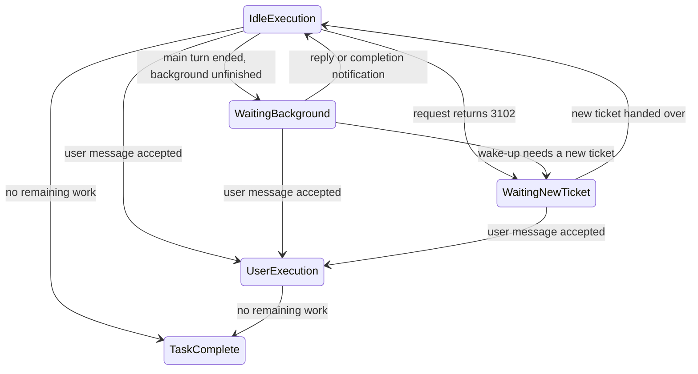

# Off-Peak Task v1 Implementation Spec

> **Background lifecycle revision:** the implementation boundary and verification progress are in the
> [implementation plan](./background-lifecycle-plan.md). The background and SendMessage restrictions
> of D51/D52 are superseded by the lifecycle below; the historical decisions stay in decisions.md.

> **Status: implemented, still being closed out against Figma.** The repo contains the `offPeak`
> domain types, repo, service, scheduler, UI and in-process mock; this file records the current
> product semantics and implementation constraints.
>
> **2026-08-22 Provider Config consolidation:** `client/configs.offPeak` keeps only the
> `enable_offpeak_task` exposure switch; model members come from Built-in
> `builtin:offpeak-idle-plan` and model capabilities from the Effective Model Config. Every
> historical `allowed_models` description below is overridden by this note.

> Source: PRD "z.ai-z.code idle-time task PRD v0.2" as converged in a grilling session. Companions:
> `glossary.md` (terms/domain model), `decisions.md` (D1-D40 and later decision records). Differences
> from the PRD are in the "Not doing" list at the end; **that list needs confirmation with product**.
>
> **Server contract source of truth:** the internal repo `zcode/zcode-server`, `docs/off_peak_design.md`
> (fetch with
> `glab api "projects/zcode%2Fzcode-server/repository/files/docs%2Foff_peak_design.md/raw?ref=main"`).
> On a contract conflict that document wins. Key constraints are excerpted in §4.1.

## 1. One-line definition

An idle-time task is a **one-shot background task under Automations** (D28, the Figma-final
paradigm). The user creates it from the Automations main view or a template card (title +
instructions + project + permission + model); submitting immediately takes a number with
`POST /ticket`. **Queuing is carried by the server** (global ticket FIFO, admission by free
resources); the client observes tickets with batch `POST /ticket/status`, writes `schedulable=true`
when `ready`, and dispatches. Unattended execution is split into 3h active-ticket segments: on
`400/3102` the same task_id re-takes a number, hands the new ticket to the resident CLI and continues
the original request until the whole task is done. Every automatically dispatched turn uses the
user-invisible idle plan provider.

Naming by level: the English UI uses `Idle-time task` for a single item and the plural
`Idle-time tasks` for the sidebar system group; the Chinese UI uses 「闲时任务」 throughout.
TypeScript types/variables/constants use `OffPeak*` / `offPeak*` / `OFF_PEAK_*`; files and URLs use
`off-peak`; SQLite uses `off_peak_*`. The user-facing concept is not renamed "Off-peak task", to avoid
confusion with the server off-peak admission protocol.

Font sizes of the idle-time settings UI follow the dedicated `DESIGN.md` tokens: the existing
`text-ui-xs` is raised to `text-ui-sm`; historical `text-base` / `text-sm` / `text-xs` migrate to
`text-ui-lg` / `text-ui-base` / `text-ui-sm`; `16px` / `14px` / `13px` / `12px` migrate to
`text-ui-lg` / `text-ui-base` / `text-ui-base` / `text-ui-sm`; only secondary meta below `10px` uses
`text-ui-xs`. Settings pages must not use arbitrary UI font sizes.

Form inputs of the idle-time and scheduled-task settings pages use `text-ui-base` + `leading-5`
(default `14px / 20px`): task title, schedule summary or schedule selection value, Instructions body
and placeholder. Both pages reuse the same input font-size contract and must not fall back to
`text-ui-sm` for a particular frequency, create state or edit state.

The idle-time instruction toolbar shares the visuals and trigger interaction of the scheduled task:
project, permission, model and reasoning controls use `h-7`, `rounded-lg`,
`text-ui-base font-normal`, no background by default, `bg-surface-hover` with primary text color on
hover and while the menu is open; menus open above the toolbar with a `4px` gap to the trigger. The
idle page must not use `focus-within`, `rounded-full` or local backgrounds to create a different
interaction. The project menu is narrowed to this contract only at the Automations call site; the
ordinary conversation project chip is unaffected.

The New Task composer is the single implementation source of the toolbar display components: the
project reuses `ChatEmptyWorkspacePreviewMenu` (scheduled and idle only unify the Automations wrapper
parameters, locked state and no-project placeholder); the idle model reuses the flat-list mode of
`ModelConfigSelect`; reasoning strength reuses the select mode of `ThoughtLevelCycleControl`;
permission reuses the conversation composer's `ConfigSelect` (mode category). Neither scheduled nor
idle may keep their own DropdownMenu copy. Reuse covers display, keyboard interaction, popover and
focus restoration only; the scheduled task's `inherit`, model preview, manage-models entry or session
state must not be carried into the idle task. The idle task gets a flat model list from Built-in
`builtin:offpeak-idle-plan.models`, always submits a concrete model, and keeps D34's default
reasoning level.

The permission selector follows the conversation composer's high-privilege semantics: only when
`permissionMode=yolo` (Full access) is selected do the trigger's permission icon and text keep the
orange `text-warning` color, including on hover / menu open; other modes use the default foreground
and a subdued trailing chevron. With `ConfigSelect` reused, the permission trigger icon follows the
current value (as in the conversation composer), the menu is fixed at `w-64` and shows two-line
options (icon + title + description), and the selected item is carried by the menu's initial
highlight. The Automations page has no chat input, so after the menu closes focus must return to the
trigger itself (`restoreFocusSelector=null` keeps the Radix default refocus), never to the body. Idle
permissions must reuse the same GLM display vocabulary and Tooltip as the conversation composer and
scheduled tasks: titles from `mode.label.glm.*`, descriptions from `mode.description.glm.*`, Tooltip
from `chat.toolbar.mode.label`, built by the shared mode option builder with the `glm` provider; no
`offPeak.mode.*` specific copy, so the three places do not drift.

The Instructions compound input of idle and scheduled tasks must reuse one structural component so
two pages do not maintain separate heights and surface levels. Desktop contract from Figma
`4827:1399`: outer frame `168px` high with `12px` radius, body `116px` high with `8px` padding,
bottom toolbar `52px` high with `12px` padding; on narrow screens only the toolbar may grow by
wrapping, never the body height.

## 2. Domain model

Domain types live in `packages/shared/src/off-peak-types.ts` (do not mix into automation-types):

```ts
type ZCodeOffPeakTaskStatus =
  | "queued" // waiting for server authorization
  | "paused" // user Pause, dispatch stopped (D30-10)
  | "running" // executing
  | "completed"
  | "failed"
  | "cancelled"; // terminal

interface ZCodeOffPeakTask {
  offPeakTaskId: string; // local primary key, also used as server task_id (D26)
  serverTicketId?: string; // server Snowflake ticket_id; updated on re-take (D26)
  title: string; // form Task title (D28)
  conversationId?: string; // host conversation taskId; D30-8 creates no conversation up front, backfilled after first dispatch (doubles as the "dispatched before" signal)
  sessionId?: string; // backfilled after first run; used by resume for continuation/interrupt recovery (many places depend on "present = a real session exists", never prefill)
  prompt: string; // form Instructions
  permissionMode: ZCodeTaskMode; // all four permission modes open (D29-4); product vocabulary build/edit/plan/yolo, default "build" (Ask before changes)
  model?: string;
  thoughtLevel?: string; // reasoning strength (D34, aligned with automation); defaults to the workspace default
  workspaceKey: string; // workspaceIdentity?.trim() || workspacePath
  workspacePath: string;
  workspaceIdentity?: string;
  status: ZCodeOffPeakTaskStatus;
  queuedAt: number;
  startedAt?: number;
  endedAt?: number;
  failureReason?: string; // low disk space / missing directory / consecutive API failures...
  filesChanged?: number; // shown in completion notification and status bar
  settledAt?: number; // terminal settle ack (D22)
  historyDeletedAt?: number; // only hides the local History row; does not delete task/session/execution fields (D37)
  createdAt: number;
  updatedAt: number;
}
```

Storage: table `off_peak_tasks` in tasks-index.sqlite (reuses the AutomationRepo database and Repo
pattern). New columns use `ensureColumn` compatibility migration; never rebuild or empty an existing
user table.

2026-09-10 storage ruling ([Todo104 §6.18.1](../working-memory/provider-refactor/steps/todo-104-pre-release-schema-review.md)):
the new `model_selection` is the post-migration selection authority. Editing title, instructions,
permission or the new selection does not clear or reverse-update the old `model` / `thought_level`
columns; their original values are only for old-version rollback reads. New records do not forge old
values. This does not change the queued/paused edit gate, Ticket binding or pre-execution checks, and
the new version never re-selects a model from the retained columns.

Since D48, the **dispatched session** of an idle task owns a first-class task row in tasks-index:
the column `tasks.off_peak_task_id` persistently marks ownership (aligned with cron's
`cron_automation_id`; the cron marker is not reused, see D45); the row id = the sessionId created by
the first run. `off_peak_tasks` remains the single source of truth for the queue/scheduling state
machine; queued/paused (undispatched) tasks produce no task row (D48-A: no phantom rows) and are
managed only in the Automations main view. The sidebar contract is in §5.1.

### State machine

```
queued ⇄ paused (user Pause/Continue; an expired ticket stops in paused awaiting manual Continue)
queued ──server ready and dispatched──▶ running ─────────▶ completed
  │                                      │ ├─ unrecoverable error ─▶ failed
  │                                      │ └─ 400/3102 ───────────▶ queued (re-take, reuse session)
  └── user cancel (any non-terminal) ──────────────────────────▶ cancelled
```

Invariants:

- Terminal states never exit; file changes are never rolled back.
- Tasks may run concurrently; the concurrency quota is decided by server scheduling (D20); per-task
  dispatch is single-flight against duplicates. File-conflict risk of concurrent runs in one
  workspace equals manual concurrent conversations; no extra isolation.
- ~~composer lock~~ (voided by D28/D30): the run session is an ordinary conversation, and a follow-up
  prompt still goes through the existing CommandInbox; once a message is accepted it takes over the
  whole task, and execution order still follows the existing queue rules. Task operations converge
  on the card menu: queued "Pause / Delete", paused "Continue / Delete", running "Cancel".
- The `build` permission mode / elicitation reuses the ordinary session interaction chain: the Agent
  waits for the user response inside the conversation, but the Off-Peak aggregate state stays
  `running`; the card has no separate Review state or dedicated notification. Approval/denial
  continues inside the same automatic turn and still uses that turn's idle Active Model; switching to
  the user's provider after approval (the D11/D27 historical plan) is not promised.
- failed is never retried automatically; the user may manually re-enqueue = resubmit an attempt.

## 3. Scheduling rules (D18/D26/D39: the client does not carry the queuing core)

- **Queuing is on the server**: a global idle-time task pool, FIFO (by task creation time), with
  admission of some concurrency by free resources.
- The client has three duties:
  1. **Take number**: on creation `POST /ticket {task_id}`; the server returns ticket/state/position,
     and the local task is persisted only on success. `429/3103 + next_take_at` means a number
     cannot be taken now.
  2. **Batch sync + dispatch**: while non-terminal tickets exist, one shared timer calls
     `POST /ticket/status`; server `ready` is written as `schedulable=true`, and the scheduler claims
     by local FIFO transaction.
  3. **Handle messages capacity wait**: when the idle provider receives HTTP `429/3105 + Retry-After`
     it waits and retries inside the adapter; ordinary providers do not take this special case.
- **No window to miss (D21/D9)**: while the machine sleeps / the app is closed nothing happens;
  polling and dispatch continue after recovery. Warning: automation's `MISFIRE_GRACE_MS` skip policy
  is unrelated and must not be reused.
- If `POST /ticket` returns ready directly, the service writes `schedulable=true` immediately and
  wakes the scheduler; otherwise a later batch status observes ready.
- While running, every model request **may be re-queued** (D19): only the idle plan provider
  classifies HTTP 429/3105 as `OffpeakQueued`, with a single wait of `min(Retry-After or 60s, 5min)`,
  abort-aware, unlimited idempotent probing, not consuming the ordinary retry budget. A stream is
  retried only before a visible output boundary. The client adds no persistent state; since running
  is written after the `sendPrompt` ACK, the UI also stays running while the first messages request
  waits on 429. A ready ticket waiting until TTL expiry is uniformly re-taken via 3102; there is no
  separate "abandon dispatch after threshold" state machine.
- Dispatch: new conversation = createTask + sendPrompt; continue an existing conversation = resume
  sessionId + sendPrompt. permissionMode goes with the dispatch.
- Interrupt recovery: when the app restarts and finds a leftover running task (process dead), it is
  put back at the head of queued, and after authorization a new attempt resumes the same session (the
  implementation meaning of the "auto-continue after restart" copy).
- Provider: after an idle task starts, the runtime `sessionModelSelection` keeps the idle
  continuation selection; background Agent, SendMessage resumption and Bash-completion wake-ups
  inherit the same execution ownership and dynamic ticket; the temporary idle selection is never
  written to the ordinary `runtime/model_selection`. When the CLI accepts a user message it
  immediately takes over the whole task and updates the Session Selection in admission order;
  changing only the model menu does not take over. A running subagent keeps this turn's model, later
  wake-ups and resumptions use the user model. permission/elicitation responses are not new user
  messages and do not change plan ownership.
- Dispatch failure classification: network, Agent startup and other unknown or self-healing errors
  are `transient`: the task stays queued with backoff starting at 30s and capped at 15min. A user
  workspace with no available model, an idle plan with no available model, or both credentials
  missing are deterministic `permanent` errors: the task goes straight to `failed`, records the
  reason and stops retrying/re-taking; the user fixes the config and resubmits. Never disguise a
  deterministic configuration error as a long "waiting for idle compute".

Formal UI replays of the home layout and quota-graying scenarios must also prepare the account
control plane, a valid login and the current connection. The take-number gateway mock provides no
Registry model facts; do not assume the create entry is visible without an account.

## 4. Current server contract (D26/D39; the client also provides an in-process mock)

### 4.1 Coding Plan support matrix and credential source of truth (D40)

The static server contract was rechecked against
`zcode-server/main@ec2b18daa01b8e1b801f0691ac22153c2e56c6db` (2026-07-22). On the server,
`X-Coding-Plan-Api-Key` is an opaque key: the Coding Plan verifier checks ZAI / BigModel by the JWT
login provider and verifies the plan validity period and key owner; it does not branch by the client
provider id, and does not pass the key through to the idle model upstream.

However, 2026-07-22 test-environment Team Plan integration showed that a valid static header shape
does not mean the dependency chain is compatible: the client correctly resolved and sent the Team
project runtime key, yet the server's Coding Plan verifier subscription dependency still rejected it
with `3101 coding plan is required`, which the server wrapped into `500/2007`. The support matrix
therefore distinguishes "client credential/transport supported" from "test backend end-to-end usable":

| Current provider family / selected connection                                                                                                    | Coding Plan credential used by Off-Peak                                                                  | Eligibility                                         |
| ------------------------------------------------------------------------------------------------------------------------------------------------ | -------------------------------------------------------------------------------------------------------- | --------------------------------------------------- |
| ZAI + `coding-plan:builtin:zai-coding-plan`                                                                                                      | raw business API Key of the selected ZAI Coding Plan provider                                            | supported                                           |
| BigModel + `coding-plan:builtin:bigmodel-coding-plan`                                                                                            | raw API Key of the selected BigModel personal Coding Plan provider                                       | supported                                           |
| BigModel + full `team-plan:builtin:bigmodel-coding-plan:<product>:<organization>:<project>`                                                      | reuses the Team Plan runtime-key resolver, `${apiKey}.${secretKey}` of the selected organization/project | **client supported; test backend verifier blocked** |
| ZAI / BigModel Start Plan                                                                                                                        | Start Plan has only the zcode JWT, not a Coding Plan API Key                                             | **rejected**                                        |
| API Key mode, family/connection unselected, login provider differing from selected family, missing/disabled/stale connection, malformed Team key | no Coding Plan runtime credential consistent with the current selection                                  | **rejected**                                        |

`providerFamilyDomain`, the family mode and `modelProviderFamilySelectedKeys` are the source of truth
for execution selection. Never scan all cached providers and pick a key, and never fall back to a
personal BigModel key when the Team Plan runtime key fails. The gray-release config only controls
exposure; model members come from Built-in `builtin:offpeak-idle-plan`. A home template click only
answers "does the user hold any Coding Plan": judged from the plan kind and system-disabled state in
the provider snapshot, without requiring a selected provider. After entering the create form,
submission eligibility is still decided by the same resolver's redacted selected-connection support
snapshot; submission is forbidden when no family/connection is selected.

Cross-process credential/state flow (credentials exist only in host/service memory; only redacted
support passes RPC):

```text
settingService
  providerFamilyDomain + family mode + selected connection key
                    |
                    v
        exact connection classifier
          | ZAI personal -> selected ZAI provider apiKey
          | Big personal -> selected BigModel provider apiKey
          ` Team        -> selected org/project + existing runtime-key resolver
                    |
credentialService --+--> OffPeakCredentialSnapshot
  active OAuth provider    { family, connection key/kind, jwt, codingPlanApiKey,
  zcode JWT                  organizationId?, projectId? }
                              |                 |                    |
                              |                 |                    `-> host dispatch
                              |                 |                        modelExecution.requestAuth
                              |                 |                        (auth + ticket + Team identity)
                              |                 `-> server client request snapshot
                              |                     availability/take/status/settle
                              |                     (auth + Team identity)
                              `-> sanitize -> IOffPeakTaskService RPC -> UI eligibility

client/configs gray enabled + support.supported + availability.canTakeNumber
                              |
                              `-> create entry enabled/locked
```

One HTTP request or automatic dispatch turn resolves the snapshot once and fills both the JWT and the
Coding Plan key from it, so the selected connection cannot switch between two independent reads and
mix credentials. After a selection change the next operation re-resolves; secrets are never written
to the task, SQLite, workspace catalog or renderer state.

The new selected connection key of a BigModel Team connection already contains
organizationId/projectId. All five Off-Peak endpoints must inject `bigmodel-organization` /
`bigmodel-project` from the same credential snapshot; both are sent as a pair only when non-empty
after trim; never reverse-look-up from the API Key or send only one. ZAI, BigModel personal plans and
legacy Team keys containing only projectId send neither header, keeping the original auth behavior.

Test-runtime evidence boundary of 2026-07-22 (credential text and fingerprints must never be written
to client logs):

```text
selected BigModel Team org/project
  -> Team project key prewarm status=existing
  -> selected credential snapshot kind=bigmodel-team
  -> GET /ticket/availability (JWT + non-empty Team key)
  -> server Coding Plan subscription verifier: 3101 coding plan is required
  -> server contract wrapper: HTTP 500 / code 2007

another POST /ticket -> HTTP 429 + empty body
                     -> global HTTP rate limit; not the 3103 take-number quota
```

The client must not fall back to a personal BigModel key to bypass the block, which would violate the
selected connection and plan ownership; the backend must make the verifier accept Team project
credentials or provide an explicit Team eligibility branch. The client shows quota exhausted only for
an explicit `429/3103 + next_take_at`; `500/2007` and a bare `429` without a business code are
uniformly shown as temporarily unavailable, while the service log keeps the secret-free credential
kind, HTTP/code and request id for backend correlation.

```http
# 0. Auth: Bearer JWT + raw Coding Plan API Key (two-level server check: login + coding plan eligibility)
Authorization: Bearer <zcode-jwt>
X-Coding-Plan-Api-Key: <coding-plan-api-key>
# BigModel Team additionally carries the selected connection identity (same on all five endpoints; must be a pair)
bigmodel-organization: <organizationId>
bigmodel-project: <projectId>

# Five task-lifecycle endpoints (D39, prefix /api/v1/off-peak): quota snapshot -> take number -> batch status -> call model -> settle
# 0. Query new-ticket availability (read-only snapshot; the real take-number is still the final authority)
GET /ticket/availability       → { can_take_number:true } | { can_take_number:false, next_take_at:<unix-ms> }
# 1. Take number (client submits task_id, server returns a Snowflake ticket_id; the same task_id may re-take after expiry)
POST /ticket                 { task_id } → { ticket_id, state, position, next_poll_after, ... } | 429/3103
# 2. Batch status (by ticket_id; poll only while non-terminal tasks exist, interval per next_poll_after; the client only observes server-advanced state)
POST /ticket/status          { ticket_ids:[…≤100] } → { next_poll_after, tickets:[{ticket_id,state,position,active_deadline}] }
#    state: queued|ready|active|expired|settled|not_found; ready is written as local schedulable
#    local running is written after the sendPrompt ACK and may precede server active
# 3. Call model (= Anthropic /messages; the first request within 5min of ready is admitted as active)
POST /anthropic/v1/messages  # header +X-Off-Peak-Ticket-ID: <ticket_id>, body native Anthropic
#    429/3105 model concurrency full → Retry-After, back off per D24 min(Retry-After,5min); 400/3102 ticket unavailable → triggers continuation; 400/3006 model not in whitelist; 429/3103 take-number limit → data.next_take_at + refresh the quota snapshot
# 4. Settle (the client always sends both credentials; the server currently checks only the JWT; no body)
POST /ticket/:ticket_id/settle → { ticket_id, state:settled, settled_at }

# 5. Gray-release config (shared client config endpoint, not newly opened for this feature, zero new requests, Authorization optional)
GET /api/v1/client/configs   → data.configs.offPeak: { enable_offpeak_task }
#    entry opens when enable===true; the model list comes from Built-in builtin:offpeak-idle-plan; admission is finally decided by server validation (3006 as backstop)
#    quota (D39): no longer delivered through client/configs; the client uses /ticket/availability for up-front graying.
```

### Take-number quota semantics (server off_peak_design.md, authoritative)

- The server-internal config `take_number.{window, limit}` is no longer delivered to the client; the
  client consumes only availability's `can_take_number` and `next_take_at`. **The actual take-number
  remains the final admission basis** (over limit: 429/3103).
- Counting basis = the user's `off_peak_tickets.created_at`; **each successful ticket creation counts
  once**; an idempotent resubmission of the same user and `task_id` is not counted again.
- Idempotent exemption holds **only while the latest ticket has not expired**: if the latest ticket
  is expired, re-taking creates a new ticket that **counts toward the quota**. Settle / ready expiry
  / active expiry **never refund** a used slot; a slot recovers automatically once the ticket
  creation time leaves the rolling window.
- Quota full at availability: HTTP 200, `can_take_number=false` + `next_take_at` (Unix ms); re-query
  at that time.
- Actual take-number over limit: `HTTP 429 + code 3103 + data.next_take_at`; this response backstops
  the race between query and take.
- Availability query failure, loading, or an unknown result all block entry; entry resumes after the
  next successful refresh returns `can_take_number=true`. Gray-release exposure reads only
  `enable_offpeak_task === true`; with an empty Built-in model list the form cannot be submitted.

## 5. UI checklist (the Figma "Automations & Idle-time tasks" page is the single source of truth; read DESIGN.md before changing packages/ui)

> **New task home temporary override (2026-08-20):** `OffPeakNewTaskEntry` is currently not mounted;
> the home page shows neither the idle-time banner nor the template buttons. The component
> implementation, unit tests and the home layout/prefill contract below are kept in reserve; every
> older statement below that the New task home entry is currently visible is overridden by this
> note, and the product boundary must be reconfirmed before remounting.

**Gray-release gate (D31).** Effective on = `configs.offPeak.enable_offpeak_task===true`; model
members come from Built-in `builtin:offpeak-idle-plan`, and with an empty list the form cannot be
submitted. Not hit: only the Idle-time tab, the idle create button, idle template cards and the idle
sidebar group are not rendered; Scheduled tasks and existing scheduled tasks are unaffected; the
"non-coding-plan gray lock" applies only after the gray release is hit. Turned off midway: only the
idle create entry is hidden; non-terminal idle stock is still shown and runs to a terminal state; with
no idle stock the idle entry is hidden.

**Automations main view.**

- When scheduled and idle are both empty, the Tabs (no filtering value) are hidden and the large
  Figma empty card is used. With tasks, two tabs "Scheduled tasks / Idle-time task" are shown (D47
  removed the All mixed overview; when the gray release is not hit and there is no idle stock only
  the Scheduled tab remains, and the action row still carries refresh and create).
- The header uses `text-ui-lg` for the title and `text-ui-base` for the helper text; no arbitrary
  font sizes around DESIGN.md.
- The list-state action row carries both Scheduled and Idle create entries: unselected tabs are
  transparent by default and show a background only on hover or when selected; `Create via chat`
  uses an outline secondary button, `Idle-time task` the primary button.
- The keep-awake banner is a global switch (mirrors the Settings "General" page) shown on both tabs:
  in the list state it sits before the task cards; in the empty state the large empty card comes
  first, then the banner. There is no cross-type mixed grid; the two card types keep independent list
  semantics inside their own tab.
- Below the tabs (when the current tab has tasks) a status filter pill row "全部 / 进行中 / 已完成 /
  失败" (All / In progress / Done / Failed) is shown, shared by Scheduled and Idle: idle
  queued/paused/running count as In progress, failed/cancelled as Failed; scheduled tasks count as
  failed when the card shows a failure badge (`hasAutomationFailureState`), the rest group by
  lifecycle. The filter defaults to All, is not persisted, resets when the top tab changes and shows
  no counts. A filter with 0 matches shows 「没有符合条件的任务」 (no matching tasks), not the
  "no tasks yet" empty state.
- Both lists scroll inside the grid itself when more than 8 cards remain after filtering
  (`max-h-[1198px] lg:max-h-[606px]`); the threshold uses the filtered count. Idle and Scheduled
  templates use the current Client Scenes catalog and a two-column grid.

**Create eligibility.** The home-template navigation gate and the real create gate are separate.

- Home: any ZAI personal Coding Plan, BigModel personal Coding Plan or BigModel Team Plan in the
  provider snapshot that is not system-judged invalid lets the user enter the form, without a
  pre-selected provider. When no Coding Plan exists at all, the template keeps its normal look and a
  click shows a dismissible subscription Toast whose Upgrade opens the existing upgrade dialog.
- Both idle Upgrade entries are merged into `coding_plan_upgrade_ck` with fixed
  `eventRegion=app.session` and `upgrade_source=session_idle_time`, and create a
  `purchase_funnel_id` running through product/cycle/pay/result; OAuth triggered inside the purchase
  panel must not lose the funnel ID or source.
- Form submit, the Automations create entry, ticket requests and the runtime still share the
  selected-connection support snapshot; Start Plan / API Key mode / unselected family or connection /
  login-provider identity mismatch / disabled or stale connection all forbid submit and show a
  Tooltip.
- Create admission is fail-closed: only availability returning `can_take_number=true` lets it
  through; false, loading, unknown, network error or a temporary dependency exception all gray it
  out. For false, the Tooltip rounds `next_take_at - now` up to minutes and shows a localized
  hours/minutes remaining duration, never a date or absolute time; it updates by the minute while
  waiting, re-queries at the due time, and can be refreshed manually on error; the actual take-number
  still backstops the race after the query.

**Create form (full page).**

- The create-state header is New Idle-time task with default title=Untitled; the default follows the
  locale while the user has not edited it and it is not template-prefilled; user input, template
  drafts and saved titles are never auto-translated. Instructions examples are per locale.
- Project lists only the local projects open and available in the current window, not recent/remote;
  the project cannot be changed after creation.
- Permission has four modes, default Ask before changes; the first submit with a non-Full-access mode
  shows a one-time warning but the same click continues creating, with no second confirmation. The
  unattended hint under Instructions uses `text-ui-sm` (default `12px`).
- The form shows no idle queuing note, free frequency, or "earliest available slot" read-only card;
  content starts directly at the task title. The model uses Built-in
  `builtin:offpeak-idle-plan.models`, capabilities and reasoning levels use the Effective Model
  Config, and keep-awake only mirrors the global setting; creation does not change it.
- A long title is single-line truncated in the header and must not squeeze the back button and the
  keep-awake control. On desktop the header lays out inline as "back/title -> 16px gap -> 12px
  vertical divider -> 16px gap -> keep-awake"; keep-awake must not be pushed to the far right of the
  container; on narrow screens the whole control group may wrap safely.

**List cards.**

- Position badge `#N in queue` / `#N Paused` (**no Est.**). queued and paused both use the idle-time
  specific purple weak-emphasis pill; do not reuse `brand`, which turns white in Zai Dark. Zai Light
  foreground/background `#9E77ED / #F5F3FF`; Zai Dark `#7B5CE5 / #160D38`. The scheduled-task
  schedule tag keeps the green `success` semantics so idle is purple and scheduled green.
- queued uses the moon icon; paused uses the circular stop icon whether or not a position is kept;
  running/completed/failed use spinner/done/warning semantic icons. A terminal card's footer shows
  only the status, with no `filesChanged` count (the field is kept for persistence and
  notifications).
- Menu: queued = Pause/Delete, paused = Continue/Delete, running = Cancel. Pause keeps a trailing
  info icon with a hover Tooltip; English text `Tasks paused beyond the queue wait time will be
placed back in the queue`, Chinese text `暂停时长超过队列等待时限的任务，将会被重新放回队列。`.
  Pause executes directly with no second confirmation.
- Delete confirmation, Chinese: title 「删除此闲时任务？」, body 「此操作无法撤销。如果任务当前正在排队或运行中，将立即停止。」, actions 「取消 / 删除闲时任务」;
  English: title `Delete this idle-time task?`, body `This action can't be undone. If the task is currently queued or running, it will stop immediately.`, actions `Cancel / Delete idle-time task`.
  The confirmation does not insert the user's task title, so a long title does not crowd out the risk
  note.
- The list is sorted only by `createdAt` descending, never grouped by status, and a status change
  must not move a card; terminal cards stay deletable and are not cleaned up automatically.
- In the one-line footer the status badge (including the position badge next to a failure state)
  does not shrink (`shrink-0`); only the right-hand 「运行会话：{title}」 (run session: {title}) may
  truncate, and a long session title must not clip the status text to one character.

**History tab.** A one-shot task has 0 or 1 rows: empty when there is no `startedAt` or a
`historyDeletedAt` exists; running=`In progress`, completed=`Succeeded`, failed=`Failure`, cancelled
after start=`Skipped`. The first column shows the truncated prompt; the row menu is Go to session
(when a session exists) / Delete history. The desktop row menu is 160px wide, 10px radius, 6px
vertical padding with a 1px divider between the two items; it opens offset 10px left from the trigger
button's left edge (not right-edge aligned), and on narrow screens popover collision detection keeps
it in the viewport. Delete history writes `historyDeletedAt` immediately, with no confirmation/Undo,
and deletes no task, session or execution fields.

**Templates.**

- New task and Automations share the remote catalog `off-peak-task.options.prompts.items` of the
  `clientScenesService.list()` response. The title uses the current-language `labels`; only the New
  task home card description prefers the current-language `descs` and falls back to `contents` when
  missing or blank, while Automations card descriptions and prefilled instructions keep using the
  current-language `contents`; a template whose title is empty in both languages is rejected.
- A click copies the configured values into an ordinary user draft and only opens the form: no
  create, no take-number, no send. After entering the form, a locale switch, Client Scenes refetch or
  background refresh must not overwrite user edits. A Client Scenes failure must not block manual
  creation in Automations.
- While the catalog loads, the currently visible idle / scheduled template area in Automations shows
  4 default skeleton cards (two rows in two desktop columns, a natural single column on mobile); the
  skeleton ends after success, business failure or network failure; an empty remote catalog shows the
  localized "no templates available". The idle template area in Automations shows only the remote
  catalog and injects no local Customize.
- The New task home template area uses its own fixed selection rule: filter out the remote Customize,
  take at most the first two usable ordinary templates in remote original order, then append the only
  local Customize blank entry as the last item; with no usable remote ordinary template only the
  local Customize is shown. Server scene/item/default metadata never enters off-peak persistence; the
  task stores only the final form fields confirmed by the user.
- Home-page layout (kept in reserve while the entry is not mounted): the idle entry is no longer
  directly below the Chat composer but sits in the **fixed bottom area** of the draft page, `38px`
  from the page bottom, and does not scroll with the conversation. Between the banner row and the
  template buttons is a fixed `12px` vertical gap. The banner's megaphone icon and main text are
  **horizontally centered** as a whole; the main text must display fully with no ellipsis; the two
  qualification notes in parentheses move into a Tooltip, the whole main-text area is the hover and
  keyboard-focus trigger, with no extra hint icon and no question-mark `cursor-help` (normal arrow
  cursor). On narrow widths the main text may wrap naturally.
- Template buttons are a **single row of columns**: three equal columns on desktop, container capped
  at `780px` with `w-full` shrinking and a `16px` column gap; screens that cannot safely hold three
  columns switch to a single column so Chinese/English copy and click areas are not squeezed.
  Descriptions show at most 2 lines with no fixed line height; the tallest content in a grid row
  stretches the cards. No auto-advance, drag, dot indicators or other carousel interaction. The
  banner's right-hand close button is not provided in this round of design: implementation and i18n
  stay but it is invisible, and `newTaskBannerDismissed` semantics are unchanged.
- The New task home navigates by "any Coding Plan": with no plan a click goes to the Upgrade Toast;
  with a plan but no provider selected it enters the form, whose selected-connection gate still
  forbids submit; gray gate, Coding Plan judgment, Upgrade Toast, draft prefill and the
  `session_idle_time` telemetry are completely unchanged after the layout merge.
- `OffPeakNewTaskEntry` keeps an independent width constraint for the fixed bottom area but is
  currently not mounted: banner capped at `580px`, three-column template buttons at the original
  `780px`; both shrink with `w-full` for narrow screens and do not depend on the
  `@container/conversation` breakpoint to extend left and right. This width rule affects only the idle
  entry itself and must not change the composer, title, Z icon or global components.
- Automations and the in-reserve New task home templates share the remote mapping semantics but keep
  their own display and fallback state. A remote catalog refresh affects only template cards not yet
  clicked. On click only `labels` / `contents` are materialized into the cross-page draft and
  `OffPeakEditView` local state takes over afterwards. An empty `contents` on the Custom template
  means blank instructions and must not fall back to another template's prompt.
- Template icons (Automations and home): the remote prompt item's `img` is interpreted as a Lucide
  canonical name and loaded dynamically by name, shown at `16px`; the SVG uses `currentColor` to
  inherit the icon slot's text color. When `img` is missing, blank, not in the current Lucide
  version, or module loading fails, Automations falls back to its existing Lucide semantic mapping by
  item id and the home falls back to the existing `Moon`. `imgs` plays no part in idle template icon
  selection. The local Customize has no remote `img`: Automations keeps `SlidersHorizontal`, the home
  keeps the `Moon` fallback.
- When the in-reserve home component is remounted it shares the in-renderer Client Scenes SWR raw
  data cache with the Automations idle and scheduled templates. Concurrent mounts under the same
  Service authority issue one request; a success is reused within a 10-minute dedupe window with no
  polling. A cold cache shows the Automations skeleton; a hot cache shows the last-known-good
  templates immediately and revalidates in the background, and a failed revalidation must not empty
  the cards or overwrite an already materialized form draft. Service/Host attachment switches use an
  isolated cache key; this in-memory cache never enters off-peak, automation, session or
  localStorage persistence. When the page actually goes `hidden -> visible`, the current
  Service/cache authority must bypass the dedupe window and force one revalidation; multiple template
  consumers merge the request; an ordinary focus, a repeated visible or the first visible does not
  force invalidation.

```text
useClientScenesResource(service authority)
        |
        +--> cold pending: Automations currently visible template area shows two skeleton rows
        +--> cache hit: show the old catalog immediately, revalidate in background if needed
        |
        v settled
off-peak-task remote candidate catalog ----+----> Automations full template area / failure degrade
                                           `----> New task first two ordinary remote templates + local Customize
                                                       |
                                                       | on click copy current-language values
                                                       v
                                               OffPeakEditView local draft
                                                       |
                                                       `-- user confirm/take number --> OffPeakTaskService --> off-peak record
```

- The New task home banner copy is a stable product wording; after moving the explanation into the
  Tooltip no bilingual parentheses remain, and the Tooltip shows on one full line:
  - `zh-CN` full copy: 订阅用户新功能体验：创建“闲时任务”，我们将免费在算力富余时段为你完成指派任务。本功能不消耗订阅用户套餐额度、本功能仅面向订阅用户开放
    - main text: 订阅用户新功能体验：创建“闲时任务”，我们将免费在算力富余时段为你完成指派任务。
    - Tooltip: `本功能不消耗订阅用户套餐额度、本功能仅面向订阅用户开放`
  - `en-US` full copy: New feature for subscribers: Create "Idle-time task" , We will complete your assigned task for free during periods of surplus computing power. This feature does not consume your subscription plan quota and is available exclusively to subscribers.
    - main text: New feature for subscribers: Create "Idle-time task" , We will complete your assigned task for free during periods of surplus computing power.
    - Tooltip: `This feature does not consume your subscription plan quota and is available exclusively to subscribers.`
- Home remote template titles resolve from the current-locale Client Scenes `labels`; descriptions
  prefer same-language `descs` with `contents` as fallback, at most 2 lines; the draft instructions
  always materialize from `contents`. The home display and the cross-page draft must not use two sets
  of static copy. Only the local Customize fallback keeps the i18n keys
  `offPeak.newTask.template.customize.title` / `.description`, resolved through intl at render time;
  the catalog must not store another cn/en copy. A Chinese UI shows and fills Chinese, an English UI
  shows and fills English; once on the create page the draft is ordinary user input and is not
  overwritten by a later language switch. Deleted static template locale keys must not be kept, to
  avoid a second source of truth next to the Client Scenes remote catalog.
- Idle template descriptions on the home and in Automations share the Chinese phrase line-break rule:
  where supported use `word-break: auto-phrase` with `line-break: strict` and `text-wrap: pretty`, so
  two-character words such as 「简报」 are not split into orphan characters and punctuation does not
  land at line start; browsers without phrase breaking fall back to normal breaking, and `keep-all`
  must not be used because it overflows on narrow screens.

**Visual contracts (Figma).**

- Completed-state cards stay consistent with scheduled tasks as a static muted level: the whole card
  uses `opacity-60`, and title, description, status and icon are all demoted; the completed status
  uses `text-foreground-subtle`, never the success highlight; on hover the muted opacity stays but
  `bg-hover` feedback must show and the available actions appear. The completed icon is the local
  `square-check` SVG exported from Figma `4768:1998`, keeping `16px` size and a `1.333px` rounded
  stroke; no Lucide approximation. The muting expresses only the terminal state and must not add
  disabled or `pointer-events-none` behavior to the card or action area; the top-right "More" stays
  reachable by mouse and keyboard and keeps available actions such as delete for terminal tasks.
- Per Figma `4970:2056`, the back action and the create-state submit button of the create/edit page
  use the design's original vectors `arrow-left-sm` and `Full Stack-play`, saved as local SVGs in the
  repo, not Lucide approximations. Both keep a `16px` outer slot with glyph geometry and `1.33px`
  rounded stroke rendered as in the original; the icon color follows the semantic text color of the
  host control to support light/dark themes and hover/disabled. The back label of the Scheduled and
  Idle-time create/edit pages uses `text-ui-base` (default `14px`) with `20px` line height. The back
  control has no background by default, uses `bg-hover` and primary text color on hover / keyboard
  focus, and keeps a `rounded-lg` hit area; entering the create page from a home-template case must
  not lose this interaction state. The switch shared by Automations pages must show a `border-hover`
  semantic outline feedback on hover, not only click and focus states.
- The task card action menu follows Figma `4579:913`: the pause action uses `stop-circle`, never the
  double-bar `pause-circle`; the edit action uses `Full-stack-edit`, never the Lucide `Pencil`
  approximation. Both icons are local repo SVGs, keep the design's original glyph size inside the
  `16px` slot, and inherit the current menu text color via mask for Zai Light, Zai Dark, hover and
  disabled.
- The scheduled-task card "Paused" state follows Figma `4622:5289`: the same-source `stop-circle`
  stroke vector, never a solid square inside a circle; the status row keeps a `20px` icon slot with a
  `14.6667px` inner glyph and `1.33333px` stroke; the icon inherits the status semantic color via
  mask for consistent light/dark.
- The Automations main view Keep-awake banner uses a fixed `10px` radius and `12px` top, bottom and
  left padding; the desktop breakpoint must not override the vertical padding to `0`. The right-hand
  switch keeps a `12px` safe gap. In the list state the gap between the action row and the following
  Keep-awake banner is a fixed `20px`.
- When the current tab shows at least one real task card and at least one template area, per Figma
  `4835:5515` a full-width `1px` `bg-surface` divider is inserted between them; its container keeps
  `8px` above and below and still takes part in the outer `32px` block spacing, so the visual gap
  from card to line and from line to template title is `40px`. No divider when either side is empty.
- When the Automations main view has tasks, the Scheduled tasks / Idle-time task tabs are separated by
  `8px` (the design system `gap-2`); adjacent controls in the right-hand refresh/create group are
  `12px` apart (`gap-3`). A control hidden by tab condition takes no extra space.
- Tabs and create buttons in that action row use `text-ui-base font-normal` (default `14px / 400`); a
  button must not use `font-medium` alone. The Idle-time task create button is a text-only button
  with no moon or lock icon; the disabled state uses a solid grey level of `bg-surface` +
  `text-foreground-subtlest` with `opacity: 1`; never simulate disabled by lowering the opacity of a
  white primary button.
- The History empty state follows Figma `4866:3110`: keeps a `226px` min height, a rounded border and
  centered text; the container uses a solid `bg-background` (resolves to `#161616` in Zai Dark) to
  stop the native material of the transparent Electron window showing through. This background rule
  applies only to the empty state and does not change the table header or row hover of the populated
  table.
- The New task idle-template banner icons follow Figma `4810:1407`: the megaphone and close action
  both use a `32px` outer slot with a fixed `16px` inner glyph, a uniform `1.33333px` rounded stroke,
  and the same color and opacity. The megaphone must use the design's `announcement-03` glyph and
  the close icon the same-family `x-close` glyph; no generic icons of different visual weight. The
  banner text is a single continuous i18n text node, with no flex `gap` inserted between title and
  description; Chinese adds no space, English keeps only the single ordinary space grammar requires.
  Text and both icons inherit `text-foreground-subtle` at `80%` opacity so SVG-own color and text
  opacity do not produce a color difference. With the entry moved to the fixed bottom area the close
  action is currently invisible, but the close-icon spec and implementation above must be kept as is
  so product can show it again directly.

**Sidebar.** The Group-view system group 「Idle-time tasks」 is a real tasks-index system group
(D48-A: `OFF_PEAK_DEFAULT_GROUP_ID`, isomorphic with the cron group; the Project view has no separate
system group; full contract in §5.1). Group members = **sessions that have been dispatched** (like the
cron group, which holds only run artifacts); queued/paused tasks are not in the sidebar before
dispatch and are managed only in the Automations main view (scope same as the grouped view: only open
projects). The row tail shows the moon marker and the `updatedAt` relative time by task meta
`offPeakTaskId`, with no position badge; clicking a row enters the session conversation. Collapse,
collapse-all, in-group drag, whole-group drag and pin-all go through the native grouped pipeline and
persist with it. Row close = archive (no confirmation dialog); delete/cancel entries are in the
Automations card menu. The group header "+" opens Automations.

Sidebar visual contract: the Idle-time system group reuses the shared display style of the Scheduled
tasks group in grouped tasks and must not maintain separate classes for the header, count badge,
vertical guide line or task rows. Both use the same title-row size, the collapse arrow right after the
title and the same hover/focus states, and sit in one system-group vertical flow; the parent task
area's section gap must not be inserted between them, the group spacing being controlled only by the
shared group container. They keep their own semantic colors: Scheduled tasks use a blue Hash marker
and guide line, Idle-time a purple Hash marker and guide line; after D48 both share the same grouped
data source and collapse/sort pipeline (see §5.1). Idle-time task rows follow Scheduled's "title on
the left, icon and relative time on the right" structure, the row tail uses the moon icon to mark the
idle origin (decided by task meta `offPeakTaskId`) and reuses `formatTaskRelativeTime(updatedAt)`;
on hover, as in Scheduled, the moon/time hide and the grouped row's native actions appear. Show in
file tree opens the idle task's workspace; move-to-top / in-group drag persist to
`task_group_members.sort_order` through the grouped native sort pipeline, never changing `queuedAt`,
the server FIFO or scheduling order; close = archive (D48 unified semantics, see §5.1), delete/cancel
entries are in the Automations card menu. Collapse is still triggered by the title area; added
entries and task-row actions must not trigger collapse or task navigation by mistake.

**Edit.** queued/paused: all fields editable; running and later: locked (cancel only); terminal:
read-only. The discard-draft dialog shares the Automation confirmation presentation with scheduled:
desktop width 448px, min height 180px. Chinese: title 「丢弃闲时任务的草稿？」, body 「你对当前闲时任务的更改将会丢失。」, actions 「取消 / 丢弃」; English: title
`Discard Idle-time task draft?`, body `Your changes to the current idle-time task will be lost.`,
actions `Cancel / Discard`.

**Notifications.** The Off-Peak aggregate sends only completion/failure notifications;
permission/elicitation and other confirmation notifications belong to the ordinary session
notification chain, avoiding duplicate notifications for one request.

**Multi-end.** Mobile `/remote` hides the Automations navigation and routes completely, and a stale
route falls back to chat; desktop remote workspaces hide Idle-time. Creating Scheduled and Idle-time
tasks is allowed only for local projects; existing remote tasks stay visible and manageable.

**Removed entries:** the composer moon switch (the PRD original, paradigm voided) and the in-conversation
429/quota-exhausted toast guidance. ~~Create via chat into idle-time~~ was restored by D49 as the
in-conversation create tool; contract in §5.2.

### 5.1 Sidebar first-class row convergence contract (D48-A, replaces virtual-id collapse and renderer sorting)

Since D48 the idle sidebar group converges to a real tasks-index system group that fully reuses the
grouped-view pipeline. The virtual group id (`zcode-off-peak-sidebar-group`) landed on the morning of
2026-07-28, the `zcode-off-peak-sidebar-order` localStorage ordering, the independent in-group
DndContext and the off-peak session projection dedupe (`off-peak-session-projection`) are retired
together; local collapse/sort preferences are reset without migration (the mechanism never shipped in
a release).

First-class row (copies cron's four-piece set):

- Persistent task-meta field `offPeakTaskId`: type + runtime schema, `createTask`/`resumeTask`
  inputs, `syncTaskMeta` marker preservation (a runtime snapshot carries no marker, the stored value
  must back it up), and `ensureOffPeakGroupMembership` when the marker is first obtained (group row /
  top-level order / membership all written idempotently with INSERT OR IGNORE, never overwriting
  user arrangement). Cron's `cronAutomationId` is not reused (D45: sibling entities each use their own
  marker).
- The system group id `OFF_PEAK_DEFAULT_GROUP_ID` is defined in shared, alongside
  `CRON_DEFAULT_GROUP_ID` (the earlier "not in shared" boundary assumed there was no real membership;
  after D48 that assumption is gone).
- The moon marker is a pure meta check (`isOffPeakTask`); a task row does not look up the off-peak
  store.
- Stock migration: tasks with a `sessionId` backfill the marker by joining on
  `off_peak_tasks.session_id` (done in MR1 bootstrap) + membership (added here, per-row
  ensureOffPeakGroupMembership, idempotent).

Remote workspaces are explicitly unsupported (idle-time v1 is desktop-local only):

- The dispatch path targets only local workspaces; a remote session never gets `offPeakTaskId`; the
  remote grouped view shows no Idle-time system group.
- Group writes skip remote identities directly (guard in `ensureOffPeakGroupMembership`); bootstrap
  membership backfill likewise skips stock rows whose `workspace_key` is a remote identity — the
  `workspace_identity` column of historical rows may be missing, and recomputing the key from
  `workspacePath` would write membership into a same-path local workspace (review CR-01).

Queued/paused visibility (D48-A, replacing the grill's initial phantom-row choice):

- **Group members = sessions that have been dispatched**, fully isomorphic with the cron group that
  holds only run artifacts; queued/paused tasks produce no tasks-index row and are not in the sidebar
  before dispatch; the Automations main view is the only queue management surface.
- `sessionId` / `conversationId` keep first-run backfill semantics ("present = has run" gates History
  Go-to-session, card entries and others; never prefill).

Behaviors copied from cron (explicitly accepted, no special-casing):

- Scope = the grouped view's open-workspace scope (the Automations main view remains the global queue
  surface).
- Loose membership: an idle row can be dragged out of the group and an ordinary session dragged in;
  the marker follows the row, not the group, so dragging out does not lose the moon identity, and
  ensureMembership's OR IGNORE does not pull it back.
- In-group order: newest first by default; after manual sorting, new entries are appended to the
  bottom by missing order.
- Persistent empty group: after all sessions are deleted/archived the empty group stays, and the
  group-header "+" is the idle entry (the group does not exist before the first idle session, so
  users who never used idle never see an empty group).
- The group header cannot be renamed or dissolved; the color can be changed (`isOffPeakGroup`, same
  mechanism as `isCronGroup`).

The only difference from cron: the group-header "+" opens the Automations main view (cron's "+"
creates an ordinary draft in the group, which is a semantic error for idle — a draft is not an idle
task).

Explicitly not doing: a membership-closure guard, a row-tail position badge, a temporary feature
toggle for the convergence, migration of local collapse/sort preferences.

**Deferred: phantom-row option.** If real user signals later require queued/paused tasks to be visible
in the sidebar, enable the incremental extension "pre-allocate sessionId at creation, write the row +
suppress everywhere" (the protocol already supports creating a session with an id). Costs recorded in
review: suppression has no single chokepoint (taskIndexItems feeds both the grouped and flat lists);
prefilling `sessionId` breaks the implicit "present = has run" contract (History/cards depend on it);
"row without session" becomes a three-state system-wide invariant. Upgrading from option A to the phantom row is a pure
incremental upgrade, no rework.

### 5.2 In-conversation creation (D49, new in v2)

The user creates idle-time tasks in natural language in any conversation, aligned with the scheduled
task's `CronCreate` paradigm; underneath it uses the same `OffPeakTaskService.createTask` as form
creation (taking a number on creation, fail-closed, server 3103 is the final authority).

**Tool surface** (agent tools, bridged to the host via zcode-protocol `offPeak/create` /
`offPeak/list`):

| Tool            | Parameters                                                                  | Notes                                                                                                                                                                                                                                                                                                                                                                                                                                                                                                                               |
| --------------- | --------------------------------------------------------------------------- | ----------------------------------------------------------------------------------------------------------------------------------------------------------------------------------------------------------------------------------------------------------------------------------------------------------------------------------------------------------------------------------------------------------------------------------------------------------------------------------------------------------------------------------- |
| `OffPeakCreate` | `title`/`prompt` required; `permissionMode`/`model`/`thoughtLevel` optional | Defaults = **yolo (fully automatic) / the last of `allowed_models` / highest reasoning level** (intentionally different from the form defaults, reasoning in D49-4); default resolution is on the host; when `model` is passed it is pre-checked against allowed_models. `needsApproval: true`. **D50: always bound to the current session** (the port fills `boundSessionId`); at dispatch it resumes this session to run the task's original prompt; creation is rejected when this session already has a non-terminal idle task. |
| `OffPeakList`   | none                                                                        | Read-only; returns the minimal fields of the current workspace's idle tasks (id/title/status/position/times/sessionId?) so the agent can answer task status.                                                                                                                                                                                                                                                                                                                                                                        |

**Turn boundary:**

```text
ordinary user turn ─────────── OffPeakCreate ✅  OffPeakList ✅
cron automation auto turn ──── OffPeakCreate ✅ (D49-3 combined play)  OffPeakList ✅
idle auto-dispatch turn ────── OffPeakCreate ❌ Workflow/dynamic-workflow execution entries ❌ CronCreate ❌; SendMessage ✅ Agent background ✅ Bash background ✅ OffPeakList ✅
subagent_child ─────────────── none registered
```

**Tool registration and call admission (3.12.2).** The local Host syncs
`workspace/updateOffPeakToolPolicy` from service assembly and workspace support conditions and keeps
the same-source flag for legacy/V4 create/resume. This does not read the gray release, plan or model
catalog; when the gray release is unknown/off, a local session still registers the tool. Pure CLI,
remote workspaces and sub-agents keep the existing no-registration boundary. Only after an actual
OffPeakCreate call enters the Host handler are the current gray release, plan and model info read,
and creation and take-number run after they pass; a failure has no creation side effect. OffPeakList
stays a workspace-isolated local query. Page entries still follow D31; the idle-turn denylist,
approval, binding guard and final server admission are unchanged.

**Turn-tail card.** After a reply completes, a static card is rendered after the assistant body (same
pipeline as the cron `CronCreateAutomationCard`): moon icon + task title + position snapshot at
creation (`#N in queue`) + a 「去到闲时任务」 (go to Idle-time tasks) button. It does not subscribe to
later status. The button and the card's primary click -> `onOpenAutomationsMain(offPeakTaskId,
"idle")` -> the Automations idle tab resolves by the `offpeak-` prefix -> the `offpeak-edit` view
(queued/paused editable, running/terminal stay readOnly, D30-7); when the task has been deleted a
toast targetNotFound shows.

**Bound-session run (D50).** The task runs in the session that created it. Before dispatch it probes
whether the session is running a user turn; if busy, it backs off transiently and retries without
changing any session config; the permission mode written by dispatch (default yolo) is not rolled back
after the task ends; a user pressing chat Stop in the task turn follows the ordinary Agent stop
behavior; only the task card "Cancel" terminates the whole idle task and suppresses late wake-ups;
deleting the bound session = permanent failure. The Automations card footer and the edit page show the
bound session title (`sessionTitle`, joined from tasks-index when listing), and the edit page
distinguishes chat stop from task-card cancel. Form creation still creates an independent session.

**Not doing:** in-conversation update/cancel tools; freezing the session title (CronCreate's
setCustomSessionTitle is not copied); live card status subscription; local quota counting; a
bound/independent session toggle; permission-mode rollback after the task ends.

## Background work and ticket closing

After the main turn ends naturally, the whole task stays incomplete while background work, unconsumed
notifications, accepted input or a re-ticket wait remains. The CLI decides from the existing task
registry and command queue; the Host consumes only explicit lifecycle events. Ticket release is
independent of task completion: after user takeover, once all idle sub-turns end the old ticket can be
released while the task may continue under the user's plan.



During re-ticketing, an already started local Bash may finish and save its output; model requests wait
for the new ticket and must not resend the original prompt or rerun tools. Concurrent ticket errors
merge into one renewal; a late ticket after takeover or cancel is only released. Background registry,
notification queue, ticket credentials and the temporary idle selection are not restored across
App/CLI restarts; cold-start reclaim of existing task rows follows the original rules and does not
restore vanished background processes.

Late control of cancel and re-ticket must be idempotent: a cancel of an already finished or canceled
execution must not stop a later user turn in the same session. A valid cancel stops only the
foreground execution captured when the cancel was issued. A failed renewal RPC receipt means the
handoff result is unknown: the Host keeps the same `executionId + renewalId + ticketId` and in-memory
credentials and retries the confirmation in the existing sync cycle; it does not write the task back
to queued, re-take, or replay the task. A newer ticket_needed round discards the old handoff's receipt
write; after takeover or completion an installed ticket can still be confirmed, while an uninstalled
candidate ticket is only released. Handoff retry adds no persistence, timers or conversation recovery
queue; the desktop continuous and mobile replayable boundaries are unchanged.

The CLI/TUI input default is named `cliDefaultSelection`, reusing `config.defaultModelSelection` of
`provider_config.json` and the existing ordinary session entry. `/model` and `/effort` change only the
input default and its original storage location; sending updates the runtime Session Selection. No
config or database migration. The highspeed card passes the ordinary selection of that user message
through `selectionFallback.target`; Core's `highspeedFallbackSelection` fixes the Session candidate
from before this turn's admission and is used for highspeed-card expiry or request-failure fallback,
unrelated to idle re-ticketing.

Automatic Project Memory extraction is still skipped: specifically the background project-memory
extraction after a successful end; the session Memory switch is not changed. Cleanup of Bash embedded
in a child runtime is the same as for an ordinary Agent.

## 6. Reuse quick reference (feat/cron infrastructure)

| Reuse                                                      | Location                                                                 |
| ---------------------------------------------------------- | ------------------------------------------------------------------------ |
| scheduler utility process + transactional claim pattern    | `packages/desktop/src/scheduler/`                                        |
| tasks-index.sqlite + Repo pattern                          | modeled on `packages/services/src/session/automationRepo.ts`             |
| dispatch -> main -> host -> createTask/sendPrompt pipeline | `desktopCronScheduler.ts` / host domain                                  |
| permission modes                                           | existing `ZCodeTaskMode` `bypassPermissions` / `default`, no new mode    |
| sensitive-operation confirmation                           | existing permission_request / elicitation chain                          |
| notifications                                              | `desktopNotifications.ts`                                                |
| built-in invisible provider                                | Start plan mechanism (reuse after verifying the provider injection path) |

## 7. Not doing (v1 cut list, needs alignment with product)

- The whole balance-guard chapter: balance validation / real-time deduction / the ¥0.50 stop /
  top-up guidance (there is no "balance" concept, D1).
- window_paused state, window-end snapshot continuation, "N windows consumed", the window-end
  three-choice notification (D3).
- The "expected completion time" three-option selector + the expiry "switch to immediate" reminder
  (D14; only a read-only estimated start time remains).
- Tier quotas lite:1/pro:2/Max:3 (D6; the server uses one count cap).
- File-system sandbox (D8; copy changed to "auto-approve all operations").
- Automatic git baseline (D8; the "commit first" warning is kept).
- Exact ETA (an "22:07" style) and queue-duration estimation.
- Mobile display, initiation or remote approval (D37: `/remote` hides Automations completely).
- Automatic powerSaveBlocker linkage (D4; manual switch).
- Queue timeout / task expiry (infinite wait under sustained full load; exits = cancel / Pause).
- Est. wait display, automatic task cleanup, Run again, in-conversation guidance entry (429/quota
  toast, cut by D29/D30); the Create via chat cut together with them was restored by D49 as the
  in-conversation create tool (§5.2).
- The "run now" dequeue entry (D32; follow the Figma/D30 card menu; to run immediately = cancel and
  start your own conversation).
- An Off-Peak-specific `awaiting_approval` state, Review card actions and a waiting-for-confirmation
  notification; confirmation goes only through the ordinary session and the aggregate stays running.
- Switching to the user provider within the current turn after approval / a "will use your plan
  quota" hint (the D11/D27 historical intent was not adopted).
- "Compute consumed / remaining" fields on the detail page.

## 8. Items to verify (before implementation)

> The 2026-07-15 spikes are all done; conclusions are in `tech-design.md` §11. This list keeps only
> the verdicts.

1. ~~Switching provider mid-session~~ holds: `session/updateRuntimeModelConfig` takes effect for the
   next model request of a live session (needs `applyModelSelection: true`).
2. ~~Agent runtime ability for session resume + continuation~~ holds: cold resume hydrates history
   from the session database; in a new process resume first, then sendPrompt (the resume prompt
   strategy for interrupt recovery is decided at implementation).
3. ~~Start plan provider injection path check~~ holds: `applyStartPlanCredentialApiKey` is the shape
   template (JWT as provider apiKey); the raw Coding Plan Key is readable in the host domain. From
   this D33's per-turn Runtime Model design was formed; Provider Refactor M4 kept its "single
   execution, zero persistence" product invariant and replaced the implementation with a hidden
   Built-in Provider + standard Model Selection + `modelExecution.requestAuth`.
4. ~~Retry/backoff infrastructure check~~ warning, carryable but not pure reuse: a new retry reason
   `offpeak_queued`, a 429+3105 mapping, bypassing the budget in three retry loops, and a newly
   written min(Retry-After, 5min) clamp (the existing 5min is a rejection threshold, not a clamp).
5. ~~client/configs fetch timing check~~ warning, the channel holds: it goes through the coding plan
   subscription provider's getClientConfigs (1h cache), so "zero new requests" is accurate on the
   network side; a force-refresh when the entry opens needs a force parameter, a gray-release flip
   can stay invisible for up to 1h; the endpoint currently carries no Authorization (tech-design
   §7.8-⑤).
6. Server scheduling: the client starts against a mock of the §4 contract.

## Todo128 update: eligibility refresh consistency (2026-09-11)

Create eligibility keeps following the existing gray release, current connection, entitlement,
credential and take-number quota rules. Startup only waits for readiness; the Host's idle credential
resolution explicitly reads the current Registry every time, never the first startup return value.
Initialization, connection changes, Registry-completed notifications, manual refresh and quota-recovery
re-query all go through the Store's serial check; both entries dedupe the same notification.

```text
init/connection change/Registry-complete notification/manual refresh
  → invalidate old eligibility → serially check current eligibility → query quota if needed → publish atomically in the same generation
               change arriving in flight → drop old success/error, merge into a check of the latest generation
```

A failed or unknown query keeps blocking entry; old eligibility is never spliced with new quota. A
Provider update does not change the form draft, an already bound Ticket or the model of a running
task. No polling is added, mobile/remote idle support is not widened, and the currently unmounted home
entry is not restored. The impact surface and S1-Q5 acceptance are in
[Todo128 impact](../working-memory/provider-refactor/steps/todo-128-impact-and-cases.md).
