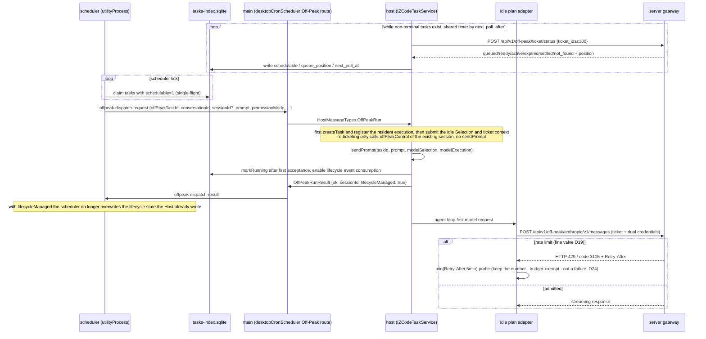
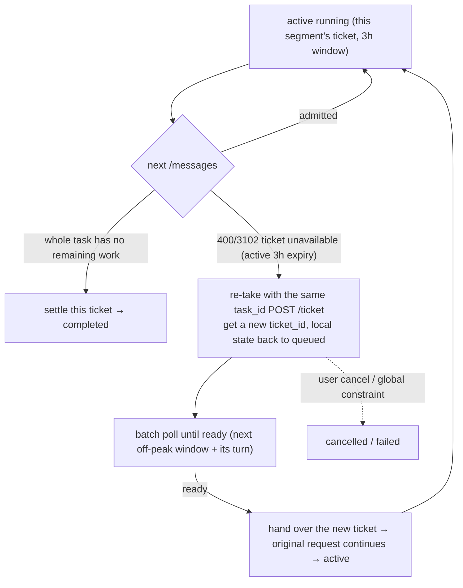
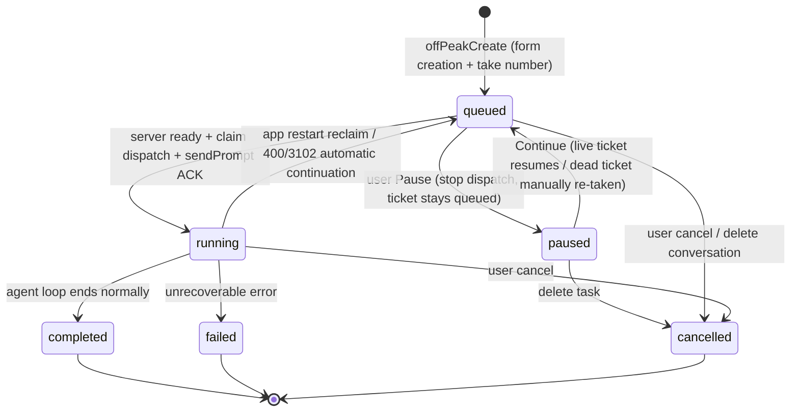
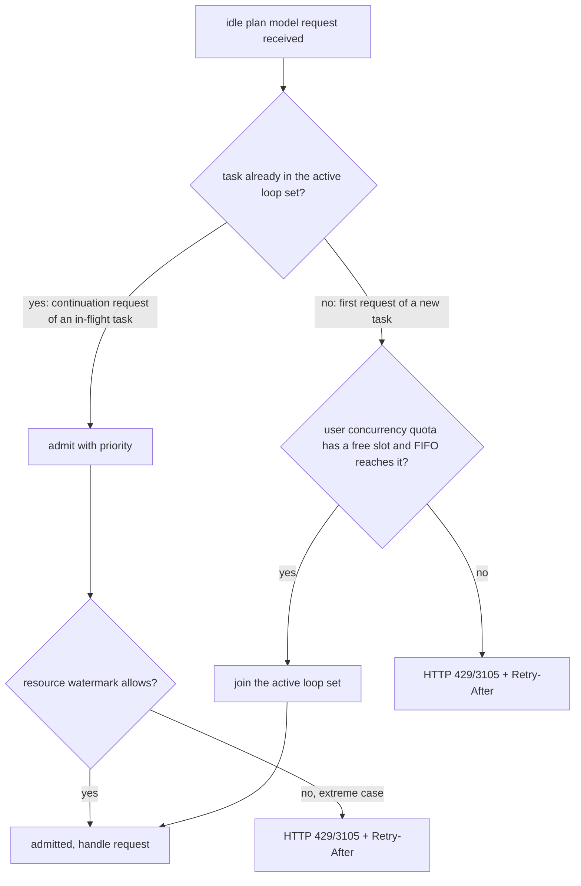
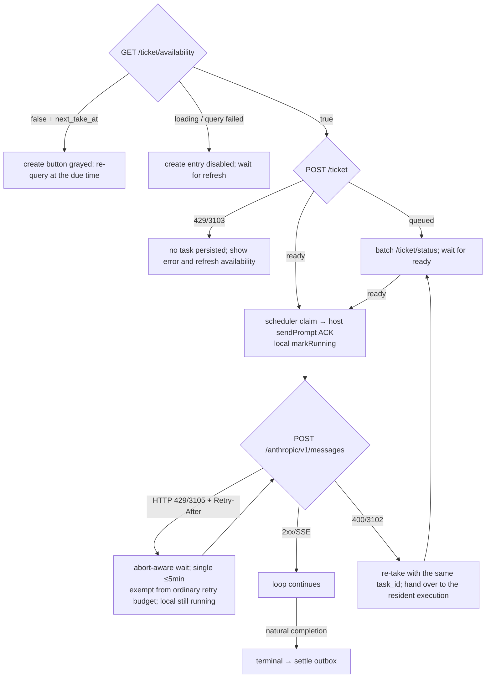

# Off-Peak Task Technical Design

> **Lifecycle implementation:** the [background execution and lifecycle plan](./background-lifecycle-plan.md)
> defines owners, sequences, interfaces and verification progress. The single-turn closing of the
> historical design is replaced by the CLI's whole-task execution closing.

> **Status: implemented; synced with the Provider Refactor M4 execution facts on 2026-08-24.** The repo
> contains the `offPeak` domain types, SQLite Repo, Service, scheduler/main/host dispatch, the standard
> Provider/Model execution chain, UI and mock. Scheduled Automation remains a separate domain, see
> [Scheduled Tasks Main View](../ui/scheduled-tasks-main-view.md).
>
> **2026-08-24 Provider Config / Model Execution consolidation:** `client/configs.offPeak` controls
> exposure only; the hidden Built-in `builtin:offpeak-idle-plan` supplies static Provider facts and the
> Effective Model Config supplies static model facts. An automatic turn submits a standard Model
> Selection; `modelExecution` carries only this run's Request Auth and Child policy. The old
> `turnRuntimeModel`, temporary Registry overlay and Session model restore chain are deleted.

> Companion docs: `spec.md` (current product rules), `decisions.md` (D1-D52 history), `glossary.md`
> (current terms), `implementation-notes.md` (code map). Early plans in the decision log must be read
> with their later superseded marks; current behavior is defined by the code, this file and the
> implementation notes.
> Full history: `git show b8876e8b:docs/off-peak-task/tech-design.md`

## 0. Orientation and key decisions

**One-line definition:** an idle-time task is a one-shot background task under Automations (D28). The
user creates it in the Automations form (title/instructions/project/permission/model), submitting takes
a number; the server admits tasks by global FIFO when compute is idle and controls concurrency; at
dispatch a new session runs unattended on the user's machine through the invisible idle plan provider
and notifies the user at terminal state.

**Waiting strategy (relies on Retry-After): the client never waits on a long timer.** Each queue
response is clamped to `min(server Retry-After, 5 minutes)` for a single wait; unlimited idempotent
probes cover any resource gap (a 3-hour wait is about 36 five-minute probes), and freed resources are
caught by the next probe. Queue probes are exempt from the retry budget and never count as a failure
(D19/D24).

| Decision                                      | One-line                                                                                                                                                                                                           |
| --------------------------------------------- | ------------------------------------------------------------------------------------------------------------------------------------------------------------------------------------------------------------------ |
| **Task nature** (D28, replaces D5/D23)        | A **one-shot background task** under Automations: form creation, list management, a new session at dispatch; UI follows Figma, the composer moon switch / lock paradigm is void                                   |
| **Queuing and concurrency on the server** (D18/D20) | Global FIFO and per-user concurrency quota are all on the server; the client carries no scheduling policy                                                                                            |
| **Five lifecycle endpoints** (D39)            | availability -> take `POST /ticket` (-> ticket_id) -> batch `POST /ticket/status` -> `POST /messages` -> settle; server ready is written as local schedulable; local running is written after the sendPrompt ACK and cannot be time-equated with active |
| **3h segments + automatic continuation** (D26 corrects D3/D15) | Each active ticket lasts at most 3h; after `3102` a new ticket is handed to the resident CLI, keeping the original request and background results, with no continuation prompt submitted |
| **Every request may be re-queued** (D19)      | Queue protocol converges in the idle plan provider adapter; waiting is not a failure and has no cap, the agent loop is unaware                                                                                    |
| **idle plan** (D11/D16/D33/D44)               | The automatic dispatch turn exactly selects the hidden Built-in `builtin:offpeak-idle-plan` and creates the Active Model through the standard Registry/ModelFactory; permission is handled inside the ordinary session with the aggregate staying running; no mid-turn provider switch after approval |
| **Billing boundary** (D23/D33)                | Runtime Session Selection maintains continuation ownership; the temporary idle selection and credentials are not written to ordinary session entries; after a user message is accepted, continuation uses the user's selection |
| **Terminal settle** (D22)                     | Idempotent settle report + outbox re-report, with server silent-timeout reclaim as a backstop                                                                                                                      |
| **Gray release** (D31)                        | Entry exposure is delivered by `offPeak.enable_offpeak_task` of the shared `GET /api/v1/client/configs`; the model list comes from Built-in `builtin:offpeak-idle-plan`. Effective on = switch true and a non-empty Built-in model list; admission remains the server's |
| **Quota snapshot** (D39)                      | The dedicated `GET /ticket/availability` returns `can_take_number` and `next_take_at`; the UI grays early and re-queries at the due time, `POST /ticket` stays the final authority under races                      |
| **Cut and new** (D1/D8/D17)                   | Free pool with no balance concept and no sandbox (mapped to existing permission modes); the ticket lifecycle and messages ability are Off-Peak specific, and the client also provides a mock                        |
| **In-conversation creation** (D49, overturns D30-4) | `OffPeakCreate`/`OffPeakList` sit beside the `Cron*` sibling family (unified creation entry, the agent routes by semantics); bridged through the new protocol methods `offPeak/create`/`offPeak/list` to the existing `OffPeakTaskService.createTask`, the same take-number chain as the form; the tool surface is controlled by the host-delivered `offPeakToolEnabled` (not delivered = not registered) |

**Provider/billing boundary (current implementation):** the session model bar always shows the user's
resident workspace model; the idle plan is only the Active Model of the automatic dispatch turn. The old
generalization "anything human-triggered switches to the user key" must no longer be used:

| Moment                                      | Action -> result                                                                                                                                                       |
| ------------------------------------------- | ---------------------------------------------------------------------------------------------------------------------------------------------------------------------- |
| No idle task created                        | ordinary conversation/task, unrelated to idle                                                                                                                          |
| Automatic dispatch / continuation           | the current automatic turn uses `builtin:offpeak-idle-plan`; the user provider is not restored before the turn completes                                               |
| User sends a prompt while the automatic turn is busy | the message enters the existing session queue; after the turn ends it drains and creates the user model by that message's ordinary Submission and Session Selection |
| permission approval                         | the ordinary session shows/answers permission or elicitation; the Off-Peak aggregate stays running. Approval/denial in the current turn keeps the same idle Active Model, no user provider switch, no duplicate Off-Peak notification |
| "Cancel" in any non-terminal state, then takeover | automation ends, files are kept, manual continuation all on the user's key                                                                                       |
| Continue chatting after terminal            | a new ordinary Loop Model is created using the user provider the Session Selection points to                                                                          |

Session Selection is the runtime continuation selection, temporarily pointing to the idle model while idle
execution is resident. After a user message is accepted it immediately becomes that message's ordinary
selection, and old queued messages must not write back. The ordinary persisted entry keeps the user's
selection. Ticket lifetime is managed by the CLI `OffPeakLifecycle` and `OffPeakTicketAuthority`; the Host
hands tickets over through the strict-schema `v4/offPeak/lifecycle` and `v4/conversation/offPeakControl`,
and terminal write-back does not depend on a single-turn terminal.

**Current server contract baseline:** `zcode-server/main@ec2b18daa01b8e1b801f0691ac22153c2e56c6db`
confirms all five endpoints require the client to carry `X-Coding-Plan-Api-Key`; a BigModel Team
connection must also carry `bigmodel-organization` / `bigmodel-project` as a pair from the same selected
credential snapshot, never relying on the server to reverse-look-up from the access key. availability,
take and messages validate it; status/settle currently read only the JWT. The verifier supports ZAI /
BigModel by JWT login provider and checks the Coding Plan key as an opaque credential for plan and user
ownership; the Start Plan JWT is not that credential and is explicitly excluded. **2026-07-22 test
runtime correction:** ZAI/BigModel personal plans work end to end; for the BigModel Team project runtime
key the client resolution and header transport are in place, but the verifier's subscription dependency
rejects it with `3101 coding plan is required`, which the server wraps as `500/2007`, so Team end to end
is currently blocked by the test backend. The client must not fall back to a personal key. Production
limit and global admitted values stay server dynamic config. Two hard requirements must not be lost:
admitted tasks are released until terminal (within 3h); active loops are reclaimed on silent timeout (so
quota is freed after a client crash).

**Selected connection / credential boundary (implementation source of truth):**

```text
AppSettings snapshot
  providerFamilyDomain
  modelProviderFamilyModes[family]
  modelProviderFamilySelectedKeys[family]
OAuth credential identity
  activeProvider + zcode JWT
             |
             v
  exact supported-connection matrix
     |-- ZAI Coding personal ---------> cached selected provider apiKey
     |-- BigModel Coding personal ----> cached selected provider apiKey
     |-- BigModel Team org/project ---> shared Team runtime-key helper
     `-- Start/API Key/identity mismatch/missing/stale --> typed permanent rejection
             |
             v
  OffPeakCredentialSnapshot { metadata + jwt + codingPlanApiKey }
      |                    |                       |
      |                    |                       `-- modelExecution.requestAuth
      |                    `-- availability/take/status/settle client
      `-- sanitized support over RPC --> gray-enabled UI creation gate
```

Root cause of the old bug: the UI scanned all cached providers while the ticket client and host turn each
read only the personal BigModel key; the three shared no selected connection and could mix snapshots in
one operation. Now every entry shares one resolver: secrets stay in host/service memory and the UI gets
only redacted support; a failed Team key must not fall back to a personal key; the active OAuth provider
must match the selected family, and after a selection or login-identity change the next operation
re-resolves.

The tester failure has a different root cause from the fixed client bug: the same selected Team snapshot
had already reached the server; the failure happened after the server verifier called the external
subscription dependency. A bare `429` without a business code is a separate global HTTP rate-limit path
and must not be read as the `3103` quota. The client only adds standard origin/request-id headers,
redacted service diagnostic logs and user-readable error mapping; it does not fake a successful Team
take-number.

## 1. Background and goals

Users submit non-urgent tasks to an "idle queue"; the server admits by global FIFO when compute is idle
(the client has no window concept and polls authorization, D21); the task runs unattended on the user's
machine through the idle-only provider (idle plan, user-invisible) at lower cost.

**Goal:** entry (Automations form / template cards, gray-gated D31) -> queue -> server authorization and
admission -> execution -> terminal notification, recoverable end to end (an app restart / sleep loses no
task).

**Non-goals (v1, see spec §7):** balance guard, window pause/snapshot continuation, tier quotas,
file-system sandbox, automatic git baseline, exact ETA, mobile initiation/approval, auto start/stop of
keep-awake by active task count. Keep-awake is currently a global setting that, once on, immediately
prevents app suspension on idle regardless of the number of running tasks.

## 2. Overall architecture

```mermaid
flowchart LR
  subgraph Client["z.code desktop client"]
    subgraph Renderer["renderer (packages/ui)"]
      Automations["AutomationsSection<br/>Idle-time tab + create form + template cards<br/>(gray gate D31)"]
      TurnCard["ConversationTurnGroup<br/>in-conversation creation turn-tail static card (D49)"]
      Sidebar["sidebar Group<br/>Idle-time task (cross-project + count badge)"]
      Detail["task detail page / run session conversation"]
      Store["offPeakStore (zustand)"]
    end
    subgraph Main["main process"]
      OPRouter["desktopCronScheduler<br/>OffPeakRun/Result routing"]
      Notif["renderer notification hook<br/>system notifications"]
    end
    subgraph Sched["scheduler utilityProcess (resident, existing)"]
      OPTick["offPeak tick: claim schedulable tasks"]
    end
    subgraph Host["window Local Host utilityProcess<br/>routed by workspaceKey"]
      TaskSvc["IOffPeakTaskService<br/>create/pause/continue/cancel/list"]
      OPTool["offPeak/create · offPeak/list handler (D49)<br/>default resolution + whitelist pre-check + workspace injection"]
      RunSvc["IZCodeTaskService<br/>createTask / resume / sendPrompt"]
      Adapter["idle plan provider adapter<br/>HTTP 429/3105 + Retry-After"]
      PollSync["OffPeakTaskService sync<br/>batch POST /ticket/status → write sqlite"]
    end
    DB[("tasks-index.sqlite<br/>off_peak_tasks (with schedulable column)")]
  end

  subgraph Server["Off-Peak server"]
    PollAPI["task lifecycle API<br/>availability / ticket / ticket/status / settle"]
    Gateway["idle plan gateway<br/>global FIFO queue + admission<br/>HTTP 429/3105 + Retry-After"]
    Pool["LLM idle resource pool"]
  end

  Automations -->|IOffPeakTaskService RPC| TaskSvc
  TurnCard -->|onOpenAutomationsMain(id,"idle")| Automations
  Store <-->|broadcast/subscribe| TaskSvc
  Sched <-->|read/write| DB
  Host <-->|read/write| DB
  Sched -->|offpeak-dispatch-request| OPRouter
  OPRouter -->|HostMessageTypes.OffPeakRun| Host
  Host -->|OffPeakRunResult| OPRouter --> Sched
  TaskSvc --> RunSvc
  OPTool -->|reuses the same take-number chain| TaskSvc
  Adapter -->|POST /messages| Gateway --> Pool
  PollSync -->|availability / take / batch status / settle| PollAPI
  Store -->|task state edges| Notif
```

Points:

- **The scheduler touches only tasks-index** (same owner scheme as automation): the host-domain
  `OffPeakTaskService` does `POST /ticket` and the batch `POST /ticket/status` sync and writes
  `schedulable`/`queue_position` back to the task row; the scheduler claims schedulable tasks from the
  database, sends no HTTP and holds no credentials. Sync uses one shared timer; `next_poll_at` is a
  snapshot, not a per-task timer.
- **Queue retry is special-cased only in the provider adapter layer:** only HTTP `429/3105` of
  `providerId=builtin:offpeak-idle-plan` is exempt from the ordinary retry budget; ordinary provider 429
  semantics are unchanged.
- It shares the scheduler process and dispatch pipeline with automation, but **tables, message types and
  state machine are all independent**; no field is added to `ZCodeAutomation`.

## 3. Domain model and storage

### 3.1 TS types (`packages/shared/src/off-peak-types.ts`, implemented)

```ts
export type ZCodeOffPeakTaskStatus =
  | "queued"
  | "paused"
  | "running"
  | "completed"
  | "failed"
  | "cancelled"; // paused added by D30-10

// D29-4: all four permission modes open (Ask/Edit automatically/Plan/Full access), directly reusing the existing ZCodeTaskMode;
// product vocabulary is build/edit/plan/yolo (same source as automationAgentConfigOptions), default "build" (Ask for
// approval). The old two-value type "bypassPermissions" | "default" is void.

export interface ZCodeOffPeakTask {
  offPeakTaskId: string; // local primary key, also the server task_id (stable across tickets)
  serverTicketId?: string; // Snowflake ticket_id returned by take-number; updated on every re-take (D26)
  title: string; // form Task title (D28)
  conversationId?: string; // host conversation taskId; D30-8 creates none up front, backfilled after first dispatch createTask
  sessionId?: string; // backfilled after first run; used by resume for continuation/interrupt recovery
  prompt: string; // form Instructions
  permissionMode: ZCodeTaskMode; // four permission modes (D29-4), default "build" (Ask before changes)
  model?: string;
  thoughtLevel?: string; // reasoning strength (D34, aligned with automation); defaults to the workspace default
  workspaceKey: string; // resolveWorkspaceKey rule
  workspacePath: string;
  workspaceIdentity?: string;
  status: ZCodeOffPeakTaskStatus;
  queuedAt: number; // local scheduler FIFO/display order; server FIFO is by ticket creation order
  startedAt?: number;
  endedAt?: number;
  failureReason?: string;
  filesChanged?: number;
  settledAt?: number; // terminal settle server ack (D22)
  historyDeletedAt?: number; // only controls local History visibility
  registeredAt?: number; // POST /ticket ack time
  schedulable?: boolean; // server ready snapshot
  queuePosition?: number;
  nextPollAt?: number; // server-suggested time snapshot; consumed by the shared sync timer
  createdAt: number;
  updatedAt: number;
}

// The batch POST /ticket/status sync snapshot is written back to the task row for cross-process scheduler reads:
// registeredAt (take-number success) / schedulable (server ready) / queuePosition / nextPollAt.
// Create quota is not derived from client/configs.limit or local counting; D39 availability is a UI snapshot only,
// the 429/3103 of POST /ticket is always the final admission authority.
```

Protocol extension points (per AGENTS.md: change `packages/shared/src/zcode-protocol/index.ts` +
the `validation.ts` runtime schema):

- `HostMessageTypes.OffPeakRun` / `HostResponseTypes.OffPeakRunResult` (modeled on CronRun/CronRunResult).
- `schedulerProtocol.ts` gains the message pair `offpeak-dispatch-request` / `offpeak-dispatch-result`.
- The renderer uses the independent `IOffPeakTaskService` RPC: `getTakeNumberAvailability` /
  `createTask` / `updateTask` / `cancelTask` / `pauseTask` / `continueTask` / `deleteTask` /
  `deleteHistory` / `list` / `get`. Take-number, batch sync, re-take and settle outbox are driven inside
  the service; ~~`offPeakRunNow`~~ was removed by D32.
- **D49 in-conversation creation:** new agent -> host protocol method `offPeak/create` (params
  `zcodeOffPeakCreateParamsSchema` = title/prompt required + permissionMode/model/thoughtLevel optional;
  result is a **discriminated union** `{ok:true,task} | {ok:false,failureStage,errorCategory,errorCode}`;
  failure classification stays faithful across the protocol and must not degrade to a string) and the
  read-only `offPeak/list`. The task snapshot schema `zcodeOffPeakTaskSnapshotSchema` is the minimal
  surface: it does not expose `serverTicketId` (must not cross the boundary) or `providerName` (a pure
  telemetry dimension). workspace is not a protocol parameter; the host injects it from the current
  session closure (symmetric with `automation/create`).
- **D49 tool-surface flag:** `session/create` and `session/resume` params each gain
  `offPeakToolEnabled?: boolean`, registered in `SESSION_CREATE/RESUME_OPTIONAL_COMPAT_FIELDS` - an old
  app-server whose `.strict()` schema does not know it degrades and retries (omitting the field = tool not
  registered, a safe direction). resume must carry it too: otherwise cold-resume runtime rebuild would lose
  the tool surface (same cause as `toolAllowlist`).

### 3.2 sqlite (tasks-index, `OffPeakTaskRepo` modeled on `AutomationRepo`)

```sql
CREATE TABLE IF NOT EXISTS off_peak_tasks (
  off_peak_task_id   TEXT PRIMARY KEY,
  server_ticket_id   TEXT,
  title              TEXT NOT NULL DEFAULT '',  -- form Task title (D28)
  conversation_id    TEXT,                 -- host conversation taskId; D30-8 backfilled after dispatch createTask
  session_id         TEXT,
  prompt             TEXT NOT NULL,
  permission_mode    TEXT NOT NULL,        -- ZCodeTaskMode four permission modes (D29-4), default 'build'
  model              TEXT,                 -- stock selection migration only; new versions write NULL
  thought_level      TEXT,                 -- stock selection migration only; new versions write NULL
  model_selection    TEXT,                 -- full frozen ModelSelection JSON; execution must not read back the two old columns
  workspace_key      TEXT NOT NULL,
  workspace_path     TEXT NOT NULL,
  workspace_identity TEXT,
  status             TEXT NOT NULL,        -- seven states (incl. paused, D30-10), see §5
  queued_at          INTEGER NOT NULL,
  started_at         INTEGER,
  ended_at           INTEGER,
  failure_reason     TEXT,
  files_changed      INTEGER,
  settled_at         INTEGER,           -- terminal settle server ack time; NULL = unsettled (7.7/D22)
  history_deleted_at INTEGER,           -- only hides the local History row, deletes no task/session
  registered_at      INTEGER,           -- POST /ticket ack time
  schedulable        INTEGER NOT NULL DEFAULT 0, -- server ready snapshot
  queue_position     INTEGER,
  next_poll_at       INTEGER,           -- server-suggested poll time snapshot; currently driven by the shared timer
  -- scheduler claim (single-flight, reusing automation's BEGIN IMMEDIATE + running 0→1 pattern)
  claim_running      INTEGER NOT NULL DEFAULT 0,
  claimed_at         INTEGER,
  attempt_count      INTEGER NOT NULL DEFAULT 0,
  last_error         TEXT,
  created_at         INTEGER NOT NULL,
  updated_at         INTEGER NOT NULL
);
CREATE INDEX IF NOT EXISTS idx_off_peak_pick   ON off_peak_tasks(status, queued_at);
CREATE INDEX IF NOT EXISTS idx_off_peak_ws     ON off_peak_tasks(workspace_key, status);
```

Key `OffPeakTaskRepo` methods: `create` / `claimDue(now)` (claims `queued + schedulable=1` in a
`BEGIN IMMEDIATE` transaction; a 10-minute stale claim is reclaimable) / `markRunning` / `markTerminal` /
`releaseClaim` / `recoverInterrupted()` / `requeueForContinuation` / `setPaused` / `delete` /
`markHistoryDeleted` / `markSettled` + `listUnsettledTerminal` / `updateSchedulingSnapshot`.
Initialization migrates the reserved legacy value `awaiting_approval` to `running`.
`countNonTerminal/countActive` are for statistics and no longer carry D36's local create-quota judgment.

## 4. End-to-end data flow

### 4.1 Submit flow (any time)

```mermaid
sequenceDiagram
  participant U as User
  participant UI as Automations create form (renderer)
  participant Svc as IOffPeakTaskService (host)
  participant Repo as OffPeakTaskRepo
  U->>UI: entry (Automations button / template card prefill)
  UI->>Svc: GET /ticket/availability (on page entry)
  alt can_take_number=false
    Svc-->>UI: create button grayed + next_take_at Tooltip; re-query at the due time
  else loading / query failed
    Svc-->>UI: create entry disabled; wait for manual or automatic refresh
  else can_take_number=true
  U->>UI: fill title/instructions/project/permission/model → Create Idle-time task
  UI->>Svc: offPeakCreate({title, instructions, permissionMode, model, workspace...})
  Svc->>Svc: POST /ticket take number (task_id=offPeakTaskId)
  alt 429/3103 over limit (D39: backstop for the race after the query)
    Svc-->>UI: show "Free tier limit reached"; no task persisted; refresh availability
  else take success
    Svc->>Repo: create(status=queued, server_ticket_id, position)
    Svc-->>UI: new list card #N in queue, sidebar Group +1
  end
  end
```

Key trade-off (D30-8, revises D25's old trade-off): **creation stores only the form data + takes a
number, and pre-creates no conversation.** Dispatch `createTask` creates a new session (the same path as
automation's CronRun) and backfills sessionId; interrupt recovery of an existing task row can still resume
the same session; a re-ticket during this run continues through the existing CLI control interface
without resending the prompt. A sidebar Group entry with no session opens the task detail page on click,
and goes straight to the conversation once a session exists.

### 4.2 Scheduling + admission flow (after authorization)



- Dispatch failure (no available host / host throws) retries with the same transient backoff as
  automation (a separate copy of the `DISPATCH_RETRY_BASE_MS` constants).
- **No window to miss (D21):** while the machine sleeps / the app is closed nothing happens; polling and
  dispatch resume as long as queued tasks remain (the original D9 deferral holds naturally). Do not reuse
  automation's `MISFIRE_GRACE_MS` skip logic.
- Concurrency is server-controlled (D20): in the authorized period the client dispatches all queued tasks
  in queue order, and the gateway admission decides how much concurrency each user gets; non-admitted
  tasks stay shown as queued. File-conflict risk of concurrent tasks in one workspace equals running
  several conversations manually; no extra isolation.

### 4.3 In-run re-queue flow (D19, can happen on every request)

```mermaid
sequenceDiagram
  participant L as agent loop (runtime)
  participant A as idle plan adapter
  participant G as server gateway
  L->>A: Nth model request
  A->>G: POST /api/v1/off-peak/anthropic/v1/messages
  G-->>A: HTTP 429 / code 3105 + Retry-After (resources tight)
  Note over A: abort-aware backoff; does not consume the ordinary retry budget;<br/>local state is still running (no separate waiting state)
  A->>G: retry
  G-->>A: admitted + response
  A-->>L: normal return (the loop only perceives "slow")
```

Adapter rules (implemented in `apps/zcode-cli/packages/adapters/src/model/offpeak-retry.ts` and called by
the generate/stream runners; effective only for `providerId=builtin:offpeak-idle-plan`):

- **Single-wait clamp:** wait = `min(server Retry-After or default 60s, 5 minutes)`; long waits are
  covered by short clamp x unlimited idempotent probes, and a wait can be aborted.
- **Retry-budget exemption:** HTTP 429 or business code 3105 maps to `ModelRetryReason.OffpeakQueued`;
  the runner keeps/rolls back the attempt so the capacity wait does not consume the ordinary retry
  budget; other providers do not take this branch.
- **Stream safety boundary:** retry only before any provider-visible output; no replay after crossing the
  visible boundary.
- **First-dispatch abandon (rule 1, implementation settled on the ticket TTL as backstop):** no separate
  abandon logic in the adapter - a queued first request hanging at the gateway has its ready 5-minute TTL
  expire into `400/3102` -> continuation re-queue (§4.6); the wait upper bound is about TTL + one
  5-minute clamped probe <= 10 minutes, meeting the rule's intent (do not hang the agent loop) with one
  fewer state machine; the new ticket is dispatched to the original resident execution which continues the
  original request, without replaying the initial instruction or executed tools.
- User cancel of the task aborts the waiting timer and the in-flight request.
- The request headers carry `X-Off-Peak-Ticket-ID` and dual credentials (JWT + `X-Coding-Plan-Api-Key`,
  the D23/D26 injection point) with the run-scope provider config.

### 4.4 Permission / elicitation boundary (D44)

D11/D27 designed "sensitive operation pauses -> dedicated waiting state -> switch to the user provider
after approval with a quota hint". The current runtime's idle Active Model covers the whole automatic turn
and permission/elicitation does not end the turn; the final code therefore reuses only the ordinary session
confirmation and builds no second Off-Peak state and notification.

```text
automatic turn (active turn model = builtin:offpeak-idle-plan)
  └─ permission_request (existing generic permission chain)
       ├─ ordinary session shows it and collects approve/deny
       ├─ local Off-Peak task stays running
       └─ after the response: the same turn continues
            ├─ still uses builtin:offpeak-idle-plan
            └─ triggers no Off-Peak specific notification or quota hint

automatic turn terminal
  └─ end idle Active Model/Request Auth → ready / drain the user's queued messages
```

User input in the run session is still admitted solely by the CLI CommandInbox.
`modelExecution.offPeak` carries only the in-memory execution identity; credentials resolve through the
current execution dependency; the re-ticket control does not enter the transcript. User takeover is not
cancellation: already started sub-turns finish, and later resumption and notification wake-ups use the
user model.

### 4.5 Interrupt recovery (app restart / machine wake)

Startup path: when the scheduler process (an app singleton, before any dispatch) starts it calls
`OffPeakTaskRepo.recoverInterrupted()` - `running`/timed-out claimed tasks are put back to `queued`
(queued_at kept, naturally near the queue head) -> the next tick re-dispatches on authorization -> the
host `session/resume`s the same session -> continues with a continuation prompt. A legacy reserved value
`awaiting_approval` is migrated to running by Repo initialization first. Continuation prompt (as
implemented): a fixed English instruction "Continue the previous task from where it left off...do not
start over", without resending the original prompt (avoids redoing from scratch); first run vs
continuation is decided by whether the row already has a conversationId.

### 4.6 3h expiry automatic continuation flow (D26)

The server's active hard cap is 3h, so long tasks run in segments: one segment = one ticket, the same
`task_id` spans segments, and the session is reused throughout.



- The trigger is the message receiving `400/3102` (active expired, the server already set the ticket to
  expired), not a client-side local timer - the server is authoritative, avoiding clock-drift
  misjudgments.
- Re-taking uses the **same `task_id`** (the server allows multiple), gets a new `ticket_id`; the
  `server_ticket_id` column updates and the old ticket is void.
- After re-ticketing waits for ready it is handed to the existing runtime: no resume, no sendPrompt;
  first dispatch still follows §4.2.
- The user-visible status falls back to "waiting for idle compute" in the gap (running -> queued
  display) and returns to running when it runs; to the user it is one task that runs slowly to the end.
- The session and local background processes stay resident across tickets; cross-restart background
  recovery is not provided.

### 4.7 In-conversation creation flow (D49)

#### Todo103 integration ruling: rewire the tool model configuration

Keep the tool creation's yolo, last-in-list model and highest reasoning-level defaults, plus session
binding / recursion guard / error redaction. Model facts now come from the current
`OffPeakClientConfig.modelSelectionView`; the legacy `allowedModels`, `allowedModelConfigs`,
`reasoning.levels/defaultLevel` and name-based level guessing branches are not restored.

```text
tool creation request
  -> existing getCodingPlanSupport confirms the current account Family
  -> the exact Off-Peak Provider of that Family in the current idle Selection View
  -> resolve the model (explicit: case-sensitive match; default: last in list)
  -> default level reuses completeNewModelSelection (values low to high, take the last)
  -> structured ModelSelection + workspace + boundSessionId
  -> the existing createTask take-number and persistence
```

A model must not be borrowed from another Family's candidates; with no supported account / no model in
that domain a stable client-cannot-create classification is returned, no number is taken and no empty
selection persisted. An explicit level goes to the existing createTask validation and is not overridden
by the default level. This rule applies only to new tool tasks, does not rebind an existing Ticket and
does not modify an already fixed execution selection. The gate is still delivered at the existing
client-ready / create-resume entries; the merge does not re-do a sync system.

Tool calls and form creation **share one take-number chain** (`OffPeakTaskService.createTask`); they
differ only in entry and default resolution: the tool still defaults to yolo / last model name of that
account domain / highest level (D49-4, for "say it and leave" unattended semantics). The form keeps the
interaction and full-selection submit of the current Selection View and does not restore the historical
workspace default level because of the tool interface.

```mermaid
sequenceDiagram
  participant M as Model (user interaction turn)
  participant H as CLI tool handler (off-peak.ts)
  participant P as offpeak-port (bootstrap)
  participant S as zcodeAgentService (host)
  participant Svc as OffPeakTaskService
  participant G as server ticket API
  participant UI as ConversationTurnGroup
  M->>H: tool_use OffPeakCreate {title, prompt, ...}
  H->>H: assertNotOffPeakTurn (idle turn rejects; automation turn allows D49-3)
  H->>P: offPeakPort.create(input, {sessionId})
  P->>P: activeOffPeakTaskId hit rejects (third layer of defense)
  P->>S: requestClient(offPeak/list) (D50 binding guard: reject if this session has a non-terminal task; query failure fail-closed)
  P->>S: requestClient(offPeak/create {…, boundSessionId})
  S->>S: default resolution + model whitelist pre-check + workspace closure injection
  alt gray off / config missing / empty whitelist
    S-->>P: {ok:false, client_validation/offpeak_disabled}
  else model not in allowed_models (trim + case-insensitive match)
    S-->>P: {ok:false, client_validation/model_not_allowed}
  else
    S->>Svc: createTask(...) (same entry as the form)
    Svc->>G: POST /ticket take number
    alt 429/3103 quota exhausted
      G-->>Svc: quota error
      Svc-->>S: {ok:false, quota_3103}
    else take success
      Svc->>Svc: repo.create(queued, session_id=boundSessionId) + wake scheduler
      Svc-->>S: {ok:true, task}
    end
  end
  S-->>P: discriminated union passed back as is (no respondError, classification faithful)
  P-->>H: outcome
  alt ok:false
    H-->>M: CoreError (actionable text by classification, recoverable:false)
  else ok:true
    H-->>M: {task, message}
    Note over UI: after the reply completes render the turn-tail static card<br/>moon + title + position snapshot at creation
    UI->>UI: click → onOpenAutomationsMain(offPeakTaskId,"idle")<br/>→ offpeak- prefix routing → offpeak-edit view
  end
```

**Three-layer turn boundary** (the opposite direction of cron, the biggest copy-paste trap):

```text
                        ┌─ ordinary user turn ──── OffPeakCreate ✅  OffPeakList ✅
current turn identity ──┼─ cron automation turn ── OffPeakCreate ✅ (D49-3 combined play) ✅
                        └─ idle dispatch turn ──── OffPeakCreate ❌            ✅

Three interception layers in an idle turn (any one holds independently):
  L1 provider request boundary   buildTurnDisallowedTools / buildTurnToolDisallowlist
                         ← host dispatch toolDenylist:["CronCreate","OffPeakCreate"] (D45+D49-2)
                         ← isOffPeakCreateRestrictedTurn three signals:
                            explicit offPeakTaskId (primary) ∥ queryId "offpeak-" prefix (resume fallback)
                            ∥ denylist already contains OffPeakCreate (busy merge path)
  L2 handler execution boundary   assertNotOffPeakTurn(context.offPeakTurn) → PermissionDenied
                         Agent/Bash explicit and automatic background, SendMessage go through the ordinary executor; standalone workflow execution is still forbidden
  L3 protocol port boundary       offpeak-port reads record.activeOffPeakTaskId → reject, no protocol request sent
  (D50 binding guard in three levels: port reads offPeak/list top-20 fast reject → service createTask exact
    pre-check repo.hasActiveBoundTask before taking a number → partial unique index idx_off_peak_bound_active
    closes the TOCTOU at INSERT; the latter two return session_bound, machine review CR-02)

⚠ Idle-specific restrictions are independent of AUTOMATION_MUTATION_TOOL_NAMES. Core and Bootstrap
  consistently consume shared OFF_PEAK_EXECUTION_TOOL_DENYLIST; the services scheduling entry additionally
  restricts CronCreate. Do not mix idle-specific items into ordinary cron automation turns.
```

**Tool registration and create admission are separate (3.12.2):**

```text
Host service assembly + local workspace (no network)
  -> workspace policy / legacy create-resume / V4 createSession flag
  -> createRecord injects OffPeakPort -> main Runtime registers the tool
tool OffPeakCreate -> approval/call guard -> Host reads gray release/plan/model -> createTask/take number
tool OffPeakList -> Host local list, filtered by workspaceKey
```

The local capability condition only checks dependency assembly, remoteSessionId and remote
workspaceIdentity; it does not use client config. The workspace policy is kept to cover V4 subscribe cold
resume, with no new Host or recovery channel. A gray-off/read failure affects only the actual create call;
page entries stay gray-controlled. An old Host that sends no flag still does not register, and an old CLI's
method-not-found still degrades. An already active Runtime does not dynamically rebuild its tool set.

**Bound-session dispatch (D50, three branches of `dispatchOffPeakRun`, pure function
`resolveOffPeakDispatchKind`):**

```mermaid
flowchart TD
  A[scheduler claim → host OffPeakRun] --> K{conversation_id?}
  K -- non-empty --> R[resume: resumeTask same session<br/>setMode → continuation prompt + single-execution full Selection]
  K -- empty --> B{session_id?}
  B -- empty --> I[init (form): createTask new session<br/>stamp offPeakTaskId → task prompt]
  B -- non-empty --> P[bound-first-run (in-conversation creation)]
  P --> D{listDeletedTaskIds contains that session?}
  D -- yes --> PERM[OffPeakBoundSessionDeletedError<br/>permanent → failed]
  D -- no --> S{tasks-index status === running?}
  S -- yes --> BUSY[OffPeakBoundSessionBusyError<br/>transient → releaseClaim + backoff<br/>⚠ no session config written]
  S -- no --> RES[resumeTask (stamp offPeakTaskId → sidebar idle group)<br/>setMode(yolo default)<br/>sendPrompt original task prompt + single-execution full Selection, toolDenylist]
  RES --> MR[markRunning: conversation_id = session_id]
  MR -.task turn ends.-> T{outcome}
  T -- succeeded --> C[completed]
  T -- stopped (user Stop) --> X[cancelled, ticket void]
  T -- other --> F[failed]
```

Busy-detection details: CLI `session/send` only looks at `record.activeAbortController` and, if present,
rejects with -32010 (user-interface input goes through the v4 queue and does not hit this); `setMode` has
no such check, so the probe must happen before writing config. The host reports every non-permanent error
as transient; the scheduler `releaseClaim`s back to queued with `attempt_count+1`, backoff 30s·2^(n-1)
capped at 15min with no attempt limit; if the ticket's ready window expires during retries, sync re-takes
with the same task_id and goes to the queue tail.

Integration wiring constraint: bound first run and continuation must not separately
setConfigOption(thought_level). The level goes with the frozen ModelSelection into selectionScope=execution
together with the Ticket Request Auth for this execution; the idle level must not be written to the
existing user Session. Keep the source busy/deleted probe, mode setting and ownership stamping, and do not
add an account sync before sending.

**Card-jump readiness signal:** in-conversation creation is persisted directly by the agent and does not go
through the UI `offPeakTaskStore`; the store's `loading` initial value is false ("not loaded" and "loaded"
are indistinguishable). When `AutomationsSection` receives an `offpeak-` prefixed navigation it forces
`refresh()` first and uses "the refresh for this navigation id finished" as the only readiness signal
before resolving found/missing; `refresh()` failure does not reject but writes `store.error`, in which case
the list is untrustworthy -> resolves `unavailable`: land on the idle tab with a "list load failed" hint,
not a false targetNotFound (review CR-01); the tab navigation effect does not consume first while an
offpeak detail navigation exists (`onOpenAutomationConsumed` clears both id and tab).

## 5. State machine



Transition table (who triggers, who persists, side effects):

| Transition               | Trigger                                                          | Persistence                                  | Side effects                                                  |
| ------------------------ | ---------------------------------------------------------------- | -------------------------------------------- | ------------------------------------------------------------- |
| →queued                  | Automations create form → RPC (persist after take success)       | Repo.create                                  | new list card #N in queue, sidebar Group +1                   |
| queued→paused            | user Pause (D29-3)                                               | Repo.setPaused                               | stop dispatch; ticket keeps queuing on the server             |
| paused→queued            | user Continue (live ticket resumes / dead ticket manually re-taken) | Repo.setPaused                            | resume polling and dispatch                                   |
| queued→running           | server ready + scheduler/host dispatch, `sendPrompt` returns ACK | Repo.markRunning + backfill conversation/session | status bar shows "running"; messages may still wait on 429/3105 |
| queued→cancelled         | user cancel/delete (confirmation dialog)                         | Repo.markTerminal                            | leaves the sidebar group (~~run-now dequeue~~ cut by D32)     |
| running→completed/failed | host listens to task terminal event                              | Repo.markTerminal                            | notification + leave group + files_changed backfill           |
| running→queued           | recoverInterrupted or host recognizes `off-peak-ticket-expired`  | Repo reclaim / `requeueForContinuation`      | keep the same session, re-take                                |

Invariant guard points (Repo layer): terminal states never exit; single-task claim is single-flight
(prevents duplicate dispatch), and there is no local concurrency cap between tasks (D20).

Interaction boundary (D30/D44): queued has Pause/Delete/edit, paused has Continue/Delete/edit, running has
cancel, terminal is Delete/read-only. permission/elicitation is handled only inside the ordinary session; a
follow-up message in the run session is not locked and drains only after the automatic turn restores the
user model.

## 6. Module design

| Module                                                | Change                                                                                                                                                                                                                                                                                | Reference                                                      |
| ----------------------------------------------------- | ------------------------------------------------------------------------------------------------------------------------------------------------------------------------------------------------------------------------------------------------------------------------------------- | -------------------------------------------------------------- |
| `packages/shared`                                     | new `off-peak-types.ts`; protocol/validation/channels extend the OffPeakRun message pair                                                                                                                                                                                              | `automation-types.ts`                                          |
| `packages/services/src/session/offPeakTaskRepo.ts`    | implemented, see §3.2                                                                                                                                                                                                                                                                 | `automationRepo.ts`                                            |
| `packages/services/src/session/offPeakTaskService.ts` | create/take number, cancel, Pause/Continue, edit, History tombstone, batch ticket sync, re-take, scheduler wake and settle outbox                                                                                                                                                      | `automationService.ts`                                         |
| `packages/desktop/src/scheduler/`                     | `index.ts` adds the offPeak tick branch (claim schedulable tasks + dispatch message); `schedulerProtocol.ts` new message pair                                                                                                                                                          | existing cron tick                                             |
| `packages/desktop/src/main/desktopCronScheduler.ts`   | merged into the existing routing: forwards OffPeakRun/Result and scheduler wake                                                                                                                                                                                                        | CronRun routing                                                |
| `packages/desktop/src/host/index.ts`                  | lazily assembles the Off-Peak runtime; first run createTask with the task's saved exact selection (resume if bound), later segments resume; submits the idle execution identity and Request Auth, subscribes to explicit lifecycle, hands re-ticket/cancel control to the existing CLI | CronRun handling block                                         |
| idle plan provider                                    | the hidden Built-in Config holds Endpoint/models/access; dispatch builds only the Request Auth of JWT + Coding Plan Key + Ticket header, bound with the current execution-scoped Model, never written to Config/Registry View/session/workspace catalog; the adapter implements the 429/3105 retry protocol (§4.3) | Provider Config + `offpeak-retry.ts` + generate/stream runner  |
| `packages/ui`                                         | AutomationsSection extension: Idle-time tab/create form/list cards/History; New task page banner + template cards; sidebar Group system group; keep-awake switch (three mirrored entries); `offPeakStore`                                                                               | `AutomationsSection` / `automationManagementStore` (extend directly) |
| Notifications                                         | `useOffPeakTaskNotifications.ts` polls tasks and sends desktop notifications on edges of completed/failed/awaiting; the awaiting variant is not triggered since the production state is unreachable                                                                                   | -                                                              |
| i18n                                                  | the PRD §8 copy table lands in `en-US.ts` / `zh-CN.ts` (entries of cut fields removed)                                                                                                                                                                                                | -                                                              |
| **In-conversation tools (D49)**                       | `contracts/src/tools/off-peak.ts` + `interfaces/off-peak.port.ts` (zod v3 mirror, no import of shared); `core/src/tool/handlers/off-peak.ts` (handler + tool entry, `needsApproval:true`); `core/runtime/methods/turn-loop-state.ts` `isOffPeakCreateRestrictedTurn` and an independent constant; the `includeOffPeak` gate of `registerBuiltInTools` | `tools/automation.ts` / `handlers/cron.ts` (**opposite defense direction, do not copy wholesale**) |
| **Protocol bridge (D49)**                             | `bootstrap/zcode-protocol/offpeak-port.ts` (simpler than automation-port: no checkTaskBinding, no session runtime-state injection, no title freezing); `server-operations.ts` injects the port only when `offPeakToolEnabled=true`; `prompt-turn.ts`/`session-flow.ts`/legacy path maintain `activeOffPeakTaskId` | `automation-port.ts`                                           |
| **Host orchestration (D49)**                          | `zcodeAgentService.ts` `offPeak/create\|list` handler, `isOffPeakToolSupported`, default resolution (`resolveOffPeakToolSelection`); `node.ts` forward-reference holder injection (the service singleton is created after the agent service)                                          | `automation/create` handler                                    |

UI rules: read `DESIGN.md` before changing `packages/ui`; logs go through `packages/ui/src/logger.ts`;
service-layer logs use `createServiceLogger("off-peak")` - per-attempt queue retries at `debug`
(high frequency), claim/dispatch/admission/terminal at `info`, per the AGENTS.md log-level rules.

## 7. Server contract and client coordination (real interfaces + in-process mock)

### 7.1 Server responsibilities

| Module                    | Responsibility                                                                                                                              | Client touch point                                                                            |
| ------------------------- | ------------------------------------------------------------------------------------------------------------------------------------------- | --------------------------------------------------------------------------------------------- |
| Ticket lifecycle API      | `availability` snapshot, `POST /ticket` take number, batch `POST /ticket/status`, settle per ticket; the server advances queued→ready itself, client polling only observes | host `OffPeakTaskService` batch sync → writes schedulable/position; UI shows queue position |
| Queue and admission gateway | **single source of queuing truth**: keeps FIFO by server ticket creation order and applies capacity admission to messages requests; insufficient capacity returns HTTP 429/3105 + Retry-After | idle plan provider adapter (the only special retry module)                          |
| idle plan provider server side | JWT + Coding Plan Key auth; accepts requests while the ticket is ready/active; active tickets have a 3h hard cap                       | in-memory provider id `builtin:offpeak-idle-plan`, not written to provider store/session/workspace catalog |

### 7.2 State the server must maintain

- **FIFO wait queue:** the set of tickets awaiting admission and their server creation order.
- **Active loop set:** each user's admitted, non-terminal tasks, the basis for "in-flight first".
  **Must have timeout reclaim:** after a client crash the task sends no more requests, and the server
  should move it out of the active set after N silent minutes and free the concurrency quota, otherwise
  quota leaks. Design goal of the priority queue: **keep one session's requests running continuously** to
  avoid loop starvation midway.
- **Resource watermark → ready and concurrency quota:** the server decides when a ticket is promoted
  from queued to ready; the client consumes only the batch status result and computes no local window.
- **Poll interval:** the server delivers `next_poll_after`; the client clamps to 5 seconds-5 minutes and
  schedules with a shared timer.

### 7.3 API contract

Five task-lifecycle endpoints (D39): **quota snapshot -> take number -> batch status -> call model ->
settle**, prefix `/api/v1/off-peak`. The client submits a stable `task_id`, the server generates a
Snowflake `ticket_id`, and everything afterwards uses ticket_id.

```http
# 0. Auth (common to all endpoints; settle needs only the JWT)
Authorization: Bearer <zcode-jwt>
X-Coding-Plan-Api-Key: <coding-plan-api-key>     # raw key, server validates coding plan eligibility; not needed by settle
bigmodel-organization: <organizationId>          # BigModel Team only; sent as a pair with project
bigmodel-project: <projectId>

# 0. Query whether a new ticket can be created (call-time snapshot; an idempotent take of an existing non-expired ticket is not limited by this result)
GET /api/v1/off-peak/ticket/availability
→ { can_take_number: true }
→ { can_take_number: false, next_take_at: 1783908000000 }  # Unix ms

# 1. Take number (client task_id → server Snowflake ticket_id; the same task_id may re-take after expiry, counting one quota)
POST /api/v1/off-peak/ticket   { "task_id": "task_xxx" }
→ { ticket_id, task_id, state, accepted, position, next_poll_after, queued_at | ready_deadline }
→ 429/3103 + data.next_take_at # take quota exhausted; final admission backstop

# 2. Batch status (by ticket_id; poll only while non-terminal tasks exist, interval per next_poll_after; observe only server-advanced state)
POST /api/v1/off-peak/ticket/status   { "ticket_ids": ["…"] }   # ≤100
→ { next_poll_after, tickets:[{ ticket_id, task_id, state, position, active_deadline }] }
#    state ∈ queued|ready|active|expired|settled|not_found; ready → client schedulable
#    Note: client running is written after the sendPrompt ACK and may precede server active
#    not present / not the owner → { ticket_id, state:"not_found" } (HTTP 200)

# 3. Call model (= Anthropic /messages; the first request within 5min of ready makes ready→active and gets a 3h window)
POST /api/v1/off-peak/anthropic/v1/messages
X-Off-Peak-Ticket-ID: <ticket_id>                # body native Anthropic Messages
#    429/3105 model concurrency full → with Retry-After, back off per D24 (note it eats the 3h active budget)
#    400/3102 ticket unavailable (expired/settled/missing/not the owner) → triggers automatic continuation (§4.6)
#    400/3006 model not in allowed_models; 499/3011 client cancel (expected); upstream status/SSE passed through

# 4. Settle (JWT only, no body)
POST /api/v1/off-peak/ticket/:ticket_id/settle
→ { ticket_id, task_id, state:"settled", settled_at }   # idempotent
```

### 7.4 Gateway admission decision (illustrative)



### 7.5 Coordination matrix (who does what per lifecycle stage)

| Stage               | Client                                                                                    | Server                                                | Boundary/failure                                                                     |
| ------------------- | ----------------------------------------------------------------------------------------- | ----------------------------------------------------- | ------------------------------------------------------------------------------------ |
| Submit              | query availability first (pass only on a successful true) → `POST /ticket`; persist only after take success | generates ticket and returns state/position; server quota is authoritative | query failure/loading blocks; `429/3103 + next_take_at` → no task persisted, refresh availability |
| Batch sync          | `POST /ticket/status` only with non-terminal tickets; shared timer by nextPollAfter       | returns ticket state + position                       | failure backs off exponentially from 10s; `not_found` is not auto re-taken           |
| Start execution     | tasks with `schedulable=1` are claimed by the scheduler; the host markRunning after the `sendPrompt` ACK | the first messages request of a ready ticket activates it as active | if messages returns `429/3105` the adapter waits; the UI still shows running |
| While running       | every request carries the ticket id; capacity queuing does not consume the ordinary retry budget | after active 3h expiry messages returns `400/3102`  | the CLI reports ticket_needed, the Host re-tickets the same task, the control channel goes to the resident execution |
| Terminal            | write the terminal locally (settle see 7.7/D22)                                           | remove from the active set and free quota (explicit settle or silent-timeout reclaim) | client crash: server reclaims quota by timeout; client re-queues via `recoverInterrupted` |
| Permission approval | no Off-Peak-specific state/switch logic; the same automatic turn continues after approval | no extra ticket action                                | still uses the same idle Active Model; the quota hint is not implemented             |

### 7.6 Create snapshot, ticket coarse valve and messages fine valve

Three different checkpoints: availability only optimizes the create interaction, `POST /ticket` is the
creation authority; ticket `ready` decides whether the scheduler dispatches; HTTP 429/3105 of messages
decides whether a single model request waits.



- **State display boundary:** `running` is written after the `sendPrompt` ACK, earlier than messages
  really passing the fine valve. When the very first request gets 429/3105 the task also shows running,
  not queued. There is no extra "waiting for idle resources" persisted state.
- **Quota boundary:** D36's `client/configs.limit.max_tasks/sliding_window` and local createdAt counting
  are deleted. The client consumes only the D39 availability snapshot; the race between snapshot and take
  is backstopped by the 3103 of `POST /ticket`.
- **Intentional boundary:** v1 has no queue timeout / task expiry; under sustained full load a task waits
  indefinitely and the exits are only the user's manual "Cancel" or "Pause" (~~run now~~ cut by D32). If
  long waits become common after launch, add an "in queue over X hours" reminder notification (one
  notification, not done now).

### 7.7 Terminal settle (D22)

Purpose: let the server **promptly** remove the task from the FIFO wait queue / active loop set and free
concurrency quota and position - faster than pure silent-timeout reclaim and with a more accurate queue
position. Settle is not a billing action (the free pool is authorized at creation), pure resource
accounting.

```http
POST /api/v1/off-peak/ticket/{ticket_id}/settle   # no body
→ { ticket_id, task_id, state:"settled", settled_at }
```

```mermaid
sequenceDiagram
  participant H as host (offPeakTaskService)
  participant DB as off_peak_tasks
  participant G as server
  Note over H: task enters terminal (completed/failed/cancelled)
  H->>G: POST /api/v1/off-peak/ticket/{ticket_id}/settle
  alt success
    G-->>H: 200 acked (idempotent)
    H->>DB: backfill settled_at
    Note over G: remove from the wait queue/active set<br/>free the user's concurrency quota
  else network / 5xx
    Note over H: no new retry timer
    H->>DB: settled_at stays NULL
    H->>G: re-report along with the next poll cycle (listUnsettledTerminal)
  end
  Note over H,G: host scans unsettled terminals once at startup;<br/>permanent failure is harmless - server silent-timeout reclaim is the backstop
```

Client semantics (outbox double protection):

- **Trigger:** reported by the host (offPeakTaskService) when the task enters a terminal state; on success
  `off_peak_tasks.settled_at` is backfilled.
- **Re-report:** unbackfilled terminal tasks are retried along with the poll cycle (no new timer); the host
  scans once at startup (`listUnsettledTerminal`).
- **4xx handling:** treated as the server having no releasable ticket; `markSettled` locally. Network/5xx
  keeps the outbox.
- **Delete risk:** Delete best-effort cancels/settles then physically deletes the task row; if settle
  fails on a network/5xx error, the deletion also removes the outbox basis and it can never be
  re-reported.
- **Failure backstop:** rows not deleted are re-reported with sync cycles; server silent-timeout reclaim is
  the last backstop.

### 7.8 Pending server alignment (the rest is settled)

Ticket FIFO, terminal settle and interface shapes have landed. Contract boundaries still to watch:

1. **Document that 429/3105 returns `Retry-After`** (confirmed verbally 2026-07-14, not yet listed in the
   v2 design doc).
2. ~~Expose `allowed_models` to the client~~: replaced by the 2026-08-22 Provider M3 - client model
   members come from Built-in `builtin:offpeak-idle-plan`.
3. **Operational values of the server-internal `take_number.limit/window`** are not delivered to the
   client; the client must not restore D36 local counting from them. Use only availability and 3103.
4. **A queue 429 must not carry `x-should-retry: false`:** the client's retry-after parsing drops
   Retry-After when that header is false (spike 4, `failure-inspection.ts:205`).
5. **If gray release hits per account, client/configs needs Authorization:** existing client consumers
   send no auth header, distinguishing only by app_version/platform (spike 6); if offPeak gray release is
   to ramp by user, the server must confirm the semantics and the client must add it.
6. **`next_poll_after` unit:** the client implements "seconds" (same convention as Retry-After, x1000 to
   ms); tell the client if the server sends milliseconds.

Final field naming follows server v2: `X-Coding-Plan-Api-Key` / `X-Off-Peak-Ticket-ID` / `Bearer JWT`;
re-queue/rate-limit goes through HTTP 429 (3105 with Retry-After; 3103 currently means only take-number
quota exhausted), with no custom `X-OffPeak-Queue` header.

### 7.9 Client gray-release switch (server §11.1, D31)

Entry exposure is delivered through the **existing shared config interface**, Off Peak adding zero
requests:

```http
GET /api/v1/client/configs        # Authorization optional; Common Params use the existing unified headers, no new fields
→ data.configs.offPeak: { "enable_offpeak_task": true }
```

- **Channel reuse:** read through `bigmodelCodingPlanSubscriptionProvider.ts`; entering Automations/idle
  entries forces a refresh so an old TTL snapshot does not block for long.
- **Effective-on criterion:** `enable_offpeak_task === true`; a gray miss delivers no `offPeak` key, and
  with false is treated as off. The model list comes from Built-in `builtin:offpeak-idle-plan`; when empty
  the form cannot be submitted.
- **Two exposure layers:** gray off -> tab/create button/template cards/sidebar group all not rendered;
  gray on -> non-coding-plan gray lock (D29-5) -> coding plan usable.
- **Flip midway:** only the create entry hides; non-terminal stock tasks keep showing and run to terminal
  (server ticket admission is the real authority); with no stock everything hides. A stock task whose
  model left the whitelist is not pre-judged; dispatch hits `400/3006` and follows failure handling.
- **Responsibility boundary:** the config controls exposure only, with no static model facts or D36's
  static `limit`; create quota comes from the `/ticket/availability` snapshot and `POST /ticket` is still
  the final admission. The server messages endpoint still does the final whitelist check with 3006.

## 8. Fault tolerance and consistency

| Fault point                                        | Impact                          | Recovery mechanism                                                                                              |
| -------------------------------------------------- | ------------------------------- | --------------------------------------------------------------------------------------------------------------- |
| Machine sleep / app not open                       | task did not run                | queued stays in place; polling and dispatch continue after recovery (D21), no skip                              |
| App exits while running                            | agent loop interrupted          | close-confirmation dialog hint; after restart `recoverInterrupted()` puts back to queued, resume the session    |
| scheduler process crash                            | dangling claim                  | `CLAIM_STALE_MS` timeout reclaim (reusing automation's zombie reclaim); main can restart the process           |
| Window Local Host owning the target workspaceKey unavailable | dispatch fails        | transient receipt → scheduler backoff retry (reusing the existing no-host path)                                 |
| Gateway queuing / network down                     | request hangs                   | adapter backoff retry, not a failure, no cap; real network errors follow the existing API failure judgment → failed |
| `POST /ticket` / batch status failure              | cannot take number or judge schedulable | take failure → not persisted and error reported to the UI; sync failure backs off exponentially from 10s, no dispatch meanwhile, running ones unaffected |
| Clock drift                                        | - (no window judgment anymore)  | polling and admission are by server response; the client does no local time judgment                            |
| Same account on several devices                    | local limit bypassed            | accepted (D18): the server's global queue backstops naturally                                                   |
| Idempotency                                        | duplicate dispatch              | offPeakTaskId is the idempotency key; claim transaction single-flight; a late OffPeakRunResult settles by id (like automation) |
| Old app-server does not know `offPeakToolEnabled` (D49) | in-conversation tool unavailable | `session/create\|resume` compat degrades and retries omitting the field → port not injected → tool not registered; safe direction (fail-closed), the user can still create from the Automations form |
| Quota exhausted / not eligible at tool creation (D49) | single tool call fails       | host discriminated union passes the protocol as is → handler translates by classification into a stable `recoverable:false` error the model relays to the user; no task persisted, no local quota boolean written (server 3103 is the only authority) |
| Gray release turned off midway (D49)               | tool surface of open sessions not reclaimed | the existing tool surface is not reclaimed; the Host creation entry re-reads the current config and returns offpeak_disabled when disabled, with server take-number the final admission authority. New/resumed local sessions keep receiving the local capability flag, and the gray release is checked at actual creation |

## 9. Tests and current coverage

Landed unit/service integration tests: Repo schema/claim/reclaim/terminal guard/History/outbox; Service
create, Pause/Continue, batch sync, retake, cancel/settle; server client and mock availability,
ticket/status, 3103, 3105, 3102; execution-scoped Selection/Request Auth and Session Selection isolation;
scheduler dispatch settlement; UI store, History, project options, toast and mobile remote hiding.

In-conversation creation (D49) unit tests: contracts schema (strict rejects unknown keys, permissionMode
four-mode vocabulary, minimal snapshot rejects serverTicketId); core handler (idle turn rejects,
**automation turn allows** as the reverse assertion, defaults and classification translation, port
missing ConfigurationError) and the three signals of `isOffPeakCreateRestrictedTurn`; bootstrap port
(activeOffPeakTaskId recursion rejection, no title freezing, discriminated-union passthrough) and
`buildTurnToolDisallowlist` two-way assertion; services' **constant isolation lock** (`OffPeakCreate` is
not in `AUTOMATION_MUTATION_TOOL_NAMES`), default-level resolution and protocol snapshot projection; UI
output parsing, status row and three-state navigation; bootstrap v4 createSession `offPeakToolEnabled`
passthrough. Bound session (D50): port binding guard (non-terminal rejects, terminal and other sessions
allowed, query failure fail-closed, `boundSessionId` passthrough); repo `create` writes `session_id`,
`list` joins the tasks table for `sessionTitle`, `markRunning` backfills `conversation_id`; host
`resolveOffPeakDispatchKind` three branches and `assertBoundSessionDispatchable` (deleted -> permanent,
running -> transient busy).

WDIO E2E (manual-review/pending, not yet promoted to the formal directory and Docker preset):
`conversation-session-offpeak-create.test.ts` (OP-CHAT-01: prompt -> OffPeakCreate in the provider tool
surface -> approval -> turn-tail card -> persisted defaults yolo / GLM-5.2 / highest level -> card click
to offpeak-edit -> rename and save -> list echo) and
`conversation-session-offpeak-create-existing-session.test.ts` (OP-CHAT-02: existing conversation,
restart Electron, reopen the old session via v4 cold resume, create in conversation, card, edit; the
regression lock of `workspace/updateOffPeakToolPolicy`; added to the wdio manual-review small-window
(240/80) opt-out list because cold-resume history + tool_result triggers an unrelated auto compact).
Existing WDIO specs: create/manage flow and availability pre-gate, with OP01-OP09 registered in the
catalog; the coverage matrix still marks some GUI / target-environment executions as planned/pending.
A focused regression for permission/elicitation continuing with the same idle Active Model has landed.

## 10. Implementation status

Done: data foundation (shared types, protocol/validation, `off_peak_tasks`, Repo); scheduling chain
(scheduler tick, main routing, host OffPeakRun, interrupt recovery, transient backoff); Provider/ticket
chain (server client, mock, hidden Built-in Provider, execution-scoped Model, batch sync, settle outbox,
429/3105, 3102); UI (Automations, create/edit, cards, History, New task, sidebar, gray release,
availability, keep-awake, i18n, closed out against design feedback); in-conversation creation (D49) and
bound-session run (D50) in code and unit tests.

Partial / pending: completed/failed notifications and two WDIO specs exist while real target-environment
execution is pending; E2E promotion of OP-CHAT-01/02; end-to-end dispatch into the bound session (needs
the mock ticket ready and then a scheduler wait) is not done.

## 11. Open questions (after convergence)

The v1 semantics of permission approval were converged by D44: the ordinary session handles confirmation,
the Off-Peak aggregate stays running, and the current turn does not switch provider. If a post-approval
billing switch is reopened later, a mid-turn provider handoff contract must be added and verified end to
end first; restoring the state field and UI alone is not allowed.

**Pending server / integration confirmation** (see §7.8): 1) document Retry-After for 429/3105; 2) a queue
429 must not carry `x-should-retry: false`; 3) if gray release must hit per account, the Authorization
semantics of client/configs; 4) the unit of `next_poll_after`. The internal take limit/window only
affects availability/3103 and is not a client config contract.

### Pre-start code spike conclusions and final landing

The constraints surveyed before starting are kept, but "needs adding / does not exist today" wording is
rewritten to the final code; these are not a to-do list.

**1. Continuation across tickets uses the existing execution control.** The lifecycle and the
request-auth wrapper keep the waiting request, and the new ticket is installed by executionId and
renewalId. After a user message is accepted the whole-task ownership changes; an already started
sub-agent's current turn keeps the original model, and later wake-ups and resumptions read the user
Selection. permission approval itself still only approves the tool and is not treated as a user-message
takeover. Cross-process restart does not restore this background work.

**2. Run-scope Provider/Model execution - done (D33 invariant closed out by Provider Refactor M4).** V4
`sendText` submits a standard Model Selection and a minimal `modelExecution`; the CLI creates the idle
Active Model through the resident Registry/ModelFactory, and the dynamic Request Auth binds only the
current execution. The runtime Session Selection temporarily carries the idle continuation selection;
after a user message is accepted it is updated to the user's selection, and a whole task that was not
taken over restores the ordinary selection. The idle selection is not persisted, and dynamic material is
not written to the CLI record, Session snapshot, ordinary Queue or workspace catalog.

**3. Resolving the currently selected Coding Plan credential - done per D40.** host/services first read
the current family and selected connection, then resolve this execution's material through the Account
Request Auth Service under the standard `zhipu-account` Access. Static Provider/Model facts come from the
current Environment's Registry; Individual/Team API Key, JWT and dynamic headers bind only this
`modelExecution` and never enter Provider Config, the Registry Snapshot or Session Selection. Start Plan,
API Key mode, login-identity mismatch, unselected and incompatible connections are all rejected at the
resolver boundary; a Team key resolution failure cannot fall back to a personal plan.

D41 only adds the "any Coding Plan" navigation gate for New Task home templates: it reads the id/enabled/
systemDisabledReason of the renderer's existing provider snapshot and does not read or select an API Key.
After navigating into the create form, submit, ticket and runtime still go through the D40
selected-connection resolver above; without a selected provider/connection submit is forbidden.

**4. 429/3105 + Retry-After - done with a provider-aware branch.** `offpeak-retry.ts` first checks
`providerId=builtin:offpeak-idle-plan`, then maps a bare 429/3105 to `OffpeakQueued`; the generate/stream
runners exempt the attempt budget only for that reason and use an abort-aware wait of
`min(Retry-After ?? 60s, 5min)`. A stream must not retry once it has crossed the visible output boundary.

**5. `files_changed` reuses the task diff - holds (MR4 follows the bots precedent directly).** The
authoritative source is the session `fileChanges` snapshot (tool-written files, not a git diff), the host
domain `getTaskSnapshot({taskId,...})` + `buildTaskChangeSummary(snapshot.fileChanges).fileCount`
(`taskChangeSummary.ts:80`); bots completion notifications already do this at terminal
(`botsService.ts:4875`). Note: **do not read `meta.changeSummary` in the host** (renderer merge cache
only); Bash-made changes are not counted (fewer than git status, accepted); with an idle-specific new
session task-level == run-level. The `off_peak_tasks.files_changed` column was created in MR1; backfill it
at terminal.

**6. `client/configs` fetch - done, keeping only the product exposure switch.**
`bigmodelCodingPlanSubscriptionProvider` parses only `enable_offpeak_task`, and the UI requests a forced
refresh when entering the related entries; model members now come from Built-in
`builtin:offpeak-idle-plan` and model capabilities from the Effective Model Config. After D39 `limit` is
no longer parsed either. If the server later requires account-level gray release, the Authorization
semantics still need separate confirmation.
