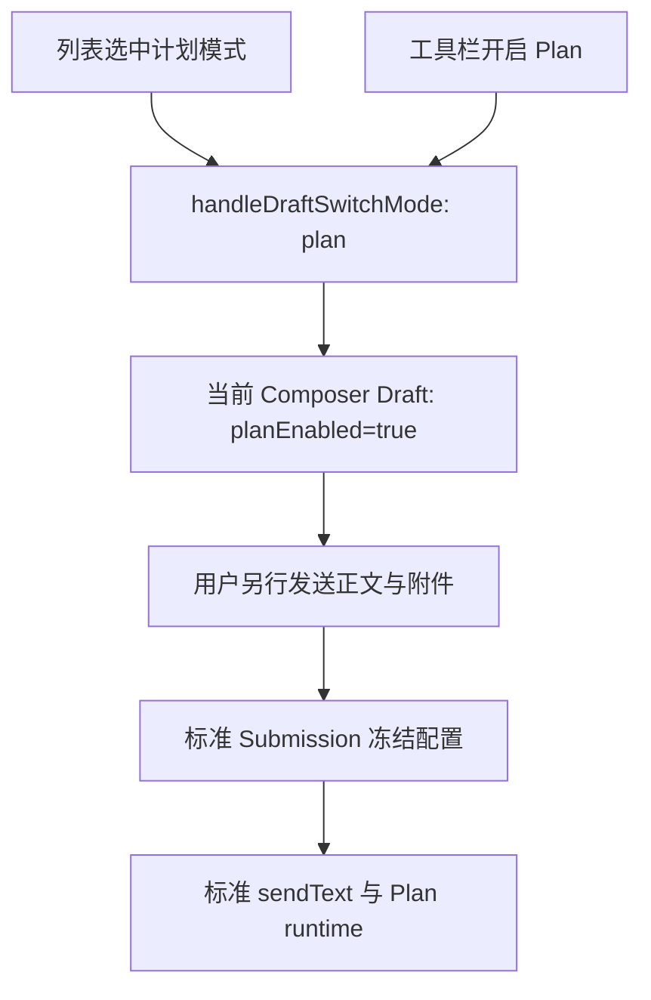

# Composer Plan Mode Quick Entry

## Goal and interaction

`/plan` is a search term for the "计划模式" (Plan mode) action in the input-box list. Selecting it
equals toggling the toolbar's standard Plan switch. The list shows the localized name
"计划模式 / Plan mode" and description "开启计划模式 / Enable Plan mode", and no command-argument
syntax.

| Action                                                     | Result                                                                                       |
| ---------------------------------------------------------- | -------------------------------------------------------------------------------------------- |
| Type `/plan`                                               | Show the plan-mode action; current mode unchanged.                                           |
| Select via Tab, Enter or click                             | Turn standard Plan on; delete only the slash search token, close the list, keep input focus. |
| Select again while Plan is on                              | Stays on; never toggles off.                                                                 |
| Other body text, attachments or structured context         | Kept as-is, never auto-sent.                                                                 |
| Escape closes the list or nothing selected                 | Mode unchanged.                                                                              |
| After closing the list, send raw `/plan` or `/plan <text>` | Sent as plain text, original text and current mode kept, no hidden parsing.                  |
| Exit Plan                                                  | Use the existing toolbar switch or the Plan marker's close button.                           |

## Single state and execution chain

List selection only edits the current Composer draft and keeps the permission mode: it sends no
prompt, creates no user row, and never pre-changes a running agent. Repeated selection is
idempotent. New drafts, existing sessions, desktop and mobile use the same action; read-only
surfaces offer no executable entry. Sending, queueing, failure recovery, Plan tool restrictions and
ExitPlanMode keep following the standard Plan contract.

## Catalog and cross-platform boundary

Plan mode is provided by the app's local list action; the CLI no longer broadcasts `/plan [task]`.
`plan` stays a reserved name so a custom command cannot take over the entry; a same-named command
broadcast by an old agent must not shadow the local action. Skills and subagents keep their own
list-entry types; an exact `plan` search prioritizes the plan-mode action. No new wire command,
protocol field, config copy or Plan-specific send branch. Desktop continuous and mobile remote
replayable reuse this Composer behavior with unchanged transport and recovery boundaries.

## Acceptance

- All three selection methods only turn Plan on and send nothing; body text, attachments, context
  and focus are kept.
- Regression evidence for new drafts, existing sessions, repeated selection, Escape and raw-text
  sending.
- Standard sends carry planEnabled; the provider receives body and attachments and enters the
  standard Plan runtime.
- The CLI catalog no longer offers a Plan command; custom same-named commands cannot take over the
  entry.
