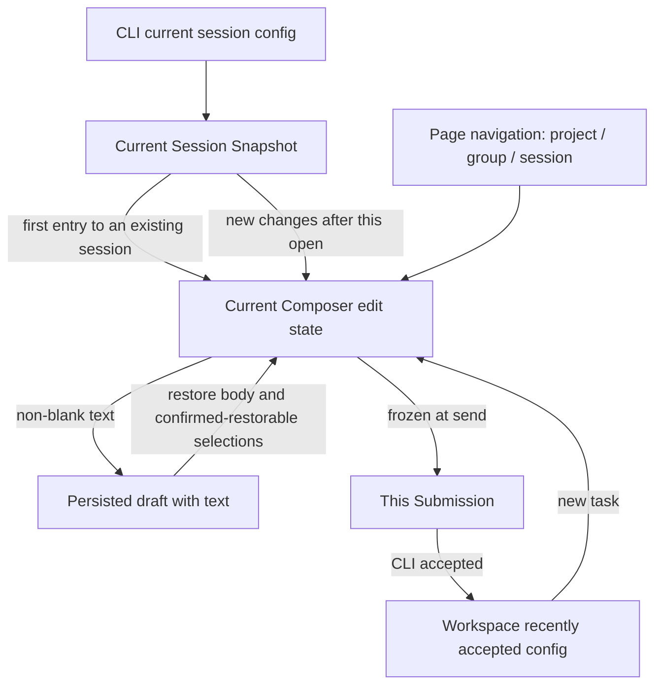

# Composer state simplification and text-draft boundaries

Status: implemented and verified within scope. The user confirmed R1 (restore latest permission/Plan) and
explicitly excluded the mobile project work from this round. Added 2026-10-14 after review of the text-draft
fix. Original behavior and verification records are in the
[text-draft spec](../ui/composer-text-draft-persistence.md).

## Feature Summary

| Item                | Content                                                                                                                                           |
| ------------------- | ------------------------------------------------------------------------------------------------------------------------------------------------- |
| Intent              | Keep "blank is not persisted"; remove replay of historical grants and ownerless config handoff; mobile navigation dependency is left for later    |
| Capability          | Composer config, permission/Plan sync, first submission and share import, new-project navigation                                                   |
| Level / mode        | draft-default, persistence, recovery; implementation                                                                                               |
| Seeds               | useDraftConfigControl, composerDraftStore, newTaskDraft, SessionPane, useRootPlatformEffects, WebRemoteControlMobileShell, web/main                |
| Non-goals           | Changing CLI execution-permission definitions, accepted queues, protocol event formats, prewarmed runtime, model candidates, cross-workspace Recent policy |

## Confirmed problems

Temporary Hook diagnostics on the MR commit: two of four correctness assertions failed, two diagnostic
assertions passed.

1. Current Session Snapshot is build but carries an old permissionGrant; a blank Composer initialized wrongly to yolo.
2. Snapshot `planEnabled=false` with an old `planTransition=true` initialized wrongly to true.
3. After New Task rendered, an old promote callback captured before send was blocked by the scopeKey guard, so new Root text was not deleted. Not every review-inferred race is confirmed.
4. A session seed with no mounted receiver outlives the original Hook; later the Hook opening that Session prefers the seed over the Snapshot. The real desktop trigger chain still needs verification.

Static call chain also confirms: `readDraftFile` writes localStorage during render; mobile project cold
recovery reads `projectId` from the text draft, so a blank draft loses that source. The latter does not prove
a wrong project is created; Host admission and the mobile entry need verification.

## State owners and target structure

- CLI/projection owns the effective session config. A historical grant ID is correlation information and must not re-execute authorization at initialization.
- The current Composer owns the local selection for the next submission; menu changes do not rewrite a running task. Only new grant/tool changes within this scope update the matching fields.
- The text draft stores only what is needed to restore input, never consumed-markers of grant events, subscription state or temporary init flags.
- Recent is updated only by an accepted Submission and isolated by workspaceKey.
- Project/group is a navigation and creation target and cannot persist through an empty Composer; mobile page recovery uses the existing navigation entry.

## UI Surface Matrix

| Scenario / entry                   | Shared implementation and edit owner | Default / restore source                           | Validation / commit                                     | Authority and persistence                   | Multi-platform and isolation          |
| ---------------------------------- | ------------------------------------ | -------------------------------------------------- | ------------------------------------------------------- | ------------------------------------------- | ------------------------------------- |
| New-task input                     | useDraftConfigControl                | Text draft or workspace Recent                     | ModelSelectionView -> frozen Submission                 | Composer-local; Recent after accepted       | desktop/web shared; identity-isolated |
| Existing Session                   | same Hook                            | Text/model from the draft; permission/Plan from Snapshot | same                                              | CLI execution facts not rebuilt from drafts | Switching Session rebuilds the observation baseline |
| Live grant / Plan tool             | Snapshot -> current Hook             | Projection observed in this scope and latest       | Sync only the matching field, keep body/model           | Observation baseline in memory only         | No new replay queue                   |
| First submission becomes a Session | SessionPane -> current pane owner    | Frozen submitted config and still-unsent text      | source scope + draft generation + target session        | Same edit owner migrates; no global seed    | Split-pane isolation                  |
| First share import                 | Root import done -> navigation entry | Receiver's new-task init rules                     | imported/reused distinction, model readiness            | One-shot navigation init parameter          | reused never overwrites existing edit |
| Mobile new-project refresh         | web/main -> Root / MobileShell       | Project navigation target, not draft config        | Re-validate host / workspace / project                  | Existing page history context               | Mobile never changes desktop selection |
| Offline view / reading old records | composerDraftStore                   | Read valid text only                               | No submit offline                                       | Cleanup only in explicit write/migration    | No render-time write side effects     |

## Shared and divergent behavior

| Concern                | Shared                                    | Kept distinct                                                                             |
| ---------------------- | ----------------------------------------- | ----------------------------------------------------------------------------------------- |
| Controls / candidates  | Existing toolbar, ModelSelectionView      | Automation and Subagent configs stay out of the Composer                                  |
| Defaults               | Single init entry                         | New reads Recent; existing session reads its own Snapshot; import states the first-init reason |
| Selection / submission | Current edit state -> frozen Submission   | Current input, accepted messages and running tasks never rewrite each other               |
| Recovery               | Save only when there is text              | Desktop direct continuous; mobile replayable gap/snapshot recovery                        |

## Feature relationships

| Level          | Start -> relation -> landing                              | Reason / evidence                                                                  |
| -------------- | --------------------------------------------------------- | ---------------------------------------------------------------------------------- |
| must-inspect   | Composer -> initializes-from -> Snapshot / Recent / text  | useDraftConfigControl mixed initialization with applying historical events         |
| must-inspect   | SessionPane -> promotes -> Composer scope                 | `handleDraftSessionCreated`, `promoteComposerDraft`; late-callback guard must stay |
| must-inspect   | Root -> initializes -> imported Session                   | `seedImportedSessionDraft` ownerless Map handoff                                   |
| must-inspect   | mobile navigation -> recovers -> Root project intent      | web/main `initialTaskDraft` passes as in-memory parameter only                     |
| should-inspect | disconnected surface -> reads -> text persistence         | `RemoteConversationDisconnected` render call                                       |
| invariant-only | Submission -> CLI admission / queue                       | No change to execution mode, FIFO, owner/lease                                     |
| evidence-only  | Hook / storage / bootstrap / E2E tests                    | Prove boundaries; test reachability is not a product dependency                    |

Graph delta: `state.composer-text-draft` now covers text recovery, current-Session permission/Plan, in-scope
observation baseline, same-pane first-submission migration and navigation-driven init. Mobile navigation adds
no relation; browser history is not defined as task authority.

## State owners and commit sinks

| State                       | Sole owner                      | Write boundary / lifecycle                                        |
| --------------------------- | ------------------------------- | ----------------------------------------------------------------- |
| Current session config      | CLI + read-only Session Snapshot | Accepted commands, real grants, tool transitions                 |
| Current input config / text | Current Composer scope          | Menu, text edits, new live config changes                         |
| Persisted text draft        | composerDraftStore              | Save non-empty, delete when emptied; no event-consumption cursors |
| Recent                      | accepted-submission callback    | Records only the selection accepted this time                     |
| Observation baseline        | Current Composer scope (memory) | Established by the first matching Snapshot; dropped on scope switch / unmount |
| Navigation creation target  | workspace/pane/navigation owner | Project selection, session switch, New Task, page recovery        |
| First-submission handoff    | One scope migration of the current pane | Ends on receipt; invalid on leave/generation change; no TTL |

## Simplification strategy and removals

### 1. Separate initialization from live update

The first matching Snapshot means "what it is now" and is used only to initialize / establish the observation
baseline; it must not call "apply historical grant" logic. When a later Snapshot shows a new change in
grant/tool association, update the matching field with the latest Snapshot's current value; never derive a
fixed yolo or stale `planEnabled` from an old event. A new grant with the same value can still matter: if the
user switched the input to build while the runtime is yolo, a new explicit grant must respond under existing
grant semantics. So compare more than the mode value, and do not blindly drop protocol correlation IDs.
The observation baseline belongs to the current open cycle, is not written to localStorage; repeated
projections and ordinary re-renders do not overwrite user re-selection. A temporarily absent Snapshot does
not reset the baseline; a real scope change does.

Delete persistence of `lastPermissionGrantId` / `lastPlanTransitionId` in V4ComposerDraft and the special
retention in replace; merge or delete the two helpers that only apply history. Same-named fields in
CLI/runtime keep their real authorization-recovery role and are not removed.

### 2. First submission reuses the current edit owner; drop the global seed Map

First submission is the current pane binding a real sessionId from the new-task address. Config moves by
explicit migration through the current owner, not a global Map waiting for some future component. The
Submission frozen at send is the config of the sent message; text/config edited after sending belongs to the
current edit cycle; mixing them ("freeze the whole draft then promote") would lose input typed during send.
Before migrating, check workspaceKey, source draft generation and target sessionId. A late ACK may still
finish organizing the accepted task but must not switch the user's new page, clear new text or override its
selection. First share import passes the init reason/config explicitly through a navigation action; only that
activation may use it, and it ends on page change / cancel / receipt. reused keeps the historical Session
rules. Delete `sessionSeeds` and its read/seed/clear API; no timer-based cleanup fallback.

### 3. Pure storage reads

`read` only parses and filters old empty records and does not write to disk. Filtered empty records no longer
overwrite Recent; physical deletion moves to explicit writes or post-mount migration. Existing text records
stay readable; unknown historical markers no longer affect behavior. Existing degradation for bad model
identity/options must not delete text. The existing one-time read-failure log policy stays.

### 4. Mobile project navigation recovery (excluded this round, later candidate)

Reuse the existing browser-history page recovery entry to save the minimal navigation info for
device/workspace/project/group/target session; do not save an empty body, model or permission. Root rebuild
consumes only navigation targets that pass identity matching and project validity checks; after a device
switch, a deleted project or a workspace identity mismatch the old intent is not applied. If the project
cannot be recovered, return to the selection entry; never silently guess a project by path or create into
uncategorized. This restores navigation state, not blank drafts, and adds no Host/relay business state. The
history entry and bridge bootstrap wiring must be verified before implementing.

## Must-preserve invariants

- Identity is always `workspaceIdentity?.trim() || workspacePath`; paths are for execution/display only.
- Blank / whitespace-only is not persisted; no hidden blank-config keys.
- Current user edits are not overwritten by ordinary Snapshots, model catalog refreshes or repeated events.
- Accepted input/execution config exists only in the CLI; the Renderer adds no second queue.
- Desktop continuous and mobile replayable keep consuming the same authority, without importing each other's recovery semantics.
- No timers for state handoff; no deleting concurrency checks in the name of simplification.

## Decisions

- Confirmed: no text means not persisted; re-entering a blank existing session reads the current Snapshot; historical grants are not replayed; this round is structural simplification.
- R1 confirmed: restore body text and model selection; permission/Plan use the session's latest state. This discards earlier uncommitted permission/Plan re-selections and may restore a yolo the user already approved elsewhere; it does not claim to only tighten permissions. CS10 is accepted.
- "Do not touch mobile project yet": CS09 and mobile project/navigation recovery are outside this round's implementation and acceptance; the analysis stays as later reference.

## Dimensions / pruning

Main dimensions: blank / with text; new / existing / first import; first Snapshot / same-value repeat / new
event / recovery snapshot; current / navigated away; desktop continuous / mobile replayable; same path with
different identity. Model candidates, theme and locale reuse existing controls with representative
combinations only; unrelated automation / Subagent / tool-execution matrices are not enumerated. The
prewarmed first-submission fault is recorded as an independent blocker and is not used to widen Host/CLI
changes.

## Accepted cases / E2E handoff

| ID   | Scenario                                                              | Assertions                                                    | Evidence plan                                     |
| ---- | --------------------------------------------------------------------- | ------------------------------------------------------------- | ------------------------------------------------- |
| CS01 | Blank Session, current build + historical full-access grant; re-enter/refresh | Still build; no persisted draft record                | Hook red test reproduced; pending E2E             |
| CS02 | Current Plan off + historical on record                               | Not re-enabled                                                | Hook red test reproduced; browser interaction     |
| CS03 | Mounted Composer receives new grant/tool change, then user re-selects, repeated projection | New change handled once; repeats do not overwrite; other fields unchanged | Hook + browser interaction |
| CS04 | First Snapshot late / reconnect / StrictMode                          | History not treated as a new event; no old/new scope cross-write | Hook                                          |
| CS05 | Keep typing during first submission; bind Session after accepted     | Unsubmitted new input kept; submitted config stays frozen     | Hook + submission integration                     |
| CS06 | New/leave/unmount after first submission, then ACK arrives            | New draft not cleared, no leftover seed; navigation-cancel boundary kept | Hook; static navigation-chain check    |
| CS07 | First import, reused, late catalog, navigate away                     | One-shot init has an owner; reused not overwritten; no leaks  | Import regression + browser interaction           |
| CS08 | Render reads old empty / bad record                                   | No storage write, text kept; empty records cleaned after explicit migration | storage + StrictMode             |
| CS09 | Mobile blank project page refresh, background rebuild, device switch  | Restore a valid navigation target; no empty config persisted; identity mismatch not misused | bootstrap + mobile E2E; navigation design pending |
| CS10 | Text draft inconsistent with current permission                       | Restore text/model, adopt current permission/Plan             | Hook + browser interaction                        |

Implementation order (as executed): update the text-draft spec, catalog, coverage and graph first; add
CS01-04 red tests, separate initialization from live observation and delete the draft event markers; add
concurrency regressions for CS05-07, merge first-submission/import init entries and delete the global seed
Map; make `read` pure; mobile project and navigation recovery untouched. The full A->B first-submission case
has a recorded baseline prewarm blocker that must stay flagged and cannot be replaced by Hook passes. Rollback
is per commit; old text drafts stay readable and cleaned-up historical empty records are not restored.

## Result

Removed persisted event markers, the two historical-event helpers and the global `sessionSeeds` Map.
First submission is held by the same pane; import passes through navigation parameters; reads do not write
to disk. A new regression also verifies that input typed after first-submission binding and before React
switches is written directly to the created Session without rebuilding the Root draft. Passed verification and
the still-uncovered full send / real-mobile boundaries are in the
[spec verification record](../ui/composer-text-draft-persistence.md).
